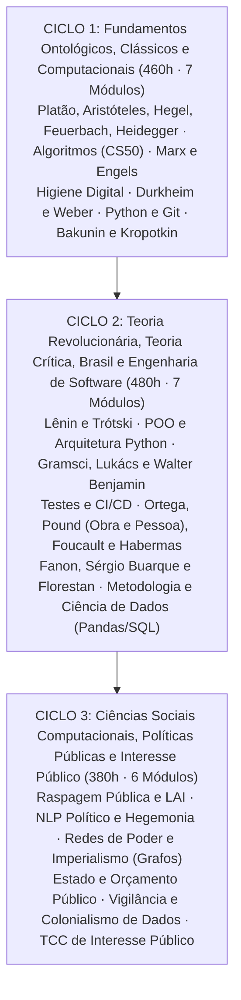

# O Último Curso

Formação livre, aberta e estruturada em Engenharia de Software, Letramento Digital, Filosofia Política e Ciências Sociais Computacionais.

[-c8102e?style=flat-square)](#aviso-de-idioma)
[-141414?style=flat-square)](#matriz-curricular-completa)
[](./docs/arquitetura-hospedagem/DEPLOY_GITHUB_PAGES_AUTENTICADO.md)

> **Aviso de Idioma:** Este currículo e todos os seus recursos de apoio foram estruturados exclusivamente em **Português (PT-BR)**.

## Como este curso funciona

Cada um dos 20 módulos tem um **guia** (objetivos, mapa de conceitos, linha do tempo, leituras e projeto avaliativo) e uma sequência de **aulas** escritas para estudo autônomo. As aulas seguem sempre o mesmo roteiro: o que você vai aprender, uma pergunta de abertura, a exposição em seções curtas, a leitura guiada da fonte primária, exercícios com gabarito comentado e um resumo.

- **Tooltips de jargão:** termos técnicos aparecem sublinhados; passe o mouse ou toque para ver a definição. As definições completas estão no [Glossário](./docs/GLOSSARIO.md).
- **Diagramas:** conceitos complexos (a dialética do senhor e do escravo, a mais-valia, o aperto de mão do TLS, a busca binária) ganham diagramas em Mermaid.
- **Imagens históricas:** fotografias, gravuras e documentos em domínio público ou licença livre, da Wikimedia Commons, com [créditos completos](./docs/CREDITOS-IMAGENS.md).
- **Código testado:** todos os trechos de Python das aulas foram executados antes da publicação.

Comece por [Como estudar neste curso](./docs/COMO-ESTUDAR.md) e pela [Linha do tempo do curso](./docs/LINHA-DO-TEMPO.md).


*Platão e Aristóteles em* A Escola de Atenas*, de Rafael (1509 a 1511). Domínio público. O curso começa por eles (MOD-101) e termina num software de interesse público (MOD-306).*

### Estado atual do conteúdo

| Ciclo | Módulos | Aulas escritas | Situação |
| :--- | :---: | :---: | :--- |
| Ciclo 1: Fundamentos | 7 | 46 | Guias e aulas completos, com tooltips, diagramas, imagens, exercícios e código testado |
| Ciclo 2: Teoria Revolucionária, Teoria Crítica, Brasil e Engenharia de Software | 7 | 25 | MOD-201, MOD-202 e MOD-203 completos; demais módulos em produção |
| Ciclo 3: Ciências Sociais Computacionais | 6 | 0 | Ementas publicadas; aulas em produção |

## Propósito

Em *A Rebelião das Massas*, José Ortega y Gasset descreveu uma figura típica da modernidade técnica: o especialista que domina um fragmento minúsculo de cálculo ou código e se comporta como ignorante em tudo o que diz respeito à história, à política e à sociedade. Na mesma década de 1930, em *O Autor como Produtor*, Walter Benjamin mostrou que boas intenções políticas servem de pouco quando o trabalhador intelectual continua abastecendo sem questionar um aparelho produtivo alheio. Para Benjamin, a tarefa passa por refuncionalizar a própria técnica, mudando a posição de quem produz dentro das relações de produção.

**O Último Curso** parte dessas duas premissas para juntar o que a universidade e o mercado costumam separar:

1. **Quem escreve código precisa de teoria social densa:** Programadores e engenheiros de software contam com boas trilhas abertas de computação, mas quase sempre estudam no vácuo político. Sem ler Platão, Aristóteles, Hegel, Marx, Weber, Lênin, Trótski, Gramsci, Lukács, Benjamin, Foucault, Habermas, Fanon, Sérgio Buarque de Holanda e Florestan Fernandes, o profissional de tecnologia acaba tratando escolhas políticas de arquitetura e vigilância como se fossem decisões técnicas neutras.
2. **Quem analisa a sociedade precisa dominar a ferramenta técnica:** Cientistas sociais, cientistas políticos e pesquisadores compreendem estruturas de dominação, Estado e políticas públicas, mas muitas vezes dependem de plataformas fechadas que não conseguem auditar, raspar ou construir. Aqui o estudo da teoria caminha junto com Python, arquitetura de software, testes automatizados, bancos de dados, higiene digital e raspagem de dados públicos.

## Referências de Arquitetura Curricular

A organização em ciclos, o controle de pré-requisitos e o modelo de avaliação por projetos práticos tomaram como base nove projetos abertos:

- [OSSU Computer Science](https://github.com/ossu/computer-science) e [OSSU Ciência da Computação Brasil](https://github.com/ossu/computer-science-br)
- [Universidade Livre: Ciência da Computação](https://github.com/universidade-livre/ciencia-da-computacao) e [Organização Universidade Livre](https://github.com/Universidade-Livre)
- [Free Software Engineering Program](https://github.com/ahmadthakur/free-software-engineering-program)
- [Software Engineering Courses (Paulo Borba / UFPE)](https://github.com/pauloborba/software-engineering-courses)
- [Steven Schwenke Software Engineering Course](https://github.com/stevenschwenke/SoftwareEngineeringCourse)
- [Curso Engenharia de Software com IA](https://github.com/afonsolelis/curso-engenharia-de-software-com-ia)
- [Jornada Engenheiro de Software](https://github.com/codermarcos/jornada-engenheiro-de-software)

## Público e Pré-Requisitos

- **Matemática:** Aritmética, proporções, leitura de gráficos e lógica elementar. O curso dispensa Cálculo Diferencial e Álgebra Linear abstrata, construindo a estatística descritiva aplicada dentro dos módulos de dados.
- **Computação:** Nenhuma experiência prévia em programação é exigida para iniciar o Ciclo 1.
- **Ambiente:** Computador com Linux, macOS ou Windows, Python 3.11 ou superior e Git.
- **Idioma:** Leitura em Português (PT-BR).

## O Cânone Teórico do Curso

Metade da carga horária total (670 horas de teoria nas fontes primárias e 650 horas de computação, engenharia de software e métodos computacionais, somando 1.320 horas) é dedicada ao estudo direto dos clássicos:

### 1. Filosofia Clássica, Dialética e Ontologia da Técnica
- **Platão** (*A República*, *Górgias*, *Fedro*): Justiça, diferença entre *episteme* e *doxa*, retórica e a crítica da escrita como *phármakon* para a memória.
- **Aristóteles** (*Política*, *Ética a Nicômaco*, *Retórica*): O ser humano como *zoon politikon*, formas de governo e a distinção entre *techne* (saber fabricar) e *phronesis* (deliberação prática sobre o bem comum).
- **G. W. F. Hegel** (*Fenomenologia do Espírito*, *Princípios da Filosofia do Direito*, *Ciência da Lógica*): Dialética do senhor e do escravo, o trabalho como mediação formadora da consciência, negatividade, sociedade civil e Estado.
- **Ludwig Feuerbach** (*A Essência do Cristianismo*, *Princípios da Filosofia do Futuro*): Crítica ao idealismo especulativo, alienação religiosa e inversão materialista.
- **Martin Heidegger** (*Ser e Tempo*, *A Questão da Técnica*): Analítica do *Dasein*, historicidade e o conceito de *Gestell* (armação técnica), que converte a natureza e as pessoas em *Bestand* (estoque disponível para cálculo e extração).

### 2. Materialismo Histórico, Anarquismo, Revolução e Hegemonia
- **Karl Marx e Friedrich Engels:** *Manuscritos Econômico-Filosóficos* (trabalho estranhado), *Teses sobre Feuerbach*, *A Ideologia Alemã*, *Manifesto Comunista*, *O 18 de Brumário de Luís Bonaparte*, *Grundrisse* (com leitura integral do Fragmento sobre as Máquinas e do *General Intellect*), *O Capital* Livro I (mercadoria, fetichismo, mais-valia absoluta e relativa, subsunção formal e real do trabalho à maquinaria e grande indústria, acumulação primitiva) e as obras de Engels (*A Situação da Classe Trabalhadora na Inglaterra*, *A Origem da Família, da Propriedade Privada e do Estado* e *Anti-Dühring*).
- **Mikhail Bakunin e Piotr Kropotkin:** Crítica ao Estado, à burocracia vermelha e ao governo tecnocrático dos cientistas (*Estatismo e Anarquia* e *Deus e o Estado*, de Bakunin), somada à demonstração histórica e biológica do auxílio mútuo, do federalismo e da descentralização produtiva (*Apoio Mútuo*, *A Conquista do Pão* e *Campos, Fábricas e Oficinas*, de Kropotkin), conectadas ao software livre e às redes distribuídas P2P.
- **Vladimir Ilitch Lênin (estudo amplo):** *O Desenvolvimento do Capitalismo na Rússia* (uso de estatísticas agrárias e industriais para demonstrar a formação do mercado interno), *Que Fazer?* (partido, consciência política de totalidade e imprensa como organizador coletivo), *Materialismo e Empiriocriticismo*, *Cadernos Filosóficos* (releitura da Lógica de Hegel), *Imperialismo, Fase Superior do Capitalismo* (monopólios, capital financeiro e partilha do mundo), *O Estado e a Revolução* e *Esquerdismo, Doença Infantil do Comunismo*.
- **Leon Trótski (estudo amplo):** *Balanços e Perspectivas*, *A Revolução Permanente*, *História da Revolução Russa* (com foco na Lei do Desenvolvimento Desigual e Combinado e na dualidade de poderes), *Literatura e Revolução* (arte, técnica e cultura), *Como Esmagar o Fascismo* (análise de classe do fascismo e frente única) e *A Revolução Traída* (sociologia da degeneração burocrática do Estado soviético).
- **Antonio Gramsci (estudo amplo):** Dos artigos no *L'Ordine Nuovo* sobre conselhos de fábrica aos *Cadernos do Cárcere*: Estado Integral (sociedade política mais sociedade civil), hegemonia, aparelhos privados de hegemonia, intelectuais orgânicos e tradicionais, guerra de posição e guerra de movimento, revolução passiva, transformismo, bloco histórico, crise orgânica e *Americanismo e Fordismo*.
- **György Lukács:** *Teoria do Romance*, *História e Consciência de Classe* (a categoria da reificação, mostrando como a forma mercadoria modela o cálculo burocrático, o direito e a ciência formalista, ao lado do método da totalidade concreta) e *Para uma Ontologia do Ser Social* (o trabalho como posição teleológica).

### 3. Sociologia Clássica, Escola de Frankfurt, Estética Crítica e Separação entre Obra e Pessoa
- **Émile Durkheim e Max Weber:** Fato social, divisão do trabalho, suicídio, anomia e representações coletivas (Durkheim); ação social, ética protestante, desencantamento do mundo, racionalidade formal e substantiva, burocracia e tipos de dominação legítima (Weber).
- **Walter Benjamin (estudo amplo e transversal):** *Crítica da Violência*, *Origem do Drama Trágico Alemão*, *Rua de Mão Única*, *O Autor como Produtor* (refuncionalização técnica do aparelho produtivo), *Pequena História da Fotografia*, *A Obra de Arte na Era de sua Reprodutibilidade Técnica* (perda da aura, valor de culto e valor de exposição, choque perceptivo, estetização da política pelo fascismo contra politização da arte), *Paris, Capital do Século XIX / Passagens* (fantasmagoria da mercadoria, *flâneur*, método da montagem histórica) e *Sobre o Conceito da História* (o *Angelus Novus*, crítica à fé positivista no progresso técnico e o método de escovar a história a contrapelo).
- **José Ortega y Gasset e Ezra Pound (conteúdo e necessidade da separação entre obra e pessoa):**
  - *Conteúdo:* Em Ortega y Gasset, a razão vital, a *Meditação da Técnica* e o capítulo de *A Rebelião das Massas* sobre a "barbárie do especialismo". Em Ezra Pound, o *ABC da Literatura*, *Os Cantos*, o método ideogramático, a precisão da linguagem (*fanopeia, melopeia e logopeia*) como higiene do pensamento e a crítica poética à usura.
  - *Método de leitura (separação entre obra e pessoa):* Estudo rigoroso de como ler autores com posições conservadoras ou elitistas (Ortega) ou que colaboraram com o fascismo (Pound) e o nazismo (Heidegger). O curso estabelece a distinção analítica entre o julgamento histórico e político da biografia do autor e a validade formal, cognitiva e estética objetiva da obra, recusando tanto o cancelamento anti-intelectual quanto a leitura apologética.
- **Michel Foucault e Jürgen Habermas:** Arqueologia do saber, genealogia do poder disciplinar (*Vigiar e Punir*), biopolítica e governamentalidade neoliberal (Foucault); crítica da razão instrumental tecnocrática (*Técnica e Ciência como "Ideologia"*), mudança estrutural da esfera pública e ação comunicativa contra a colonização do mundo da vida pelos sistemas técnicos e mercantis (Habermas).

### 4. Anticolonialismo, Pensamento Social Brasileiro e Capitalismo Dependente
- **Frantz Fanon:** *Pele Negra, Máscaras Brancas* e *Os Condenados da Terra* (violência colonial, alienação psíquica e linguística, mundo compartimentado e crítica às burguesias nacionais periféricas subalternas).
- **Sérgio Buarque de Holanda:** *Raízes do Brasil* e *Visão do Paraíso* (herança ibérica, patrimonialismo e o conceito sociológico de "homem cordial" como invasão do espaço público pela lógica afetiva e doméstica privada).
- **Florestan Fernandes:** *A Integração do Negro na Sociedade de Classes*, *Sociedade de Classes e Subdesenvolvimento* e *A Revolução Burguesa no Brasil* (racismo estrutural na ordem competitiva, capitalismo dependente e autocracia burguesa).

## Estrutura dos Ciclos Formativos



## Matriz Curricular Completa

### Ciclo 1: Fundamentos Ontológicos, Clássicos e Computacionais (460h)

| Código | Módulo | Eixo | Tópicos e Autores Centrais | Curso / Obras Base Gratuitas (PT-BR) | Duração | Projeto Prático Avaliativo |
| :--- | :--- | :--- | :--- | :--- | :---: | :--- |
| **MOD-101** | **Filosofia Clássica, Dialética e Ontologia da Técnica** | Eixo 4 | Platão (*A República*, *Fedro*); Aristóteles (*Política*, *Ética a Nicômaco*: *techne* e *phronesis*); Hegel (*Fenomenologia do Espírito*, *Filosofia do Direito*: senhor e escravo, sociedade civil e Estado); Feuerbach (*A Essência do Cristianismo*); Heidegger (*Ser e Tempo*, *A Questão da Técnica*: *Gestell* e *Bestand*). | Filosofia Política e Geral (e-Aulas USP) + Obras em Domínio Público (PT-BR) | 70h | **Ensaio Ontológico-Político:** Artigo analítico (3.500 palavras) contrastando a *phronesis* aristotélica, a dialética do trabalho em Hegel e o *Gestell* heideggeriano aplicados à automação algorítmica. |
| **MOD-102** | **Introdução à Computação e Pensamento Algorítmico** | Eixo 1 | Binário, Unicode (`UTF-8`), memória, decomposição algorítmica, busca linear e binária, ordenação, estruturas de dados elementares (listas, pilhas, filas, tabelas hash) e noção prática de complexidade ($O(1)$, $O(\log n)$, $O(n)$). | CC50: Ciência da Computação de Harvard no Brasil (Fundação Estudar) + Algoritmos (UNIVESP) | 70h | **CLI de Indexação de Acervo Histórico:** Busca linear, binária e tabela hash em Python puro sobre 10.000 ementas de leis e textos clássicos com medição de tempo. |
| **MOD-103** | **Crítica da Economia Política e Materialismo Histórico: Marx e Engels** | Eixo 4 | Karl Marx e Friedrich Engels: *Teses sobre Feuerbach*, *Manuscritos Econômico-Filosóficos*, *A Ideologia Alemã*, *Manifesto Comunista*, *O 18 de Brumário*, *Grundrisse* (Fragmento sobre as Máquinas e *General Intellect*), *O Capital* Livro I e Engels (*A Origem da Família, da Propriedade Privada e do Estado*, *Anti-Dühring*). | Arquivo Marxista na Internet (MIA PT-BR) + Aulas Abertas d'O Capital (USP / UNICAMP) | 70h | **Caderno d'O Capital e Simulador de Indicadores:** Fichamento completo d'O Capital (Caps. 1, 13 e 24) + script Python calculando taxas de mais-valia e composição orgânica em séries históricas. |
| **MOD-104** | **Letramento Digital, Arquitetura da Rede e Higiene Crítica de Dados** | Eixo 3 | Protocolos da Internet (DNS, TCP/IP, HTTP/TLS), terminal POSIX, metadados ocultos (EXIF, PDF), modelagem de ameaças, criptografia prática (`AES-256-GCM`, `PBKDF2`, `GPG`, `SSH`), anonimato (`Tor`) e soberania tecnológica. | Autodefesa Contra Vigilância (EFF SSD PT-BR) + Redes de Computadores (UNIVESP) | 50h | **Kit `meta-limpa` e Modelo de Ameaças:** Ferramenta CLI em Python para varredura, laudo de risco e remoção de metadados em lotes de PDFs e imagens com verificação `SHA-256`. |
| **MOD-105** | **Sociologia Clássica: Émile Durkheim e Max Weber** | Eixo 4 | Durkheim: *As Regras do Método Sociológico*, *Da Divisão do Trabalho Social*, *O Suicídio* e *As Formas Elementares da Vida Religiosa*. Weber: *A Ética Protestante e o Espírito do Capitalismo*, *Economia e Sociedade* (ação social, dominação e burocracia), *A Ciência como Vocação* e *A Política como Vocação*. | Sociologia Clássica I e II (e-Aulas USP) + *Um Toque de Clássicos: Marx, Durkheim e Weber* | 70h | **Dossiê Durkheim-Weber:** Estudo comparado analisando o método estatístico de *O Suicídio* e a burocracia racional-legal weberiana aplicada ao Estado digital brasileiro. |
| **MOD-106** | **Fundamentos de Python e Controle de Versão (Git/GitHub)** | Eixo 2 | Sintaxe Python 3, estruturas nativas, funções, módulos, manipulação de arquivos (`CSV`, `JSON`, `Markdown`), tratamento de codificações (`UTF-8` e `Latin-1`), ambientes virtuais (`venv`) e fluxo Git/GitHub. | Introdução à Ciência da Computação com Python 1 e 2 (USP / Coursera Ouvinte) + Pro Git Book (PT-BR) | 60h | **Higienizador e Validador de Bases Públicas:** Ferramenta Python versionada em Git que ingere arquivos CSV brutos do TSE/IBGE, corrige codificação e exporta relatórios. |
| **MOD-107** | **Anarquismo, Autogestão, Apoio Mútuo e Redes Distribuídas: Bakunin e Kropotkin** | Eixo 4 e Eixo 3 | Bakunin: *Estatismo e Anarquia*, *Deus e o Estado* (crítica ao Estado e à tecnocracia científica). Kropotkin: *Apoio Mútuo: Um Fator de Evolução*, *A Conquista do Pão*, *Campos, Fábricas e Oficinas*. Conexão com *commons* digitais, protocolos federados e Software Livre. | Arquivo Marxista na Internet / Biblioteca Anarquista em Português (Domínio Público) | 70h | **Sincronizador Federado e Ensaio sobre Apoio Mútuo:** Protótipo em Python de sincronização descentralizada de catálogos por hash + ensaio conectando Kropotkin e Bakunin ao Software Livre. |

### Ciclo 2: Teoria Revolucionária, Marxismo Ocidental, Crítica Cultural, Brasil e Engenharia de Software (480h)

| Código | Módulo | Eixo | Tópicos e Autores Centrais | Curso / Obras Base Gratuitas (PT-BR) | Duração | Projeto Prático Avaliativo |
| :--- | :--- | :--- | :--- | :--- | :---: | :--- |
| **MOD-201** | **Teoria e Práxis Revolucionária em Profundidade: Lênin e Trótski (Amplo)** | Eixo 4 | **Lênin:** *O Desenvolvimento do Capitalismo na Rússia*, *Que Fazer?*, *Materialismo e Empiriocriticismo*, *Cadernos Filosóficos* (Hegel), *Imperialismo, Fase Superior do Capitalismo*, *O Estado e a Revolução* e *Esquerdismo, Doença Infantil do Comunismo*. **Trótski:** *Balanços e Perspectivas*, *A Revolução Permanente*, *História da Revolução Russa* (Lei do Desenvolvimento Desigual e Combinado), *Literatura e Revolução*, *Como Esmagar o Fascismo* e *A Revolução Traída*. | Obras Escolhidas de V. I. Lênin e Leon Trótski (Marxists Internet Archive PT-BR) | 80h | **Monografia e Painel Empírico sobre Imperialismo e Desenvolvimento Desigual:** Aplicação das categorias de Lênin e Trótski à concentração monopolista das Big Techs e à divisão internacional do trabalho digital. |
| **MOD-202** | **Engenharia de Software Moderna, POO e Arquitetura com Python** | Eixo 2 | Programação Orientada a Objetos (POO), composição e herança, tipagem estática (`typing`, `Pydantic`), princípios SOLID, Design Patterns (*Repository*, *Adapter*, *Strategy*, *Factory*), arquitetura limpa e empacotamento (`pyproject.toml`). | Engenharia de Software Moderna (Prof. Marco Tulio Valente / UFMG) + Refactoring.Guru (PT-BR) | 80h | **SDK Python para APIs de Transparência (`br-transparencia-sdk`):** Biblioteca modular em Python com arquitetura em camadas para consumir APIs da Câmara, Senado e Portal da Transparência. |
| **MOD-203** | **Hegemonia, Reificação e Estética Crítica: Gramsci (Amplo), Lukács e Walter Benjamin (Amplo)** | Eixo 4 | **Gramsci:** *L'Ordine Nuovo* e *Cadernos do Cárcere* (Estado Integral, Hegemonia, Aparelhos Privados de Hegemonia, Intelectuais Orgânicos e Tradicionais, Guerra de Posição e Movimento, Revolução Passiva, Bloco Histórico, Crise Orgânica e *Americanismo e Fordismo*). **Lukács:** *História e Consciência de Classe* (Reificação e Totalidade Concreta) e *Ontologia do Ser Social*. **Walter Benjamin:** *Crítica da Violência*, *Origem do Drama Trágico Alemão*, *O Autor como Produtor* (refuncionalização técnica), *A Obra de Arte na Era de sua Reprodutibilidade Técnica*, *Passagens* e *Sobre o Conceito da História* (*Angelus Novus* e história a contrapelo). | Arquivo Gramsci, Lukács e Walter Benjamin em Português + Seminários FFLCH-USP e IFCH-UNICAMP | 90h | **Motor de Passagens e Constelações + Ensaio "O Engenheiro como Produtor":** Software em Python inspirado no arquivo das *Passagens* de Benjamin para conectar fichas, citações e conceitos em grafo, acompanhado de ensaio teórico. |
| **MOD-204** | **Qualidade de Software, Testes Automatizados, CI/CD e Auditoria de Código** | Eixo 2 e Eixo 3 | Testes unitários e de integração com `pytest`, TDD, *fixtures*, *mocks*, cobertura de código, análise estática (`ruff`), GitHub Actions (CI), reprodutibilidade científica, minificação e auditoria de dependências. | Capítulos de Testes e DevOps de Engenharia de Software Moderna (UFMG) + Documentação `pytest` | 60h | **Suíte de Testes (>85%) e Pipeline de Auditoria:** Instrumentação completa do SDK do MOD-202 com CI/CD no GitHub Actions e relatório SBOM de licenças e segurança. |
| **MOD-205** | **Cultura, Especialismo, Separação Obra e Pessoa, Poder e Esfera Pública: Ortega y Gasset, Ezra Pound, Foucault e Habermas** | Eixo 4 | **Ortega y Gasset:** *A Rebelião das Massas* (homem-massa e a barbárie do especialismo) e *Meditação da Técnica*. **Ezra Pound:** *ABC da Literatura*, *Os Cantos*, método ideogramático e precisão da linguagem. **Separação Obra e Pessoa:** Critérios epistemológicos para separar a validade formal e analítica da obra da biografia política do autor (Ortega, Pound, Heidegger). **Foucault:** *Vigiar e Punir*, biopolítica e governamentalidade neoliberal. **Habermas:** *Técnica e Ciência como "Ideologia"*, *Mudança Estrutural da Esfera Pública* e *Teoria do Agir Comunicativo*. | Seminários de Filosofia Contemporânea, Estética e Teoria Social (e-Aulas USP / LAVITS / SciELO) | 70h | **Tratado Metodológico em Duas Partes:** (1) Autonomia analítica da obra frente à biografia política em Ortega, Pound e Heidegger; (2) Diagnóstico da esfera pública habermasiana sob dispositivos foucaultianos de governamentalidade algorítmica. |
| **MOD-206** | **Anticolonialismo, Formação do Brasil e Capitalismo Dependente: Fanon, Sérgio Buarque e Florestan Fernandes** | Eixo 4 | **Frantz Fanon:** *Pele Negra, Máscaras Brancas* e *Os Condenados da Terra* (violência colonial, alienação e crítica à burguesia nacional periférica). **Sérgio Buarque de Holanda:** *Raízes do Brasil* (patrimonialismo e o "homem cordial" como confusão entre espaço doméstico afetivo e esfera pública impessoal). **Florestan Fernandes:** *A Integração do Negro na Sociedade de Classes* e *A Revolução Burguesa no Brasil* (capitalismo dependente, racismo estrutural e autocracia burguesa). | Pensamento Social Brasileiro e Latino-Americano (e-Aulas USP / SciELO Books / CLACSO Aberto) | 50h | **Radiografia Sociológica e Computacional do Capitalismo Dependente:** Cruzamento das teses de Fanon, Sérgio Buarque e Florestan Fernandes com séries históricas do IBGE e IPEA. |
| **MOD-207** | **Metodologia de Pesquisa Social (Quali/Quanti) e Ciência de Dados com Python (Pandas e SQL)** | Eixo 4 e Eixo 5 | Desenho de pesquisa social, operacionalização de conceitos teóricos em variáveis, inferência causal e correlação, SQL (`SQLite`/`DuckDB`), `Pandas`, microdados públicos (IBGE Censo/PNAD, TSE, DataSUS, Base dos Dados) e visualização com `Matplotlib`/`Seaborn`. | Métodos de Pesquisa em Ciências Sociais (CEBRAP Aberto) + Trilha Python/SQL (Base dos Dados) | 50h | **Atlas Reprodutível de Estratificação Social Municipal:** Pipeline SQL e Pandas analisando indicadores de classe, raça e capacidade estatal nos 5.570 municípios brasileiros. |

### Ciclo 3: Ciências Sociais Computacionais, Políticas Públicas e Ferramentas de Interesse Público (380h)

| Código | Módulo | Eixo | Tópicos e Autores Centrais | Curso / Obras Base Gratuitas (PT-BR) | Duração | Projeto Prático Avaliativo |
| :--- | :--- | :--- | :--- | :--- | :---: | :--- |
| **MOD-301** | **Engenharia de Raspagem de Dados Públicos (Web Scraping), LAI e Arquivo a Contrapelo** | Eixo 5 e Eixo 3 | Lei de Acesso à Informação (LAI, Lei 12.527/2011), `httpx`, `BeautifulSoup4`, `Playwright`, extração de Diários Oficiais e PDFs (`pdfplumber`), rate-limiting ético e preservação documental inspirada nas *Passagens* de Walter Benjamin. | Escola de Dados (Open Knowledge Brasil) + Documentação do Querido Diário | 60h | **Coletor Resiliente de Diários Oficiais e Atos Administrativos:** Raspador automatizado com testes offline e banco SQLite auditável com proveniência de cada registro. |
| **MOD-302** | **Análise Computacional de Discursos Políticos, Ideologia e Hegemonia (NLP em Português)** | Eixo 5 e Eixo 4 | Operacionalização computacional de Hegemonia (Gramsci), Formação Discursiva (Foucault) e Precisão Linguística (Pound): `spaCy pt_core_news`, lematização, TF-IDF, *Word Embeddings*, modelagem de tópicos e análise de pronunciamentos parlamentares e imprensa. | Processamento de Linguagem Natural em Português (USP / ICMC) + Guias da Escola de Dados | 70h | **Radar Computacional de Hegemonia e Discurso Parlamentar:** Pipeline em Python medindo deslocamentos semânticos e disputas ideológicas em discursos na Câmara e no Senado. |
| **MOD-303** | **Análise de Redes de Poder, Imperialismo, Elites e Estado Integral com Grafos (`NetworkX`)** | Eixo 5 e Eixo 4 | Teoria dos Grafos aplicada à sociologia política de Lênin (capital financeiro e monopólios), Gramsci (aparelhos privados de hegemonia) e Florestan/Sérgio Buarque (elites e patrimonialismo): centralidade de grau, intermediação, autovetor e comunidades com `NetworkX`. | Análise de Redes para Ciências Sociais (Escola de Dados / IPEA Aberto) + Documentação `NetworkX` | 60h | **Cartografia de Coalizões, Financiamento e Aparelhos de Hegemonia:** Construção e análise topológica de grafos bipartidos de doadores, conselhos corporativos e bancadas parlamentares. |
| **MOD-304** | **Estado, Burocracia e Avaliação de Políticas Públicas Baseada em Evidências** | Eixo 4 | Ciclo de políticas públicas, burocracia weberiana e burocracia de nível de rua (Lipsky), capacidades estatais, orçamento público brasileiro (PPA, LDO, LOA, fundo público, emendas parlamentares, empenho, liquidação e pagamento) e avaliação de impacto. | Guia Prático de Análise de Políticas Públicas (IPEA Aberto) + Trilha de Orçamento Público (ENAP) | 60h | **Auditoria Cívica de Execução Orçamentária:** Parecer técnico-político e scripts Python confrontando orçamento autorizado, execução financeira e entrega física de uma política pública. |
| **MOD-305** | **Sociologia Digital, Vigilância Algorítmica, Colonialismo de Dados e Trabalho de Plataforma** | Eixo 4 e Eixo 3 | Subsunção algorítmica do trabalho e *General Intellect* (Marx e Lukács), governamentalidade e biopolítica digital (Foucault), colonialismo de dados no Sul Global (Fanon e Florestan) e auditoria de sistemas automatizados de escoragem e policiamento preditivo. | Publicações Abertas da Rede LAVITS + Relatórios Coding Rights e InternetLab | 60h | **Laudo de Auditoria Algorítmica e Sociotécnica:** Investigação empírica e teórica sobre vieses discriminatórios, extração de dados e controle de trabalhadores em plataforma ou sistema estatal. |
| **MOD-306** | **Projeto Integrador Final (TCC): "O Engenheiro como Produtor"** | Todos os Eixos (1 a 5) | Síntese prática de *O Autor como Produtor* (Walter Benjamin) e do Intelectual Orgânico (Gramsci): arquitetura de software em Python, testes automatizados, privacidade desde a concepção e monografia crítica. | Estudos de Caso de Tecnologia Pública no Brasil (Operação Serenata de Amor, Querido Diário, Brasil.IO) | 70h | **Plataforma de Interesse Público e Monografia de Conclusão:** Software livre de interesse público testado e documentado em PT-BR, acompanhado de monografia (6.000 a 10.000 palavras). |

## Como Compilar, Minificar e Criptografar com Chave

Todo o repositório é minificado e criptografado com a sua senha funcionando como chave (`PBKDF2-HMAC-SHA256` + `AES-256-GCM`) através de um único script:

```bash
python3 scripts/build_and_encrypt.py --key "SUA_SENHA_CHAVE"
```

O comando gera `viewer/index.html` com a identidade visual do **Memória de Trabalho** (papel `#F2EBDD`, tinta `#141414`, vermelho `#C8102E`, amarelo `#FFE600`, fontes Anton, Special Elite e Inter) e embute o cofre criptografado no próprio arquivo.

## Licença e Expediente

- **Currículo, Ementas e Textos:** [CC BY-SA 4.0](https://creativecommons.org/licenses/by-sa/4.0/deed.pt_BR).
- **Código, Scripts e Visualizador:** [Licença MIT](./LICENSE).
- **Conteúdo e tecnicalidades:** Lucas Rafaldini (`thothandson@icloud.com` · Thoth & Son).