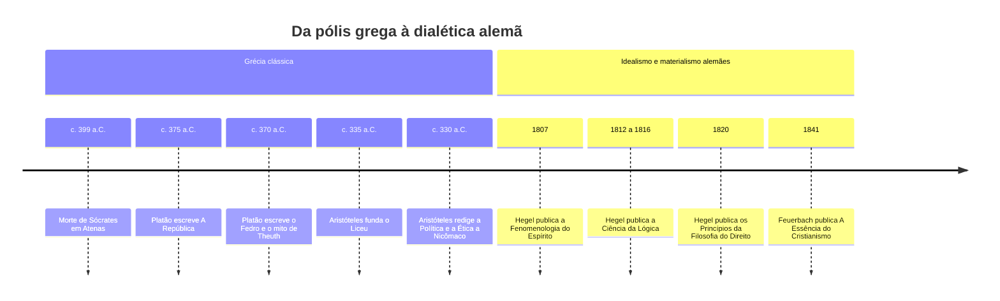
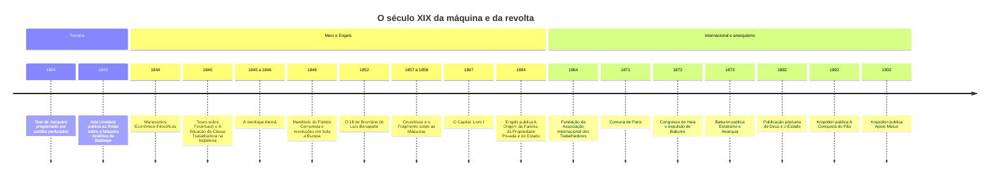
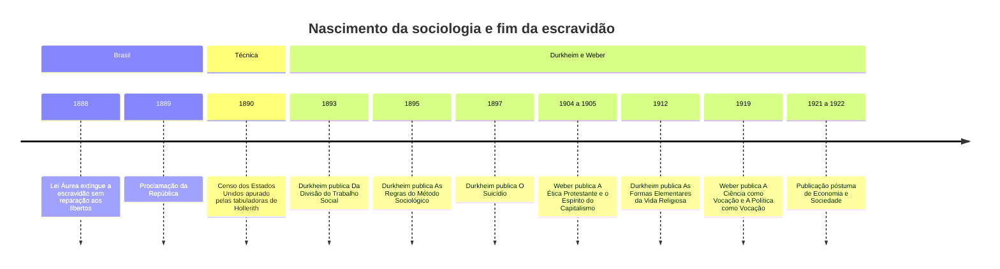
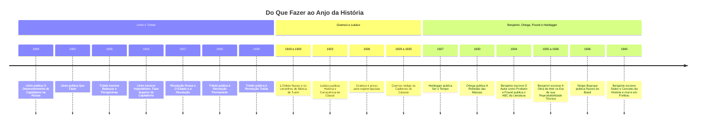
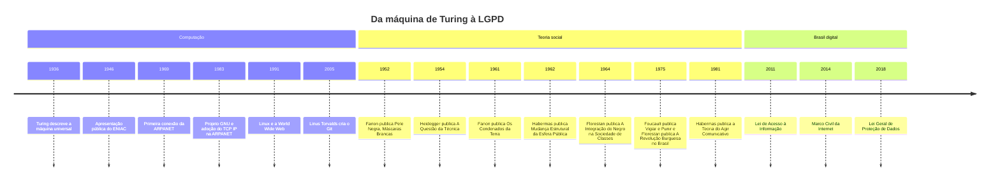

> **Aviso de Idioma:** Este currículo e todos os seus recursos de apoio foram estruturados exclusivamente em **Português (PT-BR)**.

# Linha do tempo do curso

Esta página reúne, em ordem cronológica, as obras e os acontecimentos que o curso estuda. Ela serve como mapa: quando uma aula citar *A Ideologia Alemã* ou a Comuna de Paris, volte aqui para ver o que vinha antes e o que veio depois.

Duas histórias correm lado a lado: a do **pensamento social e político** e a da **técnica e da computação**. O curso sustenta que elas são a mesma história vista de dois lados. O tear de Jacquard, que lia cartões perfurados em 1804, é antepassado direto do computador e também personagem das páginas de Marx sobre a maquinaria.

*Platão (à esquerda, apontando para o alto) e Aristóteles (apontando para a terra) em* A Escola de Atenas*, afresco de Rafael (1509 a 1511). Domínio público.*

## 1. Antiguidade e formação da filosofia moderna

## 2. Revolução industrial, Marx, Engels e o anarquismo

*Tecelagem mecânica numa fábrica de algodão inglesa, gravura do livro de Edward Baines (1835). É este o mundo descrito por Engels em 1845 e analisado por Marx no capítulo 13 d'*O Capital*. Domínio público.*

## 3. A sociologia clássica e o Brasil do fim do Império

## 4. Revolução, fascismo e teoria crítica (1899 a 1940)

## 5. Computação, descolonização e a era digital

*Glen Beck e Betty Snyder programam o ENIAC no Laboratório de Pesquisa Balística do Exército dos Estados Unidos, por volta de 1947. Programar, então, era religar cabos à mão. Domínio público.*

## Como usar esta linha do tempo

- **Ao começar um módulo:** localize as obras do módulo aqui e leia o que estava acontecendo no mundo naquele momento.
- **Ao escrever um ensaio:** confira se as obras que você relaciona podiam de fato dialogar. Lênin leu Hegel em 1914, mas não leu Lukács de 1923 antes de escrever *O Estado e a Revolução*.
- **Ao ler uma crítica:** pergunte a quem o autor responde. *Apoio Mútuo* (1902) responde ao darwinismo social dos anos 1880. *A Revolução Traída* (1936) responde à consolidação de Stálin.