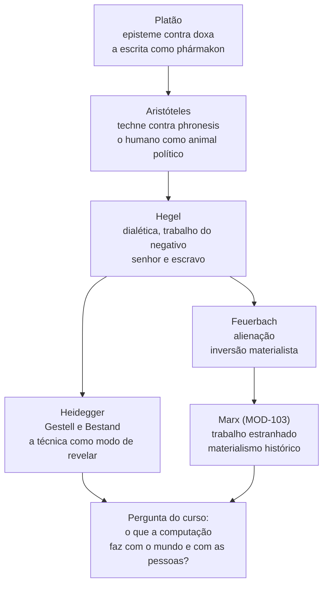
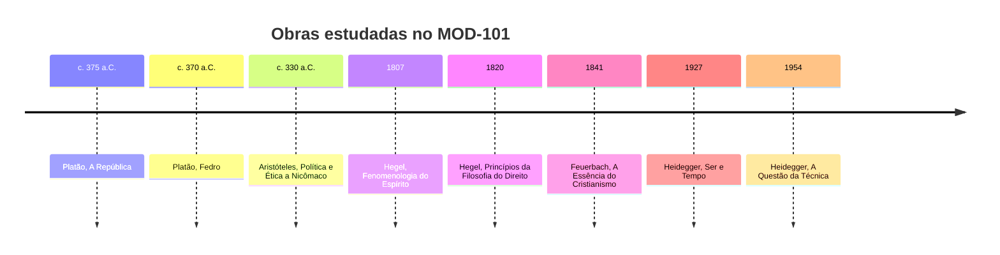

> **Aviso de Idioma:** Este currículo e todos os seus recursos de apoio foram estruturados exclusivamente em **Português (PT-BR)**.

# MOD-101: Filosofia Clássica, Dialética e Ontologia da Técnica

**Ciclo 1 · Eixo 4 (Filosofia Política e Teoria Social) · 70 horas · 7 aulas · Sem pré-requisitos**

*Platão aponta para o céu das ideias, Aristóteles estende a mão para o mundo. Detalhe de* A Escola de Atenas*, de Rafael (1509 a 1511). Domínio público.*

## Apresentação

Toda pessoa que escreve software toma decisões filosóficas sem perceber. Quando você cria uma tabela `cidadao` com as colunas `cpf`, `renda` e `risco`, está dizendo **o que existe** (uma <abbr title="Ontologia: parte da filosofia que estuda o que existe e de que modo existe. Em computação, a palavra também nomeia um esquema formal de classes e relações.">ontologia</abbr>), **como se conhece** (que dados contam como prova) e **para que serve** aquele conhecimento (classificar, punir, assistir). Este módulo dá nome a essas decisões e mostra que elas têm uma história de 2.400 anos.

Percorremos cinco autores em sequência cronológica. Cada um responde, à sua maneira, a três perguntas que vão atravessar o curso inteiro:

1. **O que é conhecer de verdade?** Platão separa a ciência da opinião.
2. **Que tipo de saber governa a vida comum?** Aristóteles separa o saber de fabricar do saber de deliberar.
3. **O que o trabalho e a técnica fazem com quem trabalha?** Hegel, Feuerbach e Heidegger respondem de maneiras opostas, e Marx (MOD-103) partirá dessa disputa.

## Mapa do módulo

## Linha do tempo

## Objetivos de aprendizagem

Ao terminar o módulo, você será capaz de:

- Explicar a diferença entre *episteme* e *doxa* em Platão e usá-la para analisar a circulação de informação nas redes.
- Reconstruir o argumento do mito de Theuth no *Fedro* e relacioná-lo à memória delegada a máquinas.
- Distinguir *episteme*, *techne* e *phronesis* em Aristóteles e mostrar por que decisões políticas não se reduzem a decisões técnicas.
- Narrar a dialética do senhor e do escravo e explicar o papel formador do trabalho em Hegel.
- Descrever a sociedade civil como "sistema das carências" e a sua relação com o Estado na *Filosofia do Direito*.
- Explicar o mecanismo da alienação em Feuerbach e a inversão materialista que ele propõe.
- Definir *Gestell* e *Bestand* em Heidegger e aplicar os conceitos à <abbr title="Datificação: transformação de aspectos da vida (relações, deslocamentos, emoções, trabalho) em dados quantificáveis que podem ser armazenados, cruzados e vendidos.">datificação</abbr> contemporânea.

## Aulas

| Aula | Tema | Duração | Leitura principal |
| :---: | :--- | :---: | :--- |
| 1 | [Platão: ciência, opinião e a cidade justa](./mod-101/aula-01-platao-episteme-doxa-republica.md) | 10h | *A República*, livros VI e VII |
| 2 | [Platão: retórica, escrita e o *phármakon*](./mod-101/aula-02-platao-retorica-escrita-pharmakon.md) | 10h | *Górgias* (trechos) e *Fedro* 274b a 278b |
| 3 | [Aristóteles: o animal político e os três saberes](./mod-101/aula-03-aristoteles-techne-phronesis-politica.md) | 10h | *Ética a Nicômaco* VI e *Política* I e III |
| 4 | [Hegel: dialética e a luta pelo reconhecimento](./mod-101/aula-04-hegel-dialetica-senhor-escravo.md) | 10h | *Fenomenologia do Espírito*, §§ 178 a 196 |
| 5 | [Hegel: sociedade civil, carências e Estado](./mod-101/aula-05-hegel-sociedade-civil-estado.md) | 10h | *Filosofia do Direito*, §§ 182 a 256 (seleção) |
| 6 | [Feuerbach: alienação e inversão materialista](./mod-101/aula-06-feuerbach-alienacao-materialismo.md) | 10h | *A Essência do Cristianismo*, Introdução |
| 7 | [Heidegger: a questão da técnica](./mod-101/aula-07-heidegger-questao-da-tecnica.md) | 10h | *A Questão da Técnica* (conferência completa) |

## Leituras obrigatórias e onde encontrar

| Obra | Onde ler de graça em português |
| :--- | :--- |
| Platão, *A República*, *Górgias*, *Fedro* | [Domínio Público (MEC)](http://www.dominiopublico.gov.br/) e bibliotecas digitais universitárias. A tradução da *República* de Maria Helena da Rocha Pereira é a referência acadêmica em português |
| Aristóteles, *Ética a Nicômaco* e *Política* | [Domínio Público (MEC)](http://www.dominiopublico.gov.br/) |
| Hegel, *Fenomenologia do Espírito* | Tradução de Paulo Meneses, amplamente disponível em acervos universitários |
| Hegel, *Princípios da Filosofia do Direito* | Edições em português em acervos universitários (seleção de parágrafos indicada nas aulas) |
| Feuerbach, *A Essência do Cristianismo* | [Arquivo Marxista na Internet](https://www.marxists.org/portugues/) e acervos universitários |
| Heidegger, *A Questão da Técnica* | Tradução de Marco Aurélio Werle, publicada na revista *Scientiae Studia* (USP, 2007), em acesso aberto no [SciELO](https://www.scielo.br/) |
| Aulas de apoio | [e-Aulas USP](https://eaulas.usp.br/): cursos de História da Filosofia e Filosofia Política |

## Projeto prático avaliativo

### Ensaio Ontológico-Político: da *phronesis* aristotélica ao *Gestell* algorítmico

Escreva um ensaio de 3.500 palavras que analise **um sistema automatizado real em uso no Brasil** (por exemplo: a triagem automática de pedidos de benefício do INSS, um sistema de reconhecimento facial em transporte público ou o algoritmo de recomendação de uma plataforma de entregas) a partir de três categorias do módulo:

1. **Aristóteles:** que decisões o sistema transforma de *phronesis* (deliberação sobre o bem comum) em *techne* (procedimento de fabricação)?
2. **Hegel:** que relação de reconhecimento (ou de falta dele) o sistema estabelece entre quem opera, quem é operado e quem lucra?
3. **Heidegger:** de que modo o sistema faz pessoas comparecerem como *Bestand*, estoque de dados disponível?

**Entregáveis**

- Fichamentos de *A República* (VI e VII), *Fedro* (274b a 278b), *Ética a Nicômaco* (VI), *Fenomenologia* (§§ 178 a 196), *A Essência do Cristianismo* (Introdução) e *A Questão da Técnica*, no modelo [`templates/FICHAMENTO_TEORICO.md`](../../templates/FICHAMENTO_TEORICO.md).
- Ensaio em Markdown com pelo menos dois diagramas Mermaid de autoria própria (um mapa conceitual e um fluxograma do sistema analisado).

**Critérios de avaliação**

| Critério | Peso | O que se espera |
| :--- | :---: | :--- |
| Rigor conceitual | 40% | Categorias gregas e alemãs usadas no sentido exato de cada autor, com citação e página |
| Análise do caso | 30% | Descrição técnica correta do sistema (o que entra, o que sai, quem decide) |
| Articulação | 20% | Os três autores dialogam entre si, sem virar três resumos colados |
| Escrita | 10% | Clareza, estrutura e respeito ao [guia de estilo](../../docs/ESTILO.md) |

**Diretório de entrega:** `projetos/ciclo-1/mod-101-ontologia-e-dialetica`

## Antes e depois deste módulo

- **Pré-requisitos:** nenhum. Este é o ponto de partida do eixo teórico.
- **Este módulo prepara:** MOD-103 (Marx parte de Hegel e Feuerbach), MOD-105 (Durkheim e Weber discutem a racionalização que Heidegger critica) e MOD-205 (o problema da separação entre obra e pessoa, a partir de Heidegger).

## Glossário do módulo

Os termos abaixo aparecem com tooltip nas aulas. As definições completas estão no [Glossário geral](../../docs/GLOSSARIO.md).

*Alienação* · *Aufhebung* · *Bestand* · *Dasein* · *Dialética* · *Doxa* · *Episteme* · *Eticidade (Sittlichkeit)* · *Gestell* · *Logos* · *Ontologia* · *Phármakon* · *Phronesis* · *Pólis* · *Reconhecimento (Anerkennung)* · *Sociedade civil* · *Techne* · *Zoon politikon*