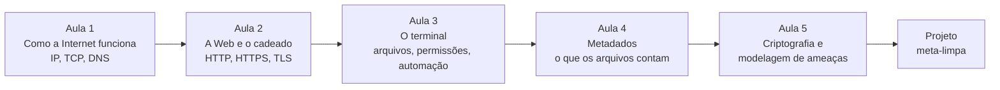

> **Aviso de Idioma:** Este currículo e todos os seus recursos de apoio foram estruturados exclusivamente em **Português (PT-BR)**.

# MOD-104: Letramento Digital, Arquitetura da Rede e Higiene Crítica de Dados

**Ciclo 1 · Eixo 3 (Letramento Digital e Higiene Crítica de Dados) · 50 horas · 5 aulas · Sem pré-requisitos**

*Mapa lógico da ARPANET, a rede que deu origem à Internet, em março de 1977. Cada retângulo é um computador de uma universidade, laboratório militar ou empresa. Computer History Museum, domínio público.*

## Apresentação

Usamos a Internet o dia inteiro sem saber o que acontece quando apertamos "enviar". Este módulo abre a caixa: o caminho de uma mensagem pela rede, o que um site sabe sobre você antes de você digitar qualquer coisa, o que fica escondido dentro de uma foto ou de um PDF, e como a criptografia protege (e onde ela não protege).

Este é um módulo de **autodefesa** e de **consciência técnica**. Pesquisadores sociais, jornalistas, militantes e servidores públicos lidam com dados sensíveis: entrevistas, denúncias, listas de beneficiários. Saber proteger esses dados é parte da ética da pesquisa, e saber como a rede funciona é condição para criticar a vigilância com precisão.

## Mapa do módulo

## Objetivos de aprendizagem

- Descrever o caminho de uma requisição da digitação de um endereço até a resposta, passando por DNS, IP, TCP e TLS.
- Explicar o que o HTTPS protege e o que continua exposto (metadados de conexão).
- Usar o terminal para navegar, procurar, filtrar e automatizar tarefas com arquivos.
- Inspecionar e remover metadados de imagens e documentos.
- Explicar hash, criptografia simétrica, criptografia assimétrica e derivação de chave, com exemplos em Python.
- Construir um modelo de ameaças para um projeto de pesquisa.

## Aulas

| Aula | Tema | Duração |
| :---: | :--- | :---: |
| 1 | [Como a Internet funciona: endereços, pacotes e nomes](./mod-104/aula-01-como-a-internet-funciona.md) | 10h |
| 2 | [A Web e o cadeado: HTTP, HTTPS e TLS](./mod-104/aula-02-http-https-tls.md) | 10h |
| 3 | [O terminal: trabalhar com arquivos como um profissional](./mod-104/aula-03-terminal-posix.md) | 10h |
| 4 | [Metadados: o que os seus arquivos contam sobre você](./mod-104/aula-04-metadados.md) | 10h |
| 5 | [Criptografia na prática e modelagem de ameaças](./mod-104/aula-05-criptografia-modelagem-ameacas.md) | 10h |

## Recursos gratuitos

| Recurso | Para que usar |
| :--- | :--- |
| [Autodefesa Contra Vigilância (EFF, em português)](https://ssd.eff.org/pt-br) | Guias práticos de segurança digital; base da aula 5 |
| [UNIVESP: Redes de Computadores](https://www.youtube.com/user/univesptv) | Aulas em vídeo sobre protocolos e camadas |
| [Guia Foca GNU/Linux](https://www.guiafoca.org/) | Referência em português do terminal Linux |
| [Cartilha de Segurança para Internet (CERT.br)](https://cartilha.cert.br/) | Cartilha oficial brasileira de segurança |

## Projeto prático avaliativo

### Kit de Auditoria e Sanitização de Metadados (`meta-limpa`) e Modelo de Ameaças

**Parte 1, ferramenta:** um programa de linha de comando em Python que:

1. Varre um diretório e lista os arquivos de imagem (JPEG), PDF e documentos de escritório (DOCX, ODT).
2. Gera um **laudo** em Markdown com os metadados encontrados em cada arquivo (autor, software, datas, coordenadas de GPS, modelo de câmera), destacando os de maior risco.
3. Produz **cópias sanitizadas** num diretório separado, sem alterar os originais.
4. Registra o hash SHA-256 de cada original e de cada cópia, para provar a integridade.

**Parte 2, modelo de ameaças:** um documento de 1.500 palavras aplicando as cinco perguntas da aula 5 a um projeto de pesquisa social real ou plausível (por exemplo, entrevistas com entregadores de aplicativo sobre condições de trabalho).

**Critérios de avaliação**

| Critério | Peso |
| :--- | :---: |
| Remoção correta e completa dos metadados identificadores, verificada no laudo | 35% |
| Integridade: originais intactos e hashes corretos | 20% |
| Rigor do modelo de ameaças (ativos, adversários, probabilidades, medidas proporcionais) | 30% |
| Clareza do código e da documentação | 15% |

**Diretório de entrega:** `projetos/ciclo-1/mod-104-meta-limpa`

## Antes e depois deste módulo

- **Pré-requisitos:** nenhum. O MOD-102 ajuda na aula 1 (bits e bytes) e o MOD-106 ajuda no projeto (Python), e os três podem ser cursados em paralelo.
- **Este módulo prepara:** MOD-301 (raspagem de dados, que exige entender HTTP), MOD-305 (vigilância) e MOD-306 (privacidade desde a concepção).

## Glossário do módulo

*Cifra simétrica* · *Cifra assimétrica* · *Certificado digital* · *DNS* · *EXIF* · *Função de hash criptográfica* · *HTTP* · *IP* · *Metadados* · *Modelo de ameaças* · *Pacote* · *PBKDF2* · *Porta* · *Roteador* · *Shell* · *TCP* · *TLS* · *Tor*