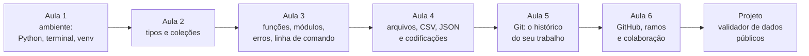

> **Aviso de Idioma:** Este currículo e todos os seus recursos de apoio foram estruturados exclusivamente em **Português (PT-BR)**.

# MOD-106: Fundamentos de Python e Controle de Versão (Git/GitHub)

**Ciclo 1 · Eixo 2 (Engenharia de Software com Python) · 60 horas · 6 aulas · Pré-requisito: MOD-102 (pode ser cursado em paralelo)**

*Linus Torvalds, criador do núcleo Linux (1991) e do Git (2005), na LinuxCon Europe de 2014. Foto de Krd, CC BY-SA 3.0.*

## Apresentação

Este é o módulo das ferramentas de trabalho. Ao final, você saberá escrever programas em Python que leem, limpam e transformam dados públicos, e saberá guardar todo o seu trabalho (código, fichamentos, ensaios) num repositório Git, com histórico completo e cópia no GitHub.

Python foi escolhido por três razões: é a linguagem mais usada nas ciências sociais computacionais e na ciência de dados; é legível, quase como pseudocódigo (MOD-102, aula 2); e é **software livre**, mantido por uma comunidade internacional. O Git foi escolhido porque é o padrão mundial de controle de versão e porque nasceu, ele próprio, de uma disputa sobre a liberdade do software.

## Mapa do módulo

## Objetivos de aprendizagem

- Instalar Python, criar ambientes virtuais e instalar pacotes com `pip`.
- Usar com segurança os tipos e coleções nativos (números, textos, listas, tuplas, dicionários, conjuntos).
- Escrever funções documentadas, organizar o código em módulos e tratar erros com exceções.
- Ler e escrever CSV, JSON e Markdown, resolvendo problemas de codificação (UTF-8 e Latin-1).
- Criar programas de linha de comando com `argparse`.
- Usar o Git para registrar a história do trabalho com commits pequenos e mensagens claras em português.
- Trabalhar com ramos, resolver conflitos e colaborar por Pull Requests no GitHub.

## Aulas

| Aula | Tema | Duração |
| :---: | :--- | :---: |
| 1 | [Preparando o ambiente: Python, terminal e ambientes virtuais](./mod-106/aula-01-ambiente-python-venv.md) | 10h |
| 2 | [Tipos e coleções: os blocos de construção](./mod-106/aula-02-tipos-colecoes.md) | 10h |
| 3 | [Funções, módulos, erros e linha de comando](./mod-106/aula-03-funcoes-modulos-erros.md) | 10h |
| 4 | [Arquivos de dados: CSV, JSON e codificações](./mod-106/aula-04-arquivos-csv-json-codificacao.md) | 10h |
| 5 | [Git: o histórico do seu trabalho](./mod-106/aula-05-git-modelo-mental-commits.md) | 10h |
| 6 | [GitHub, ramos e colaboração](./mod-106/aula-06-github-ramos-colaboracao.md) | 10h |

## Recursos gratuitos

| Recurso | Para que usar |
| :--- | :--- |
| [Tutorial oficial de Python em português](https://docs.python.org/pt-br/3/tutorial/) | Referência principal da linguagem |
| [Introdução à Ciência da Computação com Python (USP, Coursera, modo ouvinte gratuito)](https://www.coursera.org/learn/ciencia-computacao-python-conceitos) | Curso completo em vídeo, com exercícios corrigidos automaticamente |
| [Pro Git, 2ª edição em português](https://git-scm.com/book/pt-br/v2) | O livro oficial do Git, gratuito |
| [Documentação do GitHub em português](https://docs.github.com/pt) | Pull Requests, Issues, Actions |

## Projeto prático avaliativo

### Higienizador e Validador de Bases Públicas

Uma ferramenta de linha de comando em Python, versionada em Git desde o primeiro commit, que:

1. Recebe um arquivo CSV de um órgão público brasileiro (TSE, IBGE, Portal da Transparência).
2. Detecta a codificação (UTF-8 ou Latin-1) e o separador (vírgula ou ponto e vírgula).
3. Valida um **esquema** declarado em JSON (colunas obrigatórias, tipos esperados, valores permitidos).
4. Corrige problemas comuns: espaços extras, acentuação quebrada, números com vírgula decimal.
5. Exporta o arquivo limpo em UTF-8 e um **relatório** em Markdown e em JSON com as linhas rejeitadas e o motivo.

**Entregáveis**

- Repositório Git com histórico de commits pequenos e mensagens claras em português (no mínimo 15 commits ao longo do desenvolvimento).
- Código organizado em módulos (`leitura.py`, `validacao.py`, `relatorio.py`, `cli.py`) com funções documentadas.
- `README.md` explicando como instalar e usar, com um exemplo real.
- Pelo menos um Pull Request revisado por um colega de estudo (ou por você mesmo, numa revisão comentada).

**Critérios de avaliação**

| Critério | Peso |
| :--- | :---: |
| Tratamento correto de codificações e de erros de entrada e saída | 30% |
| Organização modular e legibilidade | 25% |
| Qualidade do histórico Git (commits atômicos, mensagens claras) | 25% |
| Documentação e utilidade real com dados públicos | 20% |

**Diretório de entrega:** `projetos/ciclo-1/mod-106-validador-dados`

## Antes e depois deste módulo

- **Pré-requisito:** MOD-102 (algoritmos). Os dois podem ser cursados juntos.
- **Este módulo prepara:** MOD-202 (orientação a objetos e arquitetura), MOD-204 (testes), MOD-207 (Pandas e SQL) e todos os projetos do curso.

## Glossário do módulo

*Ambiente virtual* · *Argumento* · *Branch (ramo)* · *Clone* · *Commit* · *Conflito de merge* · *CSV* · *Dicionário* · *Exceção* · *Fork* · *Função* · *JSON* · *Merge* · *Módulo* · *pip* · *Pull Request* · *Repositório* · *Software livre* · *Staging (área de preparação)* · *Tupla*