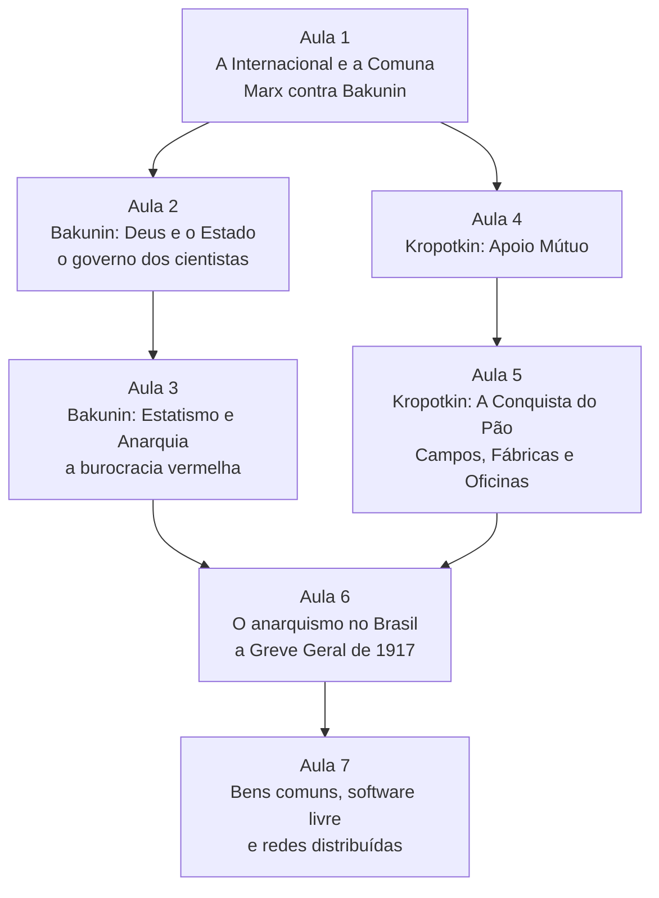
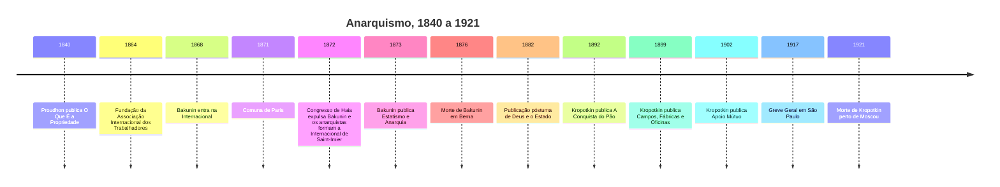

> **Aviso de Idioma:** Este currículo e todos os seus recursos de apoio foram estruturados exclusivamente em **Português (PT-BR)**.

# MOD-107: Anarquismo, Autogestão, Apoio Mútuo e Redes Distribuídas: Bakunin e Kropotkin

**Ciclo 1 · Eixo 4 (Filosofia Política) e Eixo 3 (Letramento Digital) · 70 horas · 7 aulas · Pré-requisitos: MOD-103 e MOD-104**

*Barricada na Chaussée Ménilmontant, Paris, 18 de março de 1871, primeiro dia da Comuna. Autor desconhecido, Museu Carnavalet, domínio público.*

## Apresentação

O anarquismo é a tradição política mais caricaturada da modernidade: a palavra virou sinônimo de bagunça. Este módulo lê os seus dois grandes teóricos nas fontes e encontra outra coisa: uma crítica rigorosa de toda forma de autoridade que não se justifica, inclusive a autoridade dos cientistas e dos técnicos, e uma teoria da cooperação baseada em ciência natural e em história.

Mikhail Bakunin travou com Marx a disputa que dividiu a Primeira Internacional e que atravessou todo o século XX: pode-se usar o Estado para emancipar os trabalhadores, ou todo Estado, mesmo "operário", produz uma nova classe dominante? Piotr Kropotkin, geógrafo e naturalista, respondeu ao darwinismo social mostrando que a cooperação é um fator de evolução tão importante quanto a competição.

O módulo termina onde a tradição encontra a técnica: o software livre, os bens comuns digitais e as redes distribuídas são, em boa medida, experiências práticas de organização sem centro.

## Mapa do módulo

## Linha do tempo

## Objetivos de aprendizagem

- Explicar o conflito entre Marx e Bakunin na Primeira Internacional e as lições tiradas da Comuna de Paris por cada tradição.
- Reconstruir a crítica de Bakunin à autoridade, ao "governo dos cientistas" e ao Estado de transição.
- Explicar a tese de Kropotkin sobre o apoio mútuo e a sua crítica ao darwinismo social.
- Descrever o programa de Kropotkin: abundância para todos, integração entre trabalho manual e intelectual, descentralização produtiva.
- Conhecer o papel do anarquismo no movimento operário brasileiro do início do século XX.
- Analisar o software livre, os bens comuns e as redes federadas com as categorias do módulo, sem idealizá-los.

## Aulas

| Aula | Tema | Duração | Leitura principal |
| :---: | :--- | :---: | :--- |
| 1 | [A Internacional, a Comuna e a grande cisão](./mod-107/aula-01-internacional-comuna-cisao.md) | 10h | Marx, *A Guerra Civil na França* (capítulo III); Bakunin, *A Comuna de Paris e a Noção de Estado* |
| 2 | [Bakunin: Deus, o Estado e o governo dos cientistas](./mod-107/aula-02-bakunin-deus-estado.md) | 10h | Bakunin, *Deus e o Estado* |
| 3 | [Bakunin: *Estatismo e Anarquia* e a burocracia vermelha](./mod-107/aula-03-bakunin-estatismo-anarquia.md) | 10h | Bakunin, *Estatismo e Anarquia* (seleção); Marx, notas sobre *Estatismo e Anarquia* |
| 4 | [Kropotkin: o apoio mútuo como fator de evolução](./mod-107/aula-04-kropotkin-apoio-mutuo.md) | 10h | Kropotkin, *Apoio Mútuo*, Introdução, capítulos 1, 2 e Conclusão |
| 5 | [Kropotkin: pão, fábricas e oficinas para todos](./mod-107/aula-05-kropotkin-conquista-pao-campos-fabricas.md) | 10h | *A Conquista do Pão* (capítulos 1 a 4); *Campos, Fábricas e Oficinas* (capítulo final) |
| 6 | [O anarquismo no Brasil: imprensa operária e a Greve Geral de 1917](./mod-107/aula-06-anarquismo-brasil-greve-1917.md) | 10h | Edgar Rodrigues e Edilene Toledo (seleção); jornal *A Plebe* (acervos digitais) |
| 7 | [Bens comuns, software livre e redes distribuídas](./mod-107/aula-07-commons-software-livre-redes-distribuidas.md) | 10h | Kropotkin, *Apoio Mútuo*, capítulo 8; Stallman, "O que é software livre?" |

## Leituras e onde encontrar

| Obra | Onde ler de graça |
| :--- | :--- |
| Bakunin e Kropotkin | [Arquivo Marxista na Internet](https://www.marxists.org/portugues/) (seção de outros autores) e a [Biblioteca Anarquista](https://theanarchistlibrary.org/), que reúne textos em várias línguas, inclusive o português |
| Marx, *A Guerra Civil na França* | [Arquivo Marxista na Internet, seção Marx e Engels](https://www.marxists.org/portugues/marx/index.htm) |
| Jornais operários brasileiros | Hemeroteca Digital da Biblioteca Nacional e o Arquivo Edgard Leuenroth (Unicamp) |
| Software livre | [Filosofia do Projeto GNU, em português](https://www.gnu.org/philosophy/philosophy.pt-br.html) |

## Projeto prático avaliativo

### Sincronizador federado de catálogos e ensaio sobre apoio mútuo

**Parte 1, protótipo em Python:** um programa que mantém um **catálogo de documentos** (por exemplo, fichamentos ou textos de domínio público) em vários computadores, **sem servidor central**. Cada documento é identificado pelo hash SHA-256 do seu conteúdo (MOD-104, aula 4). O programa deve:

1. Gerar o catálogo local (hash, título, tamanho, data) a partir de uma pasta.
2. Comparar dois catálogos e listar o que cada lado tem que o outro não tem.
3. Juntar os catálogos sem duplicar documentos e detectar conflitos (mesmo título, conteúdos diferentes).
4. Verificar a integridade de cada documento recebido pelo hash.

**Parte 2, ensaio de 2.500 palavras:** relacione as teses de Kropotkin (apoio mútuo, integração do trabalho, descentralização) e de Bakunin (crítica da autoridade técnica) com um projeto real de software livre ou de bem comum digital (Wikipédia, Linux, OpenStreetMap, uma rede federada, o próprio Git). Analise também os limites: onde o projeto reproduz hierarquias, depende de empresas ou exclui pessoas.

**Critérios de avaliação**

| Critério | Peso |
| :--- | :---: |
| Fidelidade às fontes de Bakunin e Kropotkin | 30% |
| Correção do protótipo (catálogo, comparação, junção, verificação) | 30% |
| Análise crítica do caso escolhido, sem idealização | 30% |
| Clareza e estilo | 10% |

**Diretório de entrega:** `projetos/ciclo-1/mod-107-sincronizador-federado`

## Antes e depois deste módulo

- **Pré-requisitos:** MOD-103 (para entender o debate com Marx) e MOD-104 (hash e redes).
- **Este módulo prepara:** MOD-201 (Lênin e Trótski, e o problema do Estado na Revolução Russa), MOD-305 (alternativas à plataformização) e MOD-306 (o software de interesse público como bem comum).

## Glossário do módulo

*Anarquismo* · *Apoio mútuo* · *Autogestão* · *Bens comuns (commons)* · *Burocracia vermelha* · *Comunismo libertário* · *Darwinismo social* · *Endereçamento por conteúdo* · *Federação* · *Federalismo* · *Mutualismo* · *P2P (par a par)* · *Sindicalismo revolucionário*