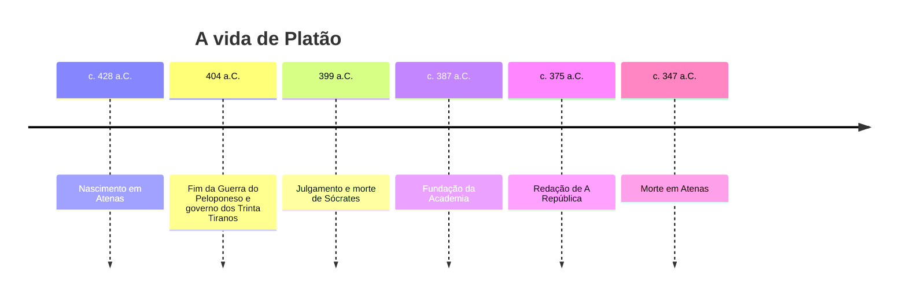
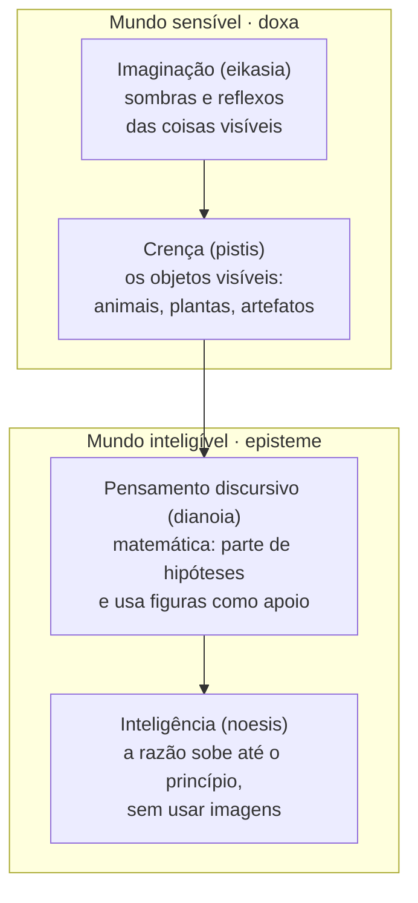
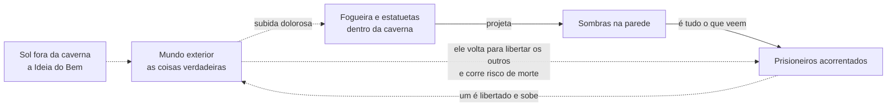

> **Aviso de Idioma:** Este currículo e todos os seus recursos de apoio foram estruturados exclusivamente em **Português (PT-BR)**.

# Aula 1 · Platão: ciência, opinião e a cidade justa

**MOD-101 · 10 horas · Leitura principal:** *A República*, livros VI (509d a 511e) e VII (514a a 521b), e livro IV (427d a 434c)

*Busto de Platão, cópia romana de um retrato feito por Silânion por volta de 370 a.C. para a Academia de Atenas. Museus Capitolinos, Roma. Foto de Marie-Lan Nguyen, CC BY 2.5.*

## O que você vai aprender

- Situar Platão na Atenas do século IV a.C. e entender por que a morte de Sócrates marca toda a sua obra.
- Distinguir <abbr title="Episteme (grego): conhecimento verdadeiro e justificado, que conhece as causas e não muda conforme o gosto de quem fala. Traduzido como ciência.">*episteme*</abbr> e <abbr title="Doxa (grego): opinião, crença baseada na aparência e no costume. Pode até ser verdadeira por acaso, mas não sabe dar razão de si.">*doxa*</abbr> e reconstruir a imagem da linha dividida.
- Ler a alegoria da caverna como teoria da educação e como teoria do poder.
- Explicar a definição de justiça na cidade e na alma.
- Avaliar criticamente a proposta do governo dos filósofos e a sua herança na ideia moderna de governo dos especialistas.

## Pergunta de abertura

> Um vídeo com 4 milhões de visualizações afirma que uma vacina causa uma doença. Um artigo científico com 40 leitores afirma o contrário. Qual dos dois "sabe" alguma coisa? O que faz uma afirmação valer mais do que outra, se não é o número de pessoas que acredita nela?

Anote a sua resposta antes de continuar. Platão passou a vida inteira tentando responder a essa pergunta, e a resposta dele ainda organiza o modo como pensamos a ciência.

## 1. Atenas, a democracia e a morte de Sócrates

Platão nasceu em Atenas por volta de 428 a.C., numa família aristocrática, durante a Guerra do Peloponeso. Cresceu numa cidade que era, ao mesmo tempo, a mais rica democracia do mundo grego e um império que explorava outras cidades.

A democracia ateniense era **direta**: os cidadãos (homens adultos, livres e filhos de atenienses, o que excluía mulheres, estrangeiros e escravizados, a grande maioria da população) votavam pessoalmente na Assembleia. Quem convencia a Assembleia governava. Por isso floresceu ali o ofício dos <abbr title="Sofistas: professores pagos que ensinavam retórica, a arte de convencer, aos jovens ricos que queriam fazer carreira política em Atenas. Protágoras e Górgias são os mais famosos.">sofistas</abbr>, que vendiam a técnica de falar bem em público.

Em 399 a.C., a mesma democracia condenou à morte o mestre de Platão, Sócrates, acusado de corromper a juventude e de não reconhecer os deuses da cidade. Sócrates não escreveu nada. Passava os dias na praça perguntando às pessoas o que era a coragem, a justiça, a piedade, e mostrando que elas não sabiam o que diziam saber.

Para Platão, a condenação provou uma coisa terrível: **uma maioria convencida pode matar o homem mais sábio da cidade**. Boa parte da sua filosofia é uma tentativa de entender como isso foi possível e de pensar uma cidade onde não se repetisse.

## 2. A ideia central: o que aparece e o que é

Platão parte de uma observação simples. As coisas que vemos mudam o tempo todo: a flor murcha, a pessoa envelhece, a cidade que hoje parece justa amanhã comete injustiças. Se o conhecimento verdadeiro fosse conhecimento dessas coisas, ele também mudaria o tempo todo, e não seria conhecimento.

Mas nós conhecemos algumas coisas que não mudam. Um triângulo desenhado no quadro é torto e se apaga, porém o geômetra demonstra propriedades do triângulo (a soma dos ângulos internos) que valem para **todo** triângulo, sempre. O geômetra não estuda o desenho: estuda o triângulo que o desenho imita.

Platão chama esse objeto estável de <abbr title="Ideia ou Forma (eidos, em grego): para Platão, o modelo perfeito, eterno e imutável de cada coisa, que só a razão alcança. As coisas sensíveis são cópias imperfeitas das Ideias.">Ideia</abbr> (ou Forma). Há, portanto, dois planos:

| Plano | O que contém | Como o alcançamos | Tipo de saber |
| :--- | :--- | :--- | :--- |
| **Sensível** | As coisas que vemos, tocamos e que mudam | Pelos sentidos | *Doxa* (opinião) |
| **Inteligível** | As Ideias: o Justo, o Belo, o Igual, o Triângulo | Pela razão | *Episteme* (ciência) |

A *doxa* não é necessariamente falsa. Posso ter a opinião verdadeira de que o caminho para Larissa é por aqui (o exemplo está no diálogo *Mênon*). A diferença é que a opinião verdadeira não sabe **por que** é verdadeira. Ela foge como as estátuas de Dédalo, que segundo a lenda saíam andando se não fossem amarradas. A *episteme* é a opinião amarrada pela explicação da causa.

## 3. A linha dividida

No final do livro VI, Platão propõe uma imagem para organizar os graus de conhecimento. Pegue uma linha e corte-a em duas partes desiguais; depois corte cada parte de novo, na mesma proporção.

Leia de baixo para cima. Cada degrau é uma imagem do degrau acima:

1. **Imaginação** (<abbr title="Eikasia (grego): o grau mais baixo de conhecimento, que toma imagens, sombras e reflexos pelas próprias coisas.">*eikasia*</abbr>): conhecer só reflexos. Alguém que conhece uma pessoa apenas pelas fotos filtradas que ela publica está nesse grau.
2. **Crença** (*pistis*): conhecer os objetos sensíveis diretamente, ainda sem saber o que os faz ser o que são.
3. **Pensamento discursivo** (*dianoia*): o modo do matemático, que raciocina a partir de suposições e usa figuras visíveis como apoio.
4. **Inteligência** (*noesis*): o modo da <abbr title="Dialética (em Platão): o método de perguntas e respostas que examina as hipóteses até chegar a um princípio que não depende de nenhuma suposição. Em Hegel, a palavra ganha outro sentido.">dialética</abbr>, que examina as próprias hipóteses até chegar a um princípio que não depende de nenhuma suposição: a Ideia do Bem.

## 4. A alegoria da caverna

Logo no início do livro VII vem a imagem mais famosa da filosofia ocidental. Sócrates pede que Gláucon imagine:

- Pessoas acorrentadas desde a infância no fundo de uma caverna, olhando para a parede.
- Atrás delas, um muro baixo; atrás do muro, uma fogueira.
- Entre o muro e a fogueira, carregadores passam levando estatuetas e objetos, cujas sombras se projetam na parede.
- Os prisioneiros só veem as sombras e ouvem os ecos. Para eles, aquilo é a realidade. Dão prêmios a quem adivinha qual sombra vai passar em seguida.

Um prisioneiro é libertado e forçado a subir. A luz dói nos olhos; primeiro ele prefere as sombras, que lhe parecem mais nítidas. Aos poucos se acostuma, vê os objetos, depois os reflexos na água fora da caverna, depois as coisas, por fim o próprio Sol. Então entende que o Sol é a causa de tudo o que via.

Se ele voltar para libertar os outros, dirá que as sombras são sombras. Os prisioneiros vão rir dele e, diz Sócrates, **se pudessem pegá-lo, o matariam**. A referência à morte de Sócrates é explícita.

A alegoria tem pelo menos três leituras, e todas importam para o curso:

1. **Teoria do conhecimento:** corresponde à linha dividida. As sombras são a *eikasia*, o Sol é a Ideia do Bem.
2. **Teoria da educação:** educar não é encher alguém de informação, como se põe visão em olhos cegos (518c). É "converter" o olhar, fazer a alma inteira se voltar para outra direção. A palavra grega para essa virada, *periagogé*, é a origem da ideia de conversão.
3. **Teoria do poder:** alguém fabrica as sombras. Os carregadores atrás do muro não são inocentes. Quem controla o que aparece na parede controla o que os prisioneiros tomam por real.

> **Conexão com a computação:** um <abbr title="Feed: a lista de conteúdos que uma plataforma escolhe mostrar a cada pessoa, ordenada por um algoritmo de recomendação que otimiza tempo de tela e engajamento.">feed</abbr> de rede social é uma parede onde passam sombras escolhidas por quem não aparece. O algoritmo de recomendação decide a ordem das sombras para maximizar o tempo que você passa olhando. A pergunta de Platão (quem carrega as estatuetas?) é hoje uma pergunta de engenharia: quem define a <abbr title="Função objetivo: em otimização e aprendizado de máquina, a quantidade que o sistema tenta maximizar ou minimizar (por exemplo, cliques, tempo de tela ou lucro).">função objetivo</abbr> do sistema?

## 5. A cidade justa

*A República* começa com uma pergunta ética: o que é a justiça, e o justo é mais feliz que o injusto? Como a justiça numa pessoa é difícil de ver, Sócrates propõe olhar para algo maior, onde ela estaria "escrita em letras grandes": a cidade, a <abbr title="Pólis (grego): a cidade-Estado grega, comunidade política autônoma com suas leis, assembleias e cidadãos. Origem das palavras política e polícia.">*pólis*</abbr>.

A cidade nasce porque ninguém é autossuficiente. Cada pessoa tem uma aptidão natural, e a cidade funciona melhor quando cada um faz aquilo para que é apto. Daí surgem três grupos:

| Grupo na cidade | Função | Parte da alma correspondente | Virtude própria |
| :--- | :--- | :--- | :--- |
| Governantes (guardiões filósofos) | Deliberar e governar | Razão (*logistikon*) | Sabedoria |
| Auxiliares (guerreiros) | Defender a cidade | Ânimo, coragem (*thymoeides*) | Coragem |
| Produtores (agricultores, artesãos, comerciantes) | Produzir e trocar | Apetites (*epithymetikon*) | Temperança (compartilhada por todos) |

A **justiça**, conclui o livro IV, é cada parte fazer o que lhe é próprio, sem se intrometer na função das outras (433a). Na alma, é a razão governar, o ânimo obedecer à razão e os apetites aceitarem ser governados. A injustiça é uma guerra civil interna: o apetite tomando o lugar da razão.

## 6. O governo dos filósofos e a sua herança incômoda

Platão tira daí uma consequência radical: os males das cidades não terão fim enquanto os filósofos não governarem ou os governantes não se tornarem filósofos (473c a 473d). Os guardiões viveriam sem propriedade privada nem família própria, para que nenhum interesse particular corrompesse o seu juízo.

Essa proposta precisa ser lida com cuidado crítico, porque ela retorna sob muitas formas ao longo do curso:

- **A favor do argumento:** governar exige saber, e a vontade da maioria pode errar gravemente (ela matou Sócrates). Há decisões que dependem de conhecimento especializado.
- **Contra o argumento:** quem decide quem são os sábios? A cidade platônica é rigidamente hierárquica e justifica a desigualdade como "natural". Platão chega a propor uma "nobre mentira" (414b a 415d): contar aos cidadãos que nasceram com ouro, prata ou bronze na alma, para que aceitem o seu lugar.

O sonho de um governo de quem "sabe" reaparece na **tecnocracia** moderna: a ideia de que a política deveria ser entregue a engenheiros, economistas ou, hoje, a algoritmos. No MOD-107 você vai ler a crítica de Bakunin ao "governo dos cientistas"; no MOD-105, a análise de Weber sobre a burocracia; no MOD-205, a crítica de Habermas à razão técnica. Guarde a pergunta: **o saber técnico autoriza alguém a mandar?**

## Leitura guiada

Leia nesta ordem, com o caderno aberto:

1. **Livro IV, 427d a 434c** (cerca de 15 páginas): a definição de justiça na cidade. Procure a frase em que Sócrates define a justiça e copie-a com a referência.
2. **Livro VI, 507a a 511e** (cerca de 12 páginas): a analogia do Sol e a linha dividida. Desenhe a linha você mesmo, com os quatro segmentos, antes de olhar o diagrama desta aula.
3. **Livro VII, 514a a 521b** (cerca de 15 páginas): a alegoria da caverna. Marque cada momento da subida e a passagem sobre a educação como conversão (518b a 518d).

**Atenção à numeração:** as referências como "514a" são a <abbr title="Paginação de Stephanus: numeração padrão das obras de Platão, tirada da edição de Henri Estienne (1578). Permite achar o mesmo trecho em qualquer tradução.">paginação de Stephanus</abbr>, impressa na margem de todas as boas traduções.

## Exercícios

**1. Compreensão.** Por que, para Platão, a opinião verdadeira não basta? Use o exemplo do caminho para Larissa.

Gabarito comentado

A opinião verdadeira acerta, mas não sabe dar a razão do acerto. Quem conhece o caminho para Larissa por ter ouvido dizer chega lá tão bem quanto quem já o percorreu, enquanto nada o contradiz. Diante de uma objeção, porém, não tem como defender a crença e pode abandoná-la. A *episteme* amarra a opinião pela explicação da causa e por isso é estável. O ponto importa para a pergunta de abertura: o vídeo viral pode até acertar por acaso, mas a ciência vale pelo método que justifica o resultado, não pelo número de pessoas que concordam.

**2. Aplicação.** Classifique cada exemplo num dos quatro segmentos da linha dividida e justifique: (a) conhecer uma cidade só pelo Street View; (b) saber que a água ferve a 100 °C ao nível do mar porque viu acontecer muitas vezes; (c) demonstrar que a soma dos ângulos de um triângulo é 180°; (d) perguntar o que é a justiça até chegar a um princípio que não depende de nenhuma convenção.

Gabarito comentado

(a) *Eikasia*: conhece imagens das coisas. (b) *Pistis*: conhece o fenômeno sensível sem a sua explicação causal. (c) *Dianoia*: raciocínio matemático que parte de hipóteses (os postulados) e usa figuras como apoio. (d) *Noesis*: o movimento dialético que examina as hipóteses até o princípio. Note que a física moderna complica o exemplo (b), porque explica a ebulição por leis; para Platão, porém, mesmo essa explicação continuaria ligada ao sensível.

**3. Análise crítica.** Releia a "nobre mentira" (414b a 415d). Ela é compatível com a valorização da verdade na alegoria da caverna? Escreva um parágrafo de 150 palavras.

Gabarito comentado

Há uma tensão real. A caverna condena quem fabrica sombras; a nobre mentira transforma os governantes em fabricantes de sombras "para o bem" dos governados. Uma defesa de Platão diria que os filósofos conhecem o Bem e mentem em nome dele, como o médico que dá um remédio amargo. A objeção é que, assim, a verdade vira privilégio de uma casta e a submissão dos outros passa a ser produzida deliberadamente. A boa resposta reconhece a tensão e conclui algo sobre o problema do poder de quem detém o saber, que é o fio condutor do curso.

**4. Conexão com a técnica.** Escolha uma plataforma que você usa todos os dias. Descreva, em linguagem da alegoria, quem são os prisioneiros, o que é a parede, quem são os carregadores e o que seria "sair da caverna".

Gabarito comentado

Não há resposta única. Uma boa resposta identifica: (1) a parede como a interface (a tela, o feed); (2) as sombras como conteúdos selecionados e ordenados; (3) os carregadores como a empresa, os anunciantes e o algoritmo cuja função objetivo eles definem; (4) sair da caverna como compreender o mecanismo (por exemplo, saber que a ordem do feed é otimizada para engajamento). Uma resposta excelente aponta o limite da analogia: em Platão, sair da caverna leva à verdade das Ideias; na crítica das plataformas, leva ao conhecimento das relações sociais e econômicas que produzem as imagens, um passo que Marx dará no MOD-103.

## Resumo da aula

- Platão escreve depois da morte de Sócrates e pergunta como uma maioria convencida pode errar tão gravemente.
- *Doxa* é opinião sobre o que aparece; *episteme* é conhecimento das causas, estável e justificado.
- A linha dividida organiza quatro graus de conhecimento, das sombras à dialética.
- A caverna é teoria do conhecimento, da educação (conversão do olhar) e do poder (quem fabrica as sombras).
- Justiça, na *República*, é cada parte cumprir a sua função. A consequência política é o governo dos filósofos, cuja herança tecnocrática o curso vai criticar várias vezes.

## Para ir além

- Platão, *Apologia de Sócrates*: o discurso de defesa de Sócrates no julgamento. Curto e essencial.
- Platão, *Mênon*, 97a a 98b: a passagem das estátuas de Dédalo.
- Aula de História da Filosofia Antiga nas [e-Aulas USP](https://eaulas.usp.br/).