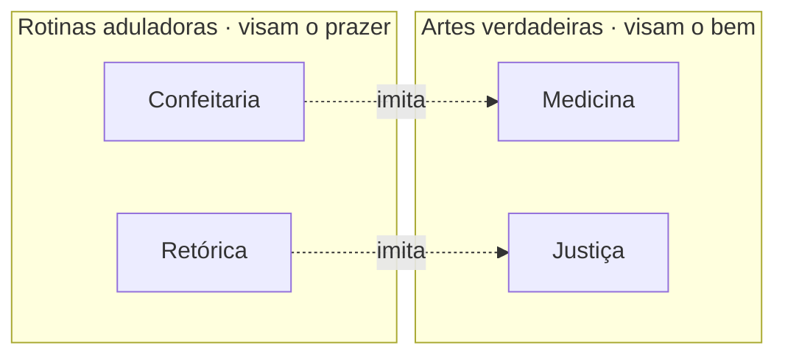
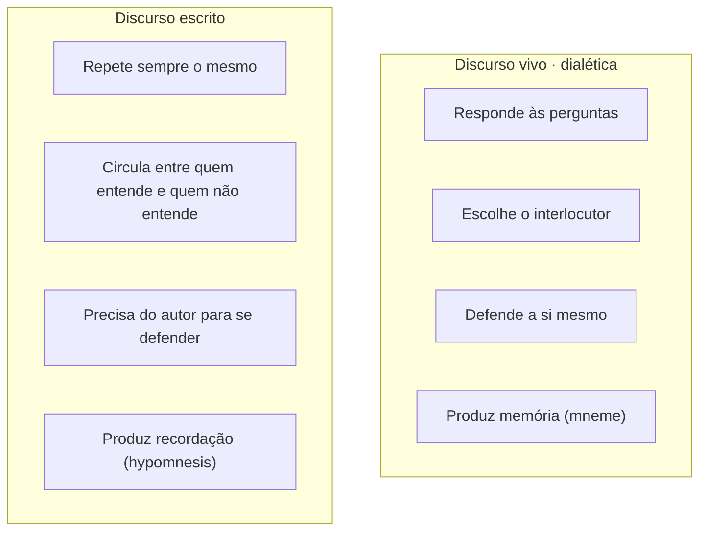

> **Aviso de Idioma:** Este currículo e todos os seus recursos de apoio foram estruturados exclusivamente em **Português (PT-BR)**.

# Aula 2 · Platão: retórica, escrita e o *phármakon*

**MOD-101 · 10 horas · Leitura principal:** *Górgias* 462b a 466a e *Fedro* 274b a 278b

## O que você vai aprender

- Explicar a crítica de Platão à <abbr title="Retórica: arte de produzir convencimento pela palavra. Para os sofistas, uma técnica neutra de sucesso político; para Platão, no Górgias, uma imitação do saber que agrada sem ensinar.">retórica</abbr> no *Górgias* e a diferença entre arte e rotina.
- Reconstruir o mito de Theuth e Thamus no *Fedro*.
- Definir <abbr title="Phármakon (grego): palavra ambígua que significa ao mesmo tempo remédio e veneno. Platão a usa para a escrita, que ajuda a lembrar e enfraquece a memória.">*phármakon*</abbr> e entender por que a ambiguidade da palavra é o centro do argumento.
- Usar o argumento do *Fedro* para pensar a memória delegada a máquinas: buscadores, bancos de dados e modelos de linguagem.

## Pergunta de abertura

> Quantos números de telefone você sabe de cor hoje? E quantos sabia há vinte anos? Você perdeu alguma coisa ao entregar essa memória ao celular, ou só se livrou de um peso inútil?

## 1. Retórica: a técnica de agradar

O *Górgias* é um diálogo sobre o poder da palavra. Górgias, o sofista mais famoso do seu tempo, defende que a retórica é a maior das artes, porque quem sabe falar convence médicos, juízes e assembleias e assim manda em todos.

Sócrates responde com uma distinção que vai organizar a aula inteira. Existem dois tipos de prática:

| | Arte (<abbr title="Techne (grego): saber produtivo, capaz de dar a razão do que faz. O médico sabe por que o remédio cura. Origem das palavras técnica e tecnologia.">*techne*</abbr>) | Rotina ou adulação (*empeiria*, *kolakeia*) |
| :--- | :--- | :--- |
| Visa | O bem do objeto | O prazer imediato |
| Sabe explicar o que faz? | Sim, conhece a causa | Não, só repete o que funcionou antes |
| No corpo | Medicina e ginástica | Culinária de confeitaria e cosmética |
| Na alma | Justiça e legislação | Retórica e sofística |

O confeiteiro agrada mais às crianças do que o médico, e numa disputa diante de crianças o confeiteiro venceria (464d a 465a). A retórica é a confeitaria da alma: diz ao público o que ele quer ouvir, sem saber se aquilo lhe faz bem.

> **Conexão com a computação:** sistemas otimizados para <abbr title="Engajamento: medida de quanto as pessoas interagem com um conteúdo (curtidas, comentários, compartilhamentos, tempo de tela). Principal métrica das plataformas financiadas por publicidade.">engajamento</abbr> funcionam como a confeitaria do *Górgias*. A métrica mede se o conteúdo agradou, não se informou. Um engenheiro que define "sucesso" como cliques fez, sem perceber, uma escolha entre arte e adulação.

## 2. O mito de Theuth

Perto do fim do *Fedro*, depois de uma longa discussão sobre o amor e sobre a boa e a má retórica, Sócrates conta uma história egípcia (274c a 275b).

O deus Theuth, inventor dos números, do cálculo, da geometria, da astronomia, dos jogos de dados e, sobretudo, das letras, vai ao rei Thamus mostrar as suas invenções. Sobre a escrita, Theuth diz:

> "Este conhecimento, ó rei, tornará os egípcios mais sábios e de melhor memória: foi encontrado o remédio (*phármakon*) da memória e da sabedoria." (274e, tradução livre)

Thamus responde que quem inventa uma técnica não é o melhor juiz dos seus efeitos. E inverte o diagnóstico:

> "Ela produzirá esquecimento nas almas dos que a aprenderem, por descuidarem da memória, porque, confiando na escrita, recordarão de fora, por sinais alheios, e não de dentro, por si mesmos. Não encontraste um remédio para a memória, mas para a recordação." (275a, tradução livre)

Note a precisão da distinção:

- **Memória** (*mneme*): saber que está em mim, que posso usar, combinar e defender.
- **Recordação** (*hypomnesis*): lembrete externo que me aponta para algo que eu talvez nunca tenha sabido.

E Thamus completa: os leitores terão "aparência de sabedoria" sem sabedoria verdadeira, pois terão ouvido muitas coisas sem instrução. Serão, diz ele, *doxosophoi*, sábios de opinião.

## 3. Por que a escrita é muda

Sócrates acrescenta um segundo argumento (275d a 275e). A escrita se parece com a pintura: as figuras pintadas parecem vivas, mas se você lhes pergunta alguma coisa, ficam em silêncio solene. Um texto escrito, se interrogado, "diz sempre a mesma coisa". Não sabe com quem deve falar e com quem deve calar. Se for maltratado ou mal lido, precisa sempre do socorro do pai (o autor), porque sozinho não consegue se defender.

O contrário da escrita é o discurso vivo da <abbr title="Dialética (em Platão): conversa de perguntas e respostas entre pessoas que buscam juntas a verdade, examinando as definições até chegar a um princípio.">dialética</abbr>, "escrito com ciência na alma de quem aprende", que sabe se defender e sabe a quem se dirigir.

## 4. A ironia: um texto contra os textos

Há algo de paradoxal aqui, e é aí que a aula fica interessante. Platão faz a crítica da escrita **por escrito**. E o faz num diálogo, a forma escrita que mais imita a conversa viva. O texto platônico não dá respostas prontas: encena perguntas, mostra personagens errando, termina muitas vezes sem conclusão. É uma escrita que tenta funcionar como dialética.

A palavra *phármakon* condensa essa ambiguidade. Em grego ela significa **remédio**, **veneno** e também **tinta** ou **corante**. Theuth oferece um remédio; Thamus vê um veneno. Os dois falam da mesma coisa. Toda técnica é *phármakon*: o que cura também pode envenenar, conforme a dose, o uso e quem administra.

No século XX, o filósofo francês Jacques Derrida dedicou um ensaio inteiro a essa palavra (*A Farmácia de Platão*, 1968). Você não precisa lê-lo agora, mas registre a ideia: **a ambiguidade não é um defeito da tradução; é a tese**.

## 5. O *Fedro* na era dos buscadores e dos modelos de linguagem

O argumento de Thamus atravessa 2.400 anos com uma atualidade incômoda:

| O *Fedro* | Hoje |
| :--- | :--- |
| A escrita substitui a memória pela recordação | O buscador substitui saber por saber onde procurar |
| O leitor terá aparência de sabedoria | A pessoa que cola uma resposta de um <abbr title="Modelo de linguagem: programa estatístico treinado em enormes quantidades de texto para prever a próxima palavra. Gera textos fluentes sem garantia de que sejam verdadeiros.">modelo de linguagem</abbr> parece saber o assunto |
| O texto escrito não responde às perguntas | O texto gerado responde, mas sem saber se o que diz é verdade |
| Quem inventa não é bom juiz dos efeitos | Quem desenvolve a ferramenta tem interesse econômico em exaltá-la |

Cuidado com a leitura apressada. Platão não está dizendo "a técnica é ruim". A própria aula que você lê agora é escrita. O ponto é outro: **toda técnica que externaliza uma capacidade humana muda essa capacidade**, e quem vai julgar se a mudança é remédio ou veneno não deve ser só quem vende a técnica. Thamus é o primeiro crítico de tecnologia da história ocidental.

> Esta é, aliás, a razão pela qual o curso exige fichamentos à mão (ou digitados por você), e não resumos gerados automaticamente. O fichamento transforma a recordação em memória.

## Leitura guiada

1. ***Górgias*, 462b a 466a** (cerca de 8 páginas): a distinção entre arte e adulação. Monte a sua própria tabela das quatro artes e quatro adulações.
2. ***Fedro*, 274b a 278b** (cerca de 6 páginas): o mito de Theuth e a crítica da escrita. Leia duas vezes. Na segunda, sublinhe cada vez que aparecer a palavra "remédio" e verifique como o tradutor lidou com *phármakon*.
3. **Opcional:** *Fedro* 259e a 274b, a discussão sobre a boa retórica, que é a retórica a serviço da dialética.

## Exercícios

**1. Compreensão.** Explique com as suas palavras a diferença entre memória e recordação no *Fedro*.

Gabarito comentado

Memória é o saber que está "dentro", na alma de quem aprendeu: ela pode ser usada, combinada com outros saberes e defendida diante de objeções. Recordação é um sinal externo (a letra escrita) que remete a um conteúdo, mas não garante que a pessoa o tenha compreendido. Uma boa resposta dá um exemplo: saber demonstrar um teorema contra ter a demonstração salva num arquivo.

**2. Aplicação.** Classifique como arte ou adulação, no sentido do *Górgias*, e justifique: (a) um aplicativo de exercícios que aumenta a carga conforme o seu progresso físico medido; (b) um aplicativo de exercícios que dá medalhas por abrir o app todos os dias; (c) um sistema de recomendação de notícias que maximiza tempo de leitura.

Gabarito comentado

(a) Aproxima-se da arte (como a ginástica): visa o bem do corpo e se orienta por um critério que pode ser explicado. (b) Aproxima-se da adulação: recompensa o hábito de abrir o app, que é bom para a empresa, não necessariamente para o corpo. (c) Adulação: o critério é o prazer de continuar lendo, não a qualidade da informação. A resposta excelente nota que a mesma tecnologia pode servir aos dois fins, dependendo da função objetivo escolhida.

**3. Análise.** Por que é relevante que a crítica da escrita esteja num texto escrito, e num diálogo? Responda em 150 palavras.

Gabarito comentado

Porque mostra que Platão não propõe abolir a escrita, e sim um uso dela que preserve a dialética. O diálogo encena perguntas e objeções, obriga o leitor a pensar e muitas vezes não dá a resposta final. É uma escrita que tenta reduzir os defeitos apontados por Thamus. A tensão também confirma a tese do *phármakon*: a técnica é remédio e veneno, e o que decide é o modo de usar.

**4. Escrita.** Escreva um diálogo curto (uma página) entre Theuth, que acaba de inventar um modelo de linguagem, e Thamus. Thamus deve usar pelo menos dois argumentos do *Fedro*.

Critérios de correção

O diálogo deve: (1) fazer Theuth anunciar a invenção como remédio (para a escrita, a pesquisa ou a memória); (2) fazer Thamus usar o argumento da recordação contra a memória e o da aparência de sabedoria; (3) idealmente, usar também o argumento do texto que não sabe se defender. Diálogos excelentes terminam sem vitória fácil, à maneira de Platão.

## Resumo da aula

- No *Górgias*, a retórica é uma rotina que imita a justiça como a confeitaria imita a medicina: agrada sem saber o que faz bem.
- No *Fedro*, Theuth apresenta a escrita como remédio da memória; Thamus mostra que ela é remédio da recordação e produz aparência de sabedoria.
- A escrita é muda: repete sempre o mesmo e não se defende.
- *Phármakon* quer dizer remédio e veneno. Toda técnica que externaliza uma capacidade humana é *phármakon*, e quem a inventa não é o melhor juiz dos seus efeitos.

## Para ir além

- Platão, *Carta VII*, 341c a 344d: Platão explica por que nunca escreveu a sua filosofia mais importante.
- Jacques Derrida, *A Farmácia de Platão* (1968).
- No MOD-203, Walter Benjamin vai pensar a reprodutibilidade técnica da arte com uma ambiguidade parecida.