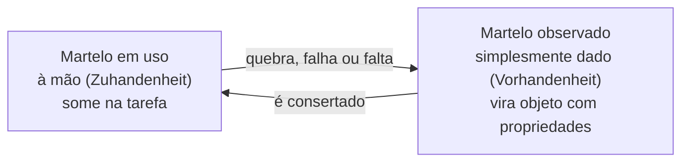
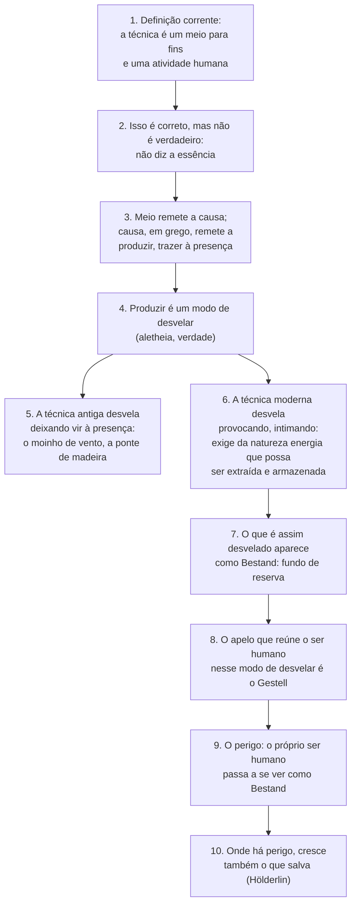

> **Aviso de Idioma:** Este currículo e todos os seus recursos de apoio foram estruturados exclusivamente em **Português (PT-BR)**.

# Aula 7 · Heidegger: a questão da técnica

**MOD-101 · 10 horas · Leitura principal:** *A Questão da Técnica* (conferência de 1953, publicada em 1954), texto integral; *Ser e Tempo* (1927), § 15 (seleção)

## O que você vai aprender

- Explicar o conceito de <abbr title="Dasein (alemão): literalmente ser-aí. Termo de Heidegger para o ser humano enquanto ente que compreende o ser e existe sempre já lançado num mundo de relações e práticas.">*Dasein*</abbr> e a análise da ferramenta em *Ser e Tempo*.
- Reconstruir o argumento de *A Questão da Técnica*: da definição instrumental à técnica como modo de desvelamento.
- Definir <abbr title="Gestell (alemão): armação ou com-posição. Para Heidegger, a essência da técnica moderna: o modo de revelar que intima tudo, a natureza e o próprio ser humano, a se apresentar como recurso disponível.">*Gestell*</abbr> e <abbr title="Bestand (alemão): fundo de reserva, estoque disponível. O modo como as coisas aparecem sob o Gestell: não como objetos com valor próprio, mas como recursos à espera de uso, mensuráveis e substituíveis.">*Bestand*</abbr> e aplicá-los à <abbr title="Datificação: transformação de aspectos da vida (relações, deslocamentos, emoções, trabalho) em dados quantificáveis que podem ser armazenados, cruzados e vendidos.">datificação</abbr>.
- Conhecer a adesão de Heidegger ao nazismo e entender por que o curso estuda a obra mesmo assim, com que cuidados.

## Pergunta de abertura

> Num aplicativo de entregas, o entregador aparece como um ponto no mapa com tempo médio de entrega, taxa de aceitação e nota. O rio que alimenta uma hidrelétrica aparece como megawatts disponíveis. O que há em comum entre esses dois modos de aparecer?

## 1. Um filósofo necessário e comprometido

Martin Heidegger (1889 a 1976) é um dos filósofos mais influentes do século XX e também um dos mais problemáticos. Em 1927 publicou *Ser e Tempo*, que mudou a filosofia europeia. Em 1933, filiou-se ao Partido Nazista e assumiu a reitoria da Universidade de Freiburg, onde fez discursos de apoio a Hitler. Deixou a reitoria em 1934, mas permaneceu no partido até 1945 e nunca fez uma retratação pública consistente. Os *Cadernos Negros*, publicados a partir de 2014, revelaram passagens antissemitas no seu pensamento privado.

O curso estuda Heidegger porque a sua análise da técnica moderna é das mais poderosas já escritas e influenciou críticos de todas as tendências. E estuda **sabendo quem ele foi**. No MOD-205, você vai desenvolver um método rigoroso para separar analiticamente a validade de uma obra da biografia política do autor, sem apagar nem uma nem outra. Por enquanto, guarde a regra: **ler um autor não é absolvê-lo, e condená-lo não dispensa de lê-lo**.

## 2. *Ser e Tempo*: o martelo antes da teoria

Para Heidegger, a filosofia esqueceu de perguntar pelo sentido do ser e passou a tratar tudo como objeto diante de um sujeito que observa. Mas não é assim que vivemos. O ser humano, que ele chama de *Dasein* ("ser-aí"), está sempre já **imerso num mundo** de afazeres, ferramentas e relações.

O exemplo do martelo (*Ser e Tempo*, § 15) mostra isso. Quando martelamos, não observamos o martelo como objeto com propriedades (peso, material, forma). Ele "some" na atividade: está **à mão** (*Zuhandenheit*), integrado ao trabalho. Só quando quebra ou falta é que ele aparece como objeto **simplesmente dado** (*Vorhandenheit*), coisa a ser examinada.

Quem programa conhece essa experiência: o teclado, o editor e a linguagem desaparecem enquanto tudo funciona. Basta um erro de compilação para que a ferramenta reapareça como coisa estranha a ser investigada.

## 3. *A Questão da Técnica*: o argumento

A conferência de 1953 é curta (cerca de 30 páginas) e densa. Ela avança em etapas. Siga o diagrama e depois leia cada uma.

### 3.1 Correto não é verdadeiro

Todos concordam que a técnica é um **meio** para fins e uma **atividade humana**. Heidegger chama isso de definição instrumental e antropológica. Ela é **correta**: um computador é de fato um meio. Mas o correto não alcança a **essência**. Dizer que a técnica é instrumento não explica o que muda no modo como o mundo inteiro aparece numa época técnica.

### 3.2 A técnica como modo de desvelar

Heidegger volta aos gregos. A palavra grega para verdade é <abbr title="Aletheia (grego): verdade entendida como desvelamento, des-ocultação. Heidegger lê a palavra como a-letheia, o que sai do esquecimento e do encobrimento para aparecer.">*aletheia*</abbr>, que ele lê como "desvelamento": tirar do esconderijo, fazer aparecer. E a *techne* grega era justamente um modo de fazer aparecer. O artesão que faz um cálice "traz à frente" algo que ainda não estava presente.

A técnica, portanto, não é só um conjunto de instrumentos. É **um modo de revelar o mundo**: um jeito de fazer as coisas aparecerem de certa maneira.

### 3.3 Provocar em vez de deixar vir

A técnica moderna também desvela, mas de um modo diferente. Ela **provoca** (*herausfordern*): impõe à natureza a exigência de fornecer energia que possa ser extraída, armazenada, distribuída e trocada.

O exemplo de Heidegger é o rio Reno:

| O moinho de vento e a ponte antiga | A usina hidrelétrica |
| :--- | :--- |
| O moinho se entrega ao vento e não acumula a sua energia | A usina é instalada no Reno e o intima a fornecer pressão hidráulica |
| A velha ponte de madeira liga as margens; o rio continua sendo rio | O rio passa a ser o que é **a partir da usina**: fornecedor de pressão |
| O camponês confia a semente às forças do crescimento | A agricultura motorizada intima o solo a render |

Heidegger nota a ironia: alguém dirá que o Reno continua sendo um rio da paisagem. Sim, responde ele, mas como objeto encomendado pela indústria do turismo, que organiza excursões para vê-lo.

### 3.4 *Bestand*: o mundo como estoque

O que aparece no desvelamento provocador não aparece mais como **objeto** (algo diante de mim, com consistência própria), e sim como ***Bestand***: fundo de reserva, estoque disponível, à espera de ser requisitado. O avião parado na pista, diz Heidegger, não é um objeto: está ali como estoque disponível para garantir a possibilidade do transporte.

### 3.5 *Gestell*: a armação

Heidegger chama de ***Gestell*** o apelo que reúne o ser humano nesse modo de revelar. A palavra alemã comum significa estante, armação, esqueleto (o *Gestell* de uma prateleira). Heidegger a usa num sentido novo: a **com-posição** que dispõe tudo como recurso. O *Gestell* não é uma máquina; é a **essência** da técnica, aquilo que faz com que máquinas, dados e pessoas apareçam como recursos.

### 3.6 O perigo e o que salva

O perigo maior não é a bomba ou a máquina que pode falhar. É que o **próprio ser humano** passe a ser tomado como *Bestand*. Heidegger nota o uso da expressão "material humano" e dá o exemplo do guarda-florestal, que hoje é encomendado pela indústria madeireira, que é encomendada pela demanda de papel para jornais e revistas, que encomendam a opinião pública. O ser humano, que acredita dominar a técnica, é ele mesmo intimado.

A conferência termina com um verso do poeta Friedrich Hölderlin: "Onde há perigo, cresce também o que salva." Para Heidegger, a saída não é rejeitar a técnica, mas pensar a sua essência, e ele aponta a arte (que também era *techne* para os gregos) como um outro modo de desvelar.

## 4. Do *Gestell* à datificação

O texto é de 1953, mas parece escrito para a economia de plataformas:

| Heidegger | Hoje |
| :--- | :--- |
| O rio aparece como pressão hidráulica disponível | A vida cotidiana aparece como dados disponíveis para extração |
| O avião na pista é estoque disponível de transporte | O entregador on-line é estoque disponível de entrega, medido por métricas |
| "Material humano" | "Capital humano", "recursos humanos", "base de usuários" |
| O guarda-florestal é encomendado pela cadeia do papel | O criador de conteúdo é encomendado pelo algoritmo, que é encomendado pelos anunciantes |

> **Conexão com a computação:** um banco de dados relacional é um ótimo exemplo de *Gestell*. Para entrar no sistema, qualquer coisa precisa ser decomposta em linhas, colunas e tipos, com uma chave que a torna substituível e consultável. Isso não é um defeito do banco de dados; é o que o torna útil. Mas é também um modo de fazer o mundo aparecer: só existe para o sistema o que pode virar registro. O projeto deste módulo pede que você pense o que fica de fora dessa armação.

### Uma crítica necessária

Heidegger fala da "técnica" e do "ser humano" em geral, como se a técnica moderna fosse um destino da história do ser. Os críticos marxistas (Marcuse, aluno de Heidegger, e depois Habermas, que você lerá no MOD-205) apontaram o que falta: **quem** intima o rio, **quem** lucra com o estoque, **que relações sociais** organizam o *Gestell*. Para Marx, a usina pertence a alguém, e o entregador é estoque disponível porque precisa vender a sua força de trabalho. Leia Heidegger para ver o fenômeno; leia Marx (MOD-103) para perguntar pelas suas causas sociais.

## Leitura guiada

1. ***Ser e Tempo*, § 15** (cerca de 5 páginas): o martelo, o ser à mão e o ser simplesmente dado.
2. ***A Questão da Técnica*, texto integral** (cerca de 30 páginas). A tradução de Marco Aurélio Werle, publicada na revista *Scientiae Studia* (USP, 2007), está em acesso aberto no [SciELO](https://www.scielo.br/). Leia em duas sessões:
   - **Sessão 1:** do início até a apresentação do Reno e da usina. Anote cada passo do argumento e compare com o diagrama.
   - **Sessão 2:** do *Bestand* até o fim. Copie as frases sobre o perigo e o verso de Hölderlin.

## Exercícios

**1. Compreensão.** Por que, para Heidegger, a definição instrumental da técnica é "correta, mas não verdadeira"?

Gabarito comentado

Porque descreve um fato real (as técnicas são meios usados por humanos para fins), mas não alcança a essência: o modo como, numa época técnica, tudo passa a aparecer como recurso. A definição instrumental nos faz pensar que basta usar bem os meios; Heidegger quer mostrar que o próprio modo de ver o mundo já foi transformado.

**2. Aplicação.** Responda à pergunta de abertura usando os conceitos de *Bestand* e *Gestell*.

Gabarito comentado

O entregador e o rio aparecem do mesmo modo: como *Bestand*, estoque disponível que vale pelo que pode render (entregas por hora, megawatts). O que os reúne nesse modo de aparecer é o *Gestell*, o apelo que intima tudo a se apresentar como recurso mensurável. A resposta excelente nota o "perigo" de Heidegger: o próprio entregador pode passar a se ver pelas métricas do aplicativo.

**3. Análise.** Compare o martelo de *Ser e Tempo* com a usina de *A Questão da Técnica*. O que muda na relação entre ser humano e ferramenta?

Gabarito comentado

O martelo à mão está integrado a uma tarefa humana e desaparece no uso; a relação é de familiaridade e o martelo serve a um mundo de práticas. Na usina, a relação se inverte: não é a ferramenta que serve a um mundo de práticas, é o mundo (o rio, a paisagem, as pessoas) que passa a ser organizado em função do sistema técnico. Uma boa resposta nota que a diferença não está no tamanho da máquina, e sim no modo de desvelar.

**4. Crítica.** Escreva 200 palavras sobre o que falta na análise de Heidegger do ponto de vista de Marx.

Critérios de correção

A resposta deve apontar que Heidegger trata a técnica como destino histórico do ser, abstraindo as relações sociais: quem é dono da usina, quem vende a força de trabalho, quem se apropria do valor. Deve explicar que, para Marx, a máquina é capital e o seu efeito depende das relações de produção. A melhor resposta reconhece o que Heidegger vê (a transformação do modo de aparecer do mundo) e o que ele não explica (as causas sociais dessa transformação), e menciona a necessidade de ler a obra sem ignorar a adesão do autor ao nazismo.

## Resumo da aula

- Heidegger aderiu ao nazismo; o curso o lê pela força da sua análise da técnica e com o método de separação entre obra e pessoa do MOD-205.
- Em *Ser e Tempo*, a ferramenta à mão some no uso e só vira objeto quando falha.
- Em *A Questão da Técnica*, a técnica é um modo de desvelar. A técnica moderna desvela provocando: intima a natureza e as pessoas a se apresentarem como estoque.
- *Bestand* é o estoque disponível; *Gestell* é a essência da técnica moderna que dispõe tudo como recurso.
- O perigo é o ser humano tomado como recurso. A crítica marxista acrescenta a pergunta pelas relações sociais que organizam o *Gestell*.

## Para ir além

- Herbert Marcuse, *O Homem Unidimensional* (1964): um aluno de Heidegger que se tornou marxista e leu a técnica a partir das relações sociais.
- Jürgen Habermas, *Técnica e Ciência como "Ideologia"* (1968), estudado no MOD-205.
- Com esta aula você fecha a leitura do MOD-101. Volte ao [guia do módulo](../01-filosofia-classica-dialetica-ontologia-tecnica.md) e comece o ensaio do projeto avaliativo.