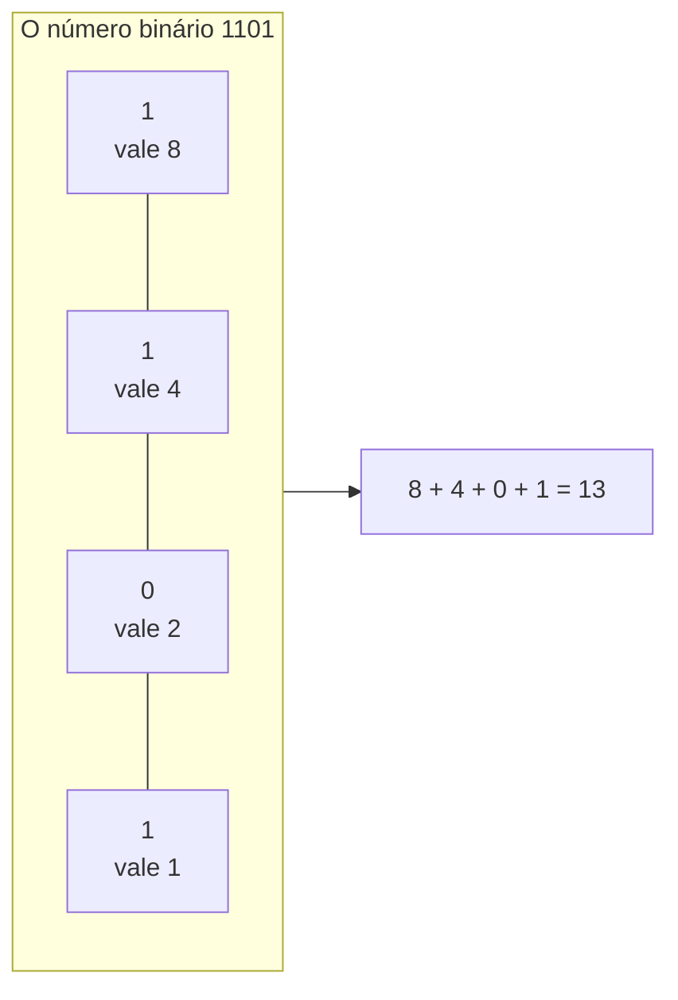
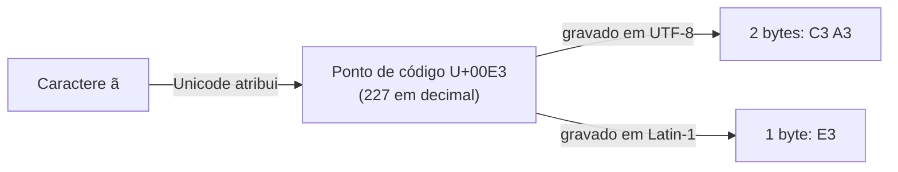
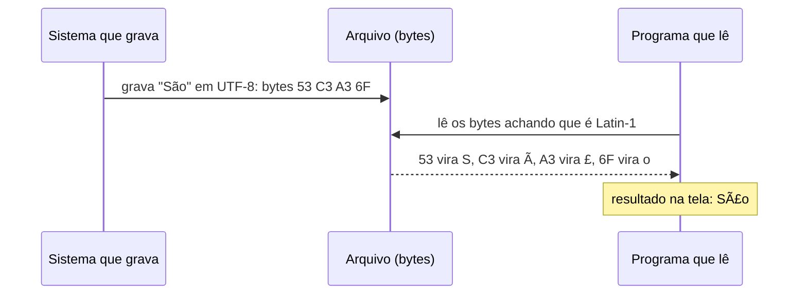

> **Aviso de Idioma:** Este currículo e todos os seus recursos de apoio foram estruturados exclusivamente em **Português (PT-BR)**.

# Aula 1 · Bits, bytes e texto: como a máquina representa o mundo

**MOD-102 · 10 horas · Apoio:** CC50, semana 0

## O que você vai aprender

- Contar em <abbr title="Binário: sistema de numeração de base 2, que usa só os algarismos 0 e 1. Cada posição vale o dobro da posição à sua direita.">binário</abbr> e converter números entre as bases 2 e 10.
- Explicar o que são <abbr title="Bit (binary digit): a menor unidade de informação, um valor que pode ser 0 ou 1, como uma lâmpada apagada ou acesa.">bit</abbr> e <abbr title="Byte: grupo de 8 bits. Pode representar 256 valores diferentes (de 0 a 255). É a unidade básica de armazenamento.">byte</abbr> e quantos valores cabem em cada um.
- Entender como texto vira número com <abbr title="ASCII (American Standard Code for Information Interchange, 1963): tabela que associa 128 caracteres (letras sem acento, algarismos, pontuação) a números de 0 a 127.">ASCII</abbr>, <abbr title="Unicode: padrão internacional que dá um número único (ponto de código) a cada caractere de todas as escritas do mundo, mais de 150 mil ao todo.">Unicode</abbr> e <abbr title="UTF-8: forma de gravar os pontos de código Unicode em bytes. Usa 1 byte para os caracteres ASCII e de 2 a 4 bytes para os demais. É a codificação dominante na Web.">UTF-8</abbr>.
- Diagnosticar e corrigir o problema clássico dos arquivos públicos brasileiros com acentos quebrados ("São Paulo").
- Situar a história da representação da informação, do tear de Jacquard ao censo de Hollerith.

## Pergunta de abertura

> Você baixa um CSV do Tribunal Superior Eleitoral e o nome de um município aparece como `SÃO PAULO`. O arquivo está corrompido? Os dados estão errados? O que aconteceu?

Ao final desta aula você vai saber explicar exatamente o que aconteceu e como consertar.

## 1. Antes do computador: informação em furos


*Funcionárias operam as tabuladoras elétricas de Herman Hollerith no Censo dos Estados Unidos de 1890. Ilustração da* Scientific American *de 30 de agosto de 1890. Domínio público.*

A ideia de gravar instruções e informações em padrões de presença e ausência é mais antiga que a eletricidade:

- **1804, o tear de Jacquard:** cartões perfurados dizem ao tear quais fios levantar. Um furo significa "levante", a ausência significa "não levante". Trocar os cartões é trocar o desenho do tecido sem trocar a máquina. Essa é, em embrião, a ideia de **programa**.
- **1843, Ada Lovelace:** ao traduzir e comentar um artigo sobre a Máquina Analítica de Charles Babbage, Lovelace escreve as famosas *Notas*. Na nota G, descreve passo a passo como a máquina poderia calcular os números de Bernoulli: é considerado o primeiro algoritmo publicado para uma máquina. Ela escreve que a máquina "tece padrões algébricos assim como o tear de Jacquard tece flores e folhas".
- **1890, o censo de Hollerith:** o Escritório do Censo dos Estados Unidos usa cartões perfurados com os dados de cada pessoa (sexo, idade, origem, ocupação) e máquinas elétricas que os contam. A apuração, que no censo anterior levara anos, é feita em muito menos tempo. A empresa de Hollerith dará origem à IBM.


*Ada Lovelace, aquarela atribuída a Alfred Edward Chalon, por volta de 1840. Science Museum, Londres. Domínio público.*

Note um fio que o curso vai puxar várias vezes: a primeira grande aplicação da computação de dados foi **contar e classificar a população** para o Estado. O censo é ao mesmo tempo instrumento de planejamento público e de controle. No MOD-305 você vai estudar o lado sombrio dessa história: as máquinas de cartões perfurados também foram usadas para identificar populações perseguidas no século XX.

## 2. Por que dois símbolos

Um computador é feito de bilhões de **transistores**, minúsculos interruptores que deixam ou não passar corrente. Dois estados são fáceis de distinguir com segurança, mesmo com ruído elétrico: ligado ou desligado, alta ou baixa tensão. Por isso toda informação no computador é gravada com dois símbolos: **0** e **1**. Cada um desses símbolos é um **bit**.

Com 1 bit representamos 2 situações. Com 2 bits, 4 (00, 01, 10, 11). Com 3 bits, 8. A regra: **com n bits representamos 2ⁿ valores diferentes**.

| Bits | Valores possíveis | Exemplo de uso |
| :---: | :---: | :--- |
| 1 | 2 | Verdadeiro ou falso |
| 8 (1 byte) | 256 | Um caractere ASCII estendido, a intensidade de uma cor num pixel |
| 16 | 65.536 | Uma amostra de áudio em qualidade de CD |
| 32 | cerca de 4,3 bilhões | Um endereço IPv4 |
| 64 | cerca de 18 quintilhões | Um número inteiro num computador moderno |

## 3. Contar em binário

No sistema decimal, cada posição vale dez vezes a posição à direita: no número 305, temos 3 centenas, 0 dezenas e 5 unidades. No sistema binário, cada posição vale **o dobro** da posição à direita.



**De binário para decimal:** some os valores das posições que têm 1. `1101` = 8 + 4 + 1 = 13.

**De decimal para binário:** divida por 2 repetidamente e anote os restos, de baixo para cima.

```text
13 ÷ 2 = 6, resto 1
 6 ÷ 2 = 3, resto 0
 3 ÷ 2 = 1, resto 1
 1 ÷ 2 = 0, resto 1
Lendo os restos de baixo para cima: 1101
```

Em Python você pode conferir:

```python
print(bin(13))          # 0b1101 (o prefixo 0b indica binário)
print(int("1101", 2))   # 13
print(2 ** 8)           # 256 valores cabem num byte
```

## 4. Texto é número: ASCII

Se tudo são números, como o computador guarda a letra "A"? Por **convenção**: alguém decide que um número representa uma letra, e todos os programas concordam. A convenção mais influente foi o **ASCII**, publicado em 1963 nos Estados Unidos. Ele usa 7 bits (128 valores):

| Caractere | Código decimal | Binário |
| :---: | :---: | :---: |
| `A` | 65 | 1000001 |
| `B` | 66 | 1000010 |
| `a` | 97 | 1100001 |
| `0` | 48 | 0110000 |
| espaço | 32 | 0100000 |

```python
print(ord("A"))   # 65: o número do caractere
print(chr(97))    # a: o caractere de um número
```

Repare no que o ASCII **não** tem: nenhuma letra acentuada, nenhum ç, nenhum til. A tabela foi pensada para o inglês. Uma escolha técnica que parece neutra embute uma hierarquia de línguas, e durante décadas sistemas brasileiros gravaram "Joao" e "Sao Paulo" por falta de alternativa.

## 5. A torre de Babel das codificações e o Unicode

Para escrever em outras línguas, cada região criou extensões que usavam o oitavo bit (valores de 128 a 255). Para o português, a mais comum foi a **ISO-8859-1**, também chamada **Latin-1**, e a sua prima da Microsoft, a **Windows-1252**. Nelas, `ã` é o byte 227.

O problema: o mesmo byte significava letras diferentes em codificações diferentes. Um arquivo gravado em grego e lido como Latin-1 virava lixo.

A solução foi o **Unicode** (primeira versão em 1991): um único catálogo que dá um número exclusivo, chamado <abbr title="Ponto de código: o número que o Unicode atribui a um caractere, escrito em hexadecimal com o prefixo U+. O ç, por exemplo, é U+00E7.">ponto de código</abbr>, a cada caractere de todas as escritas do mundo. `ã` é U+00E3; `ç` é U+00E7; o ideograma chinês 中 é U+4E2D.

Mas o Unicode só diz qual é o número. Falta decidir **como gravar esse número em bytes**. É aí que entra o **UTF-8** (1993):

- Caracteres ASCII (até 127) ocupam **1 byte**, exatamente como no ASCII. Todo arquivo ASCII já é UTF-8 válido.
- Caracteres latinos acentuados ocupam **2 bytes**.
- Outros caracteres ocupam 3 ou 4 bytes.



```python
print("ã".encode("utf-8"))     # b'\xc3\xa3': dois bytes
print("ã".encode("latin-1"))   # b'\xe3': um byte
```

## 6. O mistério do "São Paulo" resolvido

Agora você pode responder à pergunta de abertura. O problema acontece quando um texto é **gravado numa codificação e lido em outra**.



O `ã` foi gravado em UTF-8 como dois bytes (`C3 A3`). O programa que leu achou que cada byte era um caractere Latin-1: `C3` virou `Ã` e `A3` virou `£`. Daí "São". Esse defeito tem até nome: <abbr title="Mojibake (japonês): texto embaralhado que aparece quando bytes gravados numa codificação são lidos como se estivessem em outra.">*mojibake*</abbr>.

O caso inverso também acontece muito com dados do governo brasileiro: o arquivo foi gravado em Latin-1 e você tenta abrir como UTF-8. Aí o Python acusa erro:

```python
dados = "São Paulo".encode("latin-1")   # simula um arquivo antigo
try:
    print(dados.decode("utf-8"))
except UnicodeDecodeError as erro:
    print("Erro de decodificação:", erro)

print(dados.decode("latin-1"))   # lendo com a codificação certa: São Paulo
```

E o *mojibake* pode ser desfeito, quando a história é a que vimos (UTF-8 lido como Latin-1):

```python
quebrado = "São Paulo"
consertado = quebrado.encode("latin-1").decode("utf-8")
print(consertado)   # São Paulo
```

**Regra prática do curso:** ao abrir qualquer arquivo de dados públicos, **sempre** declare a codificação. Se não souber qual é, teste `utf-8` primeiro e `latin-1` depois. No MOD-106 você vai escrever uma função que faz isso automaticamente.

## 7. Números, imagens e tudo o mais

O mesmo princípio vale para qualquer informação:

- **Imagens:** uma grade de pixels; cada pixel guarda três números de 0 a 255 (vermelho, verde, azul). A cor vermelha do curso, `#C8102E`, é (200, 16, 46).
- **Som:** milhares de medições da pressão do ar por segundo, cada uma gravada como número.
- **Números com vírgula:** usam uma representação chamada ponto flutuante, que tem limites de precisão. Experimente no Python: `print(0.1 + 0.2)`. O resultado não é exatamente 0.3. Para dinheiro, use inteiros em centavos ou o módulo `decimal`.

> **Ideia central da aula:** o computador não guarda "letras", "cores" ou "pessoas". Guarda números, e **convenções humanas** dizem o que os números significam. Toda convenção foi decidida por alguém, num lugar, com certos interesses. O ASCII sem acentos é um pequeno exemplo de uma pergunta que o curso fará muitas vezes: quem define as categorias do sistema?

## Exercícios

**1.** Converta para decimal: `1010`, `11111111`, `100000`.

<details>
<summary>Gabarito</summary>

`1010` = 8 + 2 = **10**. `11111111` = 128 + 64 + 32 + 16 + 8 + 4 + 2 + 1 = **255** (o maior valor de um byte). `100000` = **32**.
</details>

**2.** Converta para binário: 7, 64, 200.

<details>
<summary>Gabarito</summary>

7 = `111`. 64 = `1000000`. 200 = `11001000` (128 + 64 + 8). Confira com `bin(200)`.
</details>

**3.** Quantos bits são necessários para dar um número diferente a cada um dos 5.570 municípios brasileiros?

<details>
<summary>Gabarito comentado</summary>

Precisamos de 2ⁿ ≥ 5.570. Com 12 bits temos 4.096 (insuficiente); com 13 bits temos 8.192. Resposta: **13 bits**. Na prática o IBGE usa um código de 7 algarismos decimais, que também codifica o estado e um dígito verificador.
</details>

**4.** Um arquivo mostra `Conceição`. Qual é a palavra original e o que aconteceu? Escreva o código Python que conserta.

<details>
<summary>Gabarito comentado</summary>

A palavra é **Conceição**. O texto foi gravado em UTF-8 (ç vira `C3 A7`, ã vira `C3 A3`) e lido como Latin-1, onde `C3` é `Ã`, `A7` é `§` e `A3` é `£`. Conserto: `"Conceição".encode("latin-1").decode("utf-8")`.
</details>

**5. Reflexão.** O ASCII foi criado sem acentos e o censo de 1890 classificava pessoas em categorias definidas pelo governo. Escreva um parágrafo sobre o que essas duas histórias têm em comum.

<details>
<summary>Critérios de correção</summary>

A resposta deve notar que, nos dois casos, uma representação técnica (uma tabela de caracteres, um cartão com campos) define de antemão o que pode existir dentro do sistema, e que essa definição reflete escolhas de quem a fez. O que não cabe na tabela (o ç, uma identidade que não está entre as opções do cartão) é deformado ou apagado. A melhor resposta liga isso ao *Gestell* de Heidegger (MOD-101, aula 7).
</details>

## Resumo da aula

- Computadores guardam tudo em bits porque dois estados elétricos são fáceis de distinguir. Com n bits representam-se 2ⁿ valores.
- Binário é um sistema posicional em que cada posição vale o dobro da anterior.
- Texto vira número por convenção: ASCII (sem acentos), Latin-1 (com acentos do português, 1 byte) e Unicode (todas as escritas), gravado em bytes pelo UTF-8.
- Acento quebrado é bytes gravados numa codificação e lidos em outra. Sempre declare a codificação ao abrir dados.
- A história da computação começa com cartões perfurados no tear, na matemática de Lovelace e no censo do Estado.

## Para ir além

- CC50, semana 0: representação de informação e o primeiro programa.
- Ada Lovelace, *Notas sobre a Máquina Analítica* (1843), especialmente a nota G.