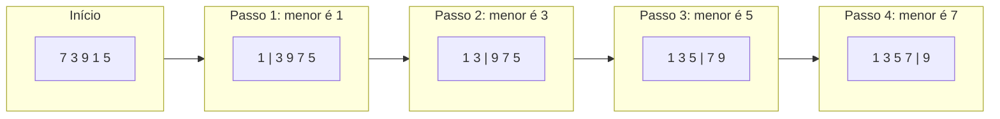
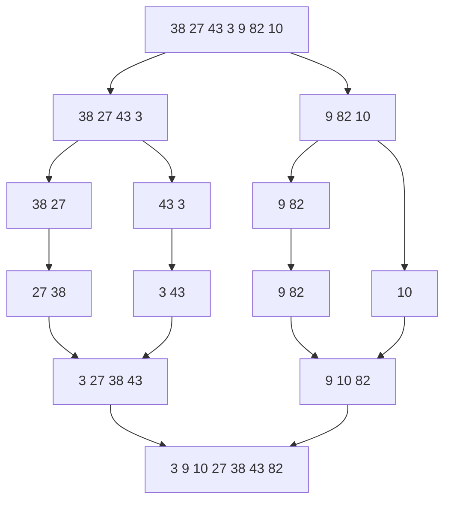

> **Aviso de Idioma:** Este currículo e todos os seus recursos de apoio foram estruturados exclusivamente em **Português (PT-BR)**.

# Aula 5 · Ordenação: seleção e intercalação

**MOD-102 · 10 horas · Apoio:** CC50, semana 3

## O que você vai aprender

- Implementar a <abbr title="Ordenação por seleção (selection sort): a cada passo, encontra o menor elemento da parte ainda desordenada e o coloca na posição seguinte da parte ordenada.">ordenação por seleção</abbr> e contar as suas comparações.
- Entender a estratégia <abbr title="Dividir para conquistar: técnica que divide um problema em partes menores do mesmo tipo, resolve cada parte (muitas vezes por recursão) e combina as soluções.">dividir para conquistar</abbr>.
- Implementar a <abbr title="Ordenação por intercalação (merge sort): divide a lista ao meio, ordena cada metade recursivamente e intercala as duas metades ordenadas numa só.">ordenação por intercalação</abbr> e explicar por que ela é muito mais rápida em listas grandes.
- Usar `sorted` e `list.sort` do Python com chaves de ordenação, e entender o que é uma ordenação <abbr title="Ordenação estável: aquela que mantém a ordem original entre elementos considerados iguais pelo critério de ordenação.">estável</abbr>.
- Perceber a ordenação como decisão: o critério de ordem é uma escolha.

## Pergunta de abertura

> Você recebe 500 fichas de inscrição em ordem aleatória e precisa colocá-las em ordem alfabética. Como você faria à mão? Se fossem 50.000 fichas e você tivesse 10 colegas para ajudar, mudaria de método?

## 1. Ordenação por seleção

A ideia mais intuitiva: procure o menor elemento e coloque-o no começo. Depois procure o menor entre os que sobraram e coloque-o em segundo. E assim por diante.



A barra separa a parte já ordenada (à esquerda) da parte que falta.

```python
def ordena_selecao(lista):
    lista = list(lista)                 # trabalha numa cópia
    n = len(lista)
    for i in range(n - 1):
        pos_menor = i
        for j in range(i + 1, n):
            if lista[j] < lista[pos_menor]:
                pos_menor = j
        lista[i], lista[pos_menor] = lista[pos_menor], lista[i]
    return lista

print(ordena_selecao([7, 3, 9, 1, 5]))   # [1, 3, 5, 7, 9]
```

**Invariante:** no início da volta `i`, as posições de 0 a `i-1` contêm os `i` menores elementos, em ordem.

### Quanto custa?

Na primeira volta, comparamos n-1 elementos; na segunda, n-2; e assim até 1. O total é

1 + 2 + ... + (n-1) = n(n-1)/2

Para 1.000 elementos, cerca de **500 mil** comparações. Para 1 milhão, cerca de **500 bilhões**. O custo cresce com o **quadrado** de n: dobrar a lista quadruplica o trabalho.

## 2. Dividir para conquistar

Para fazer muito melhor, usamos uma das ideias mais poderosas da computação: **dividir para conquistar**.

1. **Dividir** o problema em partes menores do mesmo tipo.
2. **Conquistar** cada parte, de preferência pelo mesmo método (recursão).
3. **Combinar** as soluções.

Volte à pergunta de abertura: com 10 colegas, você dividiria as fichas em pilhas, cada um ordenaria a sua, e depois vocês juntariam as pilhas ordenadas. Juntar duas pilhas já ordenadas é fácil: basta comparar as fichas do topo e pegar a menor.

## 3. Ordenação por intercalação

O algoritmo (conhecido como *merge sort*, inventado por John von Neumann em 1945) aplica a ideia até o fim:

- Uma lista com 0 ou 1 elemento já está ordenada (caso base).
- Senão, divida a lista ao meio, ordene cada metade (recursivamente) e **intercale** as duas metades ordenadas.



A metade de cima do diagrama divide; a de baixo intercala.

### A intercalação

Intercalar duas listas ordenadas é como juntar duas pilhas de fichas ordenadas: compare os primeiros de cada pilha, pegue o menor, repita.

```python
def intercala(esq, dir):
    resultado = []
    i = j = 0
    while i < len(esq) and j < len(dir):
        if esq[i] <= dir[j]:          # o <= mantém a estabilidade
            resultado.append(esq[i])
            i += 1
        else:
            resultado.append(dir[j])
            j += 1
    resultado.extend(esq[i:])          # sobras de uma das listas
    resultado.extend(dir[j:])
    return resultado

def ordena_intercalacao(lista):
    if len(lista) <= 1:
        return list(lista)
    meio = len(lista) // 2
    esq = ordena_intercalacao(lista[:meio])
    dir = ordena_intercalacao(lista[meio:])
    return intercala(esq, dir)

print(ordena_intercalacao([38, 27, 43, 3, 9, 82, 10]))
# [3, 9, 10, 27, 38, 43, 82]
```

### Quanto custa?

- A lista é dividida ao meio até chegar a pedaços de 1 elemento: isso dá cerca de log₂ n **níveis**.
- Em cada nível, a intercalação de todos os pedaços percorre os n elementos uma vez.

Total: cerca de **n × log₂ n** operações.

| n | Seleção (cerca de n²/2) | Intercalação (cerca de n log₂ n) |
| :--- | :---: | :---: |
| 1.000 | 500.000 | 10.000 |
| 1.000.000 | 500.000.000.000 | 20.000.000 |

Para um milhão de registros, a intercalação é cerca de **25 mil vezes** mais rápida. O preço: ela usa memória extra para as listas intermediárias.

## 4. Medindo de verdade

```python
import random
import time

def medir(funcao, dados):
    inicio = time.perf_counter()
    funcao(dados)
    return time.perf_counter() - inicio

for n in [1_000, 2_000, 4_000]:
    dados = [random.randint(0, 1_000_000) for _ in range(n)]
    t_sel = medir(ordena_selecao, dados)
    t_int = medir(ordena_intercalacao, dados)
    print(f"n={n:5d}  seleção={t_sel:.3f}s  intercalação={t_int:.4f}s")
```

(Execute junto com as definições das seções anteriores.) Repare que, ao dobrar `n`, o tempo da seleção aproximadamente **quadruplica** e o da intercalação apenas um pouco mais que **dobra**.

## 5. Ordenar em Python no dia a dia

Na prática, use as ferramentas do Python. Elas usam o algoritmo Timsort, uma combinação refinada de intercalação com inserção, criada por Tim Peters em 2002.

```python
municipios = [
    ("Brasília", "DF", 2817068),
    ("São Paulo", "SP", 11451999),
    ("Rio de Janeiro", "RJ", 6211223),
    ("Fortaleza", "CE", 2428708),
]

# por população, do maior para o menor
por_pop = sorted(municipios, key=lambda m: m[2], reverse=True)
print([m[0] for m in por_pop])

# por UF e, dentro da UF, por nome
por_uf = sorted(municipios, key=lambda m: (m[1], m[0]))
print([m[0] for m in por_uf])
```

O parâmetro `key` diz **qual critério** usar. E aqui está o ponto que vai além da técnica.

> **Ordenar é decidir.** Uma lista de espera de cirurgia ordenada por data de inscrição, por gravidade, por idade ou por renda produz resultados de vida ou morte completamente diferentes. A escolha da função `key` é uma escolha política. O algoritmo de ordenação garante só que o critério será aplicado com precisão. No MOD-305 você vai auditar sistemas que "ordenam" pessoas por risco, mérito ou prioridade.

### Estabilidade

A ordenação do Python é **estável**: elementos iguais pelo critério mantêm a ordem em que estavam. Isso permite ordenar em etapas: ordene por nome e depois por UF, e cada UF ficará com os nomes em ordem alfabética. Em sistemas de fila (por exemplo, empate na nota de um concurso, desempatado pela ordem de inscrição), a estabilidade é exigência de justiça, não detalhe técnico.

## Exercícios

**1.** Mostre, passo a passo, a ordenação por seleção de `[64, 25, 12, 22, 11]`.

<details>
<summary>Gabarito</summary>

Passo 1: menor é 11, troca com 64: `11 | 25 12 22 64`. Passo 2: menor é 12: `11 12 | 25 22 64`. Passo 3: menor é 22: `11 12 22 | 25 64`. Passo 4: menor é 25 (já no lugar): `11 12 22 25 | 64`.
</details>

**2.** Quantas comparações a ordenação por seleção faz numa lista de 10 elementos?

<details>
<summary>Gabarito</summary>

9 + 8 + ... + 1 = 10 × 9 / 2 = **45**.
</details>

**3.** Intercale à mão `[2, 5, 9]` e `[1, 5, 6, 10]`, anotando cada comparação.

<details>
<summary>Gabarito</summary>

2 contra 1: pega 1. 2 contra 5: pega 2. 5 contra 5: pega o 5 da esquerda (estabilidade). 9 contra 5: pega 5. 9 contra 6: pega 6. 9 contra 10: pega 9. Sobra 10. Resultado: `[1, 2, 5, 5, 6, 9, 10]`, com 6 comparações.
</details>

**4.** Rode o experimento da seção 4 e preencha uma tabela com os seus tempos. Os números confirmam as previsões teóricas?

<details>
<summary>Gabarito comentado</summary>

Os números exatos dependem do computador. O que deve aparecer: a razão entre os tempos da seleção para n=2.000 e n=1.000 fica perto de 4, e a da intercalação fica perto de 2 (um pouco mais). Se não aparecer, aumente os valores de n, porque com listas pequenas outros custos (chamadas de função, memória) atrapalham a medição.
</details>

**5. Reflexão.** Escolha um serviço público que organiza uma fila (vagas em creche, transplantes, moradia popular). Pesquise o critério de ordenação usado e escreva um parágrafo sobre as consequências sociais de trocá-lo por outro.

<details>
<summary>Critérios de correção</summary>

A resposta deve identificar o critério real (com fonte), propor pelo menos um critério alternativo e mostrar quem ganha e quem perde com a troca. A melhor resposta nota que critérios aparentemente neutros (ordem de inscrição) favorecem quem tem mais informação e tempo para se inscrever cedo.
</details>

## Resumo da aula

- A ordenação por seleção busca o menor e o põe no lugar, repetidamente: cerca de n²/2 comparações.
- Dividir para conquistar: dividir, resolver as partes, combinar.
- A ordenação por intercalação divide ao meio, ordena as metades e as intercala: cerca de n log₂ n operações, à custa de memória extra.
- Em Python, use `sorted` com `key`. A ordenação é estável.
- O critério de ordenação é uma decisão social; o algoritmo só o aplica com precisão.

## Para ir além

- CC50, semana 3: a comparação visual entre *bubble sort*, *selection sort* e *merge sort*.
- [Visualgo: ordenação](https://visualgo.net/pt/sorting), com animações de todos os algoritmos clássicos.