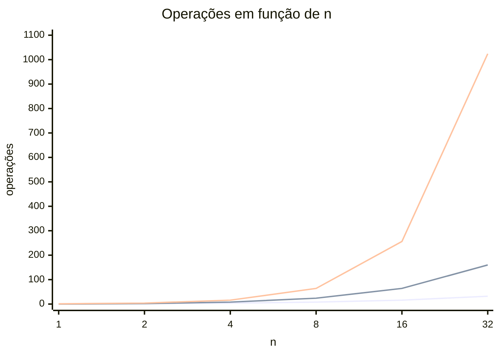
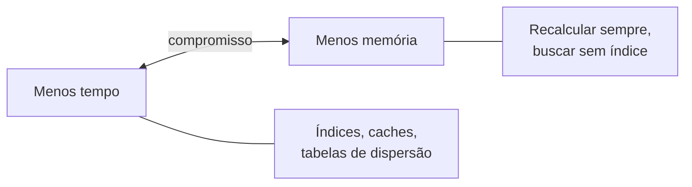

> **Aviso de Idioma:** Este currículo e todos os seus recursos de apoio foram estruturados exclusivamente em **Português (PT-BR)**.

# Aula 6 · Complexidade: quanto custa um algoritmo

**MOD-102 · 10 horas · Apoio:** CC50, semana 3

## O que você vai aprender

- Explicar por que medimos algoritmos pelo **crescimento** do custo, e não por segundos.
- Usar a <abbr title="Notação O (ou Big-O): forma de descrever como o custo de um algoritmo cresce quando a entrada cresce, ignorando constantes. O(n) cresce em proporção a n; O(n²) cresce com o quadrado de n.">notação O</abbr> para classificar algoritmos: O(1), O(log n), O(n), O(n log n), O(n²), O(2ⁿ).
- Estimar a <abbr title="Complexidade de tempo: quantidade de operações que um algoritmo executa em função do tamanho da entrada.">complexidade de tempo</abbr> de um trecho de código olhando para os laços.
- Distinguir tempo e <abbr title="Complexidade de espaço: quantidade de memória extra que um algoritmo usa em função do tamanho da entrada.">espaço</abbr> e reconhecer o compromisso entre os dois.
- Confirmar estimativas teóricas com medições.

## Pergunta de abertura

> Um programa processa os dados de uma cidade de 10 mil habitantes em 1 segundo. Quanto tempo levará para processar o país inteiro, com 200 milhões? A resposta "20 mil segundos" só está certa para um tipo de algoritmo. Para outros, a resposta pode ser "menos de um minuto" ou "mais que a idade do universo".

## 1. Por que não medir em segundos

O tempo em segundos depende do computador, da linguagem, de outros programas abertos, até da temperatura do processador. Precisamos de uma medida que descreva **o algoritmo**, não a máquina.

A pergunta certa é: **quando a entrada cresce, como o custo cresce?** Se dobrarmos o número de registros, o trabalho dobra? Quadruplica? Aumenta só um pouquinho?

## 2. A notação O

A notação O descreve a **forma do crescimento** e ignora constantes e termos menores. Se um algoritmo faz `3n² + 5n + 100` operações, dizemos que ele é **O(n²)**: para n grande, o termo n² domina todo o resto.

As classes que você vai encontrar sempre:

| Notação | Nome | Exemplo | Se n dobra, o custo... |
| :--- | :--- | :--- | :--- |
| O(1) | Constante | Ler `lista[i]`; consultar um dicionário | não muda |
| O(log n) | Logarítmica | Busca binária | aumenta um passo |
| O(n) | Linear | Busca linear; somar uma lista | dobra |
| O(n log n) | Quase linear | Ordenação por intercalação; `sorted` | pouco mais que dobra |
| O(n²) | Quadrática | Ordenação por seleção; comparar todos com todos | quadruplica |
| O(2ⁿ) | Exponencial | Testar todos os subconjuntos | eleva ao quadrado |



*As três linhas, de baixo para cima: O(n), O(n log n) e O(n²). Com n = 32, a linha quadrática já está em 1.024 operações, contra 32 da linear.*

## 3. Respondendo à pergunta de abertura

Suponha 1 segundo para n = 10.000. Para n = 200.000.000 (20 mil vezes maior):

| Complexidade | Tempo estimado para o país |
| :--- | :--- |
| O(log n) | cerca de 2 segundos |
| O(n) | 20.000 s, cerca de **5,5 horas** |
| O(n log n) | cerca de 9 horas |
| O(n²) | 400 milhões de segundos, cerca de **13 anos** |
| O(2ⁿ) | inviável: já para n = 100, mais operações do que átomos no universo observável |

Esse quadro explica por que a escolha de algoritmo importa mais do que comprar um computador mais rápido. Um computador 100 vezes mais rápido reduz os 13 anos do algoritmo quadrático para 47 dias. Trocar o algoritmo quadrático por um O(n log n) reduz para horas.

## 4. Como estimar olhando o código

Algumas regras práticas cobrem a maioria dos casos.

**Regra 1: operações simples são O(1).** Atribuir, somar, comparar, ler uma posição.

**Regra 2: um laço que percorre n elementos multiplica por n.**

```python
def soma(lista):            # O(n)
    total = 0
    for x in lista:         # n voltas
        total += x          # O(1) cada
    return total
```

**Regra 3: laços aninhados multiplicam.**

```python
def tem_duplicado(lista):   # O(n²)
    n = len(lista)
    for i in range(n):              # n voltas
        for j in range(i + 1, n):   # até n voltas para cada i
            if lista[i] == lista[j]:
                return True
    return False
```

**Regra 4: laços em sequência somam, e fica o maior.** Um laço O(n) seguido de outro O(n²) dá O(n²).

**Regra 5: dividir o problema pela metade a cada passo dá log n.**

**Cuidado com operações escondidas.** Algumas linhas de Python parecem O(1) e não são:

| Código | Custo real | Por quê |
| :--- | :--- | :--- |
| `x in lista` | O(n) | É uma busca linear |
| `x in conjunto` | O(1) em média | Usa tabela de dispersão (aula 7) |
| `lista.insert(0, x)` | O(n) | Desloca todos (aula 3) |
| `sorted(lista)` | O(n log n) | Ordenação |
| `lista[a:b]` | O(b-a) | Copia os elementos |

Por isso o código abaixo, que parece ter um laço só, é O(n²):

```python
def tem_duplicado_lento(lista):
    vistos = []
    for x in lista:          # n voltas
        if x in vistos:      # busca linear: O(n) a cada volta
            return True
        vistos.append(x)
    return False
```

E esta versão, trocando a lista por um conjunto, vira O(n):

```python
def tem_duplicado_rapido(lista):
    vistos = set()
    for x in lista:
        if x in vistos:      # O(1) em média
            return True
        vistos.add(x)
    return False
```

## 5. Tempo contra espaço

A versão rápida usa um conjunto que pode crescer até n elementos: ela gasta **memória** para ganhar **tempo**. Esse compromisso é onipresente:



Bancos de dados criam índices (mais espaço, consultas rápidas). Navegadores guardam páginas em cache. O projeto deste módulo pede que você meça exatamente esse compromisso.

## 6. Melhor caso, pior caso, caso médio

A notação O costuma descrever o **pior caso**, porque é a garantia que importa. Uma busca linear pode achar o alvo na primeira posição, mas não podemos contar com isso. Em sistemas públicos, o pior caso é o dia de pico: o último dia do prazo do Imposto de Renda, o dia de inscrição do Enem. Um sistema que funciona "na média" e trava no pior caso falha exatamente quando mais gente precisa dele.

## 7. Medir para confirmar

A teoria prevê; a medição confirma. Um experimento simples:

```python
import random
import time

def tem_duplicado_lento(lista):
    vistos = []
    for x in lista:
        if x in vistos:
            return True
        vistos.append(x)
    return False

def tem_duplicado_rapido(lista):
    vistos = set()
    for x in lista:
        if x in vistos:
            return True
        vistos.add(x)
    return False

for n in [2_000, 4_000, 8_000]:
    dados = random.sample(range(10 * n), n)   # sem duplicados: pior caso
    for f in (tem_duplicado_lento, tem_duplicado_rapido):
        t0 = time.perf_counter()
        f(dados)
        print(f"n={n:5d} {f.__name__:22s} {time.perf_counter() - t0:.4f}s")
```

Você deve ver o tempo da versão lenta aproximadamente quadruplicar a cada vez que n dobra, e o da rápida apenas dobrar.

## Exercícios

**1.** Dê a complexidade de cada função:

```python
def a(lista):
    return lista[0] if lista else None

def b(lista):
    for x in lista:
        for y in lista:
            print(x, y)

def c(n):
    passos = 0
    while n > 1:
        n = n // 2
        passos += 1
    return passos

def d(lista):
    ordenada = sorted(lista)
    return ordenada[len(ordenada) // 2]
```

<details>
<summary>Gabarito</summary>

`a`: **O(1)**. `b`: **O(n²)** (laços aninhados sobre a mesma lista). `c`: **O(log n)** (divide por 2 a cada volta). `d`: **O(n log n)** (dominado pela ordenação; a leitura do meio é O(1)). A função `d` calcula a mediana.
</details>

**2.** Um algoritmo O(n²) leva 2 segundos para n = 1.000. Estime o tempo para n = 10.000 e para n = 100.000.

<details>
<summary>Gabarito</summary>

n multiplicado por 10 multiplica o tempo por 100: **200 segundos** para 10.000. Multiplicado por 100, o tempo é multiplicado por 10.000: **20.000 segundos**, cerca de 5,5 horas, para 100.000.
</details>

**3.** Reescreva em O(n) uma função que recebe a lista de CPFs inscritos num programa social e a lista de CPFs de servidores públicos e devolve os CPFs que estão nas duas.

<details>
<summary>Gabarito</summary>

```python
def cruzar(inscritos, servidores):
    conjunto_servidores = set(servidores)            # O(m)
    return [c for c in inscritos if c in conjunto_servidores]   # O(n)
```

A versão ingênua (`for c in inscritos: if c in servidores`) é O(n × m). Esse tipo de cruzamento de bases é exatamente o que órgãos de controle fazem para detectar fraudes, e também o que permite vigilância: a eficiência é a mesma, o uso é que muda.
</details>

**4. Reflexão.** Explique por que, para um sistema público de inscrição, o pior caso é mais importante do que o caso médio.

<details>
<summary>Gabarito comentado</summary>

Porque a demanda não é uniforme: concentra-se em prazos finais e datas de abertura. Um sistema dimensionado pela média trava nos picos, que é quando a maior parte das pessoas precisa dele. Quem tem pior conexão, menos tempo ou menos informação tende a deixar para o fim e é quem mais sofre. Uma boa resposta liga a escolha técnica (projetar para o pior caso) a uma questão de igualdade de acesso.
</details>

## Resumo da aula

- Medimos algoritmos pelo crescimento do custo, não por segundos.
- A notação O ignora constantes e descreve a forma do crescimento: O(1), O(log n), O(n), O(n log n), O(n²), O(2ⁿ).
- Laços em sequência somam, laços aninhados multiplicam, dividir pela metade dá log n.
- Algumas operações de Python escondem laços: `x in lista` é O(n), `x in conjunto` é O(1) em média.
- Tempo e espaço se trocam: índices e conjuntos gastam memória para ganhar velocidade.
- Projete para o pior caso: é nele que os sistemas públicos falham.

## Para ir além

- CC50, semana 3: a discussão sobre o tempo de execução de algoritmos de ordenação.
- Engenharia de Software Moderna, capítulo 1, sobre requisitos não funcionais (desempenho).