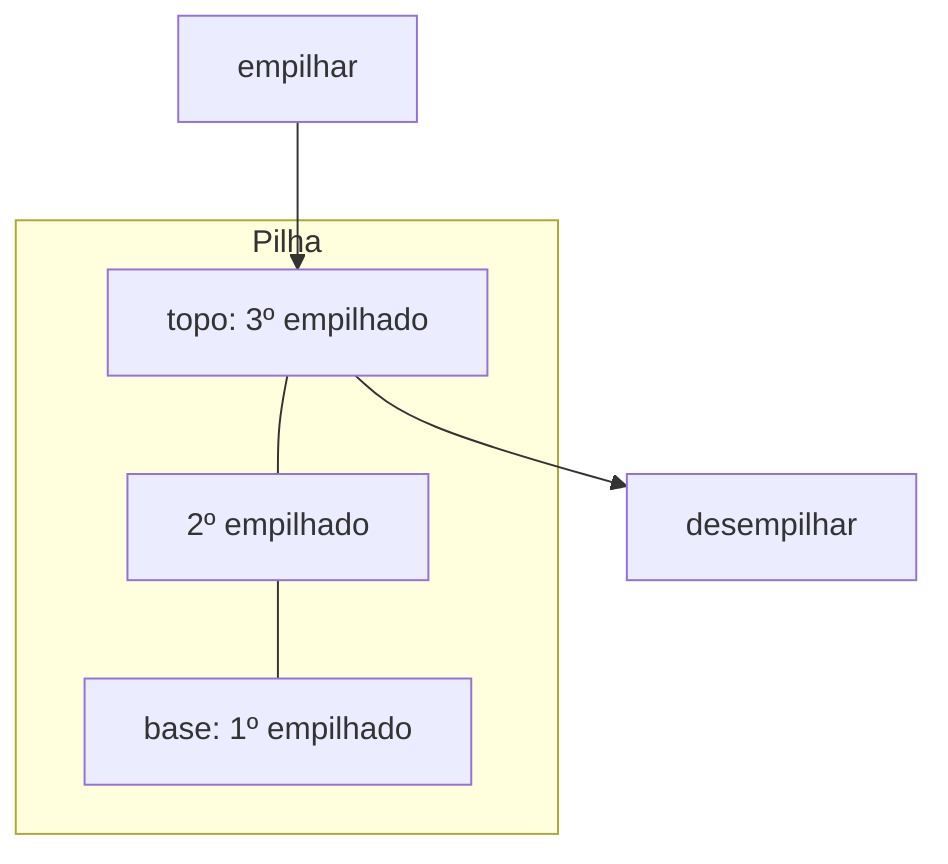
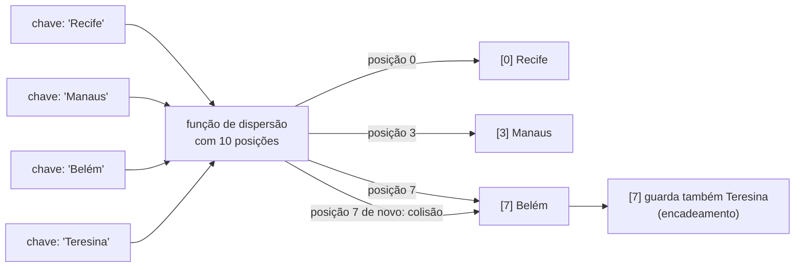
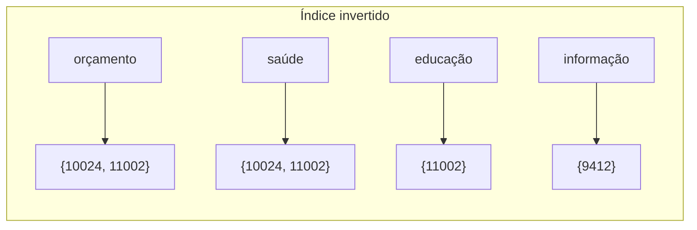

> **Aviso de Idioma:** Este currículo e todos os seus recursos de apoio foram estruturados exclusivamente em **Português (PT-BR)**.

# Aula 7 · Pilhas, filas e tabelas de dispersão

**MOD-102 · 10 horas · Apoio:** CC50, semana 5

## O que você vai aprender

- Usar a <abbr title="Pilha (stack): estrutura em que o último elemento a entrar é o primeiro a sair, como uma pilha de pratos. Operações principais: empilhar (push) e desempilhar (pop).">pilha</abbr> e a <abbr title="Fila (queue): estrutura em que o primeiro elemento a entrar é o primeiro a sair, como uma fila de banco. Operações principais: enfileirar e desenfileirar.">fila</abbr> e reconhecer problemas que pedem cada uma.
- Explicar como funciona uma <abbr title="Tabela de dispersão (hash table): estrutura que guarda pares de chave e valor num arranjo, usando uma função de dispersão para calcular, a partir da chave, a posição onde o valor fica. Busca em tempo constante na média.">tabela de dispersão</abbr> e por que ela busca em tempo constante na média.
- Entender o que é uma <abbr title="Função de dispersão (hash): função que transforma uma chave de qualquer tamanho (um nome, um CPF) num número de tamanho fixo. A mesma chave produz sempre o mesmo número.">função de dispersão</abbr> e o que é uma <abbr title="Colisão: quando duas chaves diferentes produzem a mesma posição na tabela de dispersão. Toda tabela precisa de uma estratégia para lidar com colisões.">colisão</abbr>.
- Usar `dict`, `set` e `collections.deque` do Python com consciência do custo de cada operação.
- Construir um <abbr title="Índice invertido: estrutura que associa cada palavra à lista de documentos em que ela aparece. É o coração de todo mecanismo de busca.">índice invertido</abbr>, peça central do projeto do módulo.

## Pergunta de abertura

> Numa biblioteca com um milhão de livros, como o bibliotecário acha um livro em segundos sem olhar prateleira por prateleira? E como um mecanismo de busca acha, entre bilhões de páginas, as que contêm a palavra "orçamento"?

## 1. Pilha: o último a entrar é o primeiro a sair

Uma pilha funciona como uma pilha de pratos: você só põe e tira pelo topo. Em inglês, *LIFO* (*last in, first out*).



Em Python, uma lista funciona como pilha usando o **fim** como topo (lembre da aula 3: o fim é a ponta barata):

```python
pilha = []
pilha.append("página A")   # empilha
pilha.append("página B")
pilha.append("página C")
print(pilha.pop())          # página C: a última que entrou
print(pilha.pop())          # página B
```

Onde as pilhas aparecem:

- O botão **voltar** do navegador.
- O **desfazer** (Ctrl+Z) de um editor.
- As **chamadas de função**: quando uma função chama outra, o computador empilha onde parou. A recursão da aula 4 usa essa pilha.
- Conferir se parênteses estão balanceados:

```python
def balanceado(texto):
    pares = {")": "(", "]": "[", "}": "{"}
    pilha = []
    for c in texto:
        if c in "([{":
            pilha.append(c)
        elif c in ")]}":
            if not pilha or pilha.pop() != pares[c]:
                return False
    return not pilha

print(balanceado("f(a[1], {b: 2})"))   # True
print(balanceado("f(a[1)]"))           # False
```

## 2. Fila: o primeiro a entrar é o primeiro a sair

Uma fila funciona como a fila do banco: entra-se pelo fim, sai-se pelo início. Em inglês, *FIFO* (*first in, first out*).

Lembre da aula 3: remover do início de uma lista do Python é O(n). Para filas, use `collections.deque`, que é O(1) nas duas pontas:

```python
from collections import deque

fila = deque()
fila.append("pedido 1")      # entra no fim
fila.append("pedido 2")
fila.append("pedido 3")
print(fila.popleft())        # pedido 1: o primeiro que entrou
print(len(fila))             # 2
```

Filas aparecem em todo sistema que atende demandas por ordem de chegada: impressoras, servidores web, sistemas de protocolo, e também em algoritmos que percorrem redes (a busca em largura, que você vai usar no MOD-303 para analisar redes de poder).

## 3. Tabelas de dispersão: achar em tempo constante

A busca binária acha um elemento em O(log n). Dá para fazer melhor? Dá: em **O(1) na média**, com uma ideia engenhosa.

Imagine um arranjo com, digamos, 10 posições. Para guardar o par (chave, valor), calculamos **a partir da própria chave** a posição onde ele vai ficar. Na hora de buscar, fazemos a mesma conta e vamos direto à posição. Sem procurar.

A conta é feita pela **função de dispersão** (*hash*). Ela transforma a chave num número, e o resto da divisão desse número pelo tamanho do arranjo dá a posição.



Uma função de dispersão didática (a do Python é muito mais sofisticada):

```python
def dispersao(chave, tamanho):
    soma = 0
    for c in chave:
        soma = soma * 31 + ord(c)
    return soma % tamanho

for cidade in ["Recife", "Manaus", "Belém", "Teresina"]:
    print(cidade, dispersao(cidade, 10))   # 0, 3, 7 e 7: Belém e Teresina colidem
```

### Colisões

Duas chaves diferentes podem cair na mesma posição: é a **colisão**. É inevitável, porque há infinitas chaves possíveis e um número finito de posições. A solução mais simples é o **encadeamento**: cada posição guarda uma pequena lista com todos os pares que caíram ali.

```python
class TabelaDispersao:
    def __init__(self, tamanho=8):
        self.posicoes = [[] for _ in range(tamanho)]

    def _pos(self, chave):
        return hash(chave) % len(self.posicoes)

    def guardar(self, chave, valor):
        balde = self.posicoes[self._pos(chave)]
        for i, (k, _) in enumerate(balde):
            if k == chave:
                balde[i] = (chave, valor)   # atualiza
                return
        balde.append((chave, valor))

    def buscar(self, chave):
        for k, v in self.posicoes[self._pos(chave)]:
            if k == chave:
                return v
        return None

t = TabelaDispersao()
t.guardar("Recife", 1488920)
t.guardar("Manaus", 2063689)
print(t.buscar("Manaus"))   # 2063689
print(t.buscar("Natal"))    # None
```

Se a função de dispersão espalhar bem as chaves e a tabela crescer quando ficar cheia (o Python faz isso automaticamente), cada balde terá poucos elementos, e buscar, guardar e remover custam **O(1) na média**. No pior caso (todas as chaves no mesmo balde), vira O(n).

### Dicionários e conjuntos do Python

O `dict` e o `set` do Python são tabelas de dispersão. Por isso:

```python
populacao = {"Recife": 1488920, "Manaus": 2063689, "Belém": 1303403}
print(populacao["Recife"])          # O(1) em média
print("Natal" in populacao)         # O(1) em média: False

capitais = {"Recife", "Manaus", "Belém"}
print("Belém" in capitais)          # O(1) em média: True
```

Uma exigência: chaves de dicionário precisam ser **imutáveis** (texto, números, tuplas). Uma lista não pode ser chave, porque se ela mudasse, mudaria a sua posição na tabela.

## 4. O índice invertido

Agora você tem tudo para entender como funciona um mecanismo de busca. Um **índice invertido** associa cada palavra ao conjunto de documentos em que ela aparece:

```python
ementas = {
    9412: "Regulamenta a lei de acesso à informação",
    10024: "Dispõe sobre o orçamento da saúde",
    11002: "Altera o orçamento da educação e da saúde",
}

indice = {}
for numero, texto in ementas.items():
    for palavra in texto.lower().split():
        indice.setdefault(palavra, set()).add(numero)

print(sorted(indice["orçamento"]))                    # [10024, 11002]
print(sorted(indice["saúde"] & indice["educação"]))   # [11002]
```



Construir o índice custa tempo proporcional ao total de palavras e ocupa memória. Depois disso, cada consulta é imediata, e combinar palavras é uma interseção de conjuntos. É exatamente o compromisso entre tempo e espaço da aula 6, e é a parte 3 do projeto do módulo.

> **Conexão com a teoria:** o índice invertido decide o que é "uma palavra". Repare que no exemplo "saúde" e "Saúde" foram unidas pelo `lower()`, mas "orçamentos" e "orçamento" continuariam separadas, e "à" vira uma palavra. Toda indexação embute decisões sobre o que conta como igual. No MOD-302 você vai estudar como essas decisões (lematização, remoção de palavras vazias) afetam a análise de discursos políticos.

## 5. Escolhendo a estrutura certa

| Preciso de... | Use | Custo das operações principais |
| :--- | :--- | :--- |
| Sequência acessada por posição | `list` | Ler O(1), inserir no fim O(1), buscar O(n) |
| Último a entrar, primeiro a sair | `list` como pilha | `append` e `pop` O(1) |
| Primeiro a entrar, primeiro a sair | `collections.deque` | `append` e `popleft` O(1) |
| Saber se um elemento existe | `set` | `in` O(1) em média |
| Associar chave a valor | `dict` | Ler, guardar e `in` O(1) em média |
| Manter dados ordenados e buscar | `list` ordenada com `bisect` | Buscar O(log n), inserir O(n) |

## Exercícios

**1.** Use uma pilha para inverter a ordem das palavras de uma frase.

<details>
<summary>Gabarito</summary>

```python
def inverte_palavras(frase):
    pilha = frase.split()
    saida = []
    while pilha:
        saida.append(pilha.pop())
    return " ".join(saida)

print(inverte_palavras("todo poder emana do povo"))   # povo do emana poder todo
```
</details>

**2.** Simule com `deque` uma fila de atendimento: chegam os pedidos 1, 2 e 3, atende-se um, chegam 4 e 5, atendem-se dois. Quais foram atendidos e quem ficou na fila?

<details>
<summary>Gabarito</summary>

Atendidos: 1, depois 2 e 3. Ficam na fila: 4 e 5.
</details>

**3.** Por que uma lista não pode ser chave de um dicionário em Python, mas uma tupla pode?

<details>
<summary>Gabarito comentado</summary>

A posição de uma chave na tabela é calculada a partir do seu conteúdo. Se a chave pudesse mudar depois de guardada (como uma lista, que é mutável), a sua posição correta mudaria, e a tabela não a encontraria mais. Tuplas são imutáveis, então o seu valor de dispersão é estável.
</details>

**4.** Estenda o índice invertido para ignorar palavras com menos de 3 letras e para remover pontuação. Teste com três ementas reais tiradas do portal da Câmara dos Deputados.

<details>
<summary>Gabarito</summary>

```python
import string

def palavras(texto):
    sem_pontuacao = texto.lower().translate(str.maketrans("", "", string.punctuation))
    return [p for p in sem_pontuacao.split() if len(p) >= 3]

def indexar(documentos):
    indice = {}
    for chave, texto in documentos.items():
        for p in palavras(texto):
            indice.setdefault(p, set()).add(chave)
    return indice
```
</details>

## Resumo da aula

- Pilha: último a entrar, primeiro a sair. Use `list` com `append` e `pop`.
- Fila: primeiro a entrar, primeiro a sair. Use `collections.deque`.
- Tabelas de dispersão calculam a posição a partir da chave: busca O(1) na média. Colisões são resolvidas por encadeamento.
- `dict` e `set` são tabelas de dispersão; as chaves precisam ser imutáveis.
- O índice invertido associa palavras a documentos e é a base dos mecanismos de busca e do projeto deste módulo.

## Para ir além

- CC50, semana 5: estruturas de dados, com a construção de uma tabela de dispersão em C.
- Com esta aula você tem tudo para o projeto do módulo. Volte ao [guia do MOD-102](../02-introducao-computacao-algoritmos.md).