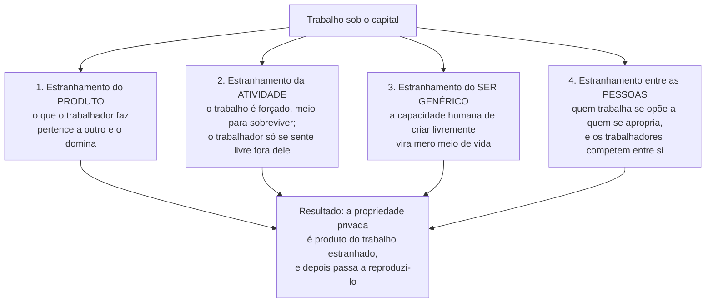

> **Aviso de Idioma:** Este currículo e todos os seus recursos de apoio foram estruturados exclusivamente em **Português (PT-BR)**.

# Aula 1 · Fábrica, miséria e trabalho estranhado

**MOD-103 · 10 horas · Leitura principal:** Marx, *Manuscritos Econômico-Filosóficos* (1844), primeiro manuscrito, seção "O trabalho estranhado"; Engels, *A Situação da Classe Trabalhadora na Inglaterra* (1845), Introdução e capítulo "As grandes cidades"

*Tecelagem mecânica numa fábrica de algodão inglesa, gravura do livro de Edward Baines (1835). Domínio público.*

## O que você vai aprender

- Descrever as transformações da <abbr title="Revolução Industrial: transformação da produção iniciada na Inglaterra no fim do século XVIII, com a máquina a vapor, o tear mecânico e a fábrica, que substituíram a oficina artesanal e o trabalho doméstico.">Revolução Industrial</abbr> e a situação da classe operária inglesa a partir de Engels.
- Explicar como Marx transforma a <abbr title="Alienação ou estranhamento (Entfremdung): em Marx, a condição em que o produto, a atividade e as relações do trabalhador se tornam estranhos a ele e o dominam. Marx transfere para o trabalho o mecanismo que Feuerbach viu na religião.">alienação</abbr> de Feuerbach numa teoria do trabalho.
- Enumerar e explicar as quatro dimensões do trabalho estranhado.
- Relacionar o trabalho estranhado com formas contemporâneas de trabalho mediado por software.

## Pergunta de abertura

> Um entregador de aplicativo trabalha 12 horas por dia. Não escolhe as rotas, não conhece os critérios que definem quanto vai ganhar por entrega, não conhece os colegas e é avaliado por clientes que nunca verá de novo. Ao fim do mês, a empresa vale bilhões e ele continua sem plano de saúde. O que exatamente foi tirado dele?

## 1. Manchester, 1842: o que Engels viu

Friedrich Engels nasceu em 1820 numa família de industriais têxteis da Renânia. Em 1842, o pai o mandou para Manchester, para trabalhar na fábrica de algodão da qual a família era sócia. Manchester era então a "oficina do mundo": a primeira cidade industrial moderna, onde centenas de fábricas movidas a vapor processavam o algodão colhido por escravizados nas Américas.

*Friedrich Engels em 1877, fotografia de William Hall. Domínio público.*

Engels passou 21 meses ali. De dia, trabalhava no escritório da fábrica; nas horas livres, guiado pela operária irlandesa Mary Burns, com quem viveria por muitos anos, percorria os bairros operários. O resultado foi *A Situação da Classe Trabalhadora na Inglaterra* (1845), um dos primeiros grandes estudos empíricos de sociologia urbana. Engels combina:

- **Observação direta:** descreve ruas, casas, latrinas, a disposição dos bairros.
- **Estatísticas oficiais:** taxas de mortalidade por bairro, idade média de morte por classe, acidentes de trabalho.
- **Documentos públicos:** relatórios de comissões parlamentares sobre o trabalho infantil e as condições sanitárias.

Uma das suas descobertas mais impressionantes é **a geografia da invisibilidade**. Manchester era construída de modo que os ricos, indo de suas casas no subúrbio para o centro comercial, passassem por avenidas ladeadas de lojas e nunca vissem os bairros miseráveis atrás delas. A miséria não estava escondida por acaso: a própria cidade a escondia.

> **Conexão com o curso:** Engels faz em 1845 o que o Ciclo 3 vai ensinar: combinar observação de campo, estatística pública e documentos oficiais para tornar visível o que a estrutura social oculta. É o primeiro modelo do "cientista social com ferramenta" que o curso quer formar.

## 2. Paris, 1844: o jovem Marx lê os economistas

Karl Marx nasceu em Trier, em 1818, numa família judia convertida ao protestantismo. Estudou direito e filosofia em Bonn e Berlim, participou do círculo dos jovens hegelianos (MOD-101, aula 6) e, como redator da *Gazeta Renana*, escreveu sobre a lei que punia camponeses pobres por recolher lenha caída nas florestas. Foi ali, contou mais tarde, que se viu pela primeira vez obrigado a tratar de "interesses materiais". O jornal foi fechado pela censura em 1843, e Marx se mudou para Paris.

Em Paris, em 1844, Marx começa a estudar os economistas ingleses (Adam Smith, David Ricardo) e escreve um conjunto de cadernos que só seriam publicados em 1932: os *Manuscritos Econômico-Filosóficos*. É também em Paris, nesse ano, que conhece Engels, e começa a parceria de quarenta anos.

## 3. O ponto de partida: um fato econômico atual

Marx começa a seção sobre o trabalho estranhado recusando partir de uma suposta "condição originária" da humanidade. Ele parte de um fato econômico do seu presente:

> "O trabalhador fica mais pobre quanto mais riqueza produz, quanto mais a sua produção cresce em poder e volume. O trabalhador se torna uma mercadoria tanto mais barata quanto mais mercadorias produz." (tradução livre)

É a mesma estrutura do Deus de Feuerbach: **quanto mais o ser humano põe em Deus, menos guarda em si mesmo**. Marx percebe que o mecanismo da alienação, que Feuerbach descobriu na religião, opera no trabalho, e opera de modo muito mais real: o produto do trabalho existe fora do trabalhador, pertence a outro e se volta contra ele.

## 4. As quatro dimensões do trabalho estranhado

### 4.1 Estranhamento em relação ao produto

O objeto que o trabalhador produz se torna um **ser estranho**, um poder independente dele. Quanto mais ele produz, mais o mundo de objetos que ele cria se ergue diante dele como poder alheio, e mais pobre fica o seu mundo interior. O tecido que o tecelão fez será vendido por outro, e o lucro dessa venda servirá para comprar a máquina que vai substituí-lo.

### 4.2 Estranhamento em relação à atividade

Se o produto é estranho, é porque a própria atividade já era estranha. O trabalho é **exterior** ao trabalhador: ele não se afirma no trabalho, se nega; não se sente bem, mas infeliz; não desenvolve livremente as suas energias, mas mortifica o corpo e arruína o espírito. Daí a observação de Marx: o trabalhador só se sente junto de si fora do trabalho, e fora de si no trabalho. O trabalho deixa de ser a satisfação de uma necessidade e passa a ser apenas um **meio** para satisfazer necessidades fora dele. A prova: assim que a coação física ou de outro tipo deixa de existir, foge-se do trabalho como da peste.

### 4.3 Estranhamento em relação ao <abbr title="Ser genérico (Gattungswesen): termo que Marx toma de Feuerbach para designar o que o ser humano é como espécie. Para Marx, a marca da espécie humana é a atividade livre e consciente de transformar o mundo.">ser genérico</abbr>

Aqui Marx reelabora Feuerbach. O que distingue o ser humano dos outros animais? O animal produz só o que precisa imediatamente, para si e para a sua cria. O ser humano produz **universalmente**: pode produzir mesmo livre da necessidade imediata, pode produzir segundo a medida de qualquer espécie, pode produzir segundo as leis da beleza. A atividade livre e consciente é o seu ser genérico.

O trabalho estranhado inverte isso: faz dessa atividade, que é a essência humana, **um simples meio para manter a existência física**.

### 4.4 Estranhamento entre os seres humanos

Se o produto do meu trabalho não me pertence, pertence a **outro ser humano**. A relação do trabalhador com o seu trabalho produz a relação com o capitalista, que se apropria dele. E os próprios trabalhadores se encontram uns diante dos outros como estranhos, concorrentes no mercado de trabalho.

### A inversão final

Marx tira uma conclusão surpreendente: a **propriedade privada** costuma ser apresentada como a causa do trabalho estranhado. Mas a análise mostra o inverso: ela é o **produto**, o resultado, do trabalho estranhado. Só mais tarde ela passa a ser também o meio de reproduzi-lo, numa relação de ação recíproca. Assim como os deuses, observa Marx, não foram originalmente a causa, mas o efeito do extravio do entendimento humano.

## 5. Os limites dos *Manuscritos*

Os *Manuscritos* são textos de juventude, inacabados, não destinados à publicação. Ainda usam conceitos de Feuerbach, como "essência humana" e "ser genérico", que o próprio Marx criticará um ano depois nas *Teses sobre Feuerbach* (aula 2). Há um debate famoso entre os intérpretes:

- Para uns (como o filósofo francês Louis Althusser), há um **corte** entre o jovem Marx humanista e o Marx maduro científico.
- Para outros (como Lukács e grande parte da tradição crítica), há **continuidade**: o tema da alienação reaparece transformado n'*O Capital* como fetichismo da mercadoria (aula 4).

Você terá elementos para tomar posição ao final do módulo.

## Leitura guiada

1. **Engels, *A Situação da Classe Trabalhadora na Inglaterra*, Introdução** (cerca de 15 páginas): a história da revolução industrial têxtil. Anote as invenções citadas e as datas.
2. **Engels, capítulo "As grandes cidades", parte sobre Manchester** (cerca de 20 páginas): procure a passagem sobre a disposição das ruas que esconde os bairros operários.
3. **Marx, *Manuscritos*, "O trabalho estranhado"** (cerca de 15 páginas): identifique o parágrafo onde começa cada uma das quatro dimensões. Copie a frase sobre o trabalhador que só se sente junto de si fora do trabalho.

Todos no [Arquivo Marxista na Internet](https://www.marxists.org/portugues/marx/index.htm).

## Exercícios

**1. Compreensão.** Explique com as suas palavras por que Marx diz que o trabalhador "se torna uma mercadoria tanto mais barata quanto mais mercadorias produz".

Gabarito comentado

O trabalhador vende a sua capacidade de trabalhar como mercadoria. Quanto mais produtivo é o trabalho (mais mercadorias por hora), menos trabalho é necessário para produzir os bens de que ele precisa para viver, e mais barata fica a sua própria manutenção. Além disso, a riqueza que ele produz se acumula como capital, que compra máquinas e aumenta a concorrência entre trabalhadores. O resultado é o paradoxo: mais riqueza produzida, trabalhador relativamente mais pobre.

**2. Aplicação.** Analise a situação da pergunta de abertura usando as quatro dimensões do trabalho estranhado.

Gabarito comentado

(1) Produto: as entregas e os dados gerados por elas pertencem à empresa, que os usa para otimizar o sistema que controla o próprio entregador. (2) Atividade: o trabalho é ditado pelo aplicativo (rotas, tempos, aceitação), e o entregador não decide como trabalhar. (3) Ser genérico: a capacidade humana de planejar e decidir é transferida para o algoritmo; ao trabalhador sobra executar. (4) Relação entre pessoas: o entregador está isolado, compete com os colegas por pedidos e se relaciona com a empresa só pela interface. Uma resposta excelente nota que os dados produzidos pelo trabalho voltam contra o trabalhador: é a versão literal da primeira dimensão.

**3. Análise.** Compare o mecanismo da alienação em Feuerbach e em Marx. O que muda?

Gabarito comentado

A estrutura é a mesma: algo humano se separa do humano e o domina. Em Feuerbach, o que se separa é a essência genérica, projetada em Deus, e o processo se passa na consciência. Em Marx, o que se separa é o produto e a atividade do trabalho, e o processo se passa nas relações materiais de produção. A consequência política muda tudo: para superar a alienação religiosa, Feuerbach propõe esclarecer a consciência; para superar o trabalho estranhado, é preciso transformar as relações de produção.

**4. Pesquisa.** Engels usou estatísticas de mortalidade por bairro. Encontre um dado público brasileiro atual que mostre diferença de expectativa de vida entre bairros ou regiões de uma mesma cidade, e escreva um parágrafo comparando com Engels.

Critérios de correção

A resposta deve citar uma fonte verificável (por exemplo, o Mapa da Desigualdade da Rede Nossa São Paulo, que compara a idade média ao morrer entre distritos da capital paulista, ou dados do DataSUS) e mostrar a diferença com números. A comparação com Engels deve apontar a continuidade do método (estatística pública para revelar desigualdade de classe no espaço urbano).

## Resumo da aula

- Engels estudou Manchester combinando observação, estatística e documentos oficiais, e descobriu uma cidade organizada para esconder a miséria.
- Marx transfere o mecanismo da alienação de Feuerbach para o trabalho: quanto mais o trabalhador produz, mais pobre fica.
- O trabalho estranhado tem quatro dimensões: em relação ao produto, à atividade, ao ser genérico e aos outros seres humanos.
- A propriedade privada aparece como resultado do trabalho estranhado, e depois como meio de reproduzi-lo.
- Há debate sobre a continuidade entre os *Manuscritos* e *O Capital*.

## Para ir além

- Friedrich Engels, *Esboço de uma Crítica da Economia Política* (1844), o texto que convenceu Marx a estudar economia.
- Karl Marx, "Debates sobre a lei do furto de lenha" (1842), na *Gazeta Renana*.