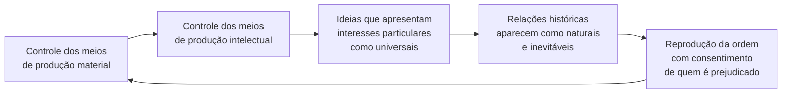
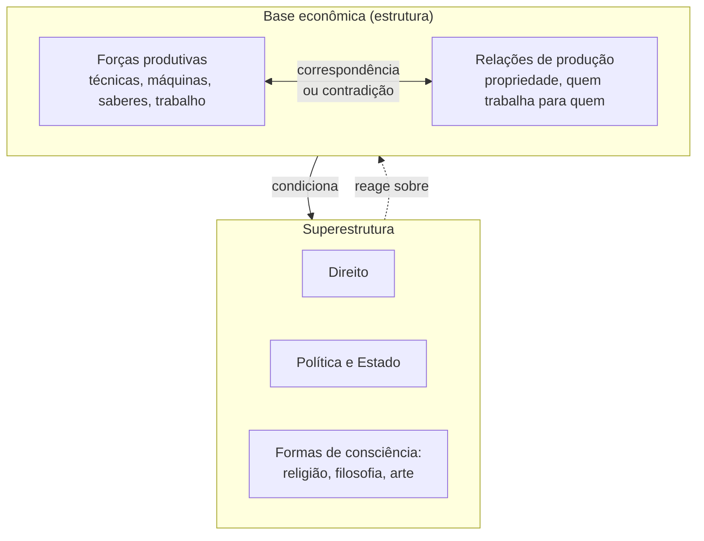

> **Aviso de Idioma:** Este currículo e todos os seus recursos de apoio foram estruturados exclusivamente em **Português (PT-BR)**.

# Aula 2 · O materialismo histórico

**MOD-103 · 10 horas · Leitura principal:** Marx, *Teses sobre Feuerbach* (1845); Marx e Engels, *A Ideologia Alemã* (1845 a 1846), parte I, "Feuerbach" (seleção); Marx, Prefácio à *Contribuição à Crítica da Economia Política* (1859)

## O que você vai aprender

- Ler as onze *Teses sobre Feuerbach* e explicar a ideia de <abbr title="Práxis: atividade humana prática e transformadora, em que pensamento e ação se unem. Nas Teses sobre Feuerbach, é o critério da verdade e o lugar onde a realidade é produzida.">práxis</abbr>.
- Explicar o ponto de partida da *Ideologia Alemã*: os indivíduos reais, a sua ação e as suas condições materiais.
- Definir <abbr title="Forças produtivas: o conjunto dos meios de produção (ferramentas, máquinas, terra, técnicas) e da força de trabalho com as suas habilidades e conhecimentos.">forças produtivas</abbr>, <abbr title="Relações de produção: as relações que as pessoas estabelecem entre si na produção, sobretudo as relações de propriedade: quem é dono dos meios de produção e quem trabalha para quem.">relações de produção</abbr> e <abbr title="Modo de produção: a combinação historicamente determinada de forças produtivas e relações de produção. Exemplos: modo de produção escravista, feudal, capitalista.">modo de produção</abbr>.
- Usar a metáfora da <abbr title="Base e superestrutura: metáfora arquitetônica de Marx. A base é a estrutura econômica (as relações de produção); a superestrutura são as formas jurídicas, políticas, religiosas e culturais que se erguem sobre ela.">base e superestrutura</abbr> sem cair no determinismo mecânico.
- Explicar o conceito de <abbr title="Ideologia: em A Ideologia Alemã, o conjunto de ideias que apresenta os interesses de uma classe como se fossem universais e as relações sociais históricas como se fossem naturais.">ideologia</abbr> e a tese das ideias dominantes.

## Pergunta de abertura

> Por que, em quase toda sociedade conhecida, a maioria das pessoas acredita que a ordem em que vive é natural, justa ou inevitável, mesmo quando essa ordem as prejudica?

## 1. As *Teses sobre Feuerbach*: onze golpes

Na primavera de 1845, em Bruxelas, Marx anotou num caderno onze teses curtas. Engels as encontrou depois da morte do amigo e as publicou em 1888, chamando-as de "o primeiro documento em que está depositado o germe genial da nova concepção de mundo". Vale ler todas: são duas páginas. As mais importantes:

| Tese | Ideia central |
| :---: | :--- |
| 1 | O defeito de todo materialismo anterior (inclusive o de Feuerbach) é tomar a realidade só como objeto de contemplação, e não como atividade humana sensível, como prática |
| 2 | Saber se o pensamento alcança a verdade não é questão teórica, é questão prática: é na prática que se prova a verdade |
| 3 | A doutrina de que as pessoas são produto das circunstâncias e da educação esquece que as circunstâncias são mudadas pelas pessoas e que o próprio educador precisa ser educado |
| 6 | A essência humana não é uma abstração inerente ao indivíduo isolado. Na sua realidade, é o conjunto das relações sociais |
| 11 | "Os filósofos apenas interpretaram o mundo de diferentes maneiras; o que importa é transformá-lo." |

A tese 11, gravada no túmulo de Marx em Londres, costuma ser lida como desprezo pela filosofia. Não é. É a afirmação de que interpretar e transformar estão ligados: só se entende de verdade o mundo social participando da sua transformação, e só se transforma bem o que se entende. Lembre de Hegel e da coruja de Minerva (MOD-101, aula 5): Marx recusa a ideia de que a filosofia só chega quando tudo acabou.

## 2. *A Ideologia Alemã*: começar pelos indivíduos reais

Entre 1845 e 1846, Marx e Engels escreveram um manuscrito enorme contra os jovens hegelianos. Não conseguiram editor; deixaram-no, como disseram depois, "à crítica roedora dos ratos". Só foi publicado em 1932. A primeira parte expõe pela primeira vez o que mais tarde se chamaria **materialismo histórico**.

O ponto de partida não é uma ideia, mas um fato verificável:

> Os pressupostos de que partimos não são arbitrários: são **os indivíduos reais, a sua ação e as suas condições materiais de vida**, tanto as que encontraram já existentes quanto as que produziram com a sua própria ação. (tradução livre)

E o primeiro fato histórico é que, para fazer história, os seres humanos precisam antes **estar vivos**: comer, beber, morar, vestir-se. O primeiro ato histórico é a produção dos meios para satisfazer essas necessidades. E esse ato não acontece uma vez só: precisa ser repetido todos os dias.

Daí a inversão contra os jovens hegelianos, que acreditavam que bastava criticar as ideias para mudar o mundo:

> "Não é a consciência que determina a vida, mas a vida que determina a consciência." (tradução livre)

## 3. Ideologia e ideias dominantes

Se a consciência nasce da vida material, por que as pessoas aceitam ideias que as prejudicam (a pergunta de abertura)? A *Ideologia Alemã* responde:

> "As ideias da classe dominante são, em cada época, as ideias dominantes; isto é, a classe que é a força **material** dominante da sociedade é, ao mesmo tempo, a sua força **espiritual** dominante." (tradução livre)

A classe que controla os meios de produção material controla também, em grande medida, os meios de produção intelectual: escolas, imprensa, editoras, igrejas. E os interesses particulares dessa classe aparecem nas ideias como interesses universais, e as relações sociais históricas aparecem como naturais. Isso é **ideologia** no sentido da obra.

Gramsci, no MOD-203, vai aprofundar esse diagnóstico com o conceito de hegemonia: a dominação de classe moderna se apoia mais no consentimento organizado do que na força.

> **Conexão com a computação:** quem controla hoje os meios de produção intelectual? As plataformas que hospedam a conversa pública, os buscadores que ordenam o conhecimento e as empresas que treinam modelos de linguagem com textos do mundo inteiro. Quando um sistema apresenta uma resposta como "neutra" ou "objetiva", vale a pergunta da *Ideologia Alemã*: de que ponto de vista social essa neutralidade foi construída?

## 4. O Prefácio de 1859: o resumo mais citado

Em 1859, Marx escreveu um prefácio de duas páginas para a *Contribuição à Crítica da Economia Política*, no qual resumiu "o fio condutor" dos seus estudos. É o texto mais citado e também o mais mal interpretado de Marx. Os conceitos centrais:

1. **Forças produtivas:** os meios com que uma sociedade produz (ferramentas, máquinas, técnicas, conhecimento) e a capacidade de trabalho das pessoas.
2. **Relações de produção:** as relações que as pessoas estabelecem na produção, independentes da sua vontade individual, sobretudo as relações de propriedade.
3. **Base e superestrutura:** o conjunto das relações de produção forma a estrutura econômica da sociedade, a "base real" sobre a qual se ergue uma superestrutura jurídica e política, e à qual correspondem formas de consciência social.
4. **Contradição e transformação:** num certo grau de desenvolvimento, as forças produtivas entram em contradição com as relações de produção existentes, que passam de formas de desenvolvimento a **entraves**. Abre-se então uma época de revolução social.
5. **Modos de produção:** Marx esboça uma sequência histórica de modos de produção (asiático, antigo, feudal, burguês moderno). A sequência descreve a história europeia e não funciona como escada obrigatória para todos os povos.

### Os três erros de leitura mais comuns

| Erro | Correção |
| :--- | :--- |
| "A economia determina tudo de modo mecânico" | O texto diz *condiciona*. Em carta de 1890 a Joseph Bloch, Engels esclareceu que a economia é determinante "em última instância", e que as formas da superestrutura reagem sobre a base e muitas vezes determinam a forma das lutas históricas |
| "A técnica faz a história sozinha" | As forças produtivas só existem dentro de relações de produção. Uma mesma máquina tem efeitos sociais opostos conforme quem é seu dono (aula 6) |
| "Toda sociedade passa pelas mesmas etapas" | Marx recusou explicitamente transformar a sua análise da Europa Ocidental numa "teoria histórico-filosófica" válida para todos os povos (carta de 1877 sobre a Rússia). Trótski, no MOD-201, vai desenvolver a ideia de desenvolvimento desigual e combinado |

## 5. Por que isso importa para um curso de tecnologia

O materialismo histórico oferece uma pergunta simples e poderosa para qualquer tecnologia: **dentro de que relações de produção ela foi desenvolvida e é usada?** Um mesmo algoritmo de roteirização pode servir a uma cooperativa de entregadores que decide junto as suas rotas ou a uma plataforma que extrai o máximo de entregas por hora de trabalhadores sem direitos. A técnica não é neutra nem determina sozinha: ela é parte de uma totalidade social.

## Leitura guiada

1. ***Teses sobre Feuerbach*** (2 páginas): leia as onze. Reescreva cada tese em uma frase sua.
2. ***A Ideologia Alemã*, parte I** (cerca de 30 páginas, na seção "A ideologia em geral, em especial a filosofia alemã" e na seção sobre a produção da consciência): marque o primeiro ato histórico e a passagem sobre as ideias dominantes.
3. **Prefácio de 1859** (2 páginas): leia duas vezes. Desenhe você mesmo o diagrama de base e superestrutura antes de olhar o da aula.
4. **Engels, carta a Joseph Bloch** (21 de setembro de 1890, 2 páginas): a correção do determinismo econômico.

Tudo no [Arquivo Marxista na Internet](https://www.marxists.org/portugues/marx/index.htm).

## Exercícios

**1.** Explique a tese 3 com um exemplo da educação brasileira.

Gabarito comentado

A tese critica quem pensa que basta mudar as circunstâncias (por exemplo, a escola) para mudar as pessoas, esquecendo que alguém precisa mudar as circunstâncias e que esse alguém também foi formado por elas. Exemplo: uma reforma do ensino médio desenhada por técnicos sem ouvir professores e estudantes trata as pessoas como produto passivo das circunstâncias. A tese aponta para a práxis: a transformação das circunstâncias e a autotransformação das pessoas acontecem juntas, na ação coletiva. Paulo Freire, na *Pedagogia do Oprimido*, desenvolve uma ideia muito próxima.

**2.** Classifique cada item como força produtiva, relação de produção ou superestrutura: (a) um servidor de computação em nuvem; (b) o contrato de um entregador "parceiro" com uma plataforma; (c) a Consolidação das Leis do Trabalho; (d) o conhecimento de programação de uma desenvolvedora; (e) a propriedade das patentes de um algoritmo.

Gabarito comentado

(a) Força produtiva (meio de produção). (b) Relação de produção (define quem trabalha para quem e em que condições), embora tenha forma jurídica. (c) Superestrutura jurídica, que regula relações de produção. (d) Força produtiva (capacidade de trabalho e conhecimento). (e) Relação de produção (propriedade) com forma jurídica. Os itens (b) e (e) mostram que a fronteira entre base e superestrutura não é rígida: relações de propriedade aparecem sempre em forma jurídica. É por isso que a metáfora precisa ser usada com cuidado.

**3.** Responda à pergunta de abertura usando os conceitos de ideologia e de ideias dominantes.

Gabarito comentado

As pessoas aceitam a ordem que as prejudica porque as ideias disponíveis para pensar essa ordem são produzidas, em grande parte, por quem se beneficia dela, já que essa classe controla os meios de produção intelectual. Essas ideias apresentam interesses particulares como universais e relações históricas como naturais. Uma resposta excelente acrescenta que a ideologia não é simples mentira: ela corresponde à experiência cotidiana (no mercado, todos parecem trocar livremente), e é por isso que convence. Essa ideia será desenvolvida na aula 4, com o fetichismo.

**4.** Escolha uma tecnologia e mostre que o seu efeito social depende das relações de produção em que está inserida.

Critérios de correção

A resposta deve descrever a mesma tecnologia em dois arranjos de relações de produção diferentes e mostrar consequências distintas para quem trabalha e para quem usa. Exemplos válidos: software livre e software proprietário com o mesmo código, um aplicativo de transporte de uma cooperativa e de uma empresa de capital aberto, um sistema de telemedicina no SUS e numa rede privada.

## Resumo da aula

- As *Teses sobre Feuerbach* definem a realidade como prática e a essência humana como conjunto das relações sociais. A tese 11 une interpretação e transformação.
- *A Ideologia Alemã* parte dos indivíduos reais e das suas condições materiais: a vida determina a consciência.
- As ideias da classe dominante são as ideias dominantes, porque quem controla a produção material controla a produção intelectual.
- No Prefácio de 1859: forças produtivas, relações de produção, base e superestrutura, contradição e revolução social.
- A base condiciona, mas não determina mecanicamente; a superestrutura reage sobre a base; não há escada única de etapas.

## Para ir além

- Friedrich Engels, *Do Socialismo Utópico ao Socialismo Científico* (1880): a exposição mais didática do materialismo histórico.
- Paulo Freire, *Pedagogia do Oprimido* (1968), para conectar a tese 3 à educação brasileira.