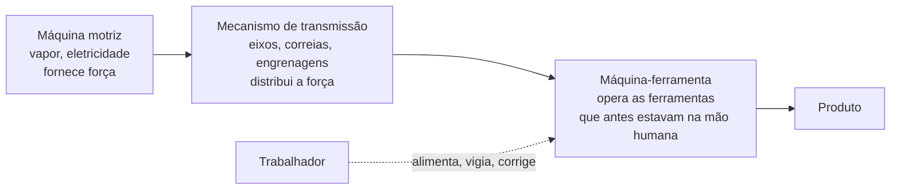
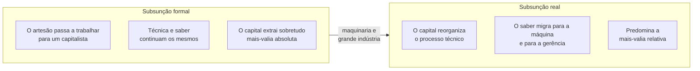
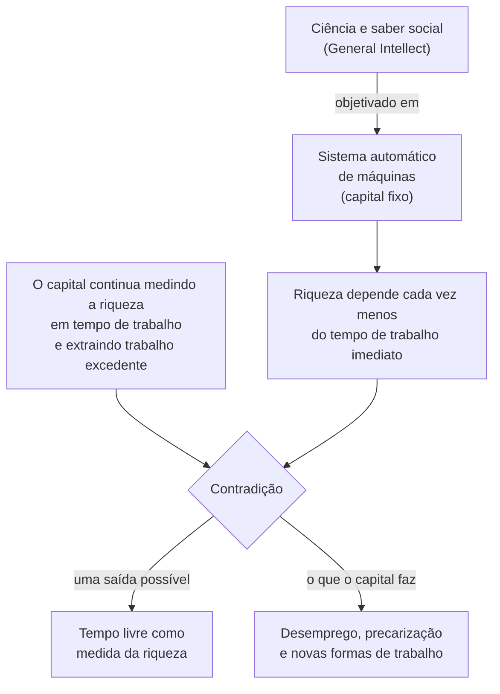

> **Aviso de Idioma:** Este currículo e todos os seus recursos de apoio foram estruturados exclusivamente em **Português (PT-BR)**.

# Aula 6 · Maquinaria, grande indústria e *General Intellect*

**MOD-103 · 10 horas · Leitura principal:** *O Capital*, Livro I, capítulo 13, "Maquinaria e grande indústria", seções 1, 3, 4, 5 e 6; *Grundrisse* (1857 a 1858), "Fragmento sobre as Máquinas"

*Parte da Máquina Analítica de Charles Babbage, Science Museum, Londres. Foto de Bruno Barral, CC BY-SA 2.5. Marx leu e citou o livro de Babbage* Sobre a Economia das Máquinas e Manufaturas *(1832) ao escrever o capítulo sobre a maquinaria.*

## O que você vai aprender

- Explicar o que distingue uma máquina de uma ferramenta, segundo Marx.
- Descrever os efeitos imediatos da maquinaria sobre o trabalhador: trabalho de mulheres e crianças, prolongamento da jornada e intensificação.
- Distinguir <abbr title="Subsunção formal do trabalho ao capital: o capital assume o comando de um processo de trabalho que continua tecnicamente igual ao de antes (o artesão passa a trabalhar para um patrão, mas com as mesmas ferramentas e o mesmo saber).">subsunção formal</abbr> e <abbr title="Subsunção real do trabalho ao capital: o capital transforma o próprio processo técnico de trabalho (maquinaria, divisão do trabalho, ciência aplicada), e o trabalhador passa a ser um apêndice do sistema de máquinas.">subsunção real</abbr> do trabalho ao capital.
- Ler o "Fragmento sobre as Máquinas" e explicar o conceito de <abbr title="General Intellect (intelecto geral): expressão inglesa usada por Marx nos Grundrisse para o conhecimento social acumulado (ciência, técnica, saber coletivo) que, objetivado nas máquinas, se torna a principal força produtiva.">*General Intellect*</abbr>.
- Usar essas categorias para analisar a automação por software e a inteligência artificial.

## Pergunta de abertura

> O filósofo e economista John Stuart Mill escreveu em 1848 que era duvidoso que todas as invenções mecânicas já feitas tivessem aliviado a labuta diária de algum ser humano. Marx começa o capítulo sobre a maquinaria com essa citação. Passados quase dois séculos, de computadores, internet e inteligência artificial, a dúvida de Mill continua de pé?

## 1. O que é uma máquina

Marx começa com uma pergunta de engenharia: o que diferencia uma máquina de uma ferramenta? Não é a força motriz (o arado puxado por bois não é máquina; a máquina de fiar movida a mão é). A diferença está na **máquina-ferramenta**: o mecanismo que pega as ferramentas que antes estavam na mão do artesão e passa a operá-las por conta própria.

A máquina a vapor, ensina Marx, não provocou a revolução industrial: foi a máquina-ferramenta (a fiandeira mecânica, o tear mecânico) que exigiu uma força motriz maior que a humana. O trabalhador deixa de manejar a ferramenta e passa a **vigiar e alimentar** a máquina que a maneja.

> **Conexão com a computação:** o software é a máquina-ferramenta do trabalho intelectual. Um programa de contabilidade pega as "ferramentas" que estavam na cabeça e na mão do contador (classificar lançamentos, somar, conferir) e as executa sozinho. O contador passa a alimentar o sistema e corrigir as suas exceções. A estrutura do diagrama acima se aplica quase sem mudança.

## 2. Os efeitos imediatos sobre o trabalhador

Na seção 3, Marx documenta, com relatórios oficiais dos inspetores de fábrica, três efeitos da maquinaria no século XIX:

| Efeito | Mecanismo | O que Marx documenta |
| :--- | :--- | :--- |
| **Incorporação de mulheres e crianças** | A máquina torna a força muscular dispensável; mão de obra mais barata passa a servir | Crianças de 8 anos em jornadas de 12 horas; mortalidade infantil altíssima nos distritos fabris |
| **Prolongamento da jornada** | A máquina se desgasta mesmo parada e pode ficar obsoleta; o capitalista quer usá-la ao máximo, dia e noite | Turnos noturnos, revezamento, jornadas sem limite antes das leis fabris |
| **Intensificação do trabalho** | Quando a lei limita a jornada, a máquina é acelerada e o trabalhador passa a cuidar de mais máquinas | Mais trabalho comprimido no mesmo tempo |

Marx retoma aqui a passagem de Aristóteles que você leu no MOD-101, aula 3: se as lançadeiras tecessem sozinhas, não seriam necessários escravos. Marx comenta com ironia que os antigos sonhavam com a máquina como fim da servidão, enquanto os economistas modernos a viam como meio de prolongar o trabalho. A máquina, que poderia encurtar a jornada, nas mãos do capital a alonga.

## 3. A fábrica: o trabalhador como apêndice

Na seção 4, Marx descreve a fábrica como um "autômato" gigantesco do qual os trabalhadores são órgãos conscientes, subordinados ao movimento central.

> "Na manufatura e no artesanato, o trabalhador se serve da ferramenta; na fábrica, ele serve à máquina." (tradução livre)

O saber, a habilidade e a decisão que antes pertenciam ao trabalhador passam para a máquina e para a direção da fábrica. O trabalho se torna monótono, e a disciplina fabril (regulamentos, multas, supervisores) assume a forma de um código privado do capitalista sobre os trabalhadores.

### Subsunção formal e real

Marx usa dois conceitos para nomear essa passagem (eles aparecem com destaque no chamado *Capítulo VI inédito*, manuscrito preparatório d'*O Capital*):

> **Conexão com o trabalho de plataforma:** um motorista que antes trabalhava numa cooperativa de táxi e agora trabalha por aplicativo passou por uma subsunção real: o saber sobre a cidade (rotas, horários de movimento, clientes) migrou para o algoritmo de despacho e precificação, e o motorista passou a executar as ordens da máquina. O MOD-305 retoma esse tema em profundidade.

## 4. Trabalhador contra máquina

Na seção 5, Marx trata das revoltas contra as máquinas. Entre 1811 e 1816, os <abbr title="Luditas: trabalhadores têxteis ingleses que, entre 1811 e 1816, destruíram máquinas em protesto contra a perda de empregos, a queda dos salários e a desqualificação do ofício. O nome vem de um líder lendário, Ned Ludd.">luditas</abbr> quebraram teares mecânicos no centro da Inglaterra. O governo respondeu com a pena de morte para a destruição de máquinas e enviou milhares de soldados.

O julgamento de Marx é preciso: foi preciso tempo e experiência para que os trabalhadores aprendessem a distinguir a maquinaria do seu **emprego capitalista**, e a dirigir os ataques não contra os meios materiais de produção, mas contra a forma social da sua exploração. A máquina não é inimiga em si; o problema é a relação social em que ela é usada.

Na seção 6, Marx critica a "teoria da compensação", segundo a qual os trabalhadores deslocados pelas máquinas seriam automaticamente reabsorvidos em outros ramos. Ele mostra que a reabsorção, quando acontece, é lenta, incerta e geralmente em condições piores, e que no meio-tempo os desempregados pressionam para baixo os salários dos que continuam empregados. É o fio que leva ao exército industrial de reserva, assunto da aula 7.

## 5. O Fragmento sobre as Máquinas

Dez anos antes d'*O Capital*, nos cadernos de rascunho que ficariam conhecidos como *Grundrisse* (publicados só em 1939 a 1941), Marx escreveu algumas páginas que se tornaram uma das passagens mais discutidas do século XX.

Ali, Marx imagina o desenvolvimento da maquinaria levado ao extremo:

1. **O sistema automático de máquinas** se torna a forma mais acabada do capital fixo. O trabalhador já não é o agente principal da produção: coloca-se "ao lado" do processo, como vigia e regulador.
2. **A ciência como força produtiva:** as máquinas são "órgãos do cérebro humano criados pela mão humana; força do saber objetivada". O conhecimento social acumulado, que Marx chama em inglês de ***General Intellect***, torna-se a força produtiva principal.
3. **A contradição:** a riqueza real passa a depender cada vez menos do tempo de trabalho imediato e cada vez mais do nível geral da ciência e da sua aplicação. Mas o capital continua medindo a riqueza pelo tempo de trabalho e se apropriando de trabalho excedente. O "roubo de tempo de trabalho alheio, sobre o qual se funda a riqueza atual", torna-se uma base miserável diante da nova base criada pela grande indústria.
4. **O horizonte:** se a riqueza não depende mais do tempo de trabalho, a medida da riqueza poderia passar a ser o **tempo livre**, o tempo disponível para o desenvolvimento das capacidades de cada um.

### O Fragmento hoje

O texto foi redescoberto nos anos 1960 pelos <abbr title="Operaísmo: corrente marxista italiana dos anos 1960 e 1970 (Mario Tronti, Raniero Panzieri, Antonio Negri) que estudou a composição técnica e política da classe operária e as transformações do trabalho na fábrica.">operaístas</abbr> italianos e é hoje central nos debates sobre "capitalismo cognitivo", trabalho imaterial e inteligência artificial. Os grandes modelos de linguagem são talvez a ilustração mais literal do conceito: foram treinados com o saber social acumulado (livros, artigos, códigos, conversas, escritos por milhões de pessoas) e esse saber, objetivado num sistema técnico, pertence a poucas empresas.

Leia com cuidado crítico: o Fragmento é um rascunho, e Marx não o retomou n'*O Capital*. Há quem leia nele uma previsão de colapso automático do capitalismo; o próprio texto mostra que a contradição pode se resolver de modos opostos, conforme as lutas sociais.

## Leitura guiada

1. ***O Capital*, capítulo 13, seção 1** (cerca de 20 páginas): a definição de máquina. Desenhe o esquema das três partes e compare com o diagrama da aula.
2. **Seção 3** (cerca de 25 páginas): efeitos imediatos. Escolha três dados dos relatórios de inspetores de fábrica e anote-os.
3. **Seção 4** (cerca de 15 páginas): a fábrica. Copie a frase sobre servir à máquina.
4. **Seções 5 e 6** (cerca de 20 páginas): luta contra a máquina e teoria da compensação.
5. ***Grundrisse*, Fragmento sobre as Máquinas** (cerca de 15 páginas, no caderno VI e início do caderno VII): leia duas vezes. Marque as expressões "órgãos do cérebro humano", *General Intellect* e "tempo disponível".

## Exercícios

**1.** Segundo Marx, o que transforma uma ferramenta em máquina? Aplique o critério a um corretor ortográfico automático.

Gabarito comentado

A máquina-ferramenta: o mecanismo que passa a operar a ferramenta que antes estava na mão humana. Um corretor ortográfico pega uma "ferramenta" do revisor (conferir palavra por palavra contra um dicionário) e a executa sozinho. O revisor deixa de manejar a ferramenta e passa a vigiar e corrigir as exceções do sistema. Pelo critério de Marx, é uma máquina do trabalho intelectual.

**2.** Explique por que, para Marx, a maquinaria tende a prolongar a jornada de trabalho, em vez de encurtá-la.

Gabarito comentado

Porque a máquina representa um grande capital que se desgasta com o tempo, mesmo parada, e pode ficar obsoleta antes de pagar o seu custo por causa de novas invenções. O capitalista tem interesse em usá-la o máximo possível, inclusive à noite. Além disso, a máquina torna o trabalho mais simples, amplia o número de pessoas disponíveis (mulheres, crianças) e quebra a resistência dos trabalhadores qualificados. Só a luta operária e a lei fabril limitaram esse movimento.

**3.** Distinga subsunção formal e real com um exemplo da área de tecnologia.

Gabarito comentado

Formal: um programador autônomo passa a ser contratado por uma empresa, mas continua escolhendo as ferramentas, o método e o ritmo do trabalho; a empresa só comanda o resultado. Real: a empresa impõe métricas de produtividade, quebra o trabalho em tarefas pequenas e padronizadas (tickets), automatiza partes do processo com ferramentas de geração de código e concentra as decisões de arquitetura numa gerência. O saber migra do trabalhador para o sistema e para a direção.

**4. Ensaio curto.** Em 300 palavras, analise um grande modelo de linguagem com o conceito de *General Intellect*. Inclua a pergunta: a quem pertence o saber social objetivado no modelo?

Critérios de correção

A resposta deve: (1) definir *General Intellect* com as palavras do Fragmento; (2) mostrar que o modelo objetiva saber social produzido por milhões de pessoas (textos, códigos, conversas); (3) discutir a apropriação privada desse saber; (4) ligar à contradição do Fragmento (riqueza produzida pelo saber social, apropriada e medida segundo o tempo de trabalho e a propriedade). A melhor resposta evita o determinismo (a tecnologia libertaria sozinha) e o catastrofismo (a tecnologia é ruim em si), e retoma o juízo de Marx sobre os luditas.

## Resumo da aula

- A máquina se define pela máquina-ferramenta, que opera as ferramentas antes manejadas pela mão humana.
- No capitalismo, a maquinaria incorporou mulheres e crianças, prolongou e intensificou a jornada.
- Na fábrica, o trabalhador serve à máquina: é a subsunção real do trabalho ao capital.
- O problema não é a máquina, mas o seu emprego capitalista. A teoria da compensação esconde o desemprego e a pressão sobre os salários.
- No Fragmento sobre as Máquinas, a ciência objetivada (*General Intellect*) se torna a força produtiva principal, em contradição com a medida da riqueza pelo tempo de trabalho. O tempo livre aparece como medida alternativa da riqueza.

## Para ir além

- Harry Braverman, *Trabalho e Capital Monopolista* (1974): a desqualificação do trabalho no século XX, aplicada também a escritórios.
- Charles Babbage, *On the Economy of Machinery and Manufactures* (1832), capítulo 19, sobre a divisão do trabalho mental, que Marx leu.