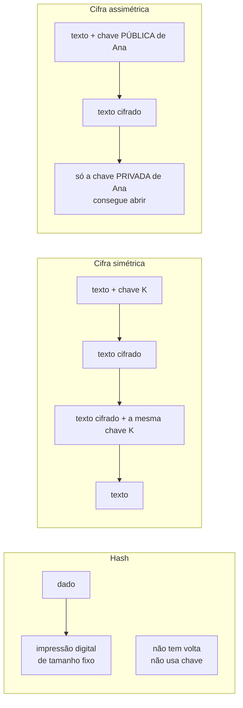
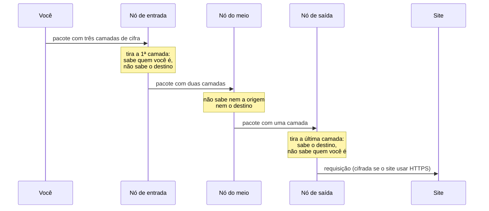
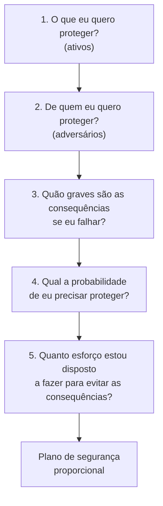

> **Aviso de Idioma:** Este currículo e todos os seus recursos de apoio foram estruturados exclusivamente em **Português (PT-BR)**.

# Aula 5 · Criptografia na prática e modelagem de ameaças

**MOD-104 · 10 horas · Apoio:** [Autodefesa Contra Vigilância (EFF)](https://ssd.eff.org/pt-br): "Seu plano de segurança" e "O que deveria saber sobre criptografia"

## O que você vai aprender

- Distinguir hash, <abbr title="Cifra simétrica: criptografia em que a mesma chave serve para cifrar e decifrar. Rápida; o problema é combinar a chave com segurança. Exemplo: AES.">cifra simétrica</abbr> e <abbr title="Cifra assimétrica (de chave pública): cada pessoa tem um par de chaves. O que é cifrado com a chave pública só se abre com a chave privada correspondente. Resolve o problema de combinar chaves. Exemplos: RSA, curvas elípticas.">cifra assimétrica</abbr>, e saber para que serve cada uma.
- Explicar por que senhas não podem virar chaves diretamente e o que faz uma <abbr title="Derivação de chave (KDF): função que transforma uma senha em chave criptográfica de forma propositalmente lenta, para dificultar ataques de adivinhação. Exemplos: PBKDF2, scrypt, Argon2.">função de derivação de chave</abbr> como o PBKDF2.
- Cifrar e decifrar dados em Python com AES-256-GCM.
- Explicar <abbr title="Criptografia de ponta a ponta: as mensagens são cifradas no aparelho de quem envia e só são decifradas no aparelho de quem recebe. Nem a empresa que transporta as mensagens consegue lê-las.">criptografia de ponta a ponta</abbr>, assinatura digital e o funcionamento do <abbr title="Tor: rede de anonimização que faz a conexão passar por três servidores voluntários, cada um conhecendo só o anterior e o próximo, para esconder quem acessa o quê.">Tor</abbr>.
- Construir um <abbr title="Modelo de ameaças: análise estruturada do que se quer proteger, de quem, com que probabilidade, com que consequências e a que custo. Orienta a escolha de medidas de segurança proporcionais.">modelo de ameaças</abbr> com as cinco perguntas da EFF.

## Pergunta de abertura

> Qual é a ferramenta de segurança mais segura que existe? Uma pergunta melhor: segura contra quem, para proteger o quê?

## 1. Três ferramentas, três funções



| Ferramenta | Serve para | Exemplo de uso | Algoritmos atuais |
| :--- | :--- | :--- | :--- |
| **Hash** | Integridade, impressão digital, guardar senhas | Verificar que um documento não foi alterado | SHA-256, SHA-3 |
| **Cifra simétrica** | Confidencialidade de grandes volumes | Cifrar um disco, um arquivo, uma conexão já combinada | AES-256-GCM, ChaCha20 |
| **Cifra assimétrica** | Combinar chaves e assinar | Aperto de mão do TLS (aula 2), chaves SSH, GPG | RSA, curvas elípticas (X25519, Ed25519) |

Na prática, os sistemas combinam as três. O TLS usa a assimétrica para combinar uma chave e depois a simétrica, que é muito mais rápida, para cifrar a conversa.

## 2. A cifra simétrica e o problema da chave

A cifra simétrica é antiquíssima: Júlio César deslocava cada letra três posições no alfabeto. A cifra moderna padrão é o **AES** (*Advanced Encryption Standard*), escolhido em 2001 num concurso público internacional. Com uma chave de 256 bits, testar todas as chaves possíveis levaria muito mais tempo do que a idade do universo, mesmo com todos os computadores do planeta.

O modo **GCM** acrescenta **autenticação**: além de esconder o conteúdo, detecta se alguém alterou um único bit do texto cifrado.

```python
import os

try:
    from cryptography.hazmat.primitives.ciphers.aead import AESGCM
except ImportError:
    print("Instale a biblioteca: pip install cryptography")
else:
    chave = AESGCM.generate_key(bit_length=256)     # 32 bytes aleatórios
    aes = AESGCM(chave)
    nonce = os.urandom(12)                          # nunca repita o nonce com a mesma chave

    cifrado = aes.encrypt(nonce, "Entrevista 07: relato sigiloso".encode(), None)
    print("Cifrado:", cifrado.hex()[:40], "...")
    print("Decifrado:", aes.decrypt(nonce, cifrado, None).decode())

    adulterado = bytearray(cifrado)
    adulterado[0] ^= 1                              # muda um único bit
    try:
        aes.decrypt(nonce, bytes(adulterado), None)
    except Exception as erro:
        print("Adulteração detectada:", type(erro).__name__)
```

O problema da cifra simétrica: **como entregar a chave** à outra pessoa sem que ninguém a intercepte? Se você já tivesse um canal seguro para mandar a chave, não precisaria cifrar nada.

## 3. Senhas não são chaves: o PBKDF2

Uma chave AES de 256 bits é um número aleatório de 32 bytes, impossível de decorar. Pessoas usam senhas. Usar a senha diretamente como chave seria fraco: senhas humanas são previsíveis, e um atacante pode testar bilhões delas por segundo.

Uma **função de derivação de chave** resolve isso de duas maneiras:

1. **Sal:** um valor aleatório misturado à senha, diferente em cada uso, para que a mesma senha gere chaves diferentes e tabelas pré-calculadas não sirvam.
2. **Lentidão proposital:** a função é repetida centenas de milhares de vezes. Para você, que digita a senha uma vez, a espera é de uma fração de segundo. Para quem tenta adivinhar bilhões de senhas, cada tentativa passa a custar caro.

```python
import hashlib
import os
import time

senha = "minha senha de pesquisa"
sal = os.urandom(16)

inicio = time.perf_counter()
chave = hashlib.pbkdf2_hmac("sha256", senha.encode(), sal, 250_000, dklen=32)
duracao = time.perf_counter() - inicio

print("Chave derivada:", chave.hex()[:32], "...")
print(f"Tempo para uma tentativa: {duracao:.3f} s")
print(f"Tempo para testar 1 bilhão de senhas: {duracao * 1e9 / 86400 / 365:,.0f} anos (num computador)")
```

### Estudo de caso: o portal deste curso

O portal do Último Curso usa exatamente essa combinação: a senha passa pelo **PBKDF2-HMAC-SHA256 com 250.000 iterações** e um sal aleatório para gerar uma chave de 256 bits, que cifra o pacote do curso com **AES-256-GCM**. O navegador faz a decifração localmente, com a API Web Crypto, sem enviar a senha a nenhum servidor. Veja o arquivo `scripts/build_and_encrypt.py` no repositório.

E a lição de modelagem de ameaças: **a criptografia é tão forte quanto o segredo da senha**. Se a senha for fraca, ou se for publicada junto com o código, o cofre continua matematicamente perfeito e não protege nada.

## 4. Criptografia de chave pública

Em 1976, Whitfield Diffie e Martin Hellman publicaram uma ideia que parecia impossível: duas pessoas podem combinar uma chave secreta conversando em público. Pouco depois veio o RSA (1977). A ideia central é o **par de chaves**:

- A **chave pública** pode ser distribuída a todos, como um cadeado aberto que qualquer um pode fechar.
- A **chave privada** fica só com o dono, como a única chave que abre aquele cadeado.

### Assinatura digital

O par funciona também ao contrário: o que é "assinado" com a chave privada pode ser verificado por qualquer um com a chave pública. Isso prova **autoria** (só o dono da chave privada poderia ter assinado) e **integridade** (qualquer alteração invalida a assinatura). É assim que o certificado de um site é assinado pela autoridade certificadora, que um commit do Git pode ser assinado e que funciona a assinatura com certificado ICP-Brasil e a assinatura eletrônica do gov.br.

### Ponta a ponta

Em aplicativos como o Signal (e, com o mesmo protocolo, o WhatsApp), cada aparelho tem as suas chaves, e as mensagens são cifradas no aparelho de quem envia e só decifradas no de quem recebe. O servidor transporta envelopes lacrados. Mas, como na aula 4: **os metadados** (quem fala com quem, quando, com que frequência) podem continuar visíveis para a empresa, e mensagens guardadas sem senha num celular desbloqueado não estão protegidas por criptografia nenhuma.

## 5. Tor: esconder quem acessa o quê

O HTTPS esconde o conteúdo, mas não o fato de que você acessou um site (aula 2). O **Tor** foi feito para isso. A conexão passa por três servidores voluntários, em camadas de criptografia como as de uma cebola (daí o símbolo):



Nenhum servidor sozinho sabe ao mesmo tempo **quem** você é e **o que** você acessa. O Tor é usado por jornalistas, defensores de direitos humanos e pessoas em países com censura. Ele é mais lento e não protege contra tudo (se você fizer login com o seu nome num site, o site sabe quem você é).

## 6. Modelagem de ameaças: as cinco perguntas

Segurança perfeita não existe. Existe segurança **proporcional** a riscos concretos. O guia da EFF propõe cinco perguntas:



### Exemplo: pesquisa com entregadores de aplicativo

| Pergunta | Resposta |
| :--- | :--- |
| **Ativos** | Gravações e transcrições de entrevistas; lista de contatos dos entrevistados; termos de consentimento |
| **Adversários** | A plataforma (pode bloquear entregadores que falam mal dela); pessoas com acesso ao computador do pesquisador; ladrões de equipamento |
| **Consequências** | Entrevistados bloqueados e sem renda; quebra da confiança na pesquisa; violação da LGPD e da ética em pesquisa |
| **Probabilidade** | Roubo de notebook e celular: alta no Brasil. Ação direta da plataforma contra o pesquisador: baixa. Identificação de entrevistado por citação mal anonimizada: média |
| **Esforço** | Moderado: o grupo de pesquisa aceita aprender ferramentas novas, mas não pode pagar por elas |

**Medidas proporcionais:** disco do notebook e do celular cifrados (recurso nativo dos sistemas operacionais); gravações transferidas para uma pasta cifrada e apagadas do celular no mesmo dia; lista de contatos separada das transcrições, ligada a elas só por códigos (E01, E02); citações revisadas para remover detalhes identificadores (bairro, turno, apelido); contato com os entrevistados por aplicativo com criptografia de ponta a ponta e mensagens temporárias; metadados removidos de todo arquivo publicado (aula 4).

Repare no que **não** está na lista: o Tor, por exemplo. Para este modelo de ameaças ele seria um esforço sem ganho proporcional. Num modelo diferente (uma investigação sobre milícias), ele poderia ser essencial.

## Exercícios

**1.** Diga se cada situação pede hash, cifra simétrica ou cifra assimétrica: (a) guardar as senhas dos usuários de um sistema; (b) cifrar um pen drive com transcrições; (c) mandar uma chave para uma colega que você nunca encontrou pessoalmente; (d) provar que um relatório publicado não foi alterado depois.

<details>
<summary>Gabarito comentado</summary>

(a) Hash, com sal e derivação lenta (PBKDF2, Argon2), nunca a senha em texto aberto. (b) Cifra simétrica (AES). (c) Cifra assimétrica, para combinar a chave ou cifrá-la com a chave pública da colega. (d) Hash publicado junto com o relatório, ou, melhor ainda, assinatura digital, que prova também a autoria.
</details>

**2.** Rode o código do PBKDF2 com 1.000 e com 1.000.000 de iterações. Explique o compromisso envolvido na escolha do número.

<details>
<summary>Gabarito comentado</summary>

Mais iterações tornam cada tentativa do atacante mais cara (bom para a segurança), mas também fazem o usuário legítimo esperar mais a cada login (ruim para a usabilidade, especialmente em celulares antigos). O número é escolhido para que o tempo de uma derivação fique em uma fração de segundo no aparelho mais lento que se quer atender. É o mesmo compromisso entre tempo e segurança que aparece em toda a engenharia.
</details>

**3.** Por que a criptografia de ponta a ponta não impede que a empresa do aplicativo saiba com quem você conversa?

<details>
<summary>Gabarito</summary>

Porque ela cifra o conteúdo, e o servidor precisa saber para quem entregar cada mensagem. Os metadados (remetente, destinatário, horário, frequência, tamanho) continuam disponíveis para a empresa, a menos que o protocolo tenha medidas específicas para escondê-los, o que poucos têm.
</details>

**4. Projeto.** Escreva o modelo de ameaças do projeto do módulo, para um tema de pesquisa da sua escolha, respondendo às cinco perguntas e propondo pelo menos seis medidas proporcionais.

<details>
<summary>Critérios de correção</summary>

O modelo deve identificar ativos concretos, adversários plausíveis com as suas capacidades reais, consequências para pessoas (não só para o pesquisador), uma estimativa honesta de probabilidade e um orçamento de esforço. As medidas devem corresponder aos riscos identificados, e o texto deve justificar também o que foi deixado de fora. Modelos que listam todas as ferramentas de segurança existentes, sem relação com os riscos, mostram que a aula não foi compreendida.
</details>

## Resumo da aula

- Hash garante integridade; cifra simétrica protege grandes volumes; cifra assimétrica resolve a troca de chaves e permite assinaturas.
- AES-256-GCM cifra e detecta adulteração. O nonce não pode se repetir com a mesma chave.
- Senhas viram chaves por meio de derivação lenta com sal (PBKDF2). A criptografia é tão forte quanto o segredo da senha.
- Ponta a ponta protege o conteúdo, não os metadados. O Tor separa quem você é do que você acessa.
- Segurança é proporcional: as cinco perguntas do modelo de ameaças orientam medidas realistas.

## Para ir além

- [Autodefesa Contra Vigilância](https://ssd.eff.org/pt-br), guias por perfil (jornalistas, ativistas, pesquisadores).
- Com esta aula você fecha o MOD-104. Volte ao [guia do módulo](../04-letramento-digital-higiene-dados.md) e construa o `meta-limpa`.