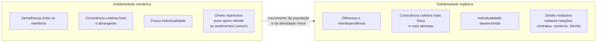
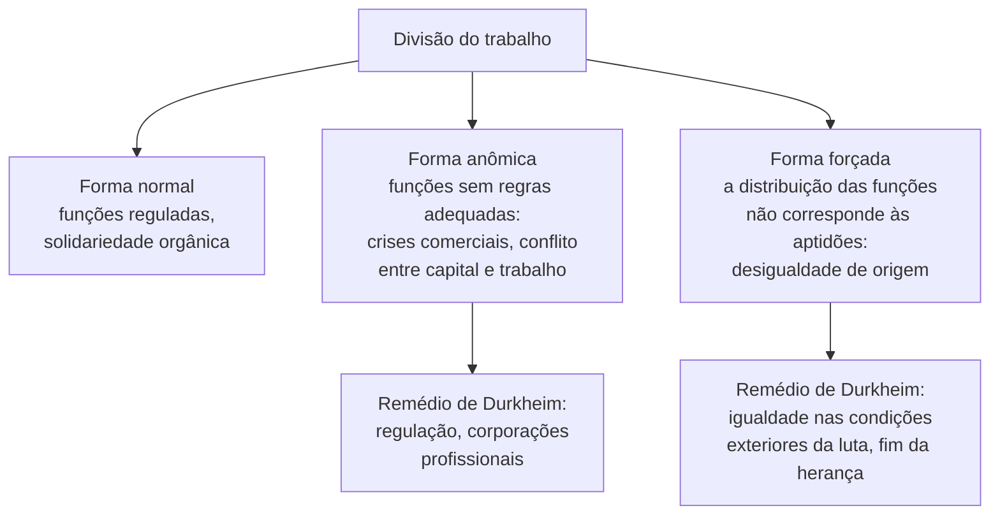

> **Aviso de Idioma:** Este currículo e todos os seus recursos de apoio foram estruturados exclusivamente em **Português (PT-BR)**.

# Aula 2 · A divisão do trabalho e as formas de solidariedade

**MOD-105 · 10 horas · Leitura principal:** Durkheim, *Da Divisão do Trabalho Social* (1893), Introdução, livro I, capítulos 2 e 3, e livro III (as formas anormais)

## O que você vai aprender

- Explicar a pergunta central do livro: como a divisão do trabalho pode produzir coesão social.
- Distinguir <abbr title="Solidariedade mecânica: coesão baseada na semelhança entre os membros do grupo, que partilham as mesmas crenças e modos de vida. Típica de sociedades pequenas e pouco diferenciadas.">solidariedade mecânica</abbr> e <abbr title="Solidariedade orgânica: coesão baseada na diferença e na interdependência entre funções especializadas, como os órgãos de um corpo. Típica das sociedades modernas com divisão do trabalho avançada.">solidariedade orgânica</abbr>.
- Definir <abbr title="Consciência coletiva: o conjunto de crenças e sentimentos comuns à média dos membros de uma sociedade, que forma um sistema com vida própria.">consciência coletiva</abbr>.
- Usar o tipo de direito (repressivo ou restitutivo) como indicador do tipo de solidariedade.
- Explicar as formas anormais da divisão do trabalho: a <abbr title="Anomia: estado de ausência ou enfraquecimento das regras que orientam as relações sociais. Em Durkheim, aparece quando a divisão do trabalho se desenvolve sem regulação adequada.">anômica</abbr> e a forçada.

## Pergunta de abertura

> Numa aldeia pequena, todos fazem quase as mesmas coisas, creem nas mesmas coisas e se conhecem. Numa metrópole, cada um faz uma coisa diferente, crê no que quer e quase ninguém se conhece. Qual das duas é mais unida?

## 1. O paradoxo

Durkheim parte de um paradoxo. A sociedade moderna torna as pessoas cada vez mais diferentes umas das outras: cada uma tem uma profissão especializada, opiniões próprias, um estilo de vida. Pela intuição comum, isso deveria desagregar a sociedade. E no entanto as sociedades modernas não se desfazem. Por quê?

A resposta de Durkheim: porque a própria **divisão do trabalho** cria um novo tipo de laço. Quanto mais especializados nós somos, mais dependemos uns dos outros. Ninguém sabe fazer tudo de que precisa: o médico depende do agricultor, que depende do mecânico, que depende do professor. A diferença, em vez de separar, une. Compare com o "sistema das carências" de Hegel (MOD-101, aula 5).

## 2. Dois tipos de solidariedade

**Solidariedade mecânica.** Nas sociedades pouco diferenciadas, os indivíduos se parecem: mesmas tarefas, mesmas crenças, mesmos rituais. A coesão vem dessa semelhança. Durkheim chama de **consciência coletiva** o conjunto de crenças e sentimentos comuns, que nesse caso cobre quase toda a consciência de cada um. "Mecânica" porque os indivíduos estão ligados como as moléculas de um corpo inorgânico, sem movimento próprio.

**Solidariedade orgânica.** Nas sociedades modernas, a coesão vem da **interdependência** de funções diferentes, como os órgãos de um corpo vivo, cada um com a sua função, todos necessários. A consciência coletiva não desaparece, mas fica mais abstrata e deixa espaço para a individualidade. O próprio indivíduo se torna objeto de uma espécie de culto: a dignidade da pessoa humana é a crença comum das sociedades modernas.

## 3. O direito como indicador

Como provar empiricamente qual tipo de solidariedade predomina? A solidariedade é um fato moral, invisível. Durkheim aplica a regra do método (aula 1): procurar um indicador exterior e objetivo. O indicador é o **direito**, porque a vida social, quando se estabiliza, se cristaliza em regras jurídicas.

| | Direito repressivo | Direito restitutivo |
| :--- | :--- | :--- |
| Sanção | Pena: sofrimento imposto ao culpado | Restauração: voltar as coisas ao estado anterior |
| O que protege | Os sentimentos comuns da consciência coletiva | As relações entre funções especializadas |
| Ramos | Direito penal | Direito civil, comercial, administrativo, processual, constitucional |
| Solidariedade que exprime | Mecânica | Orgânica |

O argumento histórico de Durkheim: quanto mais antiga e menos diferenciada uma sociedade, maior a proporção do direito penal; nas sociedades modernas, o direito restitutivo cresce muito mais. O crime, no sentido durkheimiano, é o ato que ofende estados fortes e definidos da consciência coletiva.

> **Conexão com os dados:** este é um dos primeiros exemplos de **operacionalização** de um conceito abstrato (solidariedade) em algo mensurável (a proporção de tipos de normas jurídicas). Você vai fazer isso sistematicamente no MOD-207. E pode testar a ideia hoje: o portal LexML e os sistemas do Planalto permitem contar leis por ramo do direito.

## 4. As causas da divisão do trabalho

Por que a divisão do trabalho cresce? Durkheim recusa a explicação dos economistas (as pessoas dividem o trabalho porque é mais eficiente e as faz mais felizes). A causa é social: o aumento do **volume** (número de pessoas) e da **densidade moral** (intensidade das relações entre elas) das sociedades. Quando mais gente convive e compete pelos mesmos recursos, a especialização é uma forma de sobreviver sem eliminar o outro: cada um encontra um nicho. Durkheim toma a ideia de Darwin, mas a lê como forma de reduzir a luta, e não de vencê-la.

## 5. As formas anormais

Se a divisão do trabalho produz solidariedade, por que a sociedade industrial do fim do século XIX vivia crises, greves, conflitos de classe? Durkheim responde no livro III: esses fenômenos correspondem a **formas anormais** da divisão do trabalho.

**Divisão do trabalho anômica.** Quando a economia cresce rápido demais e as funções se multiplicam sem regras que as coordenem, surge a **anomia**: ausência de regulação. Crises comerciais, falências em cadeia e o antagonismo entre trabalho e capital seriam sintomas disso. É a primeira vez que o conceito de anomia aparece na obra de Durkheim; ele vai desenvolvê-lo em *O Suicídio* (aula 3).

**Divisão do trabalho forçada.** A divisão só produz solidariedade se for **espontânea**, isto é, se cada um ocupar a função que corresponde às suas aptidões. Quando a distribuição das funções é imposta pela origem social, pela herança ou pela força, a divisão do trabalho produz ressentimento e conflito. Durkheim chega a dizer que a herança de fortunas é incompatível com uma solidariedade orgânica plena, porque distorce as condições iniciais da competição.

### Durkheim e Marx

Compare os dois diagnósticos do mesmo mundo industrial:

| | Durkheim | Marx |
| :--- | :--- | :--- |
| O conflito entre capital e trabalho é... | Patologia de uma divisão do trabalho mal regulada | Expressão da estrutura normal do capitalismo |
| Remédio | Regulação moral e profissional, igualdade de oportunidades | Transformação das relações de produção |
| A divisão do trabalho em si | Fonte de solidariedade | No capitalismo, fonte de estranhamento (MOD-103, aula 1) |

## Leitura guiada

1. **Introdução** (cerca de 15 páginas): o problema e a pergunta.
2. **Livro I, capítulo 2** (cerca de 30 páginas): solidariedade mecânica e direito repressivo. Copie a definição de consciência coletiva.
3. **Livro I, capítulo 3** (cerca de 20 páginas): solidariedade orgânica e direito restitutivo.
4. **Livro III, capítulos 1 e 2** (cerca de 30 páginas): a divisão do trabalho anômica e a forçada.

## Exercícios

**1.** Responda à pergunta de abertura com os conceitos da aula.

Gabarito comentado

As duas são unidas, mas de modos diferentes. A aldeia tem solidariedade mecânica: unida pela semelhança e por uma consciência coletiva forte que deixa pouco espaço ao indivíduo. A metrópole tem solidariedade orgânica: unida pela interdependência de funções diferentes. A resposta excelente nota que a metrópole real também tem muita divisão do trabalho forçada e anômica, e que nem toda interdependência produz sentimento de solidariedade.

**2.** Classifique como direito repressivo ou restitutivo, segundo Durkheim: (a) a pena por homicídio; (b) a obrigação de pagar uma dívida com juros; (c) a anulação de um contrato assinado sob coação; (d) a multa por desacato a autoridade.

Gabarito

(a) Repressivo. (b) Restitutivo. (c) Restitutivo (restaura a situação anterior). (d) Repressivo (pune uma ofensa a um sentimento coletivo, o respeito à autoridade).

**3.** Dê um exemplo brasileiro atual de divisão do trabalho forçada, no sentido de Durkheim.

Gabarito comentado

Exemplos válidos: a sobrerrepresentação de pessoas negras no trabalho doméstico e em ocupações manuais mal pagas, que não corresponde a aptidões e sim à herança da escravidão e ao racismo (Florestan Fernandes, MOD-206); a reprodução de profissões de elite entre filhos de famílias ricas, garantida por escolas caras e redes de contatos. A resposta deve explicar por que a distribuição não é espontânea.

**4.** Plataformas de trabalho por aplicativo reúnem milhões de pessoas que fazem tarefas complementares sem se conhecer. Isso produz solidariedade orgânica? Argumente com Durkheim e com Marx.

Critérios de correção

A resposta deve reconhecer a interdependência funcional (o que, em Durkheim, seria base da solidariedade orgânica) e apontar a ausência de regulação adequada (anomia) e a distribuição forçada de funções (desigualdade de condições). Com Marx, deve apontar o estranhamento e a relação de exploração. A melhor resposta conclui que interdependência técnica não basta para produzir solidariedade, e discute o surgimento de associações de entregadores como tentativa de criar regras e laços.

## Resumo da aula

- A divisão do trabalho, que torna as pessoas diferentes, também as une pela interdependência.
- Solidariedade mecânica: semelhança, consciência coletiva forte, direito repressivo.
- Solidariedade orgânica: diferença e interdependência, individualidade, direito restitutivo.
- O direito é o indicador objetivo do tipo de solidariedade: primeiro exemplo de operacionalização.
- Formas anormais: anômica (sem regulação) e forçada (funções impostas pela origem social). Para Durkheim, o conflito de classes é patologia; para Marx, é estrutura.

## Para ir além

- Émile Durkheim, Prefácio à segunda edição de *Da Divisão do Trabalho Social* (1902), sobre as corporações profissionais.
- Um Toque de Clássicos, capítulo sobre Durkheim, seção sobre a divisão do trabalho.