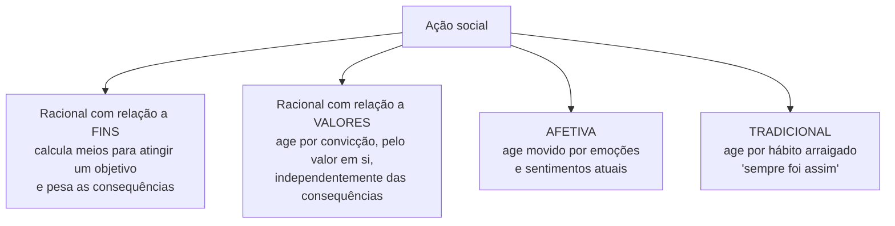
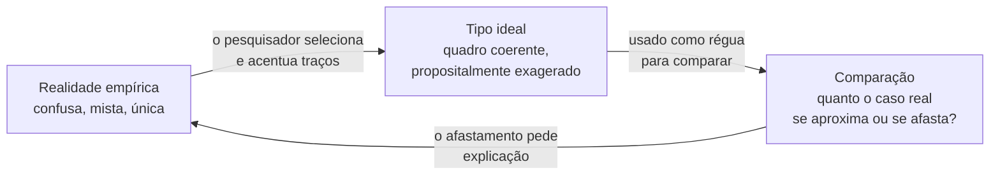

> **Aviso de Idioma:** Este currículo e todos os seus recursos de apoio foram estruturados exclusivamente em **Português (PT-BR)**.

# Aula 5 · Weber: compreender a ação social

**MOD-105 · 10 horas · Leitura principal:** Weber, *Economia e Sociedade*, capítulo I, "Conceitos sociológicos fundamentais", §§ 1 e 2; "A 'objetividade' do conhecimento nas ciências sociais" (1904), seleção

*Max Weber em 1894, aos 30 anos. Autor desconhecido, domínio público.*

## O que você vai aprender

- Situar Weber na Alemanha do Império e na disputa sobre o método das ciências sociais.
- Definir <abbr title="Ação social: em Weber, toda ação humana a que o agente atribui um sentido e que, por esse sentido, se orienta pelo comportamento de outras pessoas.">ação social</abbr> e a tarefa da <abbr title="Sociologia compreensiva: a sociologia proposta por Weber, que procura compreender o sentido que os agentes dão às suas ações para, a partir daí, explicar as suas causas e consequências.">sociologia compreensiva</abbr>.
- Distinguir os quatro tipos de ação: racional com relação a fins, racional com relação a valores, afetiva e tradicional.
- Explicar o <abbr title="Tipo ideal: construção conceitual que exagera de propósito certos traços de um fenômeno para torná-lo nítido. Não é um modelo do que deve ser nem uma média; é uma régua para medir a realidade.">tipo ideal</abbr> como ferramenta de pesquisa.
- Explicar a <abbr title="Neutralidade axiológica: princípio de Weber segundo o qual o cientista, ao analisar, deve separar os juízos de fato dos seus próprios juízos de valor, embora os valores orientem a escolha dos temas.">neutralidade axiológica</abbr> e o seu limite.

## Pergunta de abertura

> Duas pessoas fecham os olhos ao mesmo tempo. Uma por causa de um cisco; outra para piscar para alguém do outro lado da sala. Fisicamente, o gesto é idêntico. Qual é a diferença, e por que ela importa para uma ciência da sociedade?

## 1. Um sociólogo do Império alemão

Max Weber nasceu em 1864 em Erfurt e cresceu em Berlim, numa família da alta burguesia liberal: o pai era deputado, a mãe uma protestante devota. Formou-se em direito e economia, foi professor em Freiburg e Heidelberg. Em 1897, depois de uma briga violenta com o pai, que morreu semanas depois, Weber teve um colapso psíquico que o afastou da universidade por anos. Voltou a produzir a partir de 1903, e foi nessa fase que escreveu as suas obras mais influentes.

Weber participou intensamente da política da Alemanha: fez pesquisas empíricas sobre os trabalhadores rurais a leste do rio Elba, discutiu o futuro do Império, participou da comissão que redigiu a Constituição de Weimar (1919). Morreu em 1920, aos 56 anos, de pneumonia, durante a pandemia de gripe.

## 2. Explicar ou compreender

No fim do século XIX, os acadêmicos alemães discutiam se as ciências sociais deveriam seguir o modelo das ciências naturais (buscar leis gerais, **explicar**) ou um modelo próprio, histórico (captar o sentido singular, **compreender**). Weber propõe uma síntese: a sociologia deve **compreender interpretativamente** a ação social para, por esse caminho, **explicá-la causalmente** no seu curso e nos seus efeitos.

Volte à pergunta de abertura. O cisco produz um **comportamento**; a piscadela é uma **ação**, porque tem um sentido para quem a faz. E é uma **ação social**, porque esse sentido se refere a outra pessoa. As ciências naturais podem estudar o fechamento das pálpebras; só a sociologia compreensiva pode estudar a piscadela.

> **Ação social:** ação em que o sentido visado pelo agente se refere ao comportamento de outros e por ele se orienta no seu curso.

Exemplos de Weber: duas pessoas de bicicleta que batem uma na outra sem querer não praticam uma ação social (é um acontecimento natural); mas a tentativa de desviar, a briga ou a conversa amigável que se seguem são ações sociais.

### Weber e Durkheim

| | Durkheim | Weber |
| :--- | :--- | :--- |
| Ponto de partida | O fato social, exterior aos indivíduos | A ação individual dotada de sentido |
| Atitude do pesquisador | Tratar os fatos como coisas, de fora | Compreender o sentido, de dentro |
| A sociedade é... | Uma realidade própria, que se impõe | Uma rede de ações e relações entre indivíduos |
| Método típico | Estatística, comparação | Tipos ideais, comparação histórica, compreensão |

Os dois métodos não se excluem. Na prática, a boa pesquisa social usa os dois: dados que mostram regularidades (Durkheim) e interpretação do sentido que as pessoas dão às suas ações (Weber).

## 3. Os quatro tipos de ação

Weber classifica a ação social segundo o modo como o agente a orienta:

| Tipo | Exemplo | Pergunta que o agente se faz |
| :--- | :--- | :--- |
| **Racional com relação a fins** | Um engenheiro escolhe a arquitetura de software que entrega o sistema no prazo pelo menor custo | Qual o meio mais eficaz para o meu objetivo? |
| **Racional com relação a valores** | Uma desenvolvedora se recusa a trabalhar num sistema de vigilância, mesmo perdendo o emprego | O que é certo fazer, sejam quais forem as consequências? |
| **Afetiva** | Alguém responde com raiva a um comentário ofensivo numa rede social | (não há cálculo; há reação emocional) |
| **Tradicional** | Uma repartição mantém um procedimento porque "sempre foi feito assim" | (não há reflexão; há costume) |

Weber adverte: são **tipos puros**. As ações reais quase sempre misturam motivos. A classificação serve para identificar o que predomina em cada caso.

## 4. O tipo ideal

Como estudar fenômenos complexos e únicos, como "o capitalismo" ou "a burocracia", sem cair nem na descrição infinita dos detalhes nem em leis gerais vazias? A ferramenta de Weber é o **tipo ideal**.

Um tipo ideal é uma construção mental que **acentua deliberadamente** certos traços de um fenômeno, reunindo-os num quadro coerente. "Ideal" não quer dizer desejável nem perfeito; quer dizer que existe como **ideia**, e não como média da realidade.

O tipo ideal funciona como uma **régua**. Ninguém encontra na realidade a burocracia perfeita descrita por Weber (aula 7). Mas, comparando uma repartição concreta com o tipo ideal, vemos onde ela se afasta (por exemplo, nomeações por amizade em vez de concurso), e esses afastamentos pedem explicação. Sérgio Buarque de Holanda vai usar exatamente esse procedimento para analisar o Estado brasileiro no MOD-206.

> **Conexão com a computação:** um modelo de dados é parecido com um tipo ideal: uma simplificação que seleciona certos traços da realidade. A diferença é perigosa. O tipo ideal de Weber é uma ferramenta de **comparação** que sabe que é uma construção. Um sistema que trata o modelo de dados como a própria realidade (e nega um benefício porque a vida da pessoa não cabe nos campos) esqueceu a lição.

## 5. Valores e ciência

No ensaio sobre a "objetividade" (1904), Weber enfrenta um problema que todo pesquisador social enfrenta: os nossos valores interferem na ciência?

A resposta tem duas partes:

1. **Os valores escolhem o tema.** A realidade é infinita; o que decidimos estudar depende do que nos parece importante, e isso depende dos nossos valores. Não há problema nisso; é inevitável.
2. **Os valores não podem decidir o resultado.** Escolhido o tema, a análise deve separar **juízos de fato** (o que é) de **juízos de valor** (o que deve ser). A ciência pode dizer quais meios levam a quais fins e quais as consequências de cada escolha; não pode dizer qual fim é o certo. É a **neutralidade axiológica**.

A posição de Weber é muito discutida. Os teóricos críticos (Lukács, Habermas, que você lerá no Ciclo 2) apontam que a separação entre fatos e valores pode servir para esconder escolhas políticas atrás de uma aparência técnica. Mas a exigência mínima de Weber continua valendo para este curso: **não falsifique os dados para chegar à conclusão que você deseja**, e deixe claro onde termina a análise e começa a sua posição.

## Leitura guiada

1. ***Economia e Sociedade*, capítulo I, § 1** (cerca de 15 páginas): a definição de sociologia e de ação social, e os métodos da compreensão. Leia devagar: é um texto denso, escrito em parágrafos numerados como um tratado.
2. **§ 2** (cerca de 4 páginas): os quatro tipos de ação.
3. **"A objetividade do conhecimento"**, a parte sobre o tipo ideal (cerca de 15 páginas).

## Exercícios

**1.** Classifique cada ação nos quatro tipos e justifique: (a) votar num candidato porque a família sempre votou no mesmo partido; (b) comprar uma ação na Bolsa depois de analisar balanços; (c) participar de uma greve de fome por uma causa, sabendo que pode morrer; (d) xingar o juiz de futebol depois de um pênalti marcado contra o seu time.

Gabarito

(a) Tradicional. (b) Racional com relação a fins. (c) Racional com relação a valores. (d) Afetiva. Uma boa resposta nota que (a) pode ter também componentes afetivos e de valor, e que a classificação aponta o que predomina.

**2.** Explique por que um tipo ideal não é uma média estatística nem um modelo do que deveria ser.

Gabarito comentado

Não é média porque não resume os casos reais, mas acentua de propósito alguns traços, construindo um quadro que talvez nenhum caso real tenha. Não é modelo normativo porque não diz que a realidade deveria se parecer com ele; é uma ferramenta de comparação. A burocracia ideal de Weber não é uma defesa da burocracia; é uma régua para medir as burocracias reais.

**3.** Compare o modo como Durkheim e Weber estudariam o aumento do número de pessoas que trabalham por aplicativo no Brasil.

Gabarito comentado

Durkheim trataria o fenômeno como fato social: buscaria taxas (proporção de ocupados por aplicativo, por região, idade, escolaridade), compararia grupos e procuraria causas sociais (desemprego, desregulação), possivelmente pelo conceito de anomia. Weber procuraria compreender o sentido que os trabalhadores dão a essa escolha (necessidade, valor da autonomia, ideal do empreendedor) por entrevistas e análise de discursos, e construiria um tipo ideal do "trabalhador de plataforma" para comparar casos. As duas abordagens se complementam.

**4.** Escreva um parágrafo sobre um tema de pesquisa que lhe interesse, separando explicitamente: os valores que o levaram a escolher o tema; as perguntas de fato que você quer responder; e as conclusões de valor que você teria de evitar misturar com a análise.

Critérios de correção

O parágrafo deve deixar claro, em frases separadas, o motivo valorativo da escolha, as perguntas empíricas (respondíveis com dados) e a fronteira entre análise e posição política. Não se espera neutralidade de interesse, e sim honestidade na separação.

## Resumo da aula

- Weber propõe uma sociologia compreensiva: compreender o sentido da ação para explicar as suas causas e efeitos.
- Ação social é a ação dotada de sentido que se orienta pelo comportamento de outros.
- Quatro tipos de ação: racional com relação a fins, racional com relação a valores, afetiva e tradicional.
- O tipo ideal acentua traços de um fenômeno e serve de régua para comparar casos reais.
- Os valores escolhem o tema, mas não podem decidir o resultado: neutralidade axiológica, com os seus limites.

## Para ir além

- Gabriel Cohn, *Crítica e Resignação: Max Weber e a Teoria Social* (1979), estudo brasileiro clássico sobre Weber.
- Um Toque de Clássicos, capítulo sobre Weber.