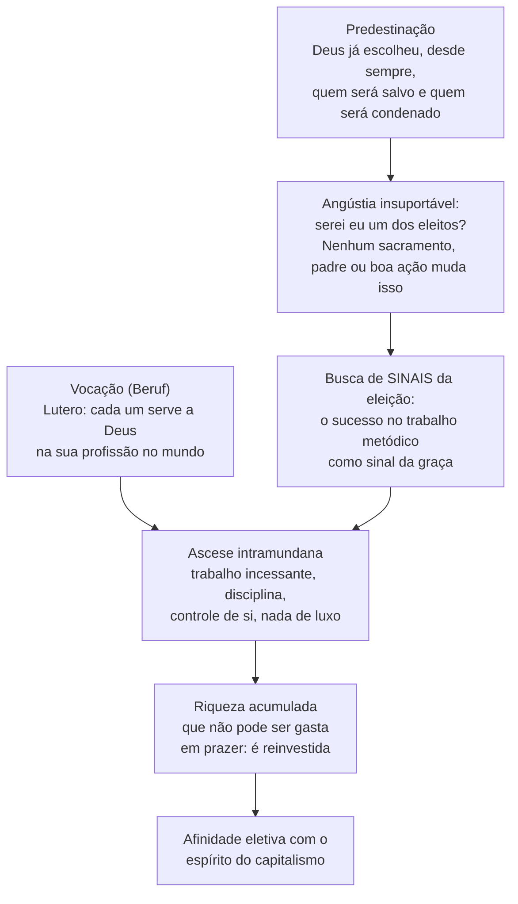

> **Aviso de Idioma:** Este currículo e todos os seus recursos de apoio foram estruturados exclusivamente em **Português (PT-BR)**.

# Aula 6 · *A Ética Protestante e o Espírito do Capitalismo*

**MOD-105 · 10 horas · Leitura principal:** Weber, *A Ética Protestante e o Espírito do Capitalismo* (1904 a 1905, edição revista de 1920), capítulo 2 da parte I ("O espírito do capitalismo") e capítulo 2 da parte II ("Ascese e capitalismo"), com atenção às páginas finais

## O que você vai aprender

- Formular a pergunta de Weber: por que o capitalismo moderno nasceu onde nasceu?
- Definir o "espírito do capitalismo" pelo tipo ideal construído com Benjamin Franklin.
- Explicar a <abbr title="Ascese intramundana: disciplina religiosa praticada no mundo, no trabalho e na vida cotidiana, e não no mosteiro. Para os puritanos, o trabalho metódico era um dever para com Deus.">ascese intramundana</abbr>, a doutrina da predestinação e a ideia de vocação.
- Explicar o conceito de <abbr title="Afinidade eletiva: expressão que Weber toma de Goethe para designar a relação entre duas formas sociais (uma ética religiosa e uma conduta econômica) que se atraem e se reforçam, sem que uma seja simplesmente causa da outra.">afinidade eletiva</abbr>.
- Interpretar o diagnóstico final: a <abbr title="Crosta de aço (stahlhartes Gehäuse): imagem de Weber para a ordem econômica moderna, que se tornou uma estrutura dura que determina a vida de todos, mesmo depois que o sentido religioso original desapareceu. Também traduzida como jaula de ferro.">crosta de aço</abbr> e o <abbr title="Desencantamento do mundo: processo histórico de eliminação da magia como meio de salvação e de dominação do mundo, substituída pelo cálculo racional e pela ciência.">desencantamento do mundo</abbr>.

## Pergunta de abertura

> Muitas culturas, em muitas épocas, conheceram comerciantes gananciosos, usurários e aventureiros que buscavam riqueza. Por que, então, só numa região e numa época surgiu uma economia inteira organizada para acumular capital sem fim, de forma metódica, mesmo por quem já era rico e não precisava de mais?

## 1. A pergunta certa

Weber parte de uma estatística alemã de 1895: nas regiões de religião mista, os protestantes tinham proporção muito maior entre os proprietários de capital, os empresários e os trabalhadores mais qualificados. A explicação fácil (os protestantes já eram ricos) não bastava. Weber queria saber se havia algo na **conduta de vida** de certas correntes protestantes que favorecesse o capitalismo.

Cuidado com o que Weber **não** diz:

- Não diz que o protestantismo **causou** o capitalismo. Diz que há uma **afinidade eletiva** entre uma ética religiosa e um espírito econômico.
- Não diz que fatores materiais não importam. No fim do livro, afirma que não pretende substituir uma interpretação "materialista unilateral" por uma interpretação "espiritualista igualmente unilateral".
- Não fala do capitalismo em geral (que existia na Babilônia, em Roma, na China), mas do **capitalismo moderno ocidental**: empresa racional, contabilidade, trabalho livre organizado, busca metódica e ilimitada do lucro.

## 2. O espírito do capitalismo

Para mostrar o que entende por "espírito do capitalismo", Weber cita longamente textos de **Benjamin Franklin**, do século XVIII: "lembre-se de que tempo é dinheiro", "lembre-se de que o crédito é dinheiro", "o bom pagador é senhor da bolsa alheia".

O que chama a atenção de Weber não é a busca de dinheiro (comum a todas as épocas), mas o tom **ético**: ganhar dinheiro, de forma honesta e metódica, aparece como um **dever**, uma virtude, quase uma obrigação moral. E o dinheiro ganho não deve ser gasto em luxo e prazer: deve ser reinvestido. Essa combinação é estranha para quase todas as culturas, para as quais trabalhar mais do que o necessário para viver bem era sinal de cobiça.

Weber dá o exemplo do trabalhador "tradicional": quando os patrões aumentavam o pagamento por peça para estimular a produção na colheita, muitos trabalhadores passavam a trabalhar **menos**, porque assim ganhavam o mesmo de antes com menos esforço. O objetivo não era ganhar o máximo, e sim viver como sempre se viveu. O espírito do capitalismo teve de vencer essa resistência.

## 3. Calvinismo, predestinação e vocação

De onde veio esse ethos? Weber o encontra nas correntes do **protestantismo ascético**, sobretudo no calvinismo e no puritanismo inglês dos séculos XVI e XVII.

**A vocação.** Lutero, ao traduzir a Bíblia, usou a palavra alemã *Beruf* (que quer dizer ao mesmo tempo profissão e chamado de Deus) para afirmar que o cumprimento dos deveres profissionais no mundo é a forma mais alta de servir a Deus. O monge não é mais santo que o sapateiro.

**A predestinação.** Calvino levou mais longe: Deus, desde a eternidade, escolheu quem será salvo. Nada que o fiel faça muda isso. O resultado psicológico, diz Weber, foi uma "solidão interior" sem precedentes e uma angústia insuportável: como saber se sou um dos eleitos?

**A resposta prática.** Os pastores puritanos ensinavam que o fiel deveria considerar-se eleito e afastar a dúvida como tentação, e que o **trabalho profissional incessante** era o melhor meio de obter a certeza da salvação. O sucesso metódico não compra a salvação, mas funciona como um sinal dela.

**A ascese intramundana.** O monge medieval praticava a disciplina no mosteiro, fora do mundo. O puritano leva a disciplina para dentro do mundo: trabalho metódico, uso racional do tempo (perder tempo é o primeiro e mais grave dos pecados), controle das emoções, condenação do luxo e do prazer. Resultado: quem trabalha muito e gasta pouco **acumula**. E a riqueza acumulada, que não pode ser desfrutada, é reinvestida.

## 4. A crosta de aço

As páginas finais do livro estão entre as mais citadas das ciências sociais. Weber observa que o puritano **quis** trabalhar numa vocação; nós **somos obrigados** a fazê-lo. Quando a ascese saiu dos mosteiros e passou a dominar a vida profissional, ajudou a construir a ordem econômica moderna, que hoje determina, "com força irresistível", a vida de todos os que nascem dentro dela.

O sentido religioso desapareceu: o espírito do capitalismo fugiu da sua "jaula", e o capitalismo vitorioso, apoiado em bases mecânicas, já não precisa dele. A preocupação com os bens exteriores, que segundo um pastor puritano deveria pesar sobre os ombros dos santos "como um manto leve que se pode tirar a qualquer momento", tornou-se uma **crosta dura como o aço** (*stahlhartes Gehäuse*, também traduzido como "jaula de ferro").

E Weber termina com uma advertência sombria sobre os "últimos homens" dessa evolução: "especialistas sem espírito, hedonistas sem coração", que imaginam ter atingido um grau de civilização nunca antes alcançado.

### O desencantamento do mundo

O processo maior em que tudo isso se insere é o **desencantamento do mundo** (*Entzauberung*): a eliminação progressiva da magia como meio de salvação e de controle do mundo. O puritanismo radicalizou esse processo ao recusar sacramentos e rituais mágicos. A ciência moderna o completa: em princípio, tudo pode ser dominado pelo cálculo. A "racionalização" é, para Weber, a marca da modernidade ocidental, e é ao mesmo tempo uma conquista e uma perda de sentido.

> **Conexão com a cultura tecnológica:** releia as frases de Franklin pensando na cultura das empresas de tecnologia e dos aplicativos de produtividade: tempo é dinheiro, otimize cada minuto, meça tudo, acorde às 5h. Weber ajuda a ver que essas máximas são uma ética, com raízes históricas, e não uma verdade natural. E a imagem da "crosta de aço" ganha um sentido literal quando a disciplina do trabalho é imposta não por um pastor ou um patrão, mas por um sistema automático de metas (MOD-305).

## 5. Weber e Marx

| | Marx | Weber |
| :--- | :--- | :--- |
| Origem do capitalismo | Acumulação primitiva violenta: expropriação, colonização, escravidão | Afinidade entre uma ética religiosa e uma conduta econômica racional |
| Papel das ideias | Expressão, em última instância, das relações materiais | Podem ter eficácia causal própria, em afinidade com interesses |
| O capitalismo hoje | Sistema de exploração com contradições que podem levar à sua superação | Crosta de aço difícil de romper; burocratização crescente |

As duas explicações não precisam se excluir: muitos historiadores combinam o papel da violência e da expropriação (Marx) com o da disciplina moral e da racionalização (Weber). Lukács (MOD-203) fará uma síntese poderosa das duas no conceito de reificação.

## Leitura guiada

1. **Parte I, capítulo 1** (cerca de 15 páginas): a estatística sobre protestantes e católicos.
2. **Parte I, capítulo 2** (cerca de 25 páginas): o espírito do capitalismo. Copie três máximas de Franklin e o exemplo do trabalhador tradicional.
3. **Parte II, capítulo 1, seção sobre o calvinismo** (cerca de 30 páginas): a predestinação e a solidão interior.
4. **Parte II, capítulo 2** (cerca de 35 páginas): ascese e capitalismo. Leia as últimas 5 páginas três vezes.

## Exercícios

**1.** O que é "afinidade eletiva" e por que Weber prefere esse termo a "causa"?

Gabarito comentado

É a relação entre duas formas sociais que se atraem e se reforçam mutuamente, como duas substâncias químicas que se combinam (a imagem vem de um romance de Goethe). Weber prefere o termo porque não quer afirmar que a ética protestante produziu sozinha o capitalismo, nem que foi apenas reflexo de interesses econômicos; quer mostrar uma convergência histórica entre uma ética religiosa e uma conduta econômica, que fortaleceu ambas.

**2.** Explique como a doutrina da predestinação, que parece levar à passividade (se tudo já está decidido, por que se esforçar?), levou ao contrário: ao trabalho metódico.

Gabarito comentado

A predestinação produziu uma angústia insuportável sobre a própria salvação. Como nenhum ato podia mudar a decisão divina, os fiéis passaram a procurar sinais dela, e os pastores ensinaram que o trabalho incessante e bem-sucedido numa vocação era um sinal da eleição e o melhor meio de afastar a dúvida. A angústia, em vez de paralisar, se converteu em disciplina.

**3.** Explique a imagem da "crosta de aço" e aplique-a a uma situação contemporânea.

Gabarito comentado

A ordem econômica criada em parte pela ascese puritana tornou-se uma estrutura que obriga todos a viver segundo a lógica do trabalho e da acumulação, mesmo sem a motivação religiosa que lhe deu origem. Aplicação possível: o trabalhador por aplicativo que precisa estar sempre disponível, aceitar corridas e manter a nota alta, não por convicção, mas porque o sistema o exige para continuar trabalhando. A imagem descreve uma racionalidade que perdeu o sentido e continua comandando.

**4.** Escreva um parágrafo comparando a explicação de Weber para a origem do capitalismo com a de Marx (MOD-103, aula 7). Elas são incompatíveis?

Critérios de correção

A resposta deve apresentar as duas explicações com precisão (acumulação primitiva e expropriação violenta; afinidade eletiva entre ética e conduta econômica) e argumentar sobre a compatibilidade. Uma boa resposta mostra que elas respondem a perguntas diferentes (como surgiram as condições materiais; como surgiu a disposição subjetiva para a acumulação metódica) e que podem ser combinadas, sem esconder a divergência sobre o peso causal das ideias.

## Resumo da aula

- Weber pergunta por que o capitalismo moderno, racional e metódico, nasceu no Ocidente moderno.
- O espírito do capitalismo é o dever ético de ganhar dinheiro de forma metódica e reinvesti-lo, ilustrado por Franklin.
- A vocação (Lutero), a predestinação (Calvino) e a ascese intramundana puritana produziram uma afinidade eletiva com esse espírito.
- A crosta de aço: a ordem econômica criada continua comandando a vida depois que o sentido religioso desapareceu.
- O desencantamento do mundo e a racionalização são a marca da modernidade para Weber.

## Para ir além

- Max Weber, *A Ética Econômica das Religiões Mundiais*, introdução (1915), em que a comparação se estende a China, Índia e judaísmo antigo.
- Michael Löwy, *A Jaula de Aço: Max Weber e o Marxismo Weberiano* (2014).