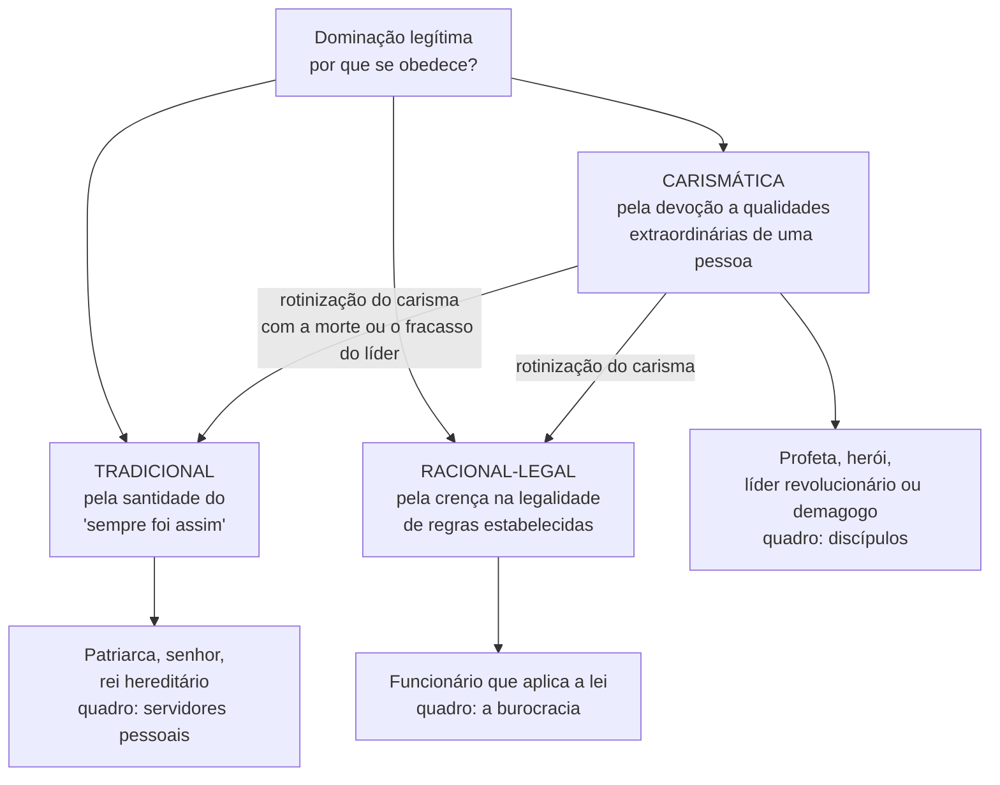

> **Aviso de Idioma:** Este currículo e todos os seus recursos de apoio foram estruturados exclusivamente em **Português (PT-BR)**.

# Aula 7 · Dominação, burocracia e as vocações da ciência e da política

**MOD-105 · 10 horas · Leitura principal:** Weber, *Economia e Sociedade*, capítulo III ("Os tipos de dominação", §§ 1 a 5, 7, 10) e capítulo sobre a burocracia (seleção); *A Ciência como Vocação* (1917, publicada em 1919); *A Política como Vocação* (1919)

## O que você vai aprender

- Distinguir poder e <abbr title="Dominação (Herrschaft): em Weber, a probabilidade de encontrar obediência a uma ordem de conteúdo determinado entre certo grupo de pessoas. É mais estável que o poder porque se apoia na crença na sua legitimidade.">dominação</abbr> e explicar o papel da legitimidade.
- Explicar os três tipos puros de dominação legítima: tradicional, <abbr title="Dominação carismática: obediência baseada na devoção a qualidades extraordinárias atribuídas a uma pessoa (heroísmo, santidade, dom de liderança). Instável, tende a se rotinizar.">carismática</abbr> e racional-legal.
- Enumerar as características da <abbr title="Burocracia: em Weber, a forma de administração da dominação racional-legal: competências fixadas por regras, hierarquia, documentos escritos, funcionários especializados e contratados por mérito, impessoalidade.">burocracia</abbr> e explicar por que ela é tecnicamente superior e politicamente perigosa.
- Definir o Estado pelo <abbr title="Monopólio da violência legítima: definição de Estado de Weber: a comunidade humana que reivindica com êxito, dentro de um território, o monopólio do uso legítimo da força física.">monopólio da violência legítima</abbr>.
- Distinguir <abbr title="Ética da convicção: agir segundo princípios, fazendo o que é certo e deixando o resultado nas mãos de Deus ou do destino.">ética da convicção</abbr> e <abbr title="Ética da responsabilidade: agir respondendo pelas consequências previsíveis dos próprios atos.">ética da responsabilidade</abbr>.
- Aplicar o tipo ideal da burocracia ao Estado digital brasileiro.

## Pergunta de abertura

> Por que milhões de pessoas cumprem, sem nenhum policial por perto, uma regra que receberam por um aplicativo do governo, como "envie a declaração até o dia 31" ou "faça a prova de vida pelo celular"? O que faz alguém obedecer a uma ordem?

## 1. Poder e dominação

Weber distingue:

- **Poder:** a probabilidade de impor a própria vontade numa relação social, mesmo contra resistência. É um conceito amplo e "amorfo": qualquer qualidade pode dar poder a alguém em alguma situação.
- **Dominação:** a probabilidade de encontrar **obediência** a uma ordem de certo conteúdo. É poder institucionalizado.

E o ponto decisivo: nenhuma dominação duradoura se apoia só na força ou no interesse material. Toda dominação procura despertar e cultivar a crença na sua **legitimidade**. Os dominados obedecem porque, em alguma medida, consideram a ordem válida. Responda à pergunta de abertura: obedecemos ao aplicativo porque acreditamos na legitimidade das leis e do procedimento que estão por trás dele.

## 2. Os três tipos puros de dominação legítima

| Tipo | Fundamento da obediência | A quem se obedece | Forma de administração |
| :--- | :--- | :--- | :--- |
| **Tradicional** | A santidade das tradições | À pessoa do senhor, designada pela tradição | Servidores pessoais, favores, patrimonialismo |
| **Carismática** | A devoção a qualidades extraordinárias | Ao líder, enquanto ele "prova" o seu carisma | Discípulos e seguidores, sem regras fixas |
| **Racional-legal** | A crença na legalidade das normas | Ao estatuto impessoal, não à pessoa | Burocracia |

Dois detalhes importantes:

- **O carisma é instável.** Depende de provas contínuas (vitórias, milagres, sucessos). Com a morte do líder, o grupo precisa resolver a sucessão, e o carisma se "rotiniza": vira tradição ou regra.
- **O patrimonialismo** é uma forma de dominação tradicional em que o senhor trata a administração e os cargos como propriedade pessoal, distribuindo-os como favores. Guarde o termo: Sérgio Buarque de Holanda e Raymundo Faoro o usarão para analisar o Estado brasileiro (MOD-206).

## 3. A burocracia

A burocracia é a forma mais pura de administração da dominação racional-legal. O **tipo ideal** de Weber tem estas características:

| Característica | Descrição | Contrário patrimonial |
| :--- | :--- | :--- |
| **Competências fixas** | Cada cargo tem atribuições definidas por regras | O senhor manda o servidor fazer o que quiser |
| **Hierarquia** | Cadeia de comando com instâncias de recurso | Fidelidade pessoal ao chefe |
| **Documentos escritos** | Tudo é registrado em processos e arquivos | Ordens orais, sem registro |
| **Especialização** | Funcionários com formação técnica comprovada | Escolha por confiança, parentesco ou amizade |
| **Dedicação integral e carreira** | O cargo é uma profissão, com salário e progressão | O cargo é uma prebenda, um benefício pessoal |
| **Regras gerais e impessoalidade** | Mesma regra para todos, "sem ódio nem paixão" | Tratamento conforme a pessoa |
| **Separação entre cargo e pessoa** | O funcionário não é dono dos meios de administração | Confusão entre patrimônio público e privado |

Para Weber, a burocracia é **tecnicamente superior** a qualquer outra forma de administração, como a máquina é superior ao trabalho manual: precisão, rapidez, clareza, conhecimento dos arquivos, continuidade, discrição, uniformidade. E, uma vez estabelecida, é uma das estruturas sociais mais difíceis de destruir.

Mas Weber também a temia. A burocratização crescente da vida (no Estado, nas empresas, nos partidos) ameaçava produzir uma nova servidão, uma "crosta de servidão" em que as pessoas seriam peças de uma engrenagem. A pergunta política decisiva, para ele, era: **quem controla a máquina burocrática?**

> **Conexão com o Estado digital:** a digitalização dos serviços públicos radicaliza várias características do tipo ideal. A **regra geral** vira código que se aplica igual a todos; o **documento escrito** vira registro automático de cada ato; a **impessoalidade** vira ausência de qualquer pessoa no atendimento. Ao mesmo tempo, surgem problemas que Weber anteviu: quem não se encaixa nas regras (a pessoa sem CPF regularizado, sem celular, com um nome que o sistema não aceita) não encontra mais o funcionário que poderia exercer algum juízo. O projeto do módulo pede que você analise exatamente isso. E repare no paralelo com a *phronesis* aristotélica (MOD-101, aula 3).

## 4. O Estado e a política como vocação

Em janeiro de 1919, numa Alemanha derrotada na guerra e em revolução, Weber fez uma conferência para estudantes em Munique: *A Política como Vocação*. Começa com a definição de Estado que se tornou clássica:

> "O Estado é aquela comunidade humana que, dentro de um determinado território, reivindica com êxito para si o monopólio da violência física legítima." (tradução livre)

O Estado não se define pelos seus fins (que variam muito), mas pelo seu **meio específico**: a força física, que ele monopoliza e só autoriza a outros quando permite (legítima defesa, por exemplo). A política é a busca de participar do poder ou de influenciar a sua distribuição.

O fim da conferência discute a ética de quem faz política:

| Ética da convicção | Ética da responsabilidade |
| :--- | :--- |
| Faço o que é certo; o resultado está nas mãos de Deus | Respondo pelas consequências previsíveis dos meus atos |
| Pureza de intenção | Eficácia e consideração dos efeitos |
| Risco: provocar o mal em nome do bem, e culpar o mundo pelo resultado | Risco: justificar qualquer meio em nome dos resultados |

Weber não diz que uma é certa e a outra errada. A política lida com um meio perigoso (a violência) e por isso exige a ética da responsabilidade; mas um político sem convicção nenhuma é só um técnico do poder. O político maduro combina as duas, e em algum momento diz: "Não posso agir de outro modo; aqui me detenho." E a política, conclui Weber, é "um esforço tenaz e lento para perfurar tábuas duras, com paixão e senso de proporção ao mesmo tempo".

## 5. A ciência como vocação

Em 1917, na mesma série de conferências, Weber falou sobre a vida acadêmica. Três ideias centrais:

1. **A ciência é especialização.** Só o trabalho rigoroso e especializado produz algo duradouro. Mas toda obra científica será superada: o progresso da ciência é o seu destino.
2. **A ciência não diz como viver.** Diante da pergunta de Tolstói ("o que devemos fazer, como devemos viver?"), a ciência não tem resposta. Ela pode esclarecer meios, consequências e coerência; a escolha entre valores cabe a cada um.
3. **O professor não deve ser profeta na sala de aula.** Usar a autoridade do professor para fazer propaganda política diante de alunos que não podem responder é abuso. Isso não proíbe o posicionamento; proíbe disfarçá-lo de ciência.

Compare com a tese 11 de Marx (MOD-103, aula 2): para Marx, interpretar e transformar estão unidos; para Weber, a ciência esclarece e a decisão pertence a outra esfera. O curso inteiro vive nessa tensão, e o MOD-205 voltará a ela com Habermas.

## Leitura guiada

1. ***Economia e Sociedade*, capítulo III, §§ 1 a 5** (cerca de 15 páginas): dominação, legitimidade e a dominação racional-legal com quadro burocrático.
2. **§§ 7 e 10** (cerca de 10 páginas): dominação tradicional (patrimonialismo) e carismática.
3. **Capítulo sobre a burocracia**, as primeiras seções (cerca de 15 páginas): as características e a superioridade técnica.
4. ***A Política como Vocação*** (cerca de 50 páginas): leia o início (definição de Estado) e as últimas 15 páginas (as duas éticas).
5. ***A Ciência como Vocação*** (cerca de 40 páginas): a especialização, Tolstói e o professor como profeta.

## Exercícios

**1.** Classifique o tipo de dominação predominante: (a) um coronel do interior que decide quem recebe emprego na prefeitura; (b) um líder religioso que atrai multidões por dons atribuídos a ele; (c) um auditor da Receita Federal que aplica a legislação tributária; (d) um rei que governa porque o pai governava.

Gabarito

(a) Tradicional, na forma patrimonial (cargos como favores pessoais). (b) Carismática. (c) Racional-legal (burocracia). (d) Tradicional. Uma boa resposta nota que, no Brasil, essas formas convivem e se misturam dentro do mesmo Estado.

**2.** Por que, para Weber, a burocracia é ao mesmo tempo tecnicamente superior e politicamente perigosa?

Gabarito comentado

É superior porque é precisa, rápida, contínua, previsível e impessoal: trata casos iguais de modo igual e acumula conhecimento nos seus arquivos. É perigosa porque concentra um enorme poder técnico, tende a escapar do controle político (o funcionário especialista sabe mais do que o político que deveria dirigi-lo) e transforma as pessoas em peças de uma engrenagem que ninguém consegue parar. A pergunta de Weber é quem controla a máquina.

**3.** Analise o aplicativo de um serviço público (INSS, gov.br, Carteira de Trabalho Digital) com o tipo ideal da burocracia. Quais características ele radicaliza? O que se perde?

Critérios de correção

A resposta deve percorrer pelo menos quatro características (regras gerais, registro escrito, impessoalidade, hierarquia, especialização) e mostrar como cada uma aparece no aplicativo. Deve identificar o que se perde: a possibilidade de recurso a uma pessoa capaz de julgar o caso particular, o acesso de quem não tem as condições técnicas exigidas. A melhor resposta liga o problema à *phronesis* de Aristóteles e à pergunta de Weber sobre quem controla a máquina.

**4.** Dê um exemplo, na área de tecnologia, de decisão em que a ética da convicção e a da responsabilidade entram em conflito, e argumente como Weber trataria o caso.

Critérios de correção

Exemplo possível: um engenheiro descobre que um sistema que ajudou a construir está sendo usado para vigilância abusiva. A ética da convicção pede a denúncia pública imediata, sejam quais forem as consequências; a da responsabilidade pede considerar os efeitos (sobre pessoas expostas, sobre a eficácia da denúncia, sobre colegas). A resposta deve mostrar que, para Weber, a maturidade está em combinar as duas e em reconhecer o momento de dizer "aqui me detenho".

## Resumo da aula

- Dominação é obediência a ordens apoiada na crença na sua legitimidade.
- Três tipos puros: tradicional, carismática e racional-legal. O carisma se rotiniza. O patrimonialismo é forma tradicional.
- A burocracia, com competências fixas, hierarquia, documentos, especialização e impessoalidade, é tecnicamente superior e politicamente perigosa.
- O Estado é o monopólio da violência física legítima num território.
- Política exige combinar ética da convicção e da responsabilidade; a ciência esclarece, mas não diz como viver.

## Para ir além

- Raymundo Faoro, *Os Donos do Poder* (1958): a aplicação do conceito de patrimonialismo à história do Estado brasileiro.
- Com esta aula você fecha o MOD-105. Volte ao [guia do módulo](../05-sociologia-classica-durkheim-weber.md) e comece o dossiê.