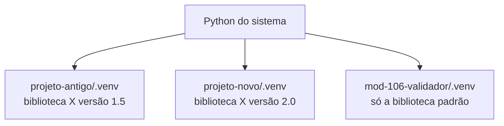
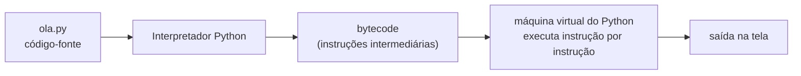

> **Aviso de Idioma:** Este currículo e todos os seus recursos de apoio foram estruturados exclusivamente em **Português (PT-BR)**.

# Aula 1 · Preparando o ambiente: Python, terminal e ambientes virtuais

**MOD-106 · 10 horas · Apoio:** Tutorial de Python, seções 1 e 2; MOD-104, aula 3 (terminal)

## O que você vai aprender

- Instalar Python 3.11 ou superior e conferir a instalação.
- Usar o <abbr title="Interpretador interativo (REPL): modo em que o Python lê uma linha, executa e mostra o resultado na hora. Read, Eval, Print, Loop: ler, avaliar, imprimir, repetir.">interpretador interativo</abbr> e executar um arquivo `.py`.
- Escolher e configurar um editor de código.
- Criar e ativar um <abbr title="Ambiente virtual (venv): pasta isolada com uma cópia do Python e os pacotes de um projeto específico, para que projetos diferentes não briguem por versões de bibliotecas.">ambiente virtual</abbr> e instalar pacotes com <abbr title="pip: o instalador de pacotes do Python. Baixa bibliotecas do repositório público PyPI.">pip</abbr>.
- Entender o que significa Python ser uma linguagem <abbr title="Linguagem interpretada: linguagem cujo código é executado por um programa (o interpretador) linha a linha, sem precisar ser transformado antes num arquivo executável separado.">interpretada</abbr> e software livre.

## Pergunta de abertura

> Você vai trabalhar ao mesmo tempo num projeto antigo, que só funciona com a versão 1.5 de uma biblioteca, e num projeto novo, que precisa da versão 2.0 da mesma biblioteca. Como as duas versões podem conviver no mesmo computador?

## 1. Um pouco de história

Python foi criado pelo programador holandês Guido van Rossum, que começou a escrevê-lo no Natal de 1989, no Centro de Matemática e Informática de Amsterdã, e lançou a primeira versão em 1991. O nome vem do grupo de humor britânico Monty Python, e não da cobra. Desde o início, o objetivo era uma linguagem **legível**: código que se lê quase como texto.

Python é **software livre**: qualquer pessoa pode usar, estudar, modificar e redistribuir. É mantido pela Python Software Foundation e por milhares de voluntários. Essa escolha de licença (que você vai estudar na aula 6 e no MOD-107) é parte da razão do seu sucesso: universidades, governos e pesquisadores podem usá-lo sem pagar licença nem depender de uma empresa.

Hoje Python é a linguagem dominante em ciência de dados, aprendizado de máquina e ciências sociais computacionais. Projetos brasileiros de interesse público, como o Querido Diário e a Base dos Dados, que você vai estudar no Ciclo 3, usam Python.

## 2. Instalação

| Sistema | Como instalar |
| :--- | :--- |
| **Linux (Ubuntu, Debian)** | Normalmente já vem instalado. Confira com `python3 --version`. Se faltar algo: `sudo apt install python3 python3-venv python3-pip` |
| **macOS** | Baixe o instalador em [python.org](https://www.python.org/downloads/) ou use o Homebrew: `brew install python` |
| **Windows** | Baixe o instalador em [python.org](https://www.python.org/downloads/). **Marque a opção "Add Python to PATH"** na primeira tela. Ou instale pela Microsoft Store |

Confira no terminal:

```bash
python3 --version     # Linux e macOS
python --version      # Windows
```

A resposta deve ser `Python 3.11` ou superior. No Windows, os comandos deste curso que começam com `python3` funcionam com `python` ou `py`.

## 3. O interpretador interativo

Digite `python3` no terminal. Aparece o símbolo `>>>`: o Python espera uma instrução, executa e mostra o resultado.

```text
>>> 2 + 3
5
>>> "Olá, " + "mundo"
'Olá, mundo'
>>> len("Florestan Fernandes")
19
>>> exit()
```

O modo interativo é ótimo para testar ideias rápidas. Para programas de verdade, escrevemos arquivos.

## 4. O primeiro programa

Crie uma pasta para o curso e, dentro dela, um arquivo chamado `ola.py`:

```python
nome = "estudante"
print(f"Olá, {nome}. Bem-vindo ao Último Curso.")

horas_totais = 1320
horas_por_semana = 10
semanas = horas_totais / horas_por_semana
print(f"No ritmo de {horas_por_semana} horas por semana, o curso leva {semanas:.0f} semanas.")
print(f"Isso dá cerca de {semanas / 52:.1f} anos.")
```

E execute no terminal, na pasta onde o arquivo está:

```bash
python3 ola.py
```

O `f` antes das aspas cria uma **f-string**: o que está entre chaves é calculado e inserido no texto. O `:.0f` e o `:.1f` dizem quantas casas decimais mostrar.

## 5. O editor de código

Você pode escrever Python em qualquer editor de texto, mas um editor de código ajuda muito: colore a sintaxe, aponta erros e completa nomes. Opções livres e gratuitas:

| Editor | Observação |
| :--- | :--- |
| **VSCodium** | Versão livre, sem telemetria, do Visual Studio Code. Instale a extensão de Python |
| **Visual Studio Code** | O mais usado; gratuito, mas com componentes proprietários e coleta de dados de uso |
| **Thonny** | Feito para iniciantes; mostra o valor das variáveis passo a passo |
| **Vim, Neovim, Emacs** | Editores de terminal, poderosos e com curva de aprendizado íngreme |

## 6. Ambientes virtuais

Volte à pergunta de abertura. Se você instalar as bibliotecas de todos os projetos no mesmo lugar, uma hora as versões vão entrar em conflito. A solução é dar a cada projeto o seu próprio **ambiente virtual**: uma pasta com uma cópia isolada do Python e das bibliotecas daquele projeto.



O passo a passo, que você vai repetir em todo projeto do curso:

```bash
mkdir mod-106-validador
cd mod-106-validador
python3 -m venv .venv                 # cria o ambiente na pasta .venv

source .venv/bin/activate             # ativa (Linux e macOS)
.venv\Scripts\activate                # ativa (Windows)

python -m pip install --upgrade pip   # atualiza o instalador
python -m pip install requests        # instala uma biblioteca
python -m pip freeze > requirements.txt   # registra as versões instaladas

deactivate                            # sai do ambiente
```

Com o ambiente ativado, o terminal mostra `(.venv)` no início da linha. O arquivo `requirements.txt` permite que outra pessoa recrie o mesmo ambiente com `python -m pip install -r requirements.txt`. Isso é **reprodutibilidade**: um princípio que o curso leva a sério, porque pesquisa que não pode ser reproduzida não pode ser verificada.

> **Segurança:** instale só pacotes conhecidos, com o nome exato. Já houve pacotes maliciosos no PyPI com nomes parecidos aos de bibliotecas populares (por exemplo, trocando uma letra). Confira o nome na documentação oficial antes de instalar.

## 7. Como o Python executa o seu código



Python é uma linguagem **interpretada**: você não precisa transformar o programa num executável antes de rodá-lo. O interpretador traduz o código para um formato intermediário (*bytecode*) e o executa. Isso torna o desenvolvimento rápido e o código portável (o mesmo arquivo roda em Linux, macOS e Windows), ao custo de alguma velocidade em comparação com linguagens compiladas como C. Para a maioria das tarefas de análise de dados, a diferença não importa, e as bibliotecas pesadas (como o Pandas, no MOD-207) são escritas em C por baixo.

## Exercícios

**1.** Instale Python, crie uma pasta `ultimato` e, dentro dela, um ambiente virtual. Ative-o e confira a versão com `python --version`. Anote os comandos que usou.

<details>
<summary>Gabarito</summary>

Linux ou macOS: `mkdir ultimato`, `cd ultimato`, `python3 -m venv .venv`, `source .venv/bin/activate`, `python --version`. Windows: o mesmo, com `.venv\Scripts\activate`. O terminal deve mostrar `(.venv)` antes do cursor.
</details>

**2.** Modifique `ola.py` para perguntar o nome da pessoa com `input()` e calcular em que ano ela terminaria o curso estudando 10 horas por semana a partir de hoje.

<details>
<summary>Gabarito</summary>

```python
import datetime

nome = input("Qual é o seu nome? ")
semanas = 1320 / 10
fim = datetime.date.today() + datetime.timedelta(weeks=semanas)
print(f"{nome}, estudando 10 horas por semana, você termina em {fim.year}.")
```
</details>

**3.** Por que é má ideia instalar todas as bibliotecas de todos os projetos no Python do sistema?

<details>
<summary>Gabarito comentado</summary>

Porque projetos diferentes podem exigir versões diferentes da mesma biblioteca, e só uma versão pode estar instalada num mesmo ambiente. Além disso, no Linux, o Python do sistema é usado por programas do próprio sistema operacional, e alterar as suas bibliotecas pode quebrá-los. Ambientes virtuais isolam cada projeto e tornam a instalação reproduzível.
</details>

**4.** Explique com as suas palavras o que é reprodutibilidade e por que um arquivo `requirements.txt` contribui para ela.

<details>
<summary>Gabarito comentado</summary>

Reprodutibilidade é a possibilidade de outra pessoa (ou você mesmo, no futuro) repetir uma análise e obter o mesmo resultado. O `requirements.txt` registra as versões exatas das bibliotecas usadas, para que o ambiente possa ser recriado igual. Sem isso, uma mudança de versão de biblioteca pode alterar resultados sem que ninguém perceba.
</details>

## Resumo da aula

- Python foi criado por Guido van Rossum (1991), é legível, interpretado e software livre.
- Instale Python 3.11 ou superior e confira com `python3 --version`.
- O interpretador interativo serve para testes; programas vão em arquivos `.py`.
- Cada projeto deve ter o seu ambiente virtual (`python3 -m venv .venv`) e o seu `requirements.txt`.
- Instale pacotes com cuidado: confira o nome exato.

## Para ir além

- [Tutorial de Python em português](https://docs.python.org/pt-br/3/tutorial/), seções 1 e 2.
- O texto "O Zen do Python": digite `import this` no interpretador.