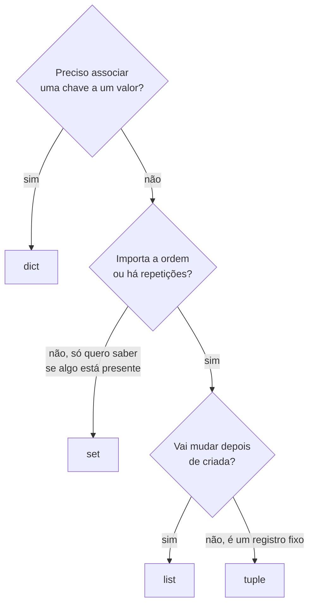
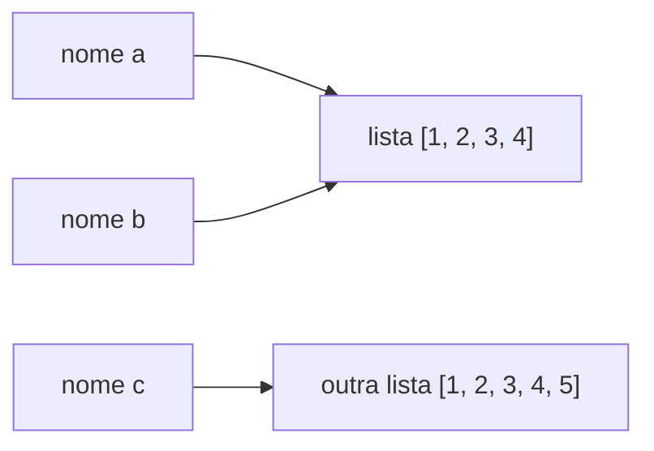

> **Aviso de Idioma:** Este currículo e todos os seus recursos de apoio foram estruturados exclusivamente em **Português (PT-BR)**.

# Aula 2 · Tipos e coleções: os blocos de construção

**MOD-106 · 10 horas · Apoio:** Tutorial de Python, seções 3 e 5

## O que você vai aprender

- Usar os <abbr title="Tipo de dado: a categoria de um valor, que define o que se pode fazer com ele. Por exemplo, números podem ser somados; textos podem ser concatenados.">tipos</abbr> básicos: `int`, `float`, `str`, `bool` e `None`.
- Manipular textos: fatiar, buscar, substituir, padronizar.
- Escolher entre lista, <abbr title="Tupla: sequência imutável de valores, escrita entre parênteses. Depois de criada, não pode ser alterada. Boa para registros fixos, como (código, nome, UF).">tupla</abbr>, <abbr title="Dicionário (dict): coleção de pares chave e valor, com busca rápida pela chave. Exemplo: {'SP': 'São Paulo'}.">dicionário</abbr> e <abbr title="Conjunto (set): coleção sem ordem e sem repetição, com teste de pertencimento muito rápido.">conjunto</abbr>.
- Escrever <abbr title="Compreensão de lista (list comprehension): forma compacta de criar uma lista a partir de outra, com transformação e filtro numa só linha: [x * 2 for x in lista if x > 0].">compreensões</abbr> para transformar e filtrar dados.
- Entender a diferença entre valores mutáveis e imutáveis.

## Pergunta de abertura

> Você recebe a lista de nomes de municípios digitada por várias pessoas: "São Paulo", "SAO PAULO", " são paulo ", "Sao Paulo". Para o computador, são quatro textos diferentes. Como transformá-los no mesmo valor?

## 1. Números e lógica

```python
habitantes = 11451999          # int: inteiro, sem limite de tamanho
area_km2 = 1521.20             # float: número com casas decimais
densidade = habitantes / area_km2
print(round(densidade, 1))     # 7528.3

print(7 // 2, 7 % 2)           # divisão inteira e resto: 3 1
print(2 ** 10)                 # potência: 1024

capital = True                 # bool: True ou False
print(densidade > 5000 and capital)   # True
```

Lembre da aula 1 do MOD-102: números com vírgula (`float`) têm precisão limitada. `0.1 + 0.2` dá `0.30000000000000004`. Para dinheiro, use centavos inteiros ou o módulo `decimal`.

O valor especial **`None`** representa "nenhum valor". Use-o para dados ausentes e teste com `is None`:

```python
renda_declarada = None
if renda_declarada is None:
    print("Renda não informada")
```

## 2. Textos

Textos (`str`) são sequências de caracteres, imutáveis. As operações mais úteis para dados públicos:

```python
nome = "  Juazeiro do Norte  "

print(nome.strip())                 # tira espaços das pontas
print(nome.strip().upper())         # JUAZEIRO DO NORTE
print(nome.strip().lower())         # juazeiro do norte
print("Norte" in nome)              # True
print(nome.strip().replace(" do ", " Do "))
print(nome.strip().split(" "))      # ['Juazeiro', 'do', 'Norte']
print(nome.strip()[0:8])            # fatia: Juazeiro
print(len(nome.strip()))            # 17
```

### Resolvendo a pergunta de abertura

Para comparar nomes digitados de jeitos diferentes, precisamos **padronizar**: tirar espaços, uniformizar maiúsculas e remover acentos. A remoção de acentos usa a normalização Unicode (MOD-102, aula 1): decompõe "ã" em "a" mais o sinal "~" e descarta o sinal.

```python
import unicodedata

def padroniza(texto):
    sem_espacos = " ".join(texto.split())               # remove espaços extras
    decomposto = unicodedata.normalize("NFKD", sem_espacos)
    sem_acentos = "".join(c for c in decomposto if not unicodedata.combining(c))
    return sem_acentos.upper()

variantes = ["São Paulo", "SAO PAULO", " são paulo ", "Sao  Paulo"]
print({padroniza(v) for v in variantes})   # {'SAO PAULO'}
```

**Atenção:** padronizar serve para **comparar**, não para **exibir**. O nome correto do município tem acento, e apagar acentos de nomes de pessoas e lugares em relatórios é uma forma de apagamento cultural que já discutimos (o ASCII sem ç). Guarde o nome original e use o padronizado só como chave de comparação.

## 3. Listas: sequências que mudam

```python
ufs = ["CE", "PE", "BA"]
ufs.append("PI")            # acrescenta no fim
ufs.extend(["MA", "RN"])    # acrescenta vários
ufs.sort()                  # ordena no lugar
print(ufs)                  # ['BA', 'CE', 'MA', 'PE', 'PI', 'RN']
print(ufs[0], ufs[-1])      # BA RN
print(ufs[1:3])             # ['CE', 'MA']
print("PE" in ufs)          # True (busca linear: O(n))
```

## 4. Tuplas: registros fixos

Uma tupla é como uma lista que não pode mudar. É ideal para **registros**, em que cada posição tem um significado fixo:

```python
municipio = ("2307304", "Juazeiro do Norte", "CE")
codigo, nome, uf = municipio          # desempacotamento
print(f"{nome} ({uf}), código IBGE {codigo}")
```

Como é imutável, a tupla pode ser chave de dicionário e elemento de conjunto (MOD-102, aula 7).

## 5. Dicionários: buscar pela chave

```python
capitais = {
    "CE": "Fortaleza",
    "PE": "Recife",
    "BA": "Salvador",
}

print(capitais["CE"])                  # Fortaleza
print(capitais.get("SP", "não cadastrada"))   # valor padrão se a chave não existir
capitais["PI"] = "Teresina"            # acrescenta
for uf, capital in capitais.items():
    print(uf, "→", capital)
```

Dicionários são a estrutura mais usada em Python para representar registros com campos nomeados, como uma linha de CSV (aula 4) ou um objeto JSON:

```python
candidato = {
    "nome": "Maria Exemplo",
    "partido": "PARTIDO A",
    "votos": 12345,
    "eleito": True,
}
print(candidato["votos"])
```

## 6. Conjuntos: pertencimento e operações

```python
inscritos = {"111", "222", "333", "444"}
aprovados = {"222", "444", "555"}

print(inscritos & aprovados)   # interseção: {'222', '444'}
print(aprovados - inscritos)   # aprovado sem inscrição: {'555'}, um erro a investigar
print(inscritos | aprovados)   # união
```

## 7. Escolhendo a coleção certa



## 8. Compreensões

Uma **compreensão** cria uma coleção nova a partir de outra, transformando e filtrando numa linha:

```python
votos = [312, 0, 450, 128, 0, 509]

sem_zeros = [v for v in votos if v > 0]
dobrados = [v * 2 for v in votos]
print(sem_zeros, dobrados)

nomes = ["são paulo", "rio de janeiro", "belo horizonte"]
titulos = {n: n.title() for n in nomes}     # compreensão de dicionário
print(titulos)
```

Use compreensões para transformações simples. Se a lógica ficar complicada, um laço `for` comum é mais legível, e legibilidade vale mais que concisão.

## 9. Mutável e imutável: uma armadilha

```python
a = [1, 2, 3]
b = a            # b não é uma cópia: é outro nome para a mesma lista
b.append(4)
print(a)         # [1, 2, 3, 4]: a também mudou

c = list(a)      # agora sim, uma cópia
c.append(5)
print(a, c)      # [1, 2, 3, 4] [1, 2, 3, 4, 5]
```



Em Python, variáveis são **nomes** que apontam para objetos. Listas, dicionários e conjuntos são **mutáveis**: alterar pelo nome `b` altera o objeto que `a` também vê. Números, textos e tuplas são **imutáveis**: toda "alteração" cria um objeto novo.

## Exercícios

**1.** Escreva uma função que receba uma lista de nomes de municípios digitados de qualquer jeito e devolva quantos municípios **diferentes** há, usando a função `padroniza`.

<details>
<summary>Gabarito</summary>

```python
def conta_distintos(nomes):
    return len({padroniza(n) for n in nomes})

print(conta_distintos(["Crato", "CRATO ", "crato", "Barbalha"]))   # 2
```
</details>

**2.** Dado o dicionário `populacao = {"CE": 8794957, "PE": 9058931, "BA": 14141626}`, escreva uma linha que encontre a UF mais populosa.

<details>
<summary>Gabarito</summary>

`max(populacao, key=populacao.get)` devolve `"BA"`. O parâmetro `key` diz para comparar as chaves pelo valor correspondente.
</details>

**3.** Por que uma lista não pode ser chave de dicionário, mas uma tupla pode? (Revise a aula 7 do MOD-102.)

<details>
<summary>Gabarito</summary>

Porque a posição de uma chave na tabela de dispersão depende do seu valor; se a chave pudesse mudar depois de guardada, ela não seria mais encontrada. Listas são mutáveis; tuplas são imutáveis.
</details>

**4.** Explique o que o código abaixo imprime e por quê:

```python
registro = {"nome": "Ana", "cursos": ["MOD-101"]}
copia = dict(registro)
copia["cursos"].append("MOD-102")
print(registro["cursos"])
```

<details>
<summary>Gabarito comentado</summary>

Imprime `['MOD-101', 'MOD-102']`. O `dict(registro)` faz uma cópia **rasa**: cria um dicionário novo, mas os valores continuam apontando para os mesmos objetos. A lista de cursos é a mesma nos dois dicionários. Para copiar tudo, use `copy.deepcopy(registro)`.
</details>

## Resumo da aula

- Tipos básicos: `int`, `float` (precisão limitada), `str` (imutável), `bool` e `None`.
- Padronizar textos (espaços, maiúsculas, acentos) serve para comparar; guarde sempre o original.
- Lista: sequência mutável. Tupla: registro imutável. Dicionário: chave e valor. Conjunto: pertencimento e operações.
- Compreensões transformam e filtram coleções numa linha.
- Variáveis são nomes; objetos mutáveis compartilhados mudam para todos os nomes.

## Para ir além

- [Tutorial de Python, seção 5: Estruturas de dados](https://docs.python.org/pt-br/3/tutorial/datastructures.html).