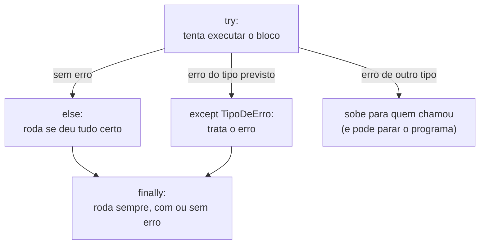
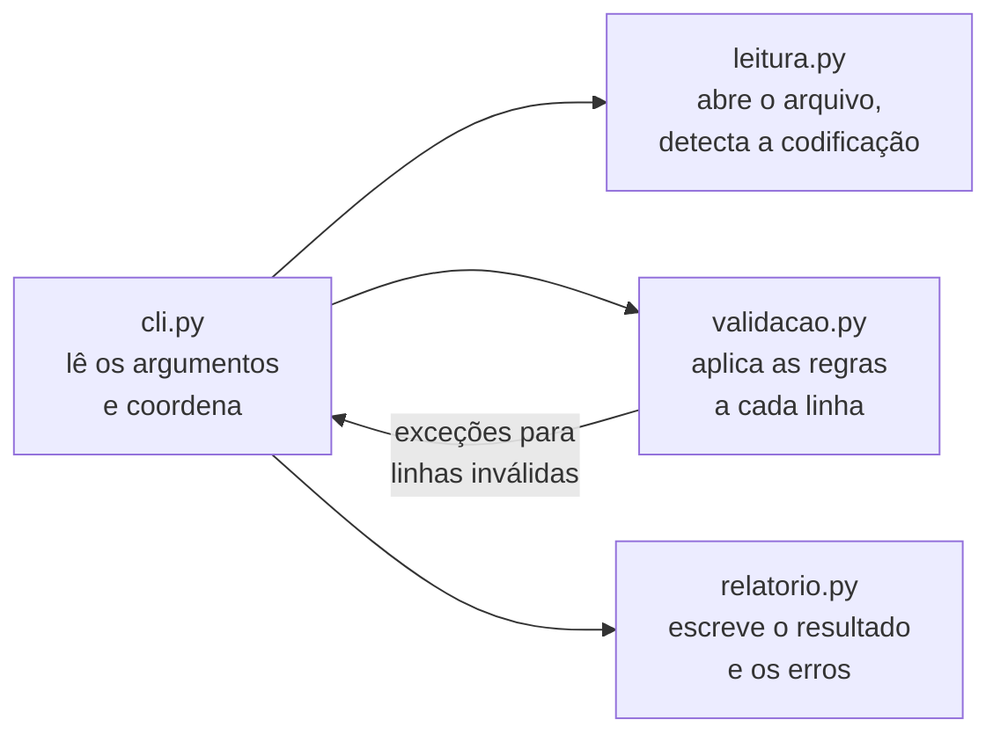

> **Aviso de Idioma:** Este currículo e todos os seus recursos de apoio foram estruturados exclusivamente em **Português (PT-BR)**.

# Aula 3 · Funções, módulos, erros e linha de comando

**MOD-106 · 10 horas · Apoio:** Tutorial de Python, seções 4.7 a 4.9, 6 e 8

## O que você vai aprender

- Escrever <abbr title="Função: bloco de código com nome, que recebe valores (parâmetros), executa uma tarefa e pode devolver um resultado. Permite reutilizar e organizar o código.">funções</abbr> com parâmetros, valores padrão e <abbr title="Docstring: texto entre três aspas logo no início de uma função ou módulo, que documenta o que ela faz. Ferramentas e editores o exibem como ajuda.">docstrings</abbr>.
- Entender o <abbr title="Escopo: a região do código em que um nome (variável) existe. Variáveis criadas dentro de uma função só existem dentro dela.">escopo</abbr> das variáveis.
- Organizar o código em <abbr title="Módulo: arquivo .py com funções e variáveis que pode ser importado por outros arquivos com import.">módulos</abbr> e importá-los.
- Tratar erros com <abbr title="Exceção: sinal de erro que interrompe o fluxo normal do programa. Pode ser capturada com try e except para que o programa reaja ao erro em vez de quebrar.">exceções</abbr> e lançar as suas próprias.
- Criar um programa de linha de comando com `argparse`.

## Pergunta de abertura

> Você escreveu um script de 300 linhas que funciona. Um mês depois, precisa usar metade dele num projeto novo e corrigir um erro que aparece só com certos arquivos. Por onde começa? O que teria tornado essa tarefa mais fácil?

## 1. Funções

Uma função dá nome a um pedaço de lógica. Isso traz três vantagens: **reutilizar** (escrever uma vez, usar muitas), **testar** (verificar cada parte separadamente) e **ler** (o nome da função diz o que ela faz).

```python
def taxa_por_mil(casos, populacao, base=1000):
    """Calcula a taxa de casos por `base` habitantes.

    Devolve None se a população for zero, para não dividir por zero.
    """
    if populacao == 0:
        return None
    return casos / populacao * base

print(taxa_por_mil(45, 30000))               # 1.5
print(taxa_por_mil(45, 30000, base=100000))  # 150.0
print(taxa_por_mil(10, 0))                   # None
help(taxa_por_mil)                           # mostra a docstring
```

Boas práticas:

- **Uma função, uma tarefa.** Se precisar de "e" para descrever o que ela faz ("lê o arquivo **e** calcula **e** imprime"), divida.
- **Nomes que dizem o que faz**, em português, com verbos: `le_csv`, `calcula_taxa`, `valida_linha`.
- **Devolva valores em vez de imprimir.** Uma função que devolve pode ser usada de muitos jeitos; uma que imprime só serve para imprimir.

## 2. Escopo

```python
total = 0

def soma_lista(numeros):
    total = 0              # este total é local: só existe dentro da função
    for n in numeros:
        total += n
    return total

print(soma_lista([1, 2, 3]))   # 6
print(total)                   # 0: o total de fora não foi alterado
```

Variáveis criadas dentro de uma função são **locais**. Isso é uma proteção: uma função não altera sem querer o resto do programa. Evite modificar variáveis globais de dentro de funções; passe valores como parâmetros e devolva resultados.

## 3. Módulos

Quando o programa cresce, divida-o em arquivos. Cada arquivo `.py` é um **módulo** que pode ser importado:

```text
mod-106-validador/
├── leitura.py        # funções para abrir arquivos
├── validacao.py      # regras de validação
├── relatorio.py      # geração de relatórios
└── cli.py            # o programa principal
```

```text
# em cli.py
from leitura import le_csv
from validacao import valida_linha
import relatorio

linhas = le_csv("dados.csv")
```

A biblioteca padrão do Python já traz centenas de módulos prontos (`csv`, `json`, `pathlib`, `datetime`, `statistics`, `unicodedata`), e essa é uma das grandes forças da linguagem. Antes de escrever algo do zero, procure na [documentação da biblioteca padrão](https://docs.python.org/pt-br/3/library/index.html).

### O truque do `__name__`

```python
def principal():
    print("Executando como programa")

if __name__ == "__main__":
    principal()
```

Esse bloco só roda quando o arquivo é executado diretamente (`python3 cli.py`), e não quando é importado por outro módulo. Assim o mesmo arquivo pode ser programa e biblioteca.

## 4. Erros e exceções

Programas que lidam com dados reais encontram erros o tempo todo: arquivo inexistente, linha mal formatada, número escrito como texto. Em Python, um erro gera uma **exceção**. Se ninguém a captura, o programa para e mostra um *traceback* (o caminho do erro).

```python
try:
    valor = int("12a")
except ValueError as erro:
    print("Não é um número:", erro)
```



Um exemplo realista: converter números escritos no formato brasileiro, que usa vírgula decimal e ponto de milhar.

```python
def para_numero(texto):
    """Converte '1.234,56' em 1234.56. Lança ValueError se não for número."""
    limpo = texto.strip().replace(".", "").replace(",", ".")
    return float(limpo)

for entrada in ["1.234,56", "12", "  7,5 ", "não informado", ""]:
    try:
        print(repr(entrada), "→", para_numero(entrada))
    except ValueError:
        print(repr(entrada), "→ inválido, linha registrada para revisão")
```

Regras de ouro:

- **Capture exceções específicas** (`ValueError`, `FileNotFoundError`), nunca um `except:` vazio, que esconde todos os erros, inclusive os que você não previu.
- **Não esconda erros.** Tratar um erro é decidir o que fazer com ele (registrar a linha rejeitada, avisar o usuário), e não fingir que não aconteceu.
- **Lance as suas próprias exceções** quando a entrada viola uma regra:

```python
def valida_uf(uf):
    ufs_validas = {"AC", "AL", "AP", "AM", "BA", "CE", "DF", "ES", "GO", "MA", "MT",
                   "MS", "MG", "PA", "PB", "PR", "PE", "PI", "RJ", "RN", "RS", "RO",
                   "RR", "SC", "SP", "SE", "TO"}
    if uf not in ufs_validas:
        raise ValueError(f"UF inválida: {uf!r}")
    return uf
```

## 5. Programas de linha de comando com `argparse`

O módulo `argparse` transforma o seu script numa ferramenta de terminal de verdade, com opções e ajuda automática:

```python
import argparse

def cria_parser():
    parser = argparse.ArgumentParser(
        description="Valida um arquivo CSV de dados públicos."
    )
    parser.add_argument("arquivo", help="caminho do CSV de entrada")
    parser.add_argument("--separador", default=";", help="separador de colunas (padrão: ;)")
    parser.add_argument("--codificacao", default="auto", help="utf-8, latin-1 ou auto")
    parser.add_argument("-v", "--verboso", action="store_true", help="mostra detalhes")
    return parser

args = cria_parser().parse_args(["eleicao.csv", "--separador", ",", "-v"])
print(args.arquivo, args.separador, args.codificacao, args.verboso)
```

(No programa real, chame `parse_args()` sem argumentos, e o Python lerá o que foi digitado no terminal.) Rodando `python3 cli.py --help`, o usuário vê a descrição de todas as opções, de graça.

## 6. Juntando: a estrutura de um programa bem organizado



Responda à pergunta de abertura: com o código dividido em funções pequenas e módulos com responsabilidades claras, reaproveitar metade do programa é importar dois módulos, e achar um erro é testar cada função isoladamente. É o começo da engenharia de software que o MOD-202 vai aprofundar.

## Exercícios

**1.** Escreva uma função `variacao_percentual(antigo, novo)` com docstring, que devolva a variação percentual e lance `ValueError` se `antigo` for zero.

<details>
<summary>Gabarito</summary>

```python
def variacao_percentual(antigo, novo):
    """Devolve a variação percentual de antigo para novo."""
    if antigo == 0:
        raise ValueError("valor antigo igual a zero: variação indefinida")
    return (novo - antigo) / antigo * 100

print(variacao_percentual(200, 250))   # 25.0
```
</details>

**2.** Modifique `para_numero` para aceitar também o sinal negativo e o símbolo `R$` (por exemplo, `"R$ -1.234,56"`).

<details>
<summary>Gabarito</summary>

```python
def para_numero_monetario(texto):
    limpo = texto.strip().replace("R$", "").strip()
    limpo = limpo.replace(".", "").replace(",", ".")
    return float(limpo)

print(para_numero_monetario("R$ -1.234,56"))   # -1234.56
```
</details>

**3.** O que há de errado neste código? Reescreva-o corretamente.

```python
def le_numero(texto):
    try:
        return int(texto)
    except:
        return 0
```

<details>
<summary>Gabarito comentado</summary>

Dois problemas. O `except:` vazio captura qualquer erro, inclusive os que não têm nada a ver com conversão (até a interrupção do programa pelo teclado). E devolver `0` esconde o erro: um valor inválido vira zero e contamina os cálculos sem que ninguém perceba. Melhor: capturar só `ValueError` e devolver `None`, ou deixar o erro subir para quem chamou decidir.

```python
def le_numero(texto):
    try:
        return int(texto)
    except ValueError:
        return None
```
</details>

**4.** Crie o esqueleto do projeto do módulo: quatro arquivos (`leitura.py`, `validacao.py`, `relatorio.py`, `cli.py`) com pelo menos uma função documentada em cada um e o `cli.py` usando `argparse` e o bloco `if __name__ == "__main__"`.

<details>
<summary>Critérios de correção</summary>

Cada arquivo deve ter uma responsabilidade clara; o `cli.py` deve só coordenar (ler argumentos e chamar as funções dos outros módulos); as funções devem ter docstrings e nomes em português; `python3 cli.py --help` deve mostrar a ajuda. Faça o primeiro commit deste esqueleto depois da aula 5.
</details>

## Resumo da aula

- Funções dão nome a tarefas, permitem reutilizar e testar. Uma função, uma tarefa; devolva valores.
- Variáveis de dentro da função são locais.
- Módulos dividem o programa em arquivos; a biblioteca padrão já traz muitos prontos.
- Exceções sinalizam erros; capture as específicas e nunca esconda erros.
- `argparse` transforma scripts em ferramentas de linha de comando com ajuda automática.

## Para ir além

- [Tutorial de Python, seção 8: Erros e exceções](https://docs.python.org/pt-br/3/tutorial/errors.html).
- [Documentação do argparse](https://docs.python.org/pt-br/3/library/argparse.html).