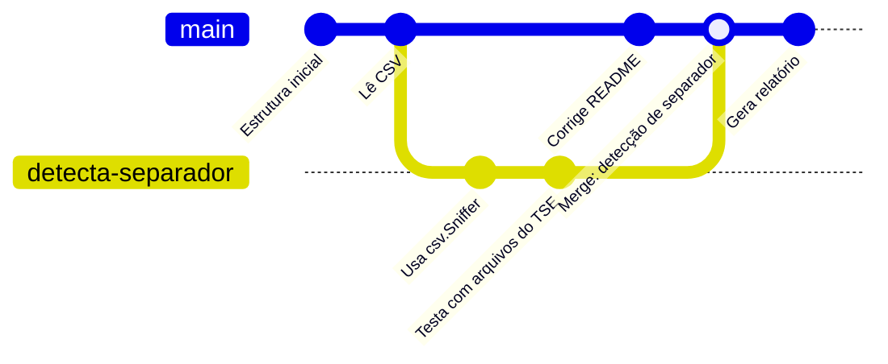
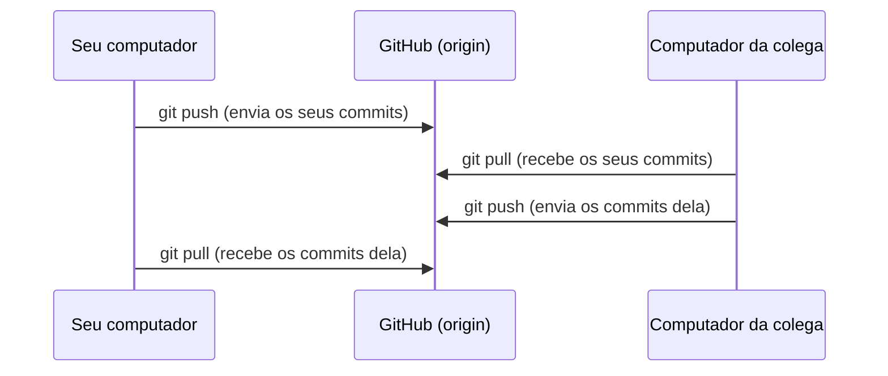
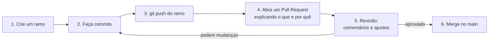

> **Aviso de Idioma:** Este currículo e todos os seus recursos de apoio foram estruturados exclusivamente em **Português (PT-BR)**.

# Aula 6 · GitHub, ramos e colaboração

**MOD-106 · 10 horas · Apoio:** [Pro Git em português](https://git-scm.com/book/pt-br/v2), capítulos 3 e 5; [documentação do GitHub em português](https://docs.github.com/pt)

## O que você vai aprender

- Criar e usar <abbr title="Ramo (branch): linha de desenvolvimento independente dentro do mesmo repositório. Permite trabalhar numa mudança sem afetar a versão principal até que ela esteja pronta.">ramos</abbr> para desenvolver mudanças isoladas.
- Fazer <abbr title="Merge (mesclagem): operação que junta as mudanças de um ramo em outro.">merge</abbr> e resolver <abbr title="Conflito de merge: situação em que dois ramos mudaram as mesmas linhas de um arquivo de jeitos diferentes, e o Git precisa que uma pessoa decida qual versão fica.">conflitos</abbr>.
- Conectar um repositório local a um <abbr title="Repositório remoto: cópia do repositório hospedada em outro lugar (GitHub, GitLab, Codeberg, um servidor próprio), usada para guardar e compartilhar o trabalho.">repositório remoto</abbr> e usar `push` e `pull`.
- Propor mudanças com <abbr title="Pull Request: pedido para que as mudanças de um ramo sejam incorporadas ao projeto, com espaço para revisão, comentários e discussão antes do merge.">Pull Requests</abbr> e revisar o código de outras pessoas.
- Entender o que é uma <abbr title="Licença de software livre: documento jurídico que garante a qualquer pessoa as liberdades de usar, estudar, modificar e redistribuir o programa. Exemplos: GPL, MIT, Apache.">licença de software livre</abbr> e escolher uma para o seu projeto.

## Pergunta de abertura

> Duas pessoas editam o mesmo documento ao mesmo tempo: uma corrige a introdução, a outra reescreve a conclusão. Como juntar o trabalho das duas sem que uma apague o que a outra fez? E se as duas mexerem no mesmo parágrafo?

## 1. Ramos: trabalhar sem medo

Um **ramo** é uma linha de desenvolvimento paralela. O ramo principal, `main`, deve conter sempre uma versão que funciona. Para desenvolver algo novo, crie um ramo, trabalhe nele e, quando estiver pronto, junte ao `main`.

```bash
git switch -c detecta-separador     # cria e entra no ramo novo
# edite, git add, git commit (quantas vezes precisar)
git switch main                     # volta ao ramo principal
git merge detecta-separador         # junta as mudanças
git branch -d detecta-separador     # apaga o ramo, já incorporado
```



Um ramo no Git é só um **nome que aponta para um commit**: criar ramos é instantâneo e barato. Use um ramo para cada mudança, por menor que seja.

## 2. Conflitos

Volte à pergunta de abertura. Se as duas pessoas mexeram em partes diferentes, o Git junta tudo sozinho. Se mexeram **nas mesmas linhas**, o Git não tem como adivinhar qual versão é a certa, e marca um conflito no arquivo:

```text
<<<<<<< HEAD
UFS_VALIDAS = {"CE", "PE", "BA"}
=======
UFS_VALIDAS = {"CE", "PE", "BA", "PI", "MA"}
>>>>>>> amplia-ufs
```

Entre `<<<<<<<` e `=======` está a versão do ramo atual; entre `=======` e `>>>>>>>`, a do outro ramo. Para resolver:

1. Edite o arquivo, deixando a versão correta (que pode combinar as duas) e apagando as marcas.
2. `git add` no arquivo resolvido.
3. `git commit` para concluir o merge.

Conflitos não são erros: são o Git pedindo uma decisão humana onde ela é necessária.

## 3. Repositórios remotos

Até aqui, tudo estava no seu computador. Para guardar uma cópia em outro lugar e colaborar, conecte o repositório a um **remoto**. O mais usado é o **GitHub**, mas há alternativas: **Codeberg** (mantido por uma associação sem fins lucrativos europeia, com software livre), **GitLab** e servidores próprios de universidades.

> **Uma observação política.** O GitHub pertence à Microsoft desde 2018. Ele é útil e é onde está a maior parte dos projetos abertos, inclusive os projetos de referência deste curso. Mas o próprio Git foi feito para que nenhum servidor fosse indispensável: como cada cópia tem o histórico completo, você pode mudar de plataforma quando quiser. Mantenha essa liberdade.

```bash
git remote add origin https://github.com/seu-usuario/mod-106-validador.git
git push -u origin main         # envia o ramo main e passa a acompanhá-lo
git pull                        # traz as novidades do remoto e junta
git clone https://github.com/outra-pessoa/projeto.git   # copia um repositório inteiro
```



Para enviar ao GitHub, você precisa se autenticar. A forma recomendada é usar uma **chave SSH** (o par de chaves pública e privada que você estudou no MOD-104, aula 5) ou o aplicativo oficial de linha de comando `gh`. Nunca use a senha da conta diretamente.

## 4. Colaborar com Pull Requests

Num projeto coletivo, ninguém deveria mandar mudanças direto para o `main`. O fluxo de trabalho padrão:



Para contribuir com um projeto do qual você não é membro, primeiro faça um <abbr title="Fork: cópia de um repositório de outra pessoa para a sua conta, onde você pode fazer mudanças livremente e depois propô-las ao projeto original por Pull Request.">*fork*</abbr> (uma cópia na sua conta), trabalhe nele e abra o Pull Request para o repositório original.

### Revisar código é uma prática social

A revisão é onde o conhecimento circula numa equipe. Boas práticas:

- **Revise o código, não a pessoa.** "Esta função não trata o arquivo vazio" em vez de "você esqueceu o arquivo vazio".
- **Pergunte antes de afirmar.** "O que acontece se a UF vier em minúsculas?"
- **Explique o porquê** de cada sugestão.
- **Elogie o que está bom.** A revisão também ensina pelo exemplo positivo.

Essa é uma forma concreta do que Kropotkin (MOD-107) chama de apoio mútuo e do que Habermas (MOD-205) chama de agir comunicativo: uma conversa orientada ao entendimento, e não à vitória.

## 5. Software livre e licenças

Publicar o código não basta para que outros possam usá-lo. Sem licença, o código está protegido por direito autoral, e ninguém pode legalmente copiá-lo ou modificá-lo. A **licença** diz o que os outros podem fazer.

Em 1983, o programador Richard Stallman lançou o projeto GNU e definiu o **software livre** pelas **quatro liberdades**:

| Liberdade | O que garante |
| :---: | :--- |
| 0 | Executar o programa para qualquer propósito |
| 1 | Estudar como o programa funciona e adaptá-lo (exige acesso ao código-fonte) |
| 2 | Redistribuir cópias |
| 3 | Distribuir versões modificadas, para que toda a comunidade se beneficie |

As licenças mais comuns:

| Licença | Tipo | Exigência principal |
| :--- | :--- | :--- |
| **GPL** (versões 2 e 3) | *Copyleft* | Quem distribuir versões modificadas precisa mantê-las livres, sob a mesma licença |
| **MIT** | Permissiva | Só manter o aviso de direito autoral; o código pode ser usado até em software fechado |
| **Apache 2.0** | Permissiva | Como a MIT, com cláusulas sobre patentes |
| **CC BY-SA** | *Copyleft* para textos | Usada pelos textos deste curso: atribuição e compartilhamento pela mesma licença |

O <abbr title="Copyleft: uso do direito autoral para garantir que uma obra e todas as suas versões modificadas continuem livres. Um jogo de palavras com copyright.">*copyleft*</abbr> usa o próprio direito autoral para impedir que o comum seja cercado, uma ideia que você vai reencontrar no MOD-107, quando Kropotkin falar dos bens comuns, e no MOD-103, com os cercamentos da acumulação primitiva. O código deste curso usa a licença MIT; os textos, CC BY-SA 4.0.

## Exercícios

**1.** Crie um repositório no GitHub (ou no Codeberg) para o projeto do módulo, envie o esqueleto da aula 3 e confira que os arquivos aparecem na página do repositório.

<details>
<summary>Critérios de correção</summary>

O repositório remoto deve conter o histórico local (confira na página que os commits aparecem com as mesmas mensagens), um `README.md` e um `.gitignore` que exclua `.venv/`. O endereço do repositório deve ser registrado no seu arquivo de progresso.
</details>

**2.** Simule um conflito: crie dois ramos a partir do `main`, altere a mesma linha de um arquivo de modos diferentes em cada um, faça o merge dos dois no `main` e resolva o conflito. Descreva os passos.

<details>
<summary>Gabarito comentado</summary>

`git switch -c ramo-a`, editar a linha, commit; `git switch main`; `git switch -c ramo-b`, editar a mesma linha de outro jeito, commit; `git switch main`; `git merge ramo-a` (sem conflito); `git merge ramo-b` (conflito). Abrir o arquivo, escolher ou combinar as versões, apagar as marcas, `git add`, `git commit`. O objetivo é perder o medo dos conflitos.
</details>

**3.** Faça a revisão escrita de um trecho de código de um colega (ou de uma função sua de uma aula anterior), com pelo menos três comentários seguindo as boas práticas da seção 4.

<details>
<summary>Critérios de correção</summary>

Os comentários devem ser sobre o código e não sobre a pessoa, explicar o motivo, incluir ao menos uma pergunta e um elogio sincero, e apontar pelo menos um problema concreto (um caso de borda não tratado, um nome pouco claro, uma função que faz coisas demais).
</details>

**4.** Escolha uma licença para o projeto do módulo e justifique a escolha em um parágrafo, considerando quem você quer que possa usar o código e em que condições.

<details>
<summary>Critérios de correção</summary>

A justificativa deve mostrar que você entendeu a diferença entre licenças permissivas (MIT: qualquer um pode usar, inclusive em produtos fechados) e *copyleft* (GPL: versões modificadas distribuídas precisam continuar livres), e relacionar a escolha ao objetivo do projeto. Não há resposta única; há argumentos bons e ruins.
</details>

## Resumo da aula

- Ramos permitem trabalhar em mudanças isoladas; criar ramos é barato. Merge junta ramos.
- Conflitos acontecem quando as mesmas linhas mudam; resolvê-los é uma decisão humana.
- Remotos (GitHub, Codeberg, GitLab) guardam cópias e permitem colaborar com `push`, `pull` e `clone`. O Git não depende de nenhuma plataforma.
- Pull Requests organizam a colaboração com revisão; revisar código é uma prática social.
- Software livre garante quatro liberdades; licenças *copyleft* (GPL) mantêm o comum livre, licenças permissivas (MIT) permitem qualquer uso.

## Para ir além

- Richard Stallman, *Software Livre, Sociedade Livre* (ensaios), em [gnu.org](https://www.gnu.org/philosophy/philosophy.pt-br.html).
- Com esta aula você fecha o MOD-106. Volte ao [guia do módulo](../06-fundamentos-python-git.md) e termine o validador.