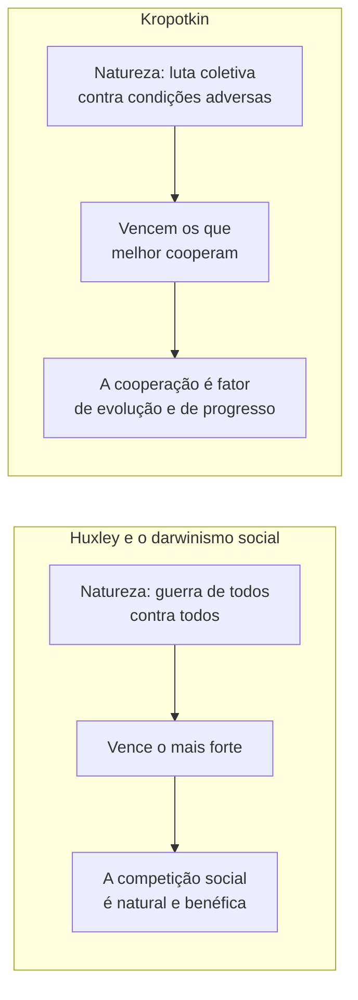

> **Aviso de Idioma:** Este currículo e todos os seus recursos de apoio foram estruturados exclusivamente em **Português (PT-BR)**.

# Aula 4 · Kropotkin: o apoio mútuo como fator de evolução

**MOD-107 · 10 horas · Leitura principal:** Kropotkin, *Apoio Mútuo: Um Fator de Evolução* (1902), Introdução, capítulos 1 e 2 (os animais), capítulo 5 (a cidade medieval) e Conclusão

*Piotr Kropotkin (1842 a 1921), fotografado por Nadar por volta de 1900. Domínio público.*

## O que você vai aprender

- Conhecer a trajetória de Kropotkin, de príncipe e geógrafo a anarquista.
- Explicar o <abbr title="Darwinismo social: aplicação distorcida da teoria de Darwin à sociedade humana, segundo a qual a competição implacável entre indivíduos, classes ou raças seria natural e benéfica, justificando a desigualdade.">darwinismo social</abbr> e o debate com Thomas Huxley.
- Reconstruir a tese do <abbr title="Apoio mútuo: para Kropotkin, a cooperação entre membros de uma mesma espécie, que favorece a sobrevivência e a evolução tanto quanto, ou mais do que, a competição.">apoio mútuo</abbr> e as evidências que Kropotkin reúne, dos animais às cidades medievais.
- Avaliar a obra à luz da biologia e da antropologia posteriores.
- Relacionar o apoio mútuo com a organização cooperativa do trabalho e do conhecimento.

## Pergunta de abertura

> "Na natureza vence o mais forte; na sociedade é a mesma coisa, e quem tenta mudar isso vai contra a natureza." Você já ouviu algo parecido? Essa frase é ciência ou ideologia?

## 1. Um príncipe na Sibéria

Piotr Kropotkin nasceu em 1842, em Moscou, numa família de príncipes. Foi pajem do czar, mas escolheu servir como oficial na Sibéria, onde, entre 1862 e 1867, fez expedições geográficas pela Manchúria e pelo vale do rio Amur. Tornou-se um geógrafo respeitado.

A Sibéria mudou a sua visão do mundo de dois jeitos. Primeiro, ele observou que, nas regiões geladas e duras, os animais não viviam numa guerra de todos contra todos: viviam em bandos, migravam em grupo, protegiam-se mutuamente. Segundo, viu que as comunidades camponesas se organizavam sozinhas, enquanto a administração do Estado só atrapalhava.

Em 1872, numa viagem à Suíça, entrou em contato com os operários relojoeiros do Jura, da federação antiautoritária da Internacional, e tornou-se anarquista. Foi preso na Rússia em 1874, fugiu de modo espetacular em 1876, viveu exilado na Suíça, na França (onde ficou anos preso) e na Inglaterra, onde passou 30 anos. Voltou à Rússia em 1917 e morreu em 1921.

## 2. O alvo: o darwinismo social

Em 1859, Darwin publicou *A Origem das Espécies*. A teoria da seleção natural foi rapidamente apropriada para justificar a ordem social: se na natureza sobrevivem os mais aptos, a miséria dos pobres, a dominação colonial e a concorrência implacável seriam naturais e até benéficas. O filósofo Herbert Spencer cunhou a expressão "sobrevivência do mais apto".

Em 1888, o biólogo Thomas Huxley, grande defensor de Darwin, publicou o ensaio "A luta pela existência", em que descreveu a natureza como um combate de gladiadores e a vida dos humanos primitivos como uma guerra contínua de todos contra todos. Kropotkin respondeu com uma série de artigos (1890 a 1896), reunidos em livro em 1902: *Apoio Mútuo*.

## 3. A tese

Kropotkin não nega a luta pela existência nem a seleção natural. Ele lembra que o próprio Darwin, em *A Descendência do Homem* (1871), havia notado a importância dos instintos sociais. A tese é:

> Ao lado da lei da luta mútua, existe na natureza a lei do **apoio mútuo**, que, para o sucesso da luta pela vida e principalmente para a evolução progressiva das espécies, é muito mais importante.

Os mais aptos não são os mais fortes nem os mais agressivos; são os que **melhor cooperam**. A luta pela existência é, em grande parte, uma luta **coletiva** contra condições adversas (o frio, a fome, os predadores), e nessa luta vencem as espécies que se associam.

## 4. As evidências

O livro é uma grande compilação de exemplos, organizada em ordem de complexidade:

| Capítulos | Domínio | Exemplos de Kropotkin |
| :--- | :--- | :--- |
| 1 e 2 | Animais | Formigas e abelhas; caça cooperativa de pelicanos; migrações de aves em bando; colônias de castores; manadas que protegem os filhotes |
| 3 e 4 | Povos "selvagens" e "bárbaros" (na linguagem da época) | Clãs, comunidades de aldeia, terras comunais, divisão coletiva das colheitas |
| 5 e 6 | Cidade medieval | Guildas de ofício, cidades livres autogovernadas, catedrais construídas por associações, ajuda aos membros doentes |
| 7 e 8 | Mundo moderno | Sindicatos, cooperativas, sociedades de socorro mútuo, salva-vidas voluntários, ajuda entre vizinhos pobres |

A cidade medieval tem um lugar especial no livro. Kropotkin a apresenta como um florescimento da cooperação: as cidades livres europeias dos séculos XI a XV, organizadas em guildas e federadas, produziram a arte gótica, o comércio e a ciência. Para ele, foi o **Estado centralizado** moderno, a partir do século XVI, que destruiu essas instituições de apoio mútuo, tomando as terras comunais e dissolvendo as guildas (compare com a acumulação primitiva, MOD-103, aula 7).

E a conclusão do livro: apesar de séculos de destruição pelo Estado e de pregação do individualismo, o apoio mútuo continua vivo em toda parte, nas instituições populares e no cotidiano dos pobres, e é nele que se apoia toda esperança de progresso ético.

## 5. Uma leitura crítica

*Apoio Mútuo* envelheceu de modos diferentes:

- **Na biologia,** a intuição de Kropotkin foi amplamente confirmada. A cooperação é hoje um tema central da biologia evolutiva: a seleção de parentesco, o altruísmo recíproco, a simbiose (a teoria da endossimbiose de Lynn Margulis, nos anos 1960, mostrou que as células complexas nasceram da cooperação entre organismos) e o estudo de sociedades animais deram razão a muito do que Kropotkin defendeu, ainda que com ferramentas que ele não tinha.
- **Na antropologia,** a linguagem de "selvagens" e "bárbaros" pertence ao evolucionismo do século XIX e deve ser lida criticamente. Mas Kropotkin foi um dos poucos autores europeus da época a descrever os povos não europeus como sociedades organizadas e solidárias, e não como hordas.
- **Na história,** a imagem da cidade medieval é idealizada: as guildas também excluíam, mantinham monopólios e oprimiam aprendizes.

> **Conexão com a computação:** o desenvolvimento de software livre é um dos maiores experimentos de apoio mútuo da história recente. Milhões de pessoas contribuem para projetos como o Linux, o Python e a Wikipédia, revisam o código umas das outras (MOD-106, aula 6) e resolvem dúvidas de desconhecidos em fóruns, sem comando central e muitas vezes sem pagamento. Mas a aula 7 vai mostrar também os limites dessa imagem: grandes empresas se apropriam desse trabalho comum, e muitos projetos essenciais dependem de poucos voluntários esgotados.

## Leitura guiada

1. **Introdução** (cerca de 10 páginas): a experiência siberiana e a conferência do zoólogo Karl Kessler sobre a lei do apoio mútuo, que inspirou Kropotkin.
2. **Capítulos 1 e 2** (cerca de 50 páginas): os animais. Escolha cinco exemplos e anote-os.
3. **Capítulo 5** (cerca de 30 páginas): a cidade medieval. Anote como funcionavam as guildas.
4. **Conclusão** (cerca de 10 páginas): copie a passagem em que Kropotkin resume a tese.

## Exercícios

**1.** Responda à pergunta de abertura com os argumentos de Kropotkin.

Gabarito comentado

A frase é ideologia disfarçada de ciência: projeta na natureza uma visão da sociedade competitiva e depois usa essa natureza para justificar a sociedade. Kropotkin mostra que, na natureza, a cooperação entre membros da mesma espécie é um fator decisivo de sobrevivência e evolução, e que os "mais aptos" são frequentemente os que melhor cooperam. A resposta excelente lembra o fetichismo e a ideologia (MOD-103, aulas 2 e 4): apresentar como natural o que é histórico.

**2.** Kropotkin nega a luta pela existência? Explique.

Gabarito

Não. Ele reconhece a luta pela existência e a seleção natural, mas afirma que essa luta é, em grande parte, coletiva contra condições adversas, e que o apoio mútuo entre membros da mesma espécie é um fator de evolução tão ou mais importante que a competição entre eles.

**3.** Por que, segundo Kropotkin, as instituições de apoio mútuo da Europa medieval desapareceram? Relacione com a acumulação primitiva de Marx.

Gabarito comentado

Para Kropotkin, o Estado centralizado moderno as destruiu: tomou as terras comunais, aboliu a autonomia das cidades e dissolveu as guildas, tratando qualquer associação como rival. Marx, na acumulação primitiva, descreve o mesmo período (cercamentos, legislação contra os despossuídos) do ponto de vista da formação do capital. As duas análises convergem em ver a violência do Estado como agente da destruição das formas comunitárias de vida, e divergem sobre o que vem depois: Kropotkin desconfia de qualquer Estado; Marx vê no Estado também um possível instrumento de transformação.

**4.** Escolha uma prática de apoio mútuo na sua cidade ou na internet e descreva-a com as categorias da aula.

Critérios de correção

A resposta deve descrever a prática concretamente (quem participa, como se organiza, o que troca), mostrar que ela não depende de comando central nem de pagamento, e discutir os seus limites (quem fica de fora, que dependências tem). Exemplos: mutirões de construção, cozinhas comunitárias, redes de doação durante enchentes, fóruns de ajuda em programação, bibliotecas comunitárias.

## Resumo da aula

- Kropotkin, príncipe e geógrafo, tornou-se anarquista depois de observar a natureza siberiana e os operários do Jura.
- O darwinismo social usou Darwin para justificar a competição social; Huxley descreveu a natureza como guerra de todos contra todos.
- Para Kropotkin, o apoio mútuo é um fator de evolução tão importante quanto a luta, e os mais aptos são os que melhor cooperam.
- As evidências vão dos animais às cidades medievais e às instituições populares modernas.
- A biologia posterior confirmou boa parte da intuição; a antropologia e a história do livro precisam ser lidas criticamente.

## Para ir além

- Stephen Jay Gould, "Kropotkin was no crackpot" (1988), ensaio em que o biólogo reavalia Kropotkin (em inglês).
- Kropotkin, *Memórias de um Revolucionário* (1899), a sua autobiografia.