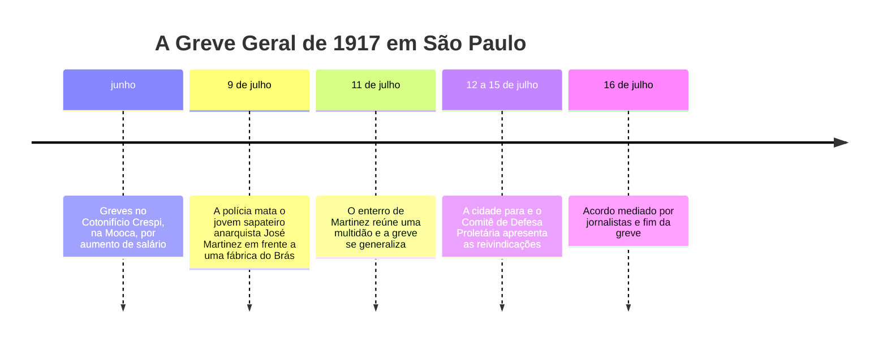

> **Aviso de Idioma:** Este currículo e todos os seus recursos de apoio foram estruturados exclusivamente em **Português (PT-BR)**.

# Aula 6 · O anarquismo no Brasil: imprensa operária e a Greve Geral de 1917

**MOD-107 · 10 horas · Leitura principal:** Edilene Toledo, *Anarquismo e Sindicalismo Revolucionário: Trabalhadores e Militantes em São Paulo na Primeira República* (2004), seleção; números de 1917 do jornal *A Plebe* (Hemeroteca Digital da Biblioteca Nacional e Arquivo Edgard Leuenroth)

## O que você vai aprender

- Situar o movimento operário brasileiro da Primeira República (1889 a 1930) e o peso do anarquismo nele.
- Explicar o <abbr title="Sindicalismo revolucionário: corrente que via no sindicato, e não no partido, o instrumento de luta e o embrião da sociedade futura, com ação direta e greve geral. Predominou no movimento operário brasileiro até os anos 1920.">sindicalismo revolucionário</abbr> e a <abbr title="Ação direta: princípio de que os trabalhadores devem agir por si mesmos (greves, boicotes, sabotagem, manifestações), sem intermediários como partidos, parlamentos ou autoridades.">ação direta</abbr>.
- Contar a história da Greve Geral de 1917 em São Paulo.
- Reconhecer a imprensa operária como fonte histórica e como forma de organização.
- Entender a repressão e o declínio do anarquismo nos anos 1920.

## Pergunta de abertura

> Em julho de 1917, a cidade de São Paulo parou. Fábricas, bondes, padarias, depósitos fecharam. Sem partido operário de massa, sem sindicatos reconhecidos por lei, sem redes sociais nem telefone para quase ninguém, como dezenas de milhares de trabalhadores se organizaram para uma greve geral?

## 1. Uma classe operária imigrante

Depois da abolição (1888) e da Lei de Terras (MOD-103, aula 7), o Estado brasileiro e os fazendeiros de café subsidiaram a vinda de centenas de milhares de imigrantes europeus, sobretudo italianos, espanhóis e portugueses. Muitos foram para as fazendas; outros, para as cidades que se industrializavam: São Paulo, Rio de Janeiro, Santos, Porto Alegre.

Uma parte desses imigrantes trouxe consigo a experiência política do movimento operário europeu, em especial o anarquismo e o sindicalismo revolucionário, muito fortes na Itália e na Espanha. Mas a classe operária brasileira não era só imigrante: trabalhadores brasileiros, negros e brancos, estavam nas fábricas, nos portos (como os estivadores do Rio) e nas ferrovias, e participaram das lutas.

As condições de trabalho eram duras: jornadas de 12 a 14 horas, trabalho infantil generalizado nas fábricas têxteis, salários que não acompanhavam a carestia, nenhuma lei trabalhista, nenhuma previdência. Sindicatos e greves eram tratados como caso de polícia.

## 2. Sindicalismo revolucionário

Em 1906, no Rio de Janeiro, reuniu-se o **Primeiro Congresso Operário Brasileiro**. As resoluções seguiram a orientação do sindicalismo revolucionário, e em 1908 foi fundada a **Confederação Operária Brasileira** (COB). Os princípios:

| Princípio | O que significava na prática |
| :--- | :--- |
| Neutralidade política e partidária | Os sindicatos não apoiariam partidos nem candidatos |
| Ação direta | Greves, boicotes e manifestações, sem esperar pelo parlamento |
| Federalismo | Sindicatos autônomos, federados de baixo para cima, sem dirigentes remunerados |
| Greve geral | A arma decisiva da classe trabalhadora |

Repare na influência da tradição de Bakunin (aula 3): federação, autonomia das bases, desconfiança do Estado e dos partidos.

## 3. A imprensa operária

A organização operária se fez, em grande parte, por meio de **jornais**. Entre 1890 e 1920 circularam centenas de jornais operários e anarquistas no Brasil, muitos em italiano e espanhol, outros em português: *A Terra Livre*, *A Lanterna*, *La Battaglia*, *A Voz do Trabalhador* (da COB) e, a partir de 1917, ***A Plebe***, fundado por Edgard Leuenroth.

Esses jornais faziam muito mais do que noticiar. Eram organizadores coletivos (expressão que Lênin usaria em *Que Fazer?*, MOD-201): convocavam reuniões, publicavam listas de contribuições, denunciavam patrões e polícia, traduziam Kropotkin e Malatesta, divulgavam peças de teatro e festas operárias. Militantes como o português Neno Vasco, que viveu no Brasil entre 1901 e 1911, foram editores e tradutores; a versão em português da letra de *A Internacional* é atribuída a ele.

Os anarquistas também criaram **escolas**. A Escola Moderna de São Paulo, aberta em 1912 e inspirada no pedagogo catalão Francisco Ferrer, ensinava crianças operárias sem castigos físicos e sem ensino religioso, até ser fechada pelas autoridades em 1919.

> **Conexão com o curso:** esses jornais são hoje uma fonte histórica preciosa e estão, em boa parte, digitalizados na Hemeroteca Digital da Biblioteca Nacional e no Arquivo Edgard Leuenroth, da Unicamp. No MOD-301 você vai aprender a raspar e organizar acervos digitalizados; no MOD-302, a analisar computacionalmente textos políticos. Os jornais operários da Primeira República são um corpus perfeito para um projeto de "arquivo a contrapelo", no sentido de Walter Benjamin (MOD-203).

## 4. A Greve Geral de 1917

O ano de 1917 era de carestia: a Primeira Guerra Mundial fazia subir o preço dos alimentos, e os salários não acompanhavam. Em junho, operários e operárias do **Cotonifício Crespi**, uma grande fábrica têxtil da Mooca, entraram em greve por aumento de salário. Outras fábricas aderiram.

Em 9 de julho, a polícia atirou contra um piquete e matou **José Martinez**, um sapateiro espanhol de 21 anos, anarquista. O seu enterro, em 11 de julho, levou milhares de pessoas às ruas, e a greve se tornou geral. Nos dias seguintes, a cidade parou: indústrias, transportes, comércio. As estimativas falam em dezenas de milhares de grevistas, num momento em que a cidade tinha cerca de meio milhão de habitantes.

A coordenação ficou a cargo do **Comitê de Defesa Proletária**, formado por militantes anarquistas e sindicalistas, entre eles Edgard Leuenroth. As reivindicações incluíam:

- Liberdade para os presos da greve e direito de associação.
- Nenhuma demissão de grevistas.
- Aumento de salários e pagamento em dia.
- Fim do trabalho de menores de 14 anos e do trabalho noturno de mulheres e menores de 18.
- Jornada de oito horas.
- Medidas contra a carestia dos alimentos e dos aluguéis.

Um comitê de jornalistas mediou as negociações com os industriais e o governo do estado. A greve terminou em 16 de julho com a promessa de aumento salarial de cerca de 20%, a libertação dos presos e o reconhecimento do direito de reunião. Muitas promessas não foram cumpridas, mas a greve mostrou a força da ação coletiva e abriu um ciclo de greves pelo país, de 1917 a 1920.

Responda à pergunta de abertura: a greve se apoiou em redes já existentes (ligas de bairro, sindicatos de ofício, jornais operários, laços de vizinhança e de origem imigrante) e foi detonada por um acontecimento que comoveu a cidade inteira. É apoio mútuo no sentido de Kropotkin, numa escala de dezenas de milhares de pessoas.

## 5. Repressão e declínio

A reação veio forte. A **Lei Adolfo Gordo**, de 1907 (endurecida em 1913 e 1921), permitia expulsar do país estrangeiros considerados perigosos à ordem pública, e foi usada contra centenas de militantes. Jornais foram fechados, sindicatos invadidos, militantes presos e deportados.

Nos anos 1920, o anarquismo perdeu espaço por várias razões combinadas: a repressão; o impacto da Revolução Russa, que levou muitos militantes (como Astrojildo Pereira) a fundar o Partido Comunista do Brasil em 1922; e, depois de 1930, a política de Vargas, que criou o Ministério do Trabalho, a legislação trabalhista e o sindicato oficial, vinculado ao Estado. Esse modelo de sindicato tutelado pelo Estado é o oposto exato do que os sindicalistas revolucionários defendiam, e marcou o movimento operário brasileiro até hoje.

## Leitura guiada

1. **Edilene Toledo, seleção** (cerca de 40 páginas): os militantes e as organizações de São Paulo.
2. ***A Plebe*, edições de junho e julho de 1917**: procure na Hemeroteca Digital da Biblioteca Nacional (pesquise pelo título do periódico). Leia pelo menos três edições e anote: que tipo de texto aparece, a quem se dirige, que convocações faz.
3. **Opcional:** Edgar Rodrigues, *Socialismo e Sindicalismo no Brasil* (1969).

## Exercícios

**1.** Quais eram os princípios do sindicalismo revolucionário adotados pelo Congresso Operário de 1906, e como eles se relacionam com as ideias de Bakunin?

Gabarito comentado

Neutralidade partidária, ação direta, federalismo e greve geral. A relação com Bakunin está na desconfiança do Estado e dos partidos, na organização de baixo para cima por federação de sindicatos autônomos e na recusa de dirigentes permanentes, ecos diretos da proposta federalista de *Estatismo e Anarquia* e da Internacional antiautoritária.

**2.** Explique como a Greve Geral de 1917 se organizou sem partido de massa nem sindicatos legais.

Gabarito comentado

Apoiou-se em redes preexistentes: ligas operárias de bairro, sindicatos de ofício, a imprensa operária que circulava convocações, laços de vizinhança e de origem imigrante. O assassinato de José Martinez e o seu enterro funcionaram como momento de comoção coletiva (lembre da efervescência coletiva de Durkheim, MOD-105, aula 4). O Comitê de Defesa Proletária coordenou as reivindicações sem comando hierárquico sobre as fábricas.

**3. Pesquisa em arquivo digital.** Encontre na Hemeroteca Digital uma edição de um jornal operário entre 1917 e 1920. Transcreva um trecho curto (até 10 linhas), identifique a fonte com precisão (título, data, página, endereço) e analise o texto com os conceitos da aula.

Critérios de correção

A referência deve permitir que outra pessoa encontre exatamente o mesmo trecho. A análise deve identificar o tipo de texto (convocação, denúncia, doutrina, notícia), o público, as estratégias de mobilização e a relação com o sindicalismo revolucionário. É um primeiro exercício do trabalho de arquivo que o MOD-301 vai automatizar.

**4.** Compare o modelo sindical do sindicalismo revolucionário com o modelo criado a partir de 1930 (sindicato único por categoria, reconhecido e financiado pelo Estado).

Gabarito comentado

O primeiro era autônomo, voluntário, federado de baixo para cima, sem financiamento estatal e centrado na ação direta. O segundo é oficial, vinculado ao Ministério do Trabalho, com monopólio de representação por categoria e financiamento compulsório (o imposto sindical, extinto como obrigatório em 2017). A resposta deve discutir o que cada modelo ganha e perde: o oficial garantiu estabilidade e direitos, mas também tutela estatal sobre os trabalhadores; o autônomo garantia independência, mas era frágil diante da repressão.

## Resumo da aula

- A classe operária da Primeira República era em boa parte imigrante, e trouxe o anarquismo e o sindicalismo revolucionário.
- O Congresso Operário de 1906 e a COB (1908) adotaram ação direta, federalismo, neutralidade partidária e greve geral.
- A imprensa operária, como *A Plebe*, organizava o movimento; escolas como a Escola Moderna educavam crianças operárias.
- A Greve Geral de 1917 parou São Paulo depois do assassinato de José Martinez e arrancou concessões.
- Repressão (Lei Adolfo Gordo), o surgimento do PCB e o sindicato oficial de Vargas levaram ao declínio do anarquismo.

## Para ir além

- O acervo do [Arquivo Edgard Leuenroth](https://www.ael.ifch.unicamp.br/), da Unicamp.
- Christina Lopreato, *O Espírito da Revolta: a Greve Geral Anarquista de 1917* (2000).