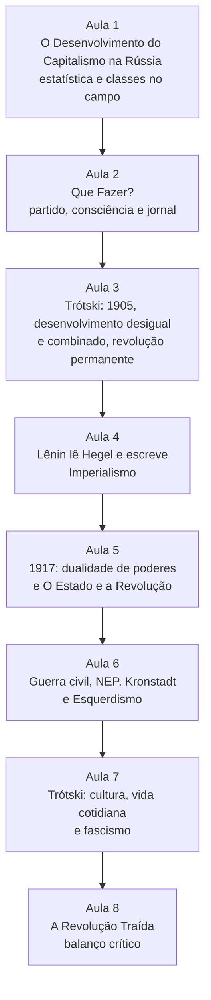
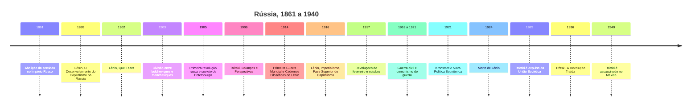

> **Aviso de Idioma:** Este currículo e todos os seus recursos de apoio foram estruturados exclusivamente em **Português (PT-BR)**.

# MOD-201: Teoria e Práxis Revolucionária em Profundidade: Lênin e Trótski (Estudo Amplo)

**Ciclo 2 · Eixo 4 (Filosofia Política e Teoria Social) · 80 horas · 8 aulas · Pré-requisitos: MOD-101 e MOD-103**

*Vladimir Ilitch Lênin em julho de 1920. Fotografia de Pavel Zhukov, domínio público.*

## Apresentação

Marx e Engels escreveram sobre a Inglaterra, a França e a Alemanha, os países capitalistas mais avançados do século XIX. A primeira revolução feita em nome do marxismo aconteceu na Rússia, um império agrário, com uma indústria moderna concentrada em poucas cidades e uma imensa população camponesa. Este módulo estuda os dois dirigentes que pensaram e fizeram essa revolução: **Vladimir Lênin** e **Leon Trótski**.

O estudo é "amplo" porque não se limita aos textos de propaganda. Lênin foi também um sociólogo empírico, que usou estatísticas agrárias para analisar a formação do capitalismo, um leitor atento de Hegel e o autor da teoria do imperialismo, que continua a ser a referência para pensar a concentração de capital em escala mundial. Trótski foi o teórico do desenvolvimento desigual e combinado, um crítico de literatura, o analista mais agudo do fascismo e o primeiro grande crítico marxista da burocracia que se apoderou do Estado soviético.

O módulo pede leitura rigorosa e crítica: a experiência soviética foi também uma história de repressão, de partido único e de terror. Os debates com Bakunin (MOD-107) e com Rosa Luxemburgo atravessam todas as aulas.

## Mapa do módulo

## Linha do tempo

## Objetivos de aprendizagem

- Explicar como Lênin usou estatísticas dos *zemstvos* para demonstrar a diferenciação de classes no campo russo, e reproduzir o método com Python.
- Reconstruir os argumentos de *Que Fazer?* sobre espontaneidade, consciência e organização, e as críticas que receberam.
- Explicar a lei do desenvolvimento desigual e combinado e a teoria da revolução permanente.
- Enunciar as cinco características do imperialismo e medir a concentração de um mercado com indicadores atuais.
- Narrar 1917 com o conceito de dualidade de poderes e explicar a teoria do Estado de *O Estado e a Revolução*.
- Avaliar a guerra civil, a NEP, Kronstadt e a crítica de Rosa Luxemburgo.
- Explicar a análise de Trótski sobre o fascismo e sobre a degeneração burocrática da União Soviética.

## Aulas

| Aula | Tema | Duração | Leitura principal |
| :---: | :--- | :---: | :--- |
| 1 | [Lênin sociólogo: o capitalismo chega ao campo russo](./mod-201/aula-01-lenin-desenvolvimento-capitalismo-russia.md) | 10h | *O Desenvolvimento do Capitalismo na Rússia*, capítulo II (seleção) |
| 2 | [*Que Fazer?*: espontaneidade, consciência e organização](./mod-201/aula-02-lenin-que-fazer.md) | 10h | *Que Fazer?*, capítulos II, III e V |
| 3 | [Trótski: 1905, desenvolvimento desigual e combinado, revolução permanente](./mod-201/aula-03-trotski-desenvolvimento-desigual-revolucao-permanente.md) | 10h | *Balanços e Perspectivas*; *História da Revolução Russa*, capítulo 1 |
| 4 | [Lênin lê Hegel e escreve o *Imperialismo*](./mod-201/aula-04-lenin-cadernos-filosoficos-imperialismo.md) | 10h | *Cadernos Filosóficos* (seleção); *Imperialismo*, capítulos I, III, VII |
| 5 | [1917: dualidade de poderes e *O Estado e a Revolução*](./mod-201/aula-05-1917-dualidade-poderes-estado-revolucao.md) | 10h | *O Estado e a Revolução*, capítulos I a III; *História da Revolução Russa*, capítulo 11 |
| 6 | [Guerra civil, NEP, Kronstadt e o *Esquerdismo*](./mod-201/aula-06-guerra-civil-nep-esquerdismo.md) | 10h | *Esquerdismo, Doença Infantil do Comunismo* (seleção); Rosa Luxemburgo, *A Revolução Russa* |
| 7 | [Trótski: cultura, vida cotidiana e a luta contra o fascismo](./mod-201/aula-07-trotski-cultura-fascismo.md) | 10h | *Literatura e Revolução* (seleção); *Como Esmagar o Fascismo* (seleção) |
| 8 | [*A Revolução Traída* e o balanço de uma época](./mod-201/aula-08-trotski-revolucao-traida.md) | 10h | *A Revolução Traída*, capítulos 5 e 11 |

## Leituras e onde encontrar

| Obra | Onde ler de graça |
| :--- | :--- |
| Lênin, todas as obras do módulo | [Arquivo Marxista na Internet, seção Lênin](https://www.marxists.org/portugues/lenin/index.htm) |
| Trótski, todas as obras do módulo | [Arquivo Marxista na Internet, seção Trótski](https://www.marxists.org/portugues/trotsky/index.htm) |
| Rosa Luxemburgo, *A Revolução Russa* | [Arquivo Marxista na Internet](https://www.marxists.org/portugues/) |

## Projeto prático avaliativo

### Monografia e painel empírico: imperialismo digital e desenvolvimento desigual e combinado

**Parte 1, painel em Python:** reúna dados públicos sobre a concentração de um mercado digital (participação de mercado de sistemas operacionais móveis, de buscadores, de nuvem ou de redes sociais no Brasil e no mundo, a partir de relatórios públicos e de fontes como o CGI.br, o Cetic.br e o IBGE). Calcule a razão de concentração e o índice de Herfindahl-Hirschman (aula 4) e mostre a evolução ao longo do tempo. Acrescente um indicador de dependência tecnológica do Brasil (por exemplo, a balança comercial de serviços de tecnologia da informação, publicada pelo Banco Central).

**Parte 2, monografia de 5.000 palavras:** interprete os dados com as categorias de Lênin (as cinco características do imperialismo) e de Trótski (desenvolvimento desigual e combinado). Discuta onde as categorias iluminam o presente e onde precisam ser revistas.

**Critérios de avaliação**

| Critério | Peso |
| :--- | :---: |
| Fidelidade às categorias de Lênin e Trótski, com citação das fontes | 30% |
| Qualidade e transparência dos dados e dos cálculos | 30% |
| Análise crítica (o que as categorias explicam e o que não explicam) | 30% |
| Clareza e estilo | 10% |

**Diretório de entrega:** `projetos/ciclo-2/mod-201-lenin-trotsky`

## Antes e depois deste módulo

- **Pré-requisitos:** MOD-101 (Hegel) e MOD-103 (Marx). O MOD-107 (Bakunin) é fortemente recomendado.
- **Este módulo prepara:** MOD-203 (Gramsci e Lukács, que partem da experiência de 1917), MOD-206 (desenvolvimento desigual e capitalismo dependente no Brasil) e MOD-303 (redes de poder e capital financeiro).

## Glossário do módulo

*Bolcheviques e mencheviques* · *Capital financeiro* · *Centralismo democrático* · *Comunismo de guerra* · *Desenvolvimento desigual e combinado* · *Dualidade de poderes* · *Economicismo* · *Frente única* · *Herfindahl-Hirschman (índice)* · *Imperialismo* · *Narodniki (populistas)* · *NEP* · *Revolução permanente* · *Soviete* · *Termidor* · *Zemstvo*