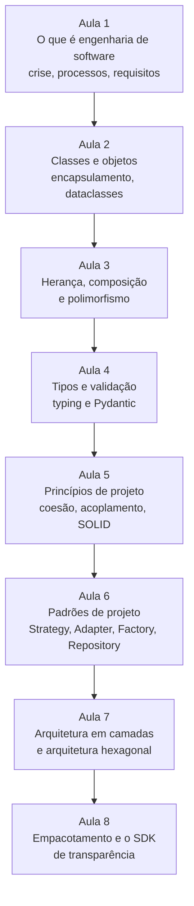
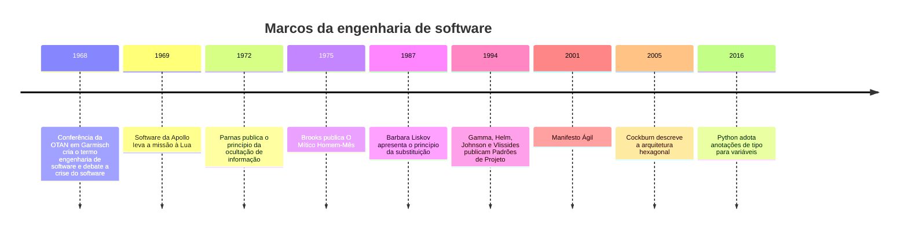

> **Aviso de Idioma:** Este currículo e todos os seus recursos de apoio foram estruturados exclusivamente em **Português (PT-BR)**.

# MOD-202: Engenharia de Software Moderna, POO e Arquitetura com Python

**Ciclo 2 · Eixo 2 (Engenharia de Software com Python) · 80 horas · 8 aulas · Pré-requisitos: MOD-102 e MOD-106**

*Margaret Hamilton em 1969, ao lado das listagens impressas do software de voo do programa Apollo, escrito pela equipe que ela dirigia no Laboratório Draper do MIT. Domínio público segundo a Wikimedia Commons.*

## Apresentação

No MOD-106 você aprendeu a escrever programas em Python. Neste módulo você aprende a **construir sistemas**: software que cresce, que é mantido por várias pessoas durante anos, que muda quando os requisitos mudam e que continua compreensível. Essa é a diferença entre programar e fazer engenharia de software.

O módulo segue de perto o livro aberto *Engenharia de Software Moderna*, do professor Marco Tulio Valente (UFMG), escrito em português e disponível de graça. Os exemplos usam APIs públicas brasileiras de transparência (Câmara dos Deputados, Senado Federal), e o projeto final é uma biblioteca Python para consultá-las, que você vai testar no MOD-204 e reutilizar no Ciclo 3.

A engenharia de software também tem uma dimensão social, que o curso não esquece: decisões de arquitetura definem quem pode auditar um sistema, quem depende de quem e quanto custa mudar de fornecedor. Uma biblioteca pública bem projetada é uma ferramenta de controle social.

## Mapa do módulo

## Linha do tempo

## Objetivos de aprendizagem

- Explicar o que é engenharia de software e comparar processos em cascata e ágeis.
- Modelar entidades do domínio com classes, `dataclasses` e encapsulamento.
- Escolher entre herança e composição e usar polimorfismo com protocolos.
- Usar anotações de tipo e validar dados de APIs com Pydantic.
- Aplicar os princípios de coesão, acoplamento e SOLID na revisão de código.
- Reconhecer e implementar os padrões Strategy, Adapter, Factory e Repository.
- Organizar um sistema em camadas, com o domínio isolado da infraestrutura.
- Empacotar uma biblioteca com `pyproject.toml` e documentá-la.

## Aulas

| Aula | Tema | Duração |
| :---: | :--- | :---: |
| 1 | [O que é engenharia de software](./mod-202/aula-01-engenharia-software-crise-processos.md) | 10h |
| 2 | [Classes e objetos: modelando o domínio](./mod-202/aula-02-classes-objetos-encapsulamento.md) | 10h |
| 3 | [Herança, composição e polimorfismo](./mod-202/aula-03-heranca-composicao-polimorfismo.md) | 10h |
| 4 | [Tipos e validação: `typing` e Pydantic](./mod-202/aula-04-tipos-validacao-pydantic.md) | 10h |
| 5 | [Princípios de projeto: coesão, acoplamento e SOLID](./mod-202/aula-05-principios-projeto-solid.md) | 10h |
| 6 | [Padrões de projeto](./mod-202/aula-06-padroes-projeto.md) | 10h |
| 7 | [Arquitetura: camadas e hexágonos](./mod-202/aula-07-arquitetura-camadas-hexagonal.md) | 10h |
| 8 | [Empacotamento e o SDK de transparência](./mod-202/aula-08-empacotamento-sdk-transparencia.md) | 10h |

## Recursos gratuitos

| Recurso | Para que usar |
| :--- | :--- |
| [Engenharia de Software Moderna (Marco Tulio Valente, UFMG)](https://engsoftmoderna.info/) | Livro-texto do módulo, capítulos 1, 2, 5, 6 e 7 |
| [Refactoring.Guru em português](https://refactoring.guru/pt-br/design-patterns/python) | Catálogo ilustrado de padrões de projeto, com exemplos em Python |
| [Documentação do Python: classes](https://docs.python.org/pt-br/3/tutorial/classes.html) | Referência da linguagem |
| [Documentação do Pydantic](https://docs.pydantic.dev/) | Validação de dados (em inglês) |
| [Dados Abertos da Câmara dos Deputados](https://dadosabertos.camara.leg.br/) | API usada nos exemplos e no projeto |

## Projeto prático avaliativo

### SDK Python para APIs de Transparência Pública (`br-transparencia-sdk`)

Uma biblioteca Python instalável com `pip`, que oferece uma interface única e tipada para consultar dados da API da Câmara dos Deputados e da API de dados abertos do Senado Federal (e, opcionalmente, do Portal da Transparência, que exige chave de acesso gratuita).

**Requisitos**

- Arquitetura em camadas: modelos de domínio, portas (interfaces), adaptadores HTTP e uma fachada de uso simples.
- Modelos validados com Pydantic.
- Cache local em disco das respostas, com tempo de validade configurável.
- Respeito aos limites dos servidores: intervalo mínimo entre requisições e nova tentativa com espera crescente em caso de erro 429 ou 5xx.
- Nenhuma dependência do domínio em relação à biblioteca HTTP: deve ser possível trocar `httpx` por outra biblioteca mexendo só no adaptador.

**Entregáveis**

- Repositório com `pyproject.toml`, código em `src/`, `README.md` com exemplos e histórico Git limpo.
- Diagrama de arquitetura em Mermaid.
- Documento de decisões de arquitetura (ADR) com pelo menos três decisões justificadas.

**Critérios de avaliação**

| Critério | Peso |
| :--- | :---: |
| Separação de responsabilidades e baixo acoplamento | 35% |
| Uso idiomático de tipos, validação e tratamento de erros | 25% |
| Respeito aos servidores públicos (limites, cache, identificação) | 15% |
| Documentação e facilidade de uso | 25% |

**Diretório de entrega:** `projetos/ciclo-2/mod-202-sdk-transparencia`

## Antes e depois deste módulo

- **Pré-requisitos:** MOD-102 (algoritmos) e MOD-106 (Python e Git).
- **Este módulo prepara:** MOD-204 (testes do SDK), MOD-301 (raspagem), MOD-306 (o software de interesse público final).

## Glossário do módulo

*Acoplamento* · *ADR (registro de decisão de arquitetura)* · *Arquitetura hexagonal* · *Classe* · *Coesão* · *Composição* · *Dataclass* · *Encapsulamento* · *Herança* · *Injeção de dependência* · *Interface (protocolo)* · *Objeto* · *Padrão de projeto* · *Polimorfismo* · *Pydantic* · *pyproject.toml* · *Requisito funcional e não funcional* · *SOLID*