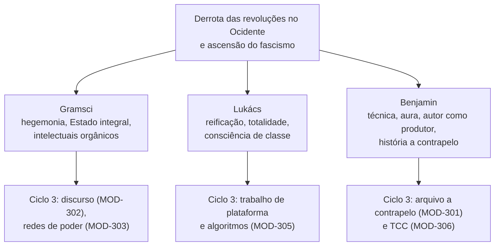
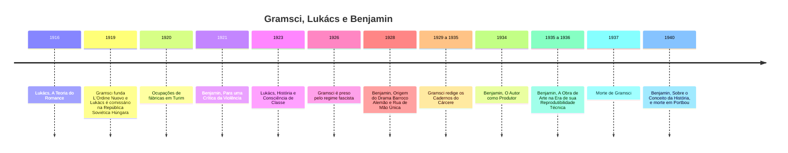

> **Aviso de Idioma:** Este currículo e todos os seus recursos de apoio foram estruturados exclusivamente em **Português (PT-BR)**.

# MOD-203: Hegemonia, Reificação e Estética Crítica: Gramsci (Amplo), Lukács e Walter Benjamin (Amplo)

**Ciclo 2 · Eixo 4 (Filosofia Política e Teoria Social) · 90 horas · 9 aulas · Pré-requisitos: MOD-101, MOD-103 e MOD-201**

*Paul Klee,* Angelus Novus *(1920). Walter Benjamin comprou o desenho em 1921 e o transformou, em 1940, na imagem do "anjo da história". Museu de Israel, Jerusalém. Domínio público.*

## Apresentação

Depois de 1917, a revolução não se espalhou pela Europa como Lênin e Trótski esperavam (MOD-201). Na Alemanha, na Itália e na Hungria, os levantes foram derrotados, e em seu lugar vieram o fascismo e o nazismo. Três pensadores marxistas tentaram entender essa derrota, e cada um abriu um caminho que continua decisivo para a teoria social:

- **Antonio Gramsci**, preso pelo fascismo, perguntou por que nas sociedades ocidentais o poder não se sustenta só pela força, mas pelo **consentimento**, e criou o conceito de **hegemonia**.
- **György Lukács** mostrou como a forma-mercadoria (MOD-103) molda o pensamento, a ciência e a burocracia (Weber, MOD-105), e chamou esse processo de **reificação**.
- **Walter Benjamin** pensou a técnica, a fotografia, o cinema e a história de um ponto de vista radicalmente novo, e escreveu o texto que dá a este curso a sua ideia central: ***O Autor como Produtor***.

O módulo é longo (90 horas) porque esses três autores são o coração teórico do Ciclo 2. Os conceitos daqui serão operacionalizados no Ciclo 3: hegemonia na análise de discursos (MOD-302), redes de aparelhos de hegemonia (MOD-303), reificação no trabalho de plataforma (MOD-305) e o "engenheiro como produtor" no TCC (MOD-306).

## Mapa do módulo

## Linha do tempo

## Objetivos de aprendizagem

- Explicar o conceito de Estado integral e a relação entre coerção e consenso em Gramsci.
- Usar os conceitos de hegemonia, aparelhos privados de hegemonia, guerra de posição, intelectuais orgânicos, revolução passiva e crise orgânica para analisar o Brasil.
- Explicar a reificação em Lukács como síntese de Marx e Weber, e o método da totalidade.
- Explicar a perda da aura, a passagem do valor de culto ao valor de exposição e a estetização da política em Benjamin.
- Aplicar a tese de *O Autor como Produtor* ao trabalho de quem desenvolve software.
- Explicar as teses *Sobre o Conceito da História* e o método de escovar a história a contrapelo.

## Aulas

| Aula | Tema | Duração | Leitura principal |
| :---: | :--- | :---: | :--- |
| 1 | [Gramsci: Turim, os conselhos e a questão meridional](./mod-203/aula-01-gramsci-ordine-nuovo-conselhos.md) | 10h | Artigos de *L'Ordine Nuovo* (1919 a 1920); *Alguns Temas da Questão Meridional* (1926) |
| 2 | [Gramsci: Estado integral, hegemonia e guerra de posição](./mod-203/aula-02-gramsci-hegemonia-estado-integral.md) | 10h | *Cadernos do Cárcere*, seleção dos cadernos 6, 7 e 13 |
| 3 | [Gramsci: intelectuais, revolução passiva e americanismo](./mod-203/aula-03-gramsci-intelectuais-revolucao-passiva.md) | 10h | *Cadernos do Cárcere*, cadernos 12, 13 e 22 (seleção) |
| 4 | [Lukács: a reificação e a consciência](./mod-203/aula-04-lukacs-reificacao.md) | 10h | *História e Consciência de Classe*, "A reificação e a consciência do proletariado", parte I |
| 5 | [Lukács: totalidade, método e o trabalho](./mod-203/aula-05-lukacs-totalidade-ontologia.md) | 10h | *História e Consciência de Classe*, "O que é o marxismo ortodoxo?"; *Para uma Ontologia do Ser Social* (seleção) |
| 6 | [Benjamin: violência, alegoria e montagem](./mod-203/aula-06-benjamin-violencia-alegoria-montagem.md) | 10h | *Para uma Crítica da Violência*; *Rua de Mão Única* (seleção) |
| 7 | [Benjamin: *O Autor como Produtor*](./mod-203/aula-07-benjamin-autor-como-produtor.md) | 10h | *O Autor como Produtor* (texto integral) |
| 8 | [Benjamin: a obra de arte, a aura e a técnica](./mod-203/aula-08-benjamin-obra-de-arte-reprodutibilidade.md) | 10h | *A Obra de Arte na Era de sua Reprodutibilidade Técnica*; *Pequena História da Fotografia* |
| 9 | [Benjamin: as *Passagens* e a história a contrapelo](./mod-203/aula-09-benjamin-passagens-conceito-historia.md) | 10h | *Sobre o Conceito da História* (integral); *Paris, Capital do Século XIX* (exposé de 1935) |

## Leituras e onde encontrar

| Obra | Onde ler de graça |
| :--- | :--- |
| Gramsci, artigos e cadernos | [Arquivo Marxista na Internet, seção Gramsci](https://www.marxists.org/portugues/gramsci/index.htm). A edição brasileira de referência dos *Cadernos* é a de Carlos Nelson Coutinho, Luiz Sérgio Henriques e Marco Aurélio Nogueira (Civilização Brasileira) |
| Lukács, *História e Consciência de Classe* | [Arquivo Marxista na Internet](https://www.marxists.org/portugues/) e acervos universitários |
| Benjamin, ensaios | Acervos universitários e coletâneas em domínio público; a tradução de *Sobre o Conceito da História* por Jeanne Marie Gagnebin e Marcos Lutz Müller (no livro de Michael Löwy, *Walter Benjamin: Aviso de Incêndio*) é a referência atual |

## Projeto prático avaliativo

### Motor de Passagens e Constelações e o ensaio "O Engenheiro como Produtor"

**Parte 1, software:** inspirado no método do *Trabalho das Passagens* de Benjamin (aula 9), um programa em Python que organiza um arquivo de **fichas** (citações e notas de leitura de todo o curso) e as conecta por conceitos em comum, formando **constelações**: grupos de fichas que se iluminam umas às outras. O programa deve:

1. Ler fichas em Markdown com cabeçalho YAML (autor, obra, página, conceitos).
2. Construir o grafo de fichas e conceitos.
3. Sugerir, para cada ficha, as mais próximas (por conceitos em comum).
4. Encontrar as constelações (componentes conectados) e exportar cada uma como página Markdown.

**Parte 2, ensaio de 4.000 palavras:** "O Engenheiro como Produtor". Aplique a pergunta de Benjamin (qual é a posição de uma obra *dentro* das relações de produção?) ao trabalho de quem desenvolve software hoje, usando também Gramsci (o engenheiro como intelectual orgânico ou tradicional) e Lukács (a reificação no trabalho técnico).

**Critérios de avaliação**

| Critério | Peso |
| :--- | :---: |
| Rigor na reconstrução dos conceitos de Gramsci, Lukács e Benjamin, com citação | 35% |
| Originalidade e consistência da aplicação ao trabalho técnico contemporâneo | 30% |
| Funcionamento e clareza do software | 25% |
| Escrita | 10% |

**Diretório de entrega:** `projetos/ciclo-2/mod-203-gramsci-lukacs-benjamin`

## Antes e depois deste módulo

- **Pré-requisitos:** MOD-101 (Hegel), MOD-103 (Marx) e MOD-201 (a revolução russa). MOD-105 (Weber) ajuda muito na aula 4.
- **Este módulo prepara:** MOD-205, MOD-301, MOD-302, MOD-303, MOD-305 e MOD-306.

## Glossário do módulo

*Alegoria* · *Aparelhos privados de hegemonia* · *Aura* · *Bloco histórico* · *Crise orgânica* · *Estado integral* · *Estetização da política* · *Flâneur* · *Guerra de posição e de movimento* · *Hegemonia* · *Imagem dialética* · *Intelectual orgânico* · *Jetztzeit (tempo de agora)* · *Refuncionalização* · *Reificação* · *Revolução passiva* · *Totalidade* · *Transformismo* · *Valor de culto e valor de exposição*