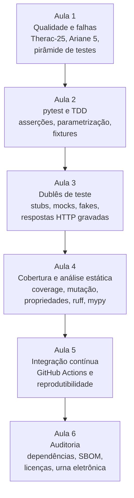
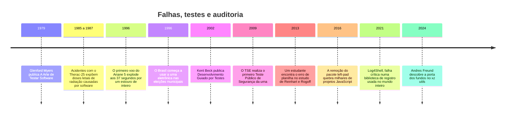

> **Aviso de Idioma:** Este currículo e todos os seus recursos de apoio foram estruturados exclusivamente em **Português (PT-BR)**.

# MOD-204: Qualidade de Software, Testes Automatizados, CI/CD e Auditoria de Código

**Ciclo 2 · Eixo 2 (Engenharia de Software com Python) · 60 horas · 6 aulas · Pré-requisito: MOD-202**

.jpg?width=500)

*A comodoro Grace Hopper em 1984. Pioneira dos compiladores e da linguagem COBOL, ela dedicou boa parte da carreira a padronizar e a testar linguagens: dirigiu na Marinha o programa que verificava se os compiladores COBOL de diferentes fabricantes obedeciam ao mesmo padrão. Fotografia de James S. Davis, Marinha dos Estados Unidos. Domínio público.*

## Apresentação

No MOD-202 você construiu um sistema. Neste módulo você aprende a **confiar nele**, e a fazer com que outras pessoas possam confiar também. Testes automatizados, análise estática, integração contínua e auditoria de dependências são as práticas que transformam "funciona na minha máquina" em "qualquer pessoa pode verificar que funciona".

Essa diferença tem peso político. Um software de interesse público que ninguém consegue testar é um software em que se precisa acreditar. Um software com testes abertos, que rodam sozinhos a cada mudança e cujos resultados ficam públicos, é um software que se pode **auditar**. A Justiça Eleitoral brasileira, por exemplo, abre o código da urna eletrônica para inspeção e convida pesquisadores a atacá-la em testes públicos de segurança (aula 6). A auditabilidade é uma forma de controle social, e o curso trata cada teste como uma pequena peça desse controle.

O módulo segue os capítulos 8 (Testes) e 10 (DevOps) do livro aberto *Engenharia de Software Moderna*, de Marco Tulio Valente (UFMG), e usa como objeto de trabalho o SDK de transparência do MOD-202 e o Motor de Passagens e Constelações do MOD-203.

## Mapa do módulo

## Linha do tempo

## Objetivos de aprendizagem

- Distinguir verificação e validação, falha, defeito e erro, e explicar a pirâmide de testes.
- Escrever testes com pytest usando asserções, parametrização e fixtures, e praticar o ciclo do TDD.
- Isolar dependências externas com dublês de teste e testar o adaptador HTTP do SDK sem rede.
- Medir cobertura, entender os seus limites e complementá-la com testes de mutação e de propriedades.
- Configurar análise estática (ruff, mypy) e um fluxo de integração contínua no GitHub Actions.
- Auditar dependências (vulnerabilidades, licenças, SBOM) e escrever um laudo de auditoria.

## Aulas

| Aula | Tema | Duração |
| :---: | :--- | :---: |
| 1 | [Qualidade de software e o custo das falhas](./mod-204/aula-01-qualidade-falhas-piramide-testes.md) | 10h |
| 2 | [pytest e o desenvolvimento guiado por testes](./mod-204/aula-02-pytest-tdd.md) | 10h |
| 3 | [Dublês de teste: isolar o mundo externo](./mod-204/aula-03-dubles-de-teste-mocks.md) | 10h |
| 4 | [Cobertura, mutação, propriedades e análise estática](./mod-204/aula-04-cobertura-mutacao-analise-estatica.md) | 10h |
| 5 | [Integração contínua e reprodutibilidade](./mod-204/aula-05-integracao-continua-reprodutibilidade.md) | 10h |
| 6 | [Auditoria de código e da cadeia de dependências](./mod-204/aula-06-auditoria-dependencias-urna.md) | 10h |

## Recursos gratuitos

| Recurso | Para que usar |
| :--- | :--- |
| [Engenharia de Software Moderna (Marco Tulio Valente, UFMG)](https://engsoftmoderna.info/) | Livro-texto: capítulos 8 (Testes) e 10 (DevOps) |
| [Documentação do pytest](https://docs.pytest.org/) | Referência da ferramenta de testes (em inglês) |
| [Documentação do GitHub Actions em português](https://docs.github.com/pt/actions) | Integração contínua |
| [Documentação do ruff](https://docs.astral.sh/ruff/) | Análise estática e formatação (em inglês) |
| [pip-audit](https://pypi.org/project/pip-audit/) | Auditoria de vulnerabilidades em dependências Python |
| [Portal do TSE sobre segurança da urna](https://www.tse.jus.br/eleicoes/urna-eletronica) | Testes públicos de segurança e inspeção do código |

## Projeto prático avaliativo

### Suíte de testes, integração contínua e laudo de auditoria

Instrumentar o SDK de transparência do MOD-202 e o Motor de Passagens e Constelações do MOD-203 com testes automatizados, análise estática, um fluxo de integração contínua e um laudo público de auditoria das dependências.

**Requisitos**

- Suíte pytest com testes unitários, de integração (adaptador HTTP com transporte falso) e de contrato (formato das respostas da API, validado contra exemplos gravados).
- Cobertura de ramos acima de 85%, com justificativa escrita para cada trecho deixado de fora.
- Nenhum teste depende de rede, relógio ou aleatoriedade sem controle: a suíte inteira roda desconectada e dá sempre o mesmo resultado.
- Fluxo `.github/workflows/ci.yml` que roda ruff, mypy e pytest em pelo menos duas versões do Python a cada envio e a cada pedido de integração.
- Laudo de auditoria: lista de dependências diretas e transitivas, vulnerabilidades conhecidas (pip-audit), licenças e compatibilidade com a licença do projeto, e um SBOM gerado automaticamente.

**Entregáveis**

- Repositório com a suíte de testes, o fluxo de CI passando e o selo de estado no README.
- Arquivo `AUDITORIA.md` com o laudo e as decisões tomadas (dependências trocadas, versões fixadas, riscos aceitos).

**Critérios de avaliação**

| Critério | Peso |
| :--- | :---: |
| Qualidade dos testes: casos de borda, clareza, independência | 35% |
| Determinismo e execução sem rede | 20% |
| Fluxo de CI correto e reprodutível | 20% |
| Rigor do laudo de auditoria (segurança e licenças) | 25% |

**Diretório de entrega:** `projetos/ciclo-2/mod-204-auditoria-e-testes`

## Antes e depois deste módulo

- **Pré-requisito:** MOD-202 (o SDK de transparência, com cliente HTTP injetável).
- **Este módulo prepara:** MOD-207 (pesquisa reprodutível), MOD-301 (raspadores testados), MOD-305 (auditoria de algoritmos) e MOD-306 (o software de interesse público final, que precisa de CI e laudo).

## Glossário do módulo

*Análise estática* · *Asserção* · *Cobertura de código* · *Dublê de teste* · *Falha, defeito e erro* · *Fixture* · *Integração contínua (CI)* · *Mock* · *Parametrização* · *Pirâmide de testes* · *Regressão* · *Reprodutibilidade* · *SBOM* · *Stub* · *TDD* · *Teste de contrato* · *Teste de mutação* · *Teste de propriedade* · *Verificação e validação* · *Vulnerabilidade (CVE)*