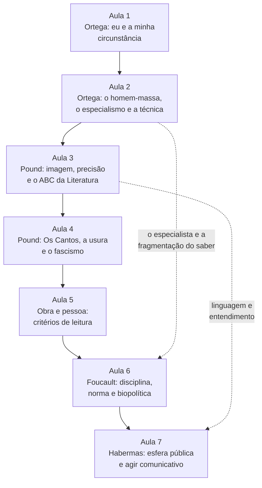
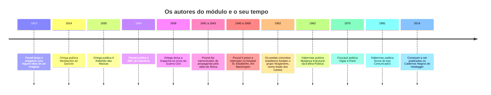

> **Aviso de Idioma:** Este currículo e todos os seus recursos de apoio foram estruturados exclusivamente em **Português (PT-BR)**.

# MOD-205: Cultura, Especialismo, Separação Obra vs. Pessoa, Poder e Esfera Pública

**Ciclo 2 · Eixo 4 (Filosofia Política e Teoria Social) · 70 horas · 7 aulas · Pré-requisitos: MOD-101, MOD-105 e MOD-203**

*José Ortega y Gasset retratado por Joaquín Sorolla em 1918. Hispanic Society of America, Nova York. Domínio público.*

## Apresentação

Este módulo reúne quatro autores que raramente aparecem juntos e uma pergunta de método que atravessa todos eles.

Os dois primeiros, o filósofo espanhol **José Ortega y Gasset** e o poeta estadunidense **Ezra Pound**, oferecem ferramentas que interessam diretamente a quem trabalha com técnica: Ortega diagnosticou, em 1930, a "barbárie do especialismo", o cientista que sabe muito de uma fração do mundo e se comporta com arrogância em tudo o mais, e pensou a técnica como produção do supérfluo; Pound exigiu da linguagem uma precisão que qualquer pessoa que já tentou dar nome a uma variável reconhece. Os dois também carregam biografias políticas difíceis: Ortega foi um liberal elitista, desconfiado das massas; Pound aderiu ao fascismo italiano e fez propaganda antissemita no rádio durante a Segunda Guerra.

Daí a pergunta de método, que ocupa uma aula inteira: **como ler uma obra importante de um autor cujas posições condenamos?** Nem apagar a obra, nem absolver o autor: o curso propõe critérios explícitos para separar analiticamente o que pertence à biografia e o que é conquista formal ou conceitual, e para examinar onde as duas coisas se contaminam.

Os dois últimos autores, **Michel Foucault** e **Jürgen Habermas**, são as referências centrais para pensar o poder e o espaço público no tempo das plataformas digitais. Foucault mostra como a disciplina, a vigilância e a norma fabricam sujeitos; Habermas, como a esfera pública nasceu, como se degradou e o que seria uma comunicação orientada ao entendimento. As duas teorias dão as categorias que o Ciclo 3 vai usar para auditar algoritmos (MOD-305).

## Mapa do módulo

## Linha do tempo

## Objetivos de aprendizagem

- Explicar a razão vital e a ideia de circunstância em Ortega, e o seu diagnóstico do homem-massa e do especialismo.
- Explicar a teoria da técnica de Ortega e aplicá-la ao trabalho de engenharia.
- Explicar o imagismo, as três modalidades da poesia e o método ideogramático de Pound, e relacioná-los com a precisão na escrita e no código.
- Analisar *Os Cantos* e o Canto XLV, e a relação entre a crítica da usura, o antissemitismo e o fascismo de Pound.
- Aplicar critérios explícitos de separação analítica entre obra e pessoa a Ortega, Pound e Heidegger, sem apologia e sem moralismo.
- Explicar a disciplina, a sanção normalizadora, o panóptico e a biopolítica em Foucault, e usá-los para analisar plataformas digitais.
- Explicar a esfera pública, o agir comunicativo e a colonização do mundo da vida em Habermas, e as críticas que receberam.

## Aulas

| Aula | Tema | Duração |
| :---: | :--- | :---: |
| 1 | [Ortega: eu e a minha circunstância](./mod-205/aula-01-ortega-circunstancia-razao-vital.md) | 10h |
| 2 | [Ortega: o homem-massa, o especialismo e a técnica](./mod-205/aula-02-ortega-massas-especialismo-tecnica.md) | 10h |
| 3 | [Pound: imagem, precisão e o *ABC da Literatura*](./mod-205/aula-03-pound-imagismo-abc-precisao.md) | 10h |
| 4 | [Pound: *Os Cantos*, a usura e o fascismo](./mod-205/aula-04-pound-cantos-usura-fascismo.md) | 10h |
| 5 | [Obra e pessoa: critérios de leitura](./mod-205/aula-05-obra-e-pessoa-criterios.md) | 10h |
| 6 | [Foucault: disciplina, norma e biopolítica](./mod-205/aula-06-foucault-disciplina-biopolitica.md) | 10h |
| 7 | [Habermas: esfera pública e agir comunicativo](./mod-205/aula-07-habermas-esfera-publica-agir-comunicativo.md) | 10h |

## Recursos gratuitos

| Recurso | Para que usar |
| :--- | :--- |
| [e-Aulas USP](https://eaulas.usp.br/) | Aulas abertas de filosofia contemporânea, estética e teoria crítica |
| [Rede LAVITS](https://lavits.org/) | Rede Latino-Americana de Estudos sobre Vigilância, Tecnologia e Sociedade: artigos e dossiês em português |
| [SciELO Brasil](https://www.scielo.br/) | Artigos de comentadores brasileiros sobre Foucault, Habermas, Ortega e Pound |
| [Domínio Público](http://www.dominiopublico.gov.br/) | Textos clássicos em português, para as leituras de apoio |

*As obras dos quatro autores principais ainda estão protegidas por direitos autorais. As leituras indicam as traduções brasileiras, disponíveis em bibliotecas públicas e universitárias.*

## Projeto prático avaliativo

### Tratado em duas partes

**Parte I. Protocolo de leitura da obra e da pessoa (2.000 palavras).** Um ensaio metodológico que aplica os critérios da aula 5 a dois conceitos: a "barbárie do especialismo" de Ortega e a "precisão da linguagem" ou o "método ideogramático" de Pound. Para cada um: reconstruir o conceito a partir do texto; examinar se e como as posições políticas do autor penetram o conceito; decidir, com argumentos, o que se pode usar e com que cautelas.

**Parte II. Esfera pública e poder numa plataforma digital (2.000 palavras).** Uma análise de uma plataforma real (uma rede social, um aplicativo de entregas, um sistema público de pontuação), usando as categorias de Foucault (vigilância, norma, exame, governamentalidade) e de Habermas (esfera pública, agir estratégico e comunicativo, colonização do mundo da vida), com fontes verificáveis.

**Entregáveis**

- Fichamentos de *A Rebelião das Massas*, *ABC da Literatura*, *Vigiar e Punir*, *Nascimento da Biopolítica* e *Técnica e Ciência como "Ideologia"*, no modelo `templates/FICHAMENTO_TEORICO.md`.
- O tratado em duas partes (4.000 palavras no total).

**Critérios de avaliação**

| Critério | Peso |
| :--- | :---: |
| Maturidade na discussão entre obra e biografia política, sem apologia e sem moralismo | 35% |
| Rigor na reconstrução dos conceitos a partir dos textos | 30% |
| Articulação entre Ortega, Pound, Foucault e Habermas | 15% |
| Qualidade e verificabilidade das fontes sobre a plataforma analisada | 20% |

**Diretório de entrega:** `projetos/ciclo-2/mod-205-ortega-pound-foucault-habermas`

## Antes e depois deste módulo

- **Pré-requisitos:** MOD-101 (Platão, Aristóteles, Hegel e Heidegger), MOD-105 (Durkheim e Weber) e MOD-203 (Gramsci, Lukács e Benjamin).
- **Este módulo prepara:** MOD-206 (o pensamento brasileiro e anticolonial), MOD-304 (análise de discurso parlamentar), MOD-305 (auditoria sociotécnica de algoritmos) e MOD-306 (o ensaio "O Engenheiro como Produtor").

## Glossário do módulo

*Agir comunicativo* · *Agir estratégico* · *Biopolítica* · *Circunstância* · *Colonização do mundo da vida* · *Corpos dóceis* · *Disciplina* · *Esfera pública* · *Especialismo* · *Exame* · *Fanopeia, melopeia e logopeia* · *Genealogia* · *Governamentalidade* · *Homem-massa* · *Imagismo* · *Método ideogramático* · *Mundo da vida* · *Panóptico* · *Poder-saber* · *Pretensões de validade* · *Razão vital* · *Sanção normalizadora* · *Triunfo do realismo* · *Usura*