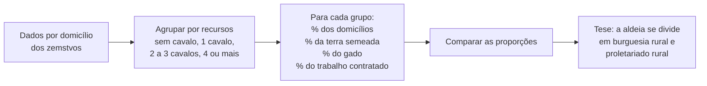

> **Aviso de Idioma:** Este currículo e todos os seus recursos de apoio foram estruturados exclusivamente em **Português (PT-BR)**.

# Aula 1 · Lênin sociólogo: o capitalismo chega ao campo russo

**MOD-201 · 10 horas · Leitura principal:** Lênin, *O Desenvolvimento do Capitalismo na Rússia* (1899), Prefácio e capítulo II, "A desintegração do campesinato" (seleção)

## O que você vai aprender

- Situar a Rússia do fim do século XIX: servidão, comuna camponesa e industrialização tardia.
- Explicar a disputa entre os <abbr title="Narodniki (populistas): revolucionários russos do século XIX que acreditavam que a Rússia poderia passar direto ao socialismo apoiada na comuna camponesa, sem atravessar o capitalismo.">populistas</abbr> e os marxistas russos.
- Reconstruir o método de Lênin: classificar os domicílios camponeses e comparar a sua parte na população com a sua parte nos recursos.
- Explicar a tese da <abbr title="Diferenciação do campesinato: processo pelo qual a massa camponesa, aparentemente homogênea, se divide em uma burguesia rural que contrata trabalho e um proletariado rural que vende a sua força de trabalho.">diferenciação do campesinato</abbr> e a formação do mercado interno.
- Reproduzir o método em Python com dados didáticos e relacioná-lo à desigualdade fundiária no Brasil.

## Pergunta de abertura

> Numa aldeia, todos são chamados de "camponeses". Uns têm cinco cavalos e contratam vizinhos na colheita; outros não têm nenhum cavalo e trabalham para os primeiros. Faz sentido continuar tratando todos como uma só classe? Como provar, com números, que a aldeia já se dividiu?

## 1. A Rússia depois da servidão

Até 1861, a maioria dos camponeses russos era **serva**: presa à terra, obrigada a trabalhar para o senhor. A abolição da servidão, decretada pelo czar Alexandre II, libertou juridicamente milhões de pessoas, mas os camponeses receberam terras piores e menores do que as que cultivavam, e tiveram de pagá-las em prestações por décadas. A terra continuou, em grande parte, sob a gestão da **comuna** camponesa (*mir* ou *obshchina*), que redistribuía periodicamente os lotes entre as famílias.

Ao mesmo tempo, a partir da década de 1880, o Estado promoveu uma industrialização acelerada, com capital estrangeiro (francês, belga, inglês), ferrovias e fábricas enormes em São Petersburgo, Moscou e no sul. A Rússia combinava a aldeia quase medieval e a fábrica mais moderna da Europa. Guarde essa combinação: ela é o centro da teoria de Trótski (aula 3).

## 2. A disputa: a Rússia precisa passar pelo capitalismo?

Os **populistas** (*narodniki*) sustentavam que a Rússia era diferente do Ocidente: graças à comuna camponesa, com a sua propriedade coletiva da terra, poderia passar diretamente a uma forma de socialismo agrário, sem a miséria do capitalismo industrial. Alguns argumentavam ainda que o capitalismo não conseguiria se desenvolver na Rússia por falta de mercado interno: os camponeses eram pobres demais para comprar mercadorias.

O próprio Marx, consultado por revolucionários russos no fim da vida, foi cauteloso: em 1881, numa carta a Vera Zasulitch, admitiu que a comuna poderia servir de ponto de apoio para uma regeneração social, desde que fosse protegida das pressões que a desagregavam.

O jovem Lênin, exilado na Sibéria por atividade revolucionária, respondeu aos populistas com um livro de quase 600 páginas, baseado em estatística. A sua tese: **o capitalismo já estava se desenvolvendo na Rússia, inclusive dentro da comuna camponesa**, e o próprio desenvolvimento do capitalismo criava o seu mercado interno.

## 3. A fonte: as estatísticas dos *zemstvos*

Os <abbr title="Zemstvo: órgão de governo local criado na Rússia em 1864, com representação de nobres, cidadãos e camponeses. Os zemstvos produziram grandes levantamentos estatísticos sobre a economia camponesa.">*zemstvos*</abbr> eram assembleias locais criadas em 1864. Muitos contrataram estatísticos (vários deles populistas, aliás) que fizeram levantamentos minuciosos, domicílio por domicílio: quantas pessoas, quanta terra própria e arrendada, quantos cavalos e vacas, quantos trabalhadores contratados, quanto ganhavam com trabalho fora.

Lênin percebeu que esses levantamentos, publicados como médias por aldeia ou por distrito, escondiam o essencial. A média de "três cavalos por domicílio" pode significar que todos têm três, ou que alguns têm dez e muitos não têm nenhum. Ele reorganizou os dados agrupando os domicílios por **grupos de recursos** e comparando a parte de cada grupo nos domicílios com a sua parte na terra, no gado e no trabalho contratado.



## 4. O que os números mostram

Os quadros de Lênin, repetidos para muitas províncias, mostram um padrão:

- O grupo superior (uma minoria de domicílios) concentrava uma parte desproporcional da terra semeada, do gado, das máquinas agrícolas e da terra **arrendada** de outros, e **contratava trabalhadores**.
- O grupo inferior (muitas vezes cerca de metade dos domicílios) tinha pouca ou nenhuma terra semeada, nenhum cavalo, **arrendava a sua terra para outros** e vivia de **vender trabalho** fora.
- O grupo do meio era instável: tendia a ser puxado para um dos polos.

Lênin chama o primeiro grupo de **burguesia camponesa** e o segundo de **proletariado rural** (ou semiproletariado). A comuna não impedia a diferenciação: ela apenas a escondia sob a aparência de igualdade.

E daí vem a resposta ao problema do mercado interno: a diferenciação **cria** o mercado. O camponês arruinado, que deixa de produzir a própria comida, passa a comprá-la; o camponês rico, que contrata trabalho e produz para vender, compra ferramentas e máquinas. O capitalismo não precisa de um mercado pronto: ele o produz ao transformar camponeses em compradores de meios de vida e de meios de produção.

## 5. Reproduzindo o método em Python

Os números abaixo são **didáticos**, construídos para imitar o padrão dos quadros de Lênin, e não dados históricos reais.

```python
grupos = [
    # (grupo, domicílios, terra semeada em hectares, cavalos, trabalhadores contratados)
    ("sem cavalo", 4200, 3100, 0, 10),
    ("1 cavalo", 3100, 9800, 3100, 150),
    ("2 a 3 cavalos", 1900, 14200, 4600, 900),
    ("4 ou mais", 800, 15900, 4100, 3400),
]

def percentuais(grupos, indice):
    total = sum(g[indice] for g in grupos)
    return [g[indice] / total * 100 for g in grupos]

colunas = {"domicílios": 1, "terra": 2, "cavalos": 3, "contratados": 4}
tabela = {nome: percentuais(grupos, i) for nome, i in colunas.items()}

print(f"{'grupo':15s}" + "".join(f"{c:>13s}" for c in colunas))
for i, g in enumerate(grupos):
    print(f"{g[0]:15s}" + "".join(f"{tabela[c][i]:12.1f}%" for c in colunas))
```

Leia a tabela como Lênin: os domicílios com 4 ou mais cavalos são 8% do total, mas semeiam mais de um terço da terra e empregam quase 80% do trabalho contratado. Os domicílios sem cavalo são 42% do total e semeiam menos de 10% da terra.

Uma forma de resumir a desigualdade num só número é calcular quanto da terra fica com os 10% de domicílios mais ricos, ou construir uma **curva de Lorenz**. Você vai fazer isso no projeto do MOD-207.

> **Conexão com o Brasil:** o método de Lênin se aplica diretamente à estrutura fundiária brasileira. Segundo o Censo Agropecuário de 2017 do IBGE, os estabelecimentos com mil hectares ou mais eram cerca de 1% do total e ocupavam perto de metade da área dos estabelecimentos, enquanto os com menos de 10 hectares eram cerca de metade dos estabelecimentos e ocupavam pouco mais de 2% da área. A mesma pergunta de Lênin (quem contrata trabalho, quem vende trabalho, quem concentra a terra?) organiza os estudos sobre o campo brasileiro, da Lei de Terras (MOD-103, aula 7) aos movimentos de luta pela terra.

## 6. Lições de método

1. **Desconfie das médias.** Uma média esconde a distribuição. Sempre pergunte como os dados se distribuem entre grupos.
2. **Classifique por critérios que importam teoricamente.** Lênin agrupou os domicílios por recursos produtivos (cavalos, terra semeada), porque a sua teoria dizia que a posição de classe depende dos meios de produção.
3. **Use os dados do adversário.** Muitos estatísticos dos *zemstvos* eram populistas; Lênin mostrou que os seus próprios números contradiziam as suas conclusões.
4. **Combine estatística e teoria.** Os números sozinhos não dizem "burguesia rural"; é a teoria (MOD-103) que diz o que procurar e como interpretar.

Compare com Durkheim (MOD-105, aula 3), que publicaria *O Suicídio* dois anos antes: os dois transformaram estatísticas oficiais em ciência social, com objetivos e teorias muito diferentes.

## Leitura guiada

1. **Prefácio à primeira edição** (cerca de 5 páginas): o objetivo do livro e a crítica aos populistas.
2. **Capítulo II**, seções I a III (cerca de 40 páginas): os dados de uma província, a forma como Lênin agrupa os domicílios e as conclusões. Escolha um quadro e refaça os percentuais com Python.
3. **Capítulo II, seção final**, "Conclusões" (cerca de 10 páginas): a formação do mercado interno.

## Exercícios

**1.** Responda à pergunta de abertura com o método de Lênin.

<details>
<summary>Gabarito comentado</summary>

Não faz sentido tratar todos como uma só classe se a posição de cada um nas relações de produção é diferente: uns contratam trabalho, outros vendem trabalho. Para provar com números, agrupam-se os domicílios por recursos produtivos e comparam-se as partes de cada grupo nos domicílios, na terra, no gado e no trabalho contratado. Se uma minoria concentra recursos e contrata trabalho e uma grande parte não tem recursos e vende trabalho, a aldeia já se dividiu em classes.
</details>

**2.** Por que, para Lênin, a ruína de muitos camponeses **amplia** o mercado interno em vez de reduzi-lo?

<details>
<summary>Gabarito comentado</summary>

Porque o camponês arruinado deixa de produzir os seus meios de vida e passa a comprá-los com o salário, tornando-se consumidor de mercadorias. O camponês enriquecido, que produz para o mercado, compra meios de produção (ferramentas, máquinas, adubos). A diferenciação transforma uma economia de subsistência numa economia de mercado: o capitalismo cria o próprio mercado.
</details>

**3.** Modifique o código para calcular, para cada grupo, a terra semeada **por domicílio** e o número de trabalhadores contratados por domicílio. O que essas medidas acrescentam?

<details>
<summary>Gabarito</summary>

```python
for nome, dom, terra, cav, contr in grupos:
    print(f"{nome:15s} terra/domicílio={terra / dom:5.2f} ha  contratados/domicílio={contr / dom:5.2f}")
```

As médias por grupo mostram a distância entre os polos: um domicílio do grupo superior semeia muitas vezes mais terra que um do grupo inferior e é praticamente o único que contrata trabalho. Repare que a média por grupo é informativa, ao contrário da média geral, porque os grupos foram definidos de modo teoricamente relevante.
</details>

**4. Pesquisa.** No SIDRA do IBGE, encontre a tabela do Censo Agropecuário de 2017 com o número e a área dos estabelecimentos por grupos de área total. Calcule a parte de cada grupo no número e na área, como Lênin, e escreva um parágrafo interpretando.

<details>
<summary>Critérios de correção</summary>

A resposta deve citar a tabela exata (número e título), apresentar os percentuais calculados e interpretá-los. Uma resposta excelente lembra que o tamanho da área não é o único critério (Lênin usou também gado, máquinas e trabalho contratado) e procura, no mesmo censo, dados sobre pessoal ocupado e contratação de mão de obra.
</details>

## Resumo da aula

- A Rússia pós-1861 combinava servidão recente, comuna camponesa e indústria moderna.
- Os populistas apostavam num socialismo agrário sem capitalismo; Lênin respondeu com estatística.
- Agrupando os domicílios por recursos, Lênin mostrou a diferenciação do campesinato em burguesia rural e proletariado rural.
- A diferenciação cria o mercado interno.
- Lições de método: desconfie das médias, classifique por critérios teoricamente relevantes, combine dados e teoria.

## Para ir além

- Teodor Shanin, *Late Marx and the Russian Road* (1983), sobre as cartas de Marx a respeito da comuna russa.
- José Graziano da Silva, *O Que É Questão Agrária* (1980), introdução curta ao tema no Brasil.