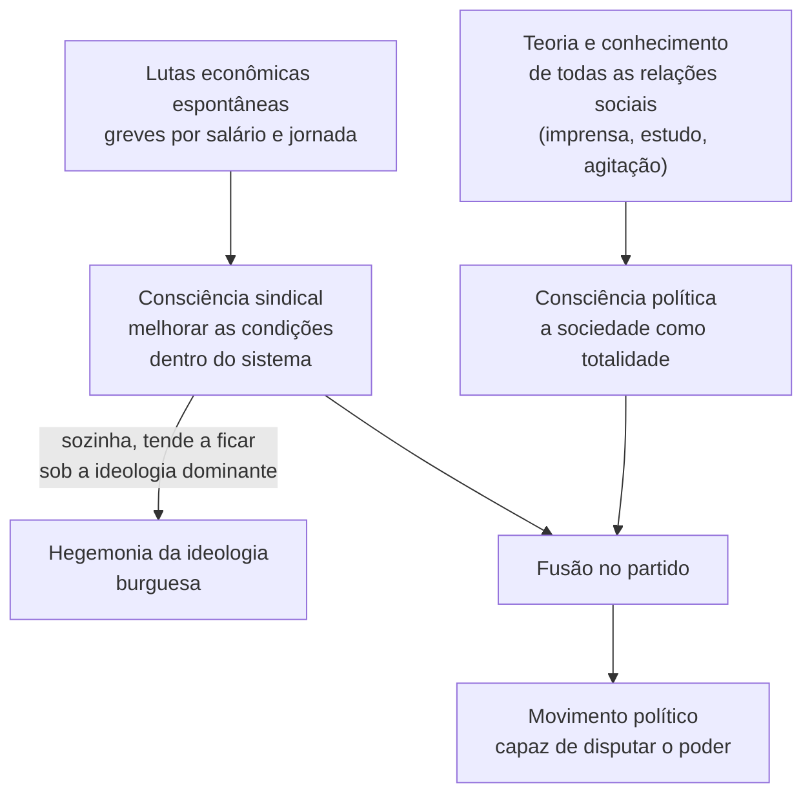
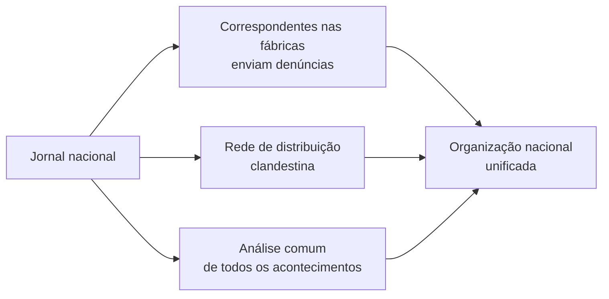

> **Aviso de Idioma:** Este currículo e todos os seus recursos de apoio foram estruturados exclusivamente em **Português (PT-BR)**.

# Aula 2 · *Que Fazer?*: espontaneidade, consciência e organização

**MOD-201 · 10 horas · Leitura principal:** Lênin, *Que Fazer? Problemas Candentes do Nosso Movimento* (1902), capítulos II, III e V (seleção)

## O que você vai aprender

- Situar *Que Fazer?* no debate do movimento operário russo por volta de 1900.
- Distinguir consciência "sindical" e consciência política, e explicar a crítica ao <abbr title="Economicismo: corrente do movimento operário russo por volta de 1900 que defendia que os operários deviam se concentrar nas lutas econômicas (salário, jornada), deixando a política à burguesia liberal.">economicismo</abbr>.
- Explicar a proposta de um partido de revolucionários profissionais e do jornal como "organizador coletivo".
- Entender a divisão entre <abbr title="Bolcheviques e mencheviques: as duas frações em que se dividiu o Partido Operário Social-Democrata Russo em 1903. Bolchevique quer dizer da maioria e menchevique, da minoria, nomes tirados de uma votação no congresso.">bolcheviques e mencheviques</abbr>.
- Avaliar as críticas de Rosa Luxemburgo e do jovem Trótski ao modelo de organização de Lênin.

## Pergunta de abertura

> Milhares de pessoas se revoltam espontaneamente contra o aumento da passagem de ônibus e enchem as ruas. Semanas depois, o movimento se dissolve, e o resultado político é muito diferente do que os manifestantes queriam. O que faltou? A espontaneidade basta?

## 1. O contexto: um movimento sem centro

Por volta de 1900, o movimento operário russo crescia: greves em São Petersburgo, círculos de estudo, pequenos jornais locais. Mas era disperso, amador e constantemente desbaratado pela polícia política do czar, a Okhrana, numa Rússia sem liberdade de imprensa, de reunião nem partidos legais.

Os marxistas russos fundaram em 1898 o Partido Operário Social-Democrata Russo, cujos dirigentes foram presos logo depois. Em 1900, Lênin, Martov, Plekhanov e outros lançaram no exílio o jornal *Iskra* (*A Centelha*), impresso na Europa e contrabandeado para a Rússia. *Que Fazer?* (1902) é a defesa do projeto do *Iskra* contra outras correntes do movimento.

## 2. Espontaneidade e consciência

O alvo principal do livro é o **economicismo**: a ideia de que os operários deveriam se concentrar nas lutas econômicas imediatas (salários, jornada, condições de trabalho), e que a consciência política surgiria naturalmente dessas lutas.

Lênin distingue:

| Consciência sindical (*trade-unionista*) | Consciência política social-democrata |
| :--- | :--- |
| Nasce espontaneamente das lutas econômicas | Não nasce espontaneamente da fábrica |
| Pede melhores condições dentro do sistema | Compreende a sociedade como totalidade: as relações entre todas as classes e o Estado |
| Luta contra o patrão | Luta contra toda forma de opressão, mesmo a que não atinge diretamente os operários |
| Horizonte: a categoria e a empresa | Horizonte: a transformação de toda a sociedade |

A tese polêmica: a consciência política "só pode ser trazida ao operário **de fora** da luta econômica", isto é, a partir do conhecimento das relações entre todas as classes. Lênin se apoia numa passagem de Karl Kautsky, o principal teórico do socialismo alemão, segundo a qual o socialismo moderno nasceu como teoria elaborada por intelectuais e foi levado ao movimento operário.

O ponto mais interessante (e menos lembrado) do capítulo III é o que Lênin entende por educação política: os operários precisam aprender a **reagir a todos os casos de arbitrariedade e opressão**, quaisquer que sejam as classes atingidas: a perseguição a estudantes, a seitas religiosas, a camponeses, a nacionalidades oprimidas. O revolucionário não deve ser um "secretário de sindicato", mas um "tribuno do povo".

Lembre da *Ideologia Alemã* (MOD-103, aula 2): as ideias dominantes são as da classe dominante. Lênin tira daí a conclusão de que a espontaneidade, deixada a si mesma, tende a reproduzir a ideologia dominante, porque é ela que está disponível por toda parte. Gramsci (MOD-203) vai desenvolver esse problema com o conceito de hegemonia.

## 3. Os revolucionários profissionais

Num Estado policial, uma organização aberta, com reuniões públicas e eleições amplas, seria destruída em semanas. Lênin propõe:

- Um núcleo de **revolucionários profissionais**, dedicados integralmente à atividade, treinados na clandestinidade e na arte de escapar da polícia.
- Uma organização **centralizada**, com divisão de tarefas, capaz de dar continuidade ao trabalho mesmo quando militantes são presos.
- Ao redor desse núcleo, organizações amplas e abertas (sindicatos, círculos), tão amplas quanto possível.

E responde à acusação de antidemocracia: num regime autocrático, a "democracia ampla" dentro de uma organização clandestina é "um brinquedo inútil e nocivo", porque exporia todos os membros à polícia. A garantia contra os abusos seria a confiança mútua e a camaradagem entre militantes experimentados.

## 4. O jornal como organizador coletivo

A proposta mais original do livro é a de um **jornal político para toda a Rússia**. Lênin usa a imagem dos andaimes de uma construção: além de propagandista e agitador coletivo, o jornal é **organizador coletivo**. A rede de correspondentes, distribuidores e leitores que o jornal exige é ela mesma uma organização: obriga a coordenar tarefas, criar canais de comunicação, testar militantes, unificar as análises.

> **Conexão com o curso:** compare com a imprensa operária anarquista no Brasil (MOD-107, aula 6), que também funcionava como organizadora, mas sem um centro único. E pense na pergunta atual: quem são hoje os "organizadores coletivos"? Plataformas digitais organizam movimentos em horas, mas o algoritmo que decide o que circula pertence a empresas com interesses próprios. No MOD-302 você vai analisar computacionalmente como discursos políticos circulam.

## 5. A divisão de 1903 e as críticas

No segundo congresso do partido (1903, em Bruxelas e Londres), a discussão sobre quem poderia ser membro do partido dividiu o *Iskra*. Lênin queria que só fossem membros os que participassem pessoalmente de uma organização do partido; Martov aceitava como membros os que colaborassem sob a direção do partido. Numa votação posterior, sobre a composição do comitê de redação, os partidários de Lênin ficaram em maioria. Daí os nomes: **bolcheviques** (da maioria) e **mencheviques** (da minoria). A divisão se aprofundou e se tornou definitiva em 1912.

As críticas vieram de dentro do próprio marxismo:

| Crítica | Argumento |
| :--- | :--- |
| **Rosa Luxemburgo**, *Questões de Organização da Social-Democracia Russa* (1904) | O ultracentralismo de Lênin subordina o movimento à direção e sufoca a iniciativa das massas. "Os erros cometidos por um movimento operário verdadeiramente revolucionário são historicamente muito mais fecundos do que a infalibilidade do melhor comitê central." |
| **Trótski**, *Nossas Tarefas Políticas* (1904) | Previu uma cadeia de substituições: a organização do partido substitui o partido, o comitê central substitui a organização e, por fim, um ditador substitui o comitê central. |

O próprio Lênin, depois, relativizou o livro: disse que tinha "torcido o bastão" para o outro lado, contra o economicismo, e que *Que Fazer?* respondia às condições específicas da clandestinidade russa. Em 1905, com a revolução, defendeu abrir o partido a milhares de operários. A expressão "centralismo democrático" (liberdade de discussão, unidade na ação) passou a definir o modelo bolchevique, e o seu sentido real foi muito disputado ao longo do século XX.

Volte à pergunta de abertura com as duas posições: para Lênin, faltou organização e consciência política para dar continuidade e direção ao movimento; para Rosa Luxemburgo, a própria experiência das massas em luta é a escola política, e a organização deve servir a ela, não comandá-la.

## Leitura guiada

1. **Capítulo II**, "A espontaneidade das massas e a consciência da social-democracia" (cerca de 25 páginas): a passagem de Kautsky e a tese sobre a consciência vinda de fora.
2. **Capítulo III**, "Política sindical e política social-democrata" (cerca de 30 páginas): o "tribuno do povo".
3. **Capítulo V**, "O plano de um jornal político para toda a Rússia" (cerca de 25 páginas): os andaimes e o organizador coletivo.
4. **Rosa Luxemburgo**, *Questões de Organização da Social-Democracia Russa* (cerca de 20 páginas).

## Exercícios

**1.** Qual é a diferença entre consciência sindical e consciência política em *Que Fazer?*

Gabarito comentado

A consciência sindical nasce das lutas econômicas e busca melhorar as condições dos trabalhadores dentro do sistema existente. A consciência política compreende as relações entre todas as classes e o Estado e reage a toda forma de opressão. Para Lênin, a primeira surge espontaneamente; a segunda exige teoria, imprensa e organização.

**2.** Explique a imagem do jornal como "organizador coletivo".

Gabarito comentado

Para produzir e distribuir um jornal nacional numa situação clandestina, é preciso uma rede de correspondentes, impressores, transportadores e distribuidores. Essa rede, criada para o jornal, é ela mesma uma organização nacional: coordena tarefas, testa militantes e unifica as análises. Como os andaimes de um prédio, o jornal sustenta a construção da organização.

**3.** Compare a crítica de Rosa Luxemburgo a Lênin com a crítica de Bakunin a Marx (MOD-107, aula 3).

Gabarito comentado

As duas apontam o risco de uma minoria dirigente se separar das massas e substituí-las. Bakunin critica o Estado e o poder político em si; Rosa Luxemburgo critica a forma de organização do partido, mas continua defendendo a necessidade do partido e da conquista do poder político. A resposta excelente nota que a previsão de Trótski sobre a cadeia de substituições (1904) se parece muito com a de Bakunin, e que o próprio Trótski mudaria de posição sobre o partido em 1917.

**4.** Escolha um movimento social brasileiro recente (as jornadas de junho de 2013, os breques dos entregadores de aplicativo em 2020, ou outro) e analise a relação entre espontaneidade e organização com as categorias da aula.

Critérios de correção

A resposta deve descrever o movimento com fontes, identificar os elementos espontâneos e os organizados (quem convocava, por quais canais, que reivindicações), e avaliar os resultados à luz das posições de Lênin e de Rosa Luxemburgo, sem reduzir o caso a uma ilustração da teoria.

## Resumo da aula

- *Que Fazer?* (1902) critica o economicismo e defende que a consciência política não nasce espontaneamente da luta econômica.
- O revolucionário deve ser um "tribuno do povo", que reage a toda opressão.
- Num Estado policial, Lênin propõe um núcleo de revolucionários profissionais e uma organização centralizada.
- O jornal nacional é propagandista, agitador e organizador coletivo.
- A divisão de 1903 criou bolcheviques e mencheviques; Rosa Luxemburgo e o jovem Trótski criticaram o centralismo de Lênin.

## Para ir além

- Rosa Luxemburgo, *Greve de Massas, Partido e Sindicatos* (1906), sobre a experiência de 1905.
- Lênin, *Um Passo em Frente, Dois Passos Atrás* (1904), sobre o congresso de 1903.