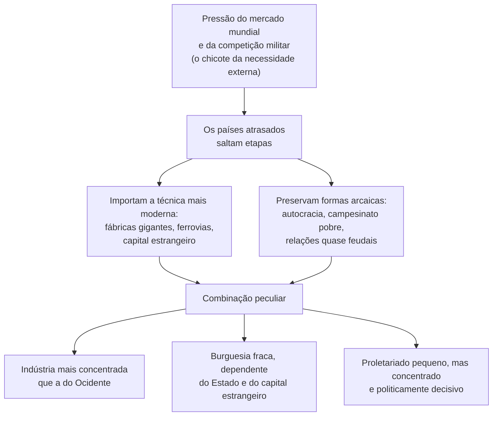

> **Aviso de Idioma:** Este currículo e todos os seus recursos de apoio foram estruturados exclusivamente em **Português (PT-BR)**.

# Aula 3 · Trótski: 1905, desenvolvimento desigual e combinado, revolução permanente

**MOD-201 · 10 horas · Leitura principal:** Trótski, *Balanços e Perspectivas* (1906), capítulos 1, 4 e 9; *História da Revolução Russa* (1930), capítulo 1, "Peculiaridades do desenvolvimento da Rússia"; *A Revolução Permanente* (1930), Introdução e "O que é a revolução permanente? (Teses fundamentais)"

*Leon Trótski, fotografia publicada em março de 1918. Domínio público nos Estados Unidos.*

## O que você vai aprender

- Conhecer a revolução de 1905 e o nascimento dos <abbr title="Soviete: em russo, conselho. Assembleia de delegados eleitos nas fábricas, quartéis e bairros, que surgiu em 1905 e reapareceu em 1917 como órgão de poder dos trabalhadores e soldados.">sovietes</abbr>.
- Explicar a lei do <abbr title="Desenvolvimento desigual e combinado: tese de Trótski segundo a qual os países que se integram tarde ao capitalismo mundial não repetem as etapas dos pioneiros, mas combinam formas arcaicas e as mais modernas, saltando etapas.">desenvolvimento desigual e combinado</abbr>.
- Explicar a teoria da <abbr title="Revolução permanente: tese de Trótski segundo a qual, nos países atrasados, as tarefas democráticas (terra, independência nacional, democracia) só podem ser cumpridas pela classe operária no poder, e a revolução precisa continuar até o socialismo e se estender internacionalmente.">revolução permanente</abbr> e compará-la com as posições de mencheviques e bolcheviques antes de 1917.
- Aplicar o conceito de desenvolvimento desigual e combinado ao Brasil e à economia digital.

## Pergunta de abertura

> Em muitas cidades brasileiras, um entregador sem carteira assinada, morador de uma rua sem saneamento, recebe pedidos de um aplicativo com inteligência artificial em um celular de última geração. O Brasil é um país "atrasado" ou "moderno"? Talvez a pergunta esteja errada.

## 1. 1905: o ensaio geral

Em janeiro de 1905, em São Petersburgo, uma procissão pacífica de operários, liderada por um padre, levou ao czar uma petição por direitos. A guarda imperial atirou na multidão: centenas de mortos. O "Domingo Sangrento" desencadeou uma onda de greves, motins de soldados e marinheiros (como o do encouraçado *Potemkin*) e revoltas camponesas que durou quase dois anos.

Em outubro de 1905, durante uma greve geral, os operários de São Petersburgo elegeram nas fábricas um **conselho de delegados**: o **soviete**. Ele organizava a greve, publicava o seu jornal e passou, na prática, a disputar a autoridade com o governo. O seu presidente, nas semanas decisivas, foi um jovem de 26 anos: Lev Bronstein, conhecido como **Leon Trótski**. O soviete foi dissolvido e os seus dirigentes, presos. No julgamento, Trótski fez a defesa política da insurreição; foi condenado ao exílio na Sibéria e fugiu no caminho.

Lênin chamaria 1905 de "ensaio geral" de 1917.

## 2. Desenvolvimento desigual e combinado

Na prisão, Trótski escreveu *Balanços e Perspectivas* (1906). Quase 25 anos depois, no exílio, abriu a sua *História da Revolução Russa* com o capítulo que formula a ideia com mais clareza.

O ponto de partida é recusar a visão de que todos os países passam pelas mesmas etapas, como alunos de uma escola que sobem de série em série. Os países que chegam tarde ao capitalismo mundial **não repetem** a trajetória dos pioneiros. Pressionados pelo mercado mundial e pela concorrência militar (o que Trótski chama de "chicote da necessidade externa"), eles **saltam etapas** e importam as técnicas mais avançadas prontas.

Mas o salto não apaga o atraso. O resultado é uma **combinação** de formas arcaicas e modernas:

Na Rússia, isso produziu algo surpreendente. Em 1914, as fábricas com mais de mil operários reuniam cerca de 40% dos operários industriais russos, uma proporção maior que a dos Estados Unidos. O país mais atrasado da Europa tinha as fábricas mais modernas e concentradas, cercadas por um oceano camponês e governadas por uma autocracia.

## 3. A revolução permanente

Que tipo de revolução poderia acontecer num país assim? Por volta de 1905, havia três respostas entre os marxistas russos:

| Corrente | Caráter da revolução | Quem dirige | Resultado esperado |
| :--- | :--- | :--- | :--- |
| **Mencheviques** | Burguesa e democrática | A burguesia liberal, com apoio operário | Uma república parlamentar e um longo período de desenvolvimento capitalista antes do socialismo |
| **Bolcheviques (Lênin, até 1917)** | Burguesa e democrática | Aliança entre operários e camponeses ("ditadura democrática do proletariado e do campesinato") | Uma república democrática radical, que abriria caminho ao socialismo na Europa |
| **Trótski** | Começa democrática e se transforma em socialista | A classe operária, apoiada pelos camponeses | O poder operário, que precisa avançar sobre a propriedade capitalista e depende da extensão da revolução a outros países |

O argumento de Trótski decorre do desenvolvimento desigual e combinado: numa sociedade assim, a **burguesia nacional é fraca** e dependente do Estado autocrático e do capital estrangeiro, e teme mais os operários do que o czar. Ela não fará a revolução democrática (reforma agrária, república, liberdades). Essas tarefas recaem sobre a classe operária. Mas os operários no poder não ficarão só nas tarefas democráticas: defenderão os seus interesses (jornada, salário, controle das fábricas), o que os levará a tocar a propriedade capitalista.

A revolução se torna **permanente** em dois sentidos:

1. **Da democracia ao socialismo**, sem uma longa etapa intermediária.
2. **Do país ao mundo**: um país atrasado não pode construir sozinho o socialismo; a revolução precisa se estender aos países avançados.

Em 1917, Lênin, nas *Teses de Abril* (aula 5), adotou na prática uma posição muito próxima da de Trótski, e os dois dirigiram juntos a revolução de outubro. Mais tarde, quando Stálin defendeu a construção do "socialismo num só país", Trótski reformulou a teoria em *A Revolução Permanente* (1930) como resposta a ele.

## 4. O desenvolvimento desigual e combinado no Brasil

A ideia de Trótski influenciou profundamente a teoria social latino-americana. No MOD-206, Florestan Fernandes vai analisar a "revolução burguesa" no Brasil como um processo em que a burguesia nacional, associada ao capital estrangeiro e às oligarquias agrárias, não realizou as tarefas democráticas clássicas. É um diagnóstico com parentesco claro com o de Trótski, ainda que Florestan chegue a ele por outros caminhos.

Volte à pergunta de abertura. Pensar o Brasil como "atrasado" ou "moderno" é pensar em etapas. A ideia de desenvolvimento desigual e combinado sugere outra coisa: o entregador sem direitos e o aplicativo de última geração não pertencem a "épocas diferentes"; são partes de uma **mesma combinação**, em que a tecnologia mais avançada se apoia exatamente na precariedade do trabalho.

> **Conexão com a economia digital:** a mesma lógica aparece na divisão internacional do trabalho digital. Os sistemas de inteligência artificial mais avançados do mundo dependem de trabalho de rotulação de dados, moderação de conteúdo e manutenção feito em países periféricos, muitas vezes por remuneração baixa e sem vínculo. O desenvolvimento é desigual (a tecnologia e os lucros se concentram nos centros) e combinado (a ponta mais moderna depende das formas mais precárias de trabalho). O projeto do módulo pede que você investigue isso com dados.

## Leitura guiada

1. ***História da Revolução Russa*, capítulo 1** (cerca de 15 páginas): a formulação mais clara da lei. Copie a passagem sobre o "chicote da necessidade externa".
2. ***Balanços e Perspectivas*, capítulos 4 e 9** (cerca de 25 páginas): a revolução e o proletariado, e a Europa e a revolução.
3. ***A Revolução Permanente*, "Teses fundamentais"** (cerca de 10 páginas): as 14 teses de 1930. Resuma cada uma numa frase.

## Exercícios

**1.** Explique a lei do desenvolvimento desigual e combinado com as suas palavras e um exemplo que não seja a Rússia.

Gabarito comentado

Países que chegam tarde ao capitalismo mundial, pressionados pelo mercado e pela competição, não repetem as etapas dos pioneiros: importam as técnicas mais avançadas e combinam-nas com relações sociais arcaicas. Exemplo: o Brasil do início do século XX, com ferrovias e fábricas modernas financiadas por capital inglês, ao lado do latifúndio e das relações de trabalho herdadas da escravidão; ou o Brasil atual, com agricultura de exportação de alta tecnologia e trabalho análogo à escravidão em parte das cadeias produtivas.

**2.** Por que, segundo Trótski, a burguesia russa não podia dirigir a revolução democrática?

Gabarito comentado

Porque era fraca, dependente do Estado autocrático (que garantia encomendas e repressão) e do capital estrangeiro, e temia a classe operária, concentrada e combativa, mais do que temia o czar. Uma revolução democrática radical (terra para os camponeses, liberdades políticas) mobilizaria as massas de um modo que ameaçaria a sua própria propriedade.

**3.** Monte uma tabela comparando as posições de mencheviques, bolcheviques (antes de 1917) e Trótski sobre o caráter da revolução russa.

Gabarito

A tabela deve reproduzir, com as palavras do estudante, as três colunas da seção 3: caráter da revolução, classe dirigente e resultado esperado. A resposta excelente acrescenta que, nas *Teses de Abril* de 1917, Lênin se aproximou da posição de Trótski.

**4.** Escreva 300 palavras sobre a pergunta de abertura, usando o conceito de desenvolvimento desigual e combinado e um dado público sobre a informalidade no Brasil (PNAD Contínua).

Critérios de correção

A resposta deve citar o dado com fonte e período, recusar a oposição simples entre "atrasado" e "moderno" e mostrar a combinação entre tecnologia de ponta e trabalho precário como uma unidade. A melhor resposta antecipa o debate do MOD-206 sobre o capitalismo dependente.

## Resumo da aula

- Em 1905, os operários de São Petersburgo criaram o soviete; Trótski foi o seu presidente.
- Desenvolvimento desigual e combinado: os países atrasados saltam etapas, importam a técnica moderna e a combinam com formas arcaicas.
- Na Rússia, isso produziu indústria concentrada, burguesia fraca e proletariado decisivo.
- Revolução permanente: as tarefas democráticas recaem sobre a classe operária, a revolução avança ao socialismo e depende da extensão internacional.
- O conceito ajuda a pensar o Brasil e a divisão internacional do trabalho digital.

## Para ir além

- Michael Löwy, artigos sobre a teoria do desenvolvimento desigual e combinado, em que o conceito é aplicado à América Latina.
- Trótski, *1905* (1909), a sua história da primeira revolução russa.