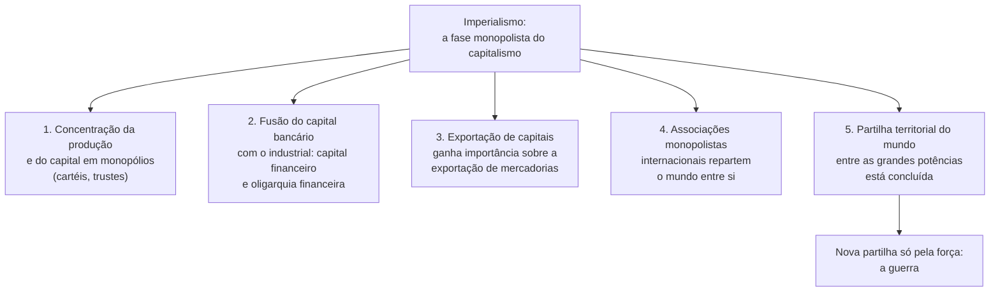
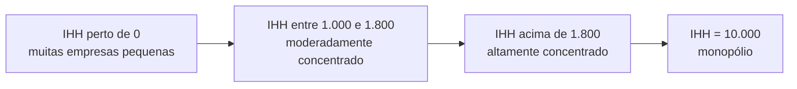

> **Aviso de Idioma:** Este currículo e todos os seus recursos de apoio foram estruturados exclusivamente em **Português (PT-BR)**.

# Aula 4 · Lênin lê Hegel e escreve o *Imperialismo*

**MOD-201 · 10 horas · Leitura principal:** Lênin, *Cadernos Filosóficos* (1914 a 1916), "Resumo da Ciência da Lógica de Hegel" e "Sobre a questão da dialética" (seleção); *Imperialismo, Fase Superior do Capitalismo* (1916), Prefácios, capítulos I, II, III, V e VII

## O que você vai aprender

- Entender o contexto da Primeira Guerra Mundial e a falência da Segunda Internacional.
- Explicar por que Lênin voltou a Hegel em 1914 e o que encontrou nele.
- Enunciar as cinco características do <abbr title="Imperialismo (em Lênin): a fase do capitalismo em que dominam os monopólios e o capital financeiro, a exportação de capitais ganha importância e o mundo está repartido entre grandes grupos econômicos e potências.">imperialismo</abbr> e definir <abbr title="Capital financeiro: em Hilferding e Lênin, a fusão entre o capital bancário e o capital industrial, sob o comando de uma oligarquia financeira.">capital financeiro</abbr>.
- Medir a concentração de um mercado com a razão de concentração e o <abbr title="Índice de Herfindahl-Hirschman (IHH): soma dos quadrados das participações de mercado das empresas, em porcentagem. Vai de perto de zero (mercado pulverizado) a 10.000 (monopólio). Usado por autoridades antitruste, como o CADE.">índice de Herfindahl-Hirschman</abbr>, em Python.
- Discutir a atualidade e os limites da teoria diante das grandes empresas de tecnologia.

## Pergunta de abertura

> Em 1914, os partidos socialistas da Alemanha, da França e da Inglaterra, que tinham jurado se opor à guerra entre trabalhadores de países diferentes, votaram a favor dos créditos de guerra dos seus governos. Milhões de operários foram matar operários de outros países. Como explicar uma traição tão rápida de princípios proclamados durante décadas?

## 1. Agosto de 1914

Quando a guerra começou, a **Segunda Internacional**, que reunia os partidos socialistas de massa da Europa, se desfez em dias: cada partido apoiou o seu próprio governo. Lênin, então exilado na Suíça, chegou a pensar que a notícia de que os social-democratas alemães tinham votado pela guerra era uma falsificação do Estado-Maior alemão.

A crise o levou a duas tarefas paralelas: estudar de novo os fundamentos do método marxista (voltando a Hegel) e explicar a guerra como produto de uma nova fase do capitalismo (o imperialismo).

## 2. Lênin lê Hegel

Entre 1914 e 1916, na biblioteca de Berna, Lênin leu e anotou a *Ciência da Lógica* de Hegel. As anotações, publicadas só depois da sua morte como *Cadernos Filosóficos*, mostram um Lênin diferente do autor de *Materialismo e Empiriocriticismo* (1909), livro em que tinha defendido uma teoria do conhecimento como "reflexo" da realidade.

Algumas notas célebres:

- Sobre o método: a dialética é o estudo da contradição **na própria essência dos objetos**; o desenvolvimento é a "luta dos contrários".
- Sobre a relação entre conhecimento e realidade: a cognição não é um reflexo simples e imediato, mas um processo de aproximação infinita, cheio de mediações e de contradições.
- E uma provocação famosa: não se pode compreender completamente *O Capital*, especialmente o primeiro capítulo, sem ter estudado e compreendido toda a *Lógica* de Hegel. "Consequentemente", conclui Lênin, "meio século depois, nenhum marxista compreendeu Marx."

Por que isso importa politicamente? Muitos intérpretes ligam a leitura de Hegel à mudança de Lênin em 1917: a capacidade de ver na guerra e na crise um "salto qualitativo", em que uma situação se transforma no seu contrário, e de abandonar fórmulas por etapas (MOD-201, aula 3) diante de uma situação nova. Lembre do MOD-101 (aula 4): a dialética recusa esquemas aplicados de fora.

## 3. O *Imperialismo*

Em 1916, ainda em Zurique, Lênin escreveu um livro curto, que chamou de "ensaio popular": *Imperialismo, Fase Superior do Capitalismo*. Ele se apoia em dois autores: o liberal inglês John Hobson (*Imperialismo*, 1902) e o marxista austríaco Rudolf Hilferding (*O Capital Financeiro*, 1910), e em muitas estatísticas de bancos, cartéis e investimentos externos.

A tese: o capitalismo de livre concorrência descrito por Marx se transformou, no fim do século XIX, num **capitalismo de monopólios**. A concorrência produz a concentração; a concentração, levada a certo ponto, produz o monopólio.

### As cinco características



A definição sintética do capítulo VII:

> "O imperialismo é o capitalismo na fase de desenvolvimento em que ganhou corpo a dominação dos monopólios e do capital financeiro, adquiriu marcada importância a exportação de capitais, começou a partilha do mundo pelos trustes internacionais e terminou a partilha de toda a terra entre os países capitalistas mais importantes." (tradução livre)

Alguns pontos merecem atenção:

- **Os bancos mudam de papel.** De simples intermediários de pagamentos, tornam-se donos e controladores da indústria. Lênin descreve a "união pessoal" entre bancos e indústrias: os mesmos diretores sentam nos conselhos de bancos e de grandes empresas. Você vai mapear exatamente esse tipo de rede no MOD-303.
- **A exportação de capitais.** Os países ricos acumulam um "excedente" de capital que rende mais aplicado em países onde o capital é escasso, a terra e os salários são baratos e as matérias-primas abundantes: ferrovias na Argentina, minas na África, empréstimos ao Império Otomano.
- **A guerra.** Se o mundo já está repartido, e o desenvolvimento das potências é desigual (a Alemanha cresceu depressa, mas chegou tarde à partilha colonial), uma nova partilha só pode acontecer pela força. A guerra de 1914 não é um acidente: é a forma de resolver o conflito entre grupos monopolistas e Estados.
- **A aristocracia operária.** Parte dos superlucros extraídos das colônias permite subornar uma camada superior de trabalhadores nos países ricos, base social do "oportunismo" dos partidos socialistas. Era a resposta de Lênin à pergunta de abertura. É a parte mais discutida e mais frágil do livro.

## 4. Medindo a concentração

Lênin usou as estatísticas disponíveis em 1916: número de grandes empresas, participação dos maiores bancos nos depósitos, capitais investidos no exterior. Hoje, autoridades de defesa da concorrência (como o CADE no Brasil) usam indicadores padronizados de concentração.

**Razão de concentração (CR4):** a soma das participações de mercado das quatro maiores empresas.

**Índice de Herfindahl-Hirschman (IHH):** a soma dos **quadrados** das participações de todas as empresas, em porcentagem. Elevar ao quadrado dá mais peso às grandes: um mercado com uma empresa de 90% tem IHH muito maior do que um com nove empresas de 10%.

```python
def cr(participacoes, n=4):
    return sum(sorted(participacoes, reverse=True)[:n])

def ihh(participacoes):
    return sum(p ** 2 for p in participacoes)

mercados = {
    "pulverizado (20 empresas iguais)": [5.0] * 20,
    "oligopólio (4 grandes e uma franja)": [30, 25, 20, 15] + [2.0] * 5,
    "quase monopólio": [85, 8, 4, 3],
}

for nome, part in mercados.items():
    assert abs(sum(part) - 100) < 1e-9, "as participações devem somar 100%"
    print(f"{nome:38s} CR4 = {cr(part):5.1f}%   IHH = {ihh(part):7.0f}")
```

Para ter uma referência: nos Estados Unidos, as diretrizes de fusões de 2023 consideram altamente concentrado um mercado com IHH acima de 1.800. O CADE usa o IHH e também a variação do índice causada por uma fusão.



## 5. Imperialismo e plataformas digitais

As características de 1916 iluminam a economia digital, e também mostram onde a teoria precisa ser atualizada:

| Característica em Lênin | Na economia digital | O que muda |
| :--- | :--- | :--- |
| Concentração em monopólios | Poucas empresas dominam busca, sistemas móveis, nuvem, redes sociais e publicidade on-line | Os **efeitos de rede** (um serviço vale mais quanto mais gente o usa) aceleram a concentração |
| Capital financeiro | Fundos de investimento e de capital de risco financiam empresas que dão prejuízo por anos para conquistar mercados | O lucro esperado do monopólio futuro justifica o prejuízo presente |
| Exportação de capitais | Data centers, cabos submarinos e aquisições de empresas locais em todo o mundo | Exporta-se também **infraestrutura** de que os outros países passam a depender |
| Partilha do mundo | Ecossistemas fechados repartem os usuários e os dados | A partilha é de usuários e dados, não só de territórios |
| Rivalidade entre potências | Disputas entre Estados Unidos e China por chips, redes e inteligência artificial | A tecnologia como campo de rivalidade geopolítica |

No MOD-305 você vai estudar o conceito de **colonialismo de dados**, que retoma a lógica do *Imperialismo* aplicada à extração de dados de populações do Sul Global.

### Limites e críticas

- Lênin chamou o imperialismo de fase "superior" e "agonizante" do capitalismo, prevendo o seu fim próximo. Um século depois, o capitalismo segue em transformação. "Superior" é melhor lido como "mais recente".
- A tese da aristocracia operária foi muito contestada por historiadores do trabalho.
- Teóricos do imperialismo posteriores (no MOD-206, os teóricos da dependência) mostraram que a relação entre centro e periferia é mais complexa que a simples exportação de capitais.

## Leitura guiada

1. ***Cadernos Filosóficos***, "Sobre a questão da dialética" (cerca de 5 páginas) e trechos do resumo da *Lógica* (cerca de 15 páginas, selecionando as notas sobre contradição e cognição).
2. ***Imperialismo***, Prefácio às edições francesa e alemã (1920) e capítulos I e II (cerca de 30 páginas): concentração e bancos.
3. **Capítulos III e V** (cerca de 25 páginas): capital financeiro e partilha do mundo entre associações capitalistas.
4. **Capítulo VII** (cerca de 10 páginas): a definição sintética.

## Exercícios

**1.** Calcule o CR4 e o IHH de um mercado com participações 40%, 25%, 15%, 10%, 5%, 5%.

<details>
<summary>Gabarito</summary>

CR4 = 40 + 25 + 15 + 10 = **90%**. IHH = 1.600 + 625 + 225 + 100 + 25 + 25 = **2.600**: altamente concentrado. Confira com `cr([40, 25, 15, 10, 5, 5])` e `ihh([40, 25, 15, 10, 5, 5])`.
</details>

**2.** Duas empresas com 20% cada se fundem num mercado com IHH inicial de 1.500. Quanto o IHH aumenta?

<details>
<summary>Gabarito comentado</summary>

Antes: 20² + 20² = 800 dessas duas. Depois: 40² = 1.600. Aumento de **800**, e o IHH vai a 2.300. Em geral, a fusão de empresas com participações a e b aumenta o IHH em 2ab. As autoridades antitruste olham tanto o nível final quanto esse aumento.
</details>

**3.** Responda à pergunta de abertura com o argumento de Lênin. Depois, apresente uma crítica a esse argumento.

<details>
<summary>Gabarito comentado</summary>

Lênin explica a adesão à guerra pelo oportunismo de uma camada privilegiada de trabalhadores e dirigentes, sustentada pelos superlucros imperialistas, e pela integração dos partidos e sindicatos ao Estado nacional. Crítica: a adesão foi também popular e envolveu sentimentos nacionais, medo e propaganda de massa que a tese da "aristocracia operária" não explica sozinha; Gramsci (MOD-203) vai propor o conceito de hegemonia para pensar esse tipo de consentimento.
</details>

**4. Projeto.** Escolha um mercado digital e reúna dados públicos de participação (com fonte e data). Calcule o CR4 e o IHH e escreva um parágrafo relacionando o resultado com as cinco características de Lênin.

<details>
<summary>Critérios de correção</summary>

As participações devem vir de fonte identificada e datada e somar perto de 100% (agrupando as pequenas em "outros", com a ressalva de que isso subestima o IHH). A interpretação deve relacionar o resultado com pelo menos duas características e reconhecer os limites dos dados (participação em acessos não é o mesmo que participação em receita).
</details>

## Resumo da aula

- Em 1914, a Segunda Internacional se desfez diante da guerra; Lênin voltou a Hegel e estudou o novo capitalismo.
- Os *Cadernos Filosóficos* mostram um Lênin atento à contradição e às mediações.
- O *Imperialismo* (1916) define a fase monopolista: monopólios, capital financeiro, exportação de capitais, partilha do mundo por associações monopolistas e potências.
- A concentração se mede com CR4 e IHH; fusões aumentam o IHH em 2ab.
- A teoria ilumina a economia digital, com atualizações (efeitos de rede, infraestrutura, dados) e críticas (a aristocracia operária, a "fase superior").

## Para ir além

- Rudolf Hilferding, *O Capital Financeiro* (1910).
- Nick Srnicek, *Capitalismo de Plataforma* (2016), sobre a economia das plataformas digitais.