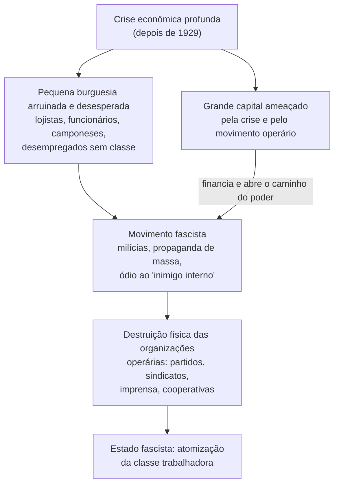

> **Aviso de Idioma:** Este currículo e todos os seus recursos de apoio foram estruturados exclusivamente em **Português (PT-BR)**.

# Aula 7 · Trótski: cultura, vida cotidiana e a luta contra o fascismo

**MOD-201 · 10 horas · Leitura principal:** Trótski, *Literatura e Revolução* (1924), Introdução e capítulo VI ("Cultura proletária e arte proletária"); *Problemas da Vida Cotidiana* (1923), seleção; *Como Esmagar o Fascismo* (escritos de 1930 a 1933), seleção ("E agora?" e "Pela frente única operária contra o fascismo")

## O que você vai aprender

- Explicar a crítica de Trótski à ideia de uma "cultura proletária" fabricada em laboratório.
- Entender a relação entre arte, técnica e política em *Literatura e Revolução*.
- Conhecer as reflexões de Trótski sobre a vida cotidiana, a família e a situação das mulheres.
- Explicar a análise de classe do <abbr title="Fascismo: movimento de massas, sobretudo da pequena burguesia arruinada, mobilizado e financiado pelo grande capital em momentos de crise para destruir pela violência as organizações independentes dos trabalhadores.">fascismo</abbr> e a proposta de <abbr title="Frente única: tática de unidade de ação entre organizações operárias de orientações diferentes (comunistas, socialistas, anarquistas) contra um inimigo comum, mantendo cada uma a sua independência e o direito de crítica.">frente única</abbr>.
- Relacionar o debate com o integralismo no Brasil e com a Batalha da Praça da Sé (1934).

## Pergunta de abertura

> Em 1932, os dois grandes partidos operários alemães, o social-democrata e o comunista, somavam mais votos que o partido nazista. Em janeiro de 1933, Hitler chegou ao poder sem enfrentar resistência organizada, e em poucos meses os dois partidos foram destruídos. Como isso foi possível?

## 1. O revolucionário crítico de arte

Trótski, o chefe do Exército Vermelho, foi também um leitor obsessivo de romances e poemas e um crítico literário respeitado. Em 1923 e 1924, ainda no auge do poder, publicou *Literatura e Revolução*, uma série de ensaios sobre a literatura russa da época: os poetas futuristas (como Maiakóvski), os simbolistas, os "companheiros de viagem" (escritores que simpatizavam com a revolução sem ser comunistas).

### Contra a "cultura proletária" de laboratório

Na época, um movimento chamado **Proletkult** defendia a criação imediata de uma "cultura proletária" nova, rompendo com toda a herança cultural burguesa. Trótski recusou a ideia com três argumentos:

1. **A burguesia levou séculos para criar a sua cultura**, e o fez quando já era a classe economicamente dominante. O proletariado no poder, ao contrário, enfrenta um período curto de transição, ocupado com a sobrevivência e a guerra.
2. **O objetivo da revolução é uma sociedade sem classes**, e portanto uma cultura humana, e não uma cultura de classe. A ditadura do proletariado é uma fase a ser superada, e não a base de uma nova cultura própria.
3. **Os trabalhadores precisam antes se apropriar da herança cultural da humanidade**: aprender a ler Púchkin e Tolstói, a física e a matemática. Desprezar essa herança é condenar os trabalhadores à ignorância.

### A arte tem as suas próprias leis

Trótski defendia que o partido deveria orientar a política, mas **não comandar a arte**. A arte deve ser julgada antes de tudo pelas suas próprias leis, as da forma e do ofício. A tarefa da política cultural seria garantir liberdade aos artistas, inclusive aos que não eram comunistas, desde que não fossem inimigos ativos da revolução. Essa posição contrasta frontalmente com o que viria depois: a partir de 1934, o "realismo socialista" se tornou doutrina oficial na União Soviética, e escritores e artistas foram perseguidos.

Compare com o MOD-205: Ezra Pound e a precisão da linguagem, e o problema de julgar uma obra pela sua forma e não pela posição política do autor. Trótski chega a uma posição próxima por outro caminho. Em 1938, já no exílio no México, redigiu com o surrealista André Breton o manifesto *Por uma Arte Revolucionária Independente*, publicado com as assinaturas de Breton e do pintor Diego Rivera, que defendia "toda licença em arte".

## 2. A vida cotidiana

Em *Problemas da Vida Cotidiana* (1923), Trótski escreveu sobre temas que os marxistas costumavam deixar de lado: a família, o alcoolismo, a grosseria da linguagem, a pontualidade, o cinema, a situação das mulheres. A tese: a revolução política e econômica não muda automaticamente a vida cotidiana; a dupla jornada das mulheres e a violência doméstica continuam se ninguém as enfrentar diretamente. Para libertar as mulheres, era preciso socializar o trabalho doméstico com restaurantes, lavanderias e creches públicos.

Trótski elogia também o **cinema** como meio de educação e lazer capaz de competir com a taberna e a igreja: "o cinema rivaliza com a taberna e com a igreja". É uma reflexão sobre técnica e cultura de massa contemporânea à de Walter Benjamin (MOD-203), que vai pensar o cinema de outro modo.

## 3. A análise do fascismo

Entre 1930 e 1933, exilado na Turquia, Trótski escreveu dezenas de artigos e brochuras sobre a situação alemã, reunidos depois em coletâneas como *Como Esmagar o Fascismo*. São considerados por muitos historiadores a análise contemporânea mais lúcida da ascensão do nazismo.

### O que é o fascismo

Para Trótski, o fascismo não é simplesmente uma ditadura militar ou policial. É um **movimento de massas**:

O que distingue o fascismo de outras ditaduras reacionárias é que ele mobiliza a **pequena burguesia** em massa, como força organizada nas ruas, para destruir o que a democracia burguesa ainda permitia aos trabalhadores: partidos, sindicatos, imprensa, associações. O grande capital recorre ao fascismo quando já não consegue governar pelos meios parlamentares e precisa esmagar o movimento operário.

### A política suicida do "terceiro período"

Naquele momento, a Internacional Comunista, dirigida por Stálin, defendia que a social-democracia era "social-fascismo", irmã gêmea do fascismo, e que o inimigo principal era o partido social-democrata. Os comunistas alemães recusavam qualquer ação comum com os social-democratas, e chegaram a votar ao lado dos nazistas num plebiscito contra o governo social-democrata da Prússia (1931). Os social-democratas, por sua vez, confiavam na legalidade e no Estado para conter Hitler.

### A frente única

Trótski propunha a **frente única operária**: unidade de ação entre comunistas e social-democratas para defender fisicamente as organizações operárias contra as milícias nazistas, sem fusão nem abandono das críticas mútuas. "Marchar separados, golpear juntos." Ele advertia que a vitória de Hitler significaria a destruição de todas as organizações operárias, comunistas e social-democratas igualmente, e uma guerra.

Responda à pergunta de abertura: a divisão entre os dois partidos operários, alimentada pela política de Stálin e pela passividade social-democrata, impediu qualquer resistência unificada. Em 1933, como Trótski previra, os dois foram destruídos.

## 4. No Brasil: integralismo e a Praça da Sé

O Brasil teve o seu próprio movimento de tipo fascista: a **Ação Integralista Brasileira** (AIB), fundada em 1932 por Plínio Salgado, com camisas verdes, saudação "anauê" e lema "Deus, Pátria e Família". Chegou a ter centenas de milhares de membros.

Em **7 de outubro de 1934**, os integralistas marcaram uma grande manifestação na Praça da Sé, em São Paulo. Uma frente única de organizações antifascistas (trotskistas, comunistas, socialistas, anarquistas e sindicatos) organizou uma contramanifestação. Houve tiroteio e mortes, e os integralistas se dispersaram em fuga: o episódio ficou conhecido como a "revoada dos galinhas-verdes". O crítico de arte e militante trotskista Mário Pedrosa, um dos organizadores, foi ferido. É um exemplo histórico, no Brasil, da tática de frente única defendida por Trótski.

## Leitura guiada

1. ***Literatura e Revolução*, Introdução e capítulo VI** (cerca de 40 páginas): a crítica à cultura proletária.
2. ***Problemas da Vida Cotidiana*** (seleção de 15 páginas): os textos sobre a família e sobre o cinema.
3. ***Como Esmagar o Fascismo***, "E agora?" (seleção sobre o que é o fascismo) e "Pela frente única operária contra o fascismo" (1931). Cerca de 40 páginas.

## Exercícios

**1.** Quais são os argumentos de Trótski contra a criação de uma "cultura proletária"?

Gabarito

(1) A burguesia levou séculos para criar a sua cultura, e o período de transição do proletariado é curto e ocupado pela luta; (2) o objetivo é uma sociedade sem classes, portanto uma cultura humana; (3) os trabalhadores precisam antes se apropriar da herança cultural da humanidade.

**2.** O que distingue o fascismo de uma ditadura militar comum, segundo Trótski?

Gabarito comentado

O fascismo é um movimento de massas, que mobiliza a pequena burguesia arruinada como força organizada nas ruas, e tem como tarefa destruir fisicamente todas as organizações independentes dos trabalhadores. Uma ditadura militar comum governa de cima, pelo aparelho do Estado, sem essa mobilização de massas.

**3.** Explique o lema "marchar separados, golpear juntos".

Gabarito

Organizações operárias de orientações diferentes mantêm a sua independência política e o direito de se criticar ("marchar separados"), mas fazem ação comum contra um inimigo comum, como a defesa contra as milícias fascistas ("golpear juntos"). É a fórmula da frente única.

**4.** Pesquise a Batalha da Praça da Sé (1934) em pelo menos duas fontes e escreva um parágrafo relacionando-a com a análise de Trótski sobre a frente única.

Critérios de correção

O parágrafo deve citar as fontes, descrever quem participou da contramanifestação e o resultado, e mostrar a relação com a tática de frente única. A melhor resposta compara com o caso alemão e discute por que a unidade foi possível em São Paulo em 1934 e não na Alemanha em 1932.

## Resumo da aula

- Em *Literatura e Revolução*, Trótski recusa a "cultura proletária" de laboratório e defende a apropriação da herança cultural e a autonomia da arte.
- Em *Problemas da Vida Cotidiana*, trata da família, das mulheres e do cinema.
- O fascismo é um movimento de massas da pequena burguesia, apoiado pelo grande capital, para destruir as organizações operárias.
- Contra a política do "social-fascismo", Trótski defendeu a frente única: marchar separados, golpear juntos.
- No Brasil, a contramanifestação antifascista da Praça da Sé (1934) é um exemplo de frente única.

## Para ir além

- Fúlvio Abramo e Dainis Karepovs (orgs.), *Na Contracorrente da História: Documentos da Liga Comunista Internacionalista 1930 a 1933*.
- André Breton e Leon Trótski, *Por uma Arte Revolucionária Independente* (1938).