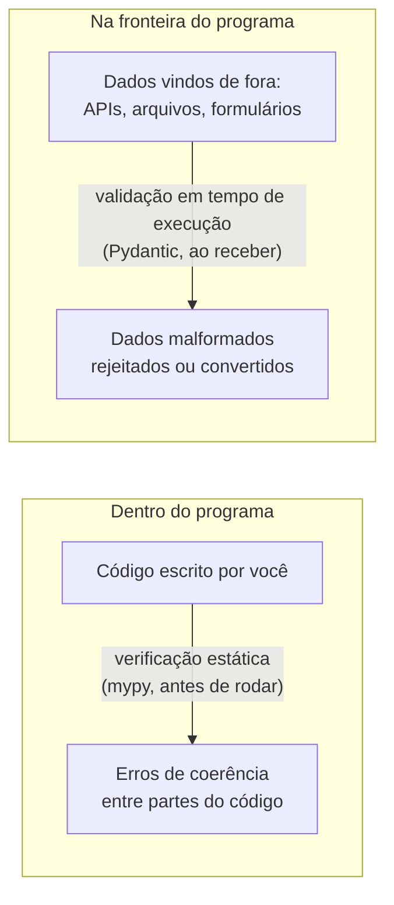
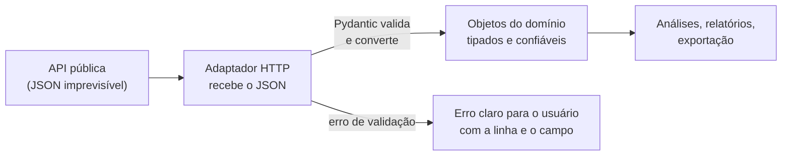

> **Aviso de Idioma:** Este currículo e todos os seus recursos de apoio foram estruturados exclusivamente em **Português (PT-BR)**.

# Aula 4 · Tipos e validação: `typing` e Pydantic

**MOD-202 · 10 horas · Apoio:** documentação do módulo [`typing`](https://docs.python.org/pt-br/3/library/typing.html) e do [Pydantic](https://docs.pydantic.dev/)

## O que você vai aprender

- Escrever <abbr title="Anotação de tipo: indicação, no código, do tipo esperado de uma variável, parâmetro ou retorno (por exemplo, nome: str). Em Python não muda a execução, mas permite verificar o código com ferramentas.">anotações de tipo</abbr> em funções, classes e coleções.
- Entender a <abbr title="Tipagem gradual: em Python, as anotações de tipo são opcionais e podem ser acrescentadas aos poucos. Um verificador estático (como o mypy) usa-as para achar erros antes de rodar o programa.">tipagem gradual</abbr> e o papel de um verificador estático como o mypy.
- Distinguir verificação de tipos (antes de rodar) e validação de dados (ao receber dados de fora).
- Validar respostas de APIs com <abbr title="Pydantic: biblioteca Python que usa as anotações de tipo para validar e converter dados (por exemplo, de JSON), lançando erros claros quando os dados não seguem o modelo.">Pydantic</abbr>: tipos, conversão, apelidos de campos e validadores.
- Tratar erros de validação de forma útil para quem usa o SDK.

## Pergunta de abertura

> Uma API pública devolve o valor de uma despesa às vezes como número (`1234.5`), às vezes como texto (`"1234,50"`), e às vezes o campo simplesmente não vem. O seu programa soma tudo e publica um relatório. Como garantir que um dado malformado não contamine o total sem ninguém perceber?

## 1. Anotações de tipo

Python é uma linguagem de tipagem dinâmica: uma variável pode guardar qualquer coisa. Desde a versão 3.5 (funções) e 3.6 (variáveis), é possível **anotar** os tipos esperados:

```python
from datetime import date

def taxa(casos: int, populacao: int, base: int = 100_000) -> float | None:
    if populacao == 0:
        return None
    return casos / populacao * base

def nomes_por_uf(parlamentares: list[dict[str, str]], uf: str) -> list[str]:
    return [p["nome"] for p in parlamentares if p["uf"] == uf]

inicio: date = date(2023, 2, 1)
print(taxa(45, 30_000), nomes_por_uf([{"nome": "Maria", "uf": "CE"}], "CE"), inicio.year)
```

As anotações **não mudam a execução**: o Python não impede `taxa("45", 30000)`. Elas servem para três coisas:

1. **Documentação:** quem lê sabe o que a função espera e devolve.
2. **Editores:** completam nomes e apontam erros enquanto você digita.
3. **Verificadores estáticos:** ferramentas como o **mypy** leem o código e acusam incoerências **antes** de o programa rodar.

| Anotação | Significa |
| :--- | :--- |
| `int`, `str`, `float`, `bool` | Tipos básicos |
| `list[str]`, `dict[str, int]`, `tuple[int, str]` | Coleções com o tipo dos elementos |
| `str \| None` | Texto ou nenhum valor (opcional) |
| `Callable[[int], str]` | Uma função que recebe `int` e devolve `str` |
| `Protocol` | Um contrato de métodos (aula 3) |

Com o mypy instalado (`pip install mypy`), o comando `mypy src/` verifica o projeto inteiro. No MOD-204, ele vai rodar automaticamente a cada commit.

## 2. Dois problemas diferentes



O mypy confere se o **seu código** é coerente. Ele não pode saber o que uma API vai devolver amanhã. Para isso é preciso **validar os dados na fronteira**: no momento em que entram no programa. Princípio de projeto: **valide na entrada; dentro do sistema, confie nos tipos**.

## 3. Pydantic: validação a partir dos tipos

O Pydantic usa as mesmas anotações de tipo para validar e converter dados. Você declara o modelo; ele confere cada campo.

```python
from datetime import date
from pydantic import BaseModel, ValidationError

class Deputado(BaseModel):
    id: int
    nome: str
    sigla_partido: str
    sigla_uf: str
    email: str | None = None

ok = Deputado(id="204554", nome="Maria Exemplo", sigla_partido="PA", sigla_uf="CE")
print(ok.id, type(ok.id))         # 204554 <class 'int'>: converteu o texto em número

try:
    Deputado(id="abc", nome="Sem partido", sigla_uf="CE")
except ValidationError as erro:
    for problema in erro.errors():
        print(problema["loc"], problema["msg"])
```

Repare em duas coisas:

- O texto `"204554"` foi **convertido** em `int`, porque é inequivocamente um número. O Pydantic faz conversões razoáveis e rejeita as absurdas.
- O erro lista **todos** os problemas de uma vez (o `id` inválido e o `sigla_partido` ausente), com o caminho de cada campo. Isso é muito melhor do que um `KeyError` genérico no meio do programa.

### Apelidos: a linguagem da API e a do domínio

A API da Câmara usa nomes como `siglaPartido`, em *camelCase*. O nosso domínio usa `sigla_partido`, no estilo do Python. Os **apelidos** (*aliases*) fazem a ponte, e o conversor fica num único lugar (lembre do encapsulamento, aula 2):

```python
from pydantic import BaseModel, ConfigDict, Field

class DeputadoAPI(BaseModel):
    model_config = ConfigDict(populate_by_name=True)

    id: int
    nome: str
    sigla_partido: str = Field(alias="siglaPartido")
    sigla_uf: str = Field(alias="siglaUf")
    email: str | None = None

resposta_api = {"id": 204554, "nome": "Maria Exemplo", "siglaPartido": "PA",
                "siglaUf": "CE", "uri": "https://...", "urlFoto": "https://..."}
d = DeputadoAPI.model_validate(resposta_api)
print(d.sigla_partido, d.sigla_uf)     # PA CE
print(d.model_dump())                  # campos extras da API foram ignorados
```

### Validadores: regras do domínio

Voltemos à pergunta de abertura. Valores em reais podem vir como número ou como texto no formato brasileiro. Um **validador** converte e confere:

```python
from decimal import Decimal, InvalidOperation
from pydantic import BaseModel, field_validator

class Despesa(BaseModel):
    ano: int
    mes: int
    tipo: str
    valor: Decimal

    @field_validator("mes")
    @classmethod
    def mes_valido(cls, v: int) -> int:
        if not 1 <= v <= 12:
            raise ValueError("mês deve estar entre 1 e 12")
        return v

    @field_validator("valor", mode="before")
    @classmethod
    def aceita_formato_brasileiro(cls, v):
        if isinstance(v, str):
            v = v.strip().replace("R$", "").replace(".", "").replace(",", ".").strip()
        try:
            valor = Decimal(str(v))
        except InvalidOperation:
            raise ValueError(f"valor monetário inválido: {v!r}")
        if valor < 0:
            raise ValueError("valor negativo")
        return valor

linhas = [
    {"ano": 2025, "mes": 3, "tipo": "PASSAGEM AÉREA", "valor": 1234.5},
    {"ano": 2025, "mes": 3, "tipo": "COMBUSTÍVEL", "valor": "R$ 1.234,50"},
    {"ano": 2025, "mes": 13, "tipo": "TELEFONIA", "valor": "80,00"},
    {"ano": 2025, "mes": 4, "tipo": "DIVULGAÇÃO", "valor": "não informado"},
]

validas, rejeitadas = [], []
for i, linha in enumerate(linhas):
    try:
        validas.append(Despesa.model_validate(linha))
    except ValidationError as erro:
        rejeitadas.append((i, [p["msg"] for p in erro.errors()]))

print("Total válido: R$", sum(d.valor for d in validas))
for i, msgs in rejeitadas:
    print(f"Linha {i} rejeitada:", msgs)
```

Usamos `Decimal` (e não `float`) para dinheiro: o resultado é exatamente `2469.00`, sem as imprecisões do ponto flutuante (MOD-102, aula 1). E as linhas inválidas são **separadas e explicadas**, nunca somadas em silêncio: é o mesmo princípio do validador do MOD-106, agora declarado no modelo.

## 4. Onde validar no SDK



Na aula 7 você verá que o adaptador é a camada de **infraestrutura**; os objetos validados pertencem ao **domínio**. O domínio nunca vê o JSON cru.

## Exercícios

**1.** Anote os tipos desta função e diga o que o mypy acusaria na chamada da última linha:

```text
def media(valores):
    return sum(valores) / len(valores)

print(media(["10", "20"]))
```

<details>
<summary>Gabarito comentado</summary>

`def media(valores: list[float]) -> float:`. O mypy acusaria que `list[str]` não é compatível com `list[float]`. Sem anotação, o erro só aparece ao rodar (um `TypeError` ao somar textos). A verificação estática encontra o problema antes.
</details>

**2.** Crie um modelo Pydantic `Proposicao` com `sigla_tipo` (apelido `siglaTipo`), `numero`, `ano` e `ementa`, e um validador que rejeite anos anteriores a 1946 ou posteriores ao ano atual.

<details>
<summary>Gabarito</summary>

```python
from datetime import date

class Proposicao(BaseModel):
    model_config = ConfigDict(populate_by_name=True)

    sigla_tipo: str = Field(alias="siglaTipo")
    numero: int
    ano: int
    ementa: str

    @field_validator("ano")
    @classmethod
    def ano_plausivel(cls, v: int) -> int:
        if not 1946 <= v <= date.today().year:
            raise ValueError("ano fora do intervalo plausível")
        return v

print(Proposicao.model_validate({"siglaTipo": "PL", "numero": 1, "ano": 2025, "ementa": "Teste"}).sigla_tipo)
```
</details>

**3.** Por que não basta o mypy para garantir que os dados de uma API estão corretos?

<details>
<summary>Gabarito</summary>

Porque o mypy analisa o código antes de rodar e não conhece os dados que vão chegar em tempo de execução. Uma API pode mudar o formato, omitir campos ou mandar valores inválidos a qualquer momento. Só a validação na entrada, em tempo de execução, protege o programa desses dados.
</details>

**4.** Responda à pergunta de abertura descrevendo, passo a passo, o que o modelo `Despesa` faz com cada uma das quatro linhas de exemplo.

<details>
<summary>Gabarito</summary>

Linha 0: o número 1234.5 vira `Decimal("1234.5")`, aceita. Linha 1: o texto "R$ 1.234,50" é limpo e convertido em `Decimal("1234.50")`, aceita. Linha 2: o mês 13 é rejeitado pelo validador de mês. Linha 3: "não informado" não pode ser convertido, rejeitada com mensagem clara. O total soma só as duas válidas (2469,00) e as rejeitadas ficam listadas para revisão.
</details>

## Resumo da aula

- Anotações de tipo documentam, ajudam os editores e permitem verificação estática com o mypy.
- Verificação estática confere o código; validação confere os dados que chegam de fora. Valide na fronteira.
- Pydantic valida e converte a partir dos tipos, lista todos os erros e usa apelidos para traduzir os nomes da API para o domínio.
- Validadores expressam regras do domínio. Use `Decimal` para dinheiro.
- Linhas inválidas são separadas e explicadas, nunca somadas em silêncio.

## Para ir além

- [Documentação do mypy](https://mypy.readthedocs.io/).
- PEP 484, que introduziu as anotações de tipo em Python.