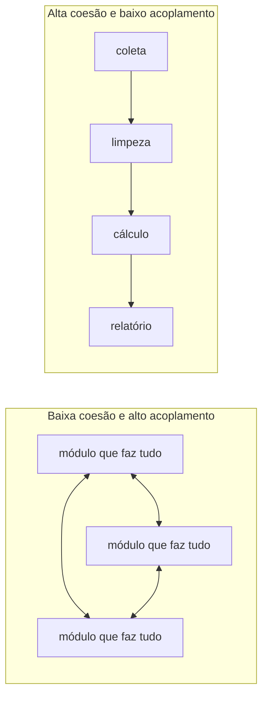
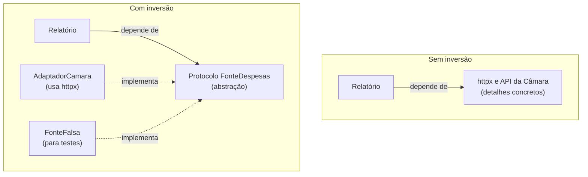

> **Aviso de Idioma:** Este currículo e todos os seus recursos de apoio foram estruturados exclusivamente em **Português (PT-BR)**.

# Aula 5 · Princípios de projeto: coesão, acoplamento e SOLID

**MOD-202 · 10 horas · Leitura principal:** *Engenharia de Software Moderna*, capítulo 5, "Princípios de Projeto"

## O que você vai aprender

- Explicar <abbr title="Coesão: o quanto as partes de uma classe ou módulo trabalham para um mesmo propósito. Alta coesão é desejável: cada módulo faz uma coisa.">coesão</abbr> e <abbr title="Acoplamento: o quanto um módulo depende de outros. Baixo acoplamento é desejável: mudanças num módulo não se espalham pelo sistema.">acoplamento</abbr> e por que se busca alta coesão e baixo acoplamento.
- Enunciar e aplicar os cinco princípios <abbr title="SOLID: acrônimo de cinco princípios de projeto orientado a objetos reunidos por Robert Martin: responsabilidade única, aberto e fechado, substituição de Liskov, segregação de interfaces e inversão de dependências.">SOLID</abbr>.
- Usar a <abbr title="Injeção de dependência: técnica em que um objeto recebe de fora (pelo construtor, por exemplo) os objetos de que depende, em vez de criá-los por conta própria.">injeção de dependência</abbr> para inverter dependências.
- Revisar código identificando violações dos princípios e propondo refatorações.

## Pergunta de abertura

> Uma única função de 300 linhas baixa dados da Câmara, limpa os nomes, calcula os gastos por partido, gera um gráfico e envia um e-mail com o relatório. Funciona. O que acontece quando a API muda, quando o e-mail precisa virar mensagem no Telegram, ou quando alguém quer testar só o cálculo?

## 1. Coesão e acoplamento

Os dois conceitos mais importantes do projeto de software vêm dos anos 1970 e continuam valendo:



- **Coesão alta:** cada classe ou módulo tem um propósito só, e tudo nele contribui para esse propósito.
- **Acoplamento baixo:** cada módulo depende de poucos outros, e depende de interfaces estáveis, não de detalhes internos.

A função de 300 linhas da pergunta de abertura tem coesão baixíssima (faz cinco coisas) e está acoplada a tudo: à API, ao formato do gráfico, ao servidor de e-mail. Qualquer mudança mexe nela, e é impossível testar uma parte sem as outras.

## 2. Os princípios SOLID

O engenheiro Robert Martin reuniu, por volta de 2000, cinco princípios para o projeto orientado a objetos; o acrônimo SOLID foi proposto depois por Michael Feathers.

| Letra | Princípio | Em uma frase |
| :---: | :--- | :--- |
| **S** | Responsabilidade única | Uma classe deve ter um, e só um, motivo para mudar |
| **O** | Aberto e fechado | Aberto para extensão, fechado para modificação: acrescente comportamento sem mexer no código que já funciona |
| **L** | Substituição de Liskov | Um subtipo deve poder substituir o tipo base sem quebrar quem o usa |
| **I** | Segregação de interfaces | Muitas interfaces pequenas e específicas são melhores que uma grande |
| **D** | Inversão de dependências | Dependa de abstrações, não de implementações concretas |

### S: responsabilidade única

```python
from dataclasses import dataclass

@dataclass(frozen=True)
class Gasto:
    partido: str
    valor_centavos: int

def soma_por_partido(gastos: list[Gasto]) -> dict[str, int]:
    """Só calcula. Não baixa, não imprime, não envia."""
    totais: dict[str, int] = {}
    for g in gastos:
        totais[g.partido] = totais.get(g.partido, 0) + g.valor_centavos
    return totais

def formata_relatorio(totais: dict[str, int]) -> str:
    """Só formata."""
    linhas = [f"{p}: R$ {v / 100:,.2f}".replace(",", "X").replace(".", ",").replace("X", ".")
              for p, v in sorted(totais.items(), key=lambda kv: -kv[1])]
    return "\n".join(linhas)

gastos = [Gasto("PA", 150000), Gasto("PB", 90000), Gasto("PA", 25050)]
print(formata_relatorio(soma_por_partido(gastos)))
```

Cada função tem um motivo para mudar: a regra de cálculo, o formato do relatório. A coleta e o envio ficam em outros módulos.

### O: aberto e fechado

Quando surge um novo canal de envio, não queremos editar o código que já funciona e já foi testado. Queremos **acrescentar** uma classe nova:

```python
from typing import Protocol

class Canal(Protocol):
    def enviar(self, texto: str) -> None: ...

class CanalTerminal:
    def enviar(self, texto: str) -> None:
        print("[terminal]\n" + texto)

class CanalArquivo:
    def __init__(self, caminho: str):
        self.caminho = caminho

    def enviar(self, texto: str) -> None:
        with open(self.caminho, "w", encoding="utf-8") as f:
            f.write(texto)

def publica(relatorio: str, canais: list[Canal]) -> None:
    for canal in canais:
        canal.enviar(relatorio)

publica(formata_relatorio(soma_por_partido(gastos)), [CanalTerminal(), CanalArquivo("relatorio.txt")])
```

Para acrescentar um canal de Telegram, escreve-se uma classe `CanalTelegram` com o método `enviar`. A função `publica` não muda: está fechada para modificação e aberta para extensão.

### L: substituição de Liskov

Formulado por Barbara Liskov em 1987: se o código funciona com um tipo, deve funcionar com qualquer subtipo dele. Um exemplo de violação:

```python
class Fonte:
    def parlamentares(self, uf: str) -> list[str]:
        return []

class FonteQueQuebra(Fonte):
    def parlamentares(self, uf: str) -> list[str]:
        if uf != "CE":
            raise NotImplementedError("só sei responder para o Ceará")
        return ["Maria Exemplo"]
```

Quem usa `Fonte` espera uma lista (talvez vazia) para qualquer UF; `FonteQueQuebra` lança uma exceção inesperada. Ela é subclasse, mas não é substituível. A correção é devolver a lista vazia, ou não fingir ser uma `Fonte` completa.

### I: segregação de interfaces

Uma interface grande obriga todas as implementações a oferecer tudo, mesmo o que não faz sentido. Se `FonteParlamentar` exige `deputados()`, `senadores()`, `despesas()` e `votacoes()`, a fonte do Senado precisaria fingir que tem `deputados()`. Melhor: protocolos pequenos (`FonteParlamentares`, `FonteDespesas`, `FonteVotacoes`), e cada adaptador implementa os que fazem sentido.

### D: inversão de dependências



A regra de negócio (o relatório) não deve depender de detalhes (a biblioteca HTTP, o formato da API). Os dois devem depender de uma **abstração**, e os detalhes são **injetados**:

```python
class FonteDespesas(Protocol):
    def gastos(self, ano: int) -> list[Gasto]: ...

class FonteDespesasFalsa:
    def gastos(self, ano: int) -> list[Gasto]:
        return [Gasto("PA", 100000), Gasto("PB", 50000)]

class ServicoRelatorio:
    def __init__(self, fonte: FonteDespesas, canais: list[Canal]):   # injeção de dependência
        self.fonte = fonte
        self.canais = canais

    def executar(self, ano: int) -> None:
        totais = soma_por_partido(self.fonte.gastos(ano))
        publica(formata_relatorio(totais), self.canais)

ServicoRelatorio(FonteDespesasFalsa(), [CanalTerminal()]).executar(2025)
```

O `ServicoRelatorio` não cria a fonte nem os canais: **recebe-os** no construtor. Por isso pode ser testado com uma fonte falsa, e por isso trocar a biblioteca HTTP não o afeta. Isso é **injeção de dependência**.

## 3. Princípios não são leis

Princípios de projeto são heurísticas, não mandamentos. Aplicados sem critério, produzem o problema oposto: dezenas de classes minúsculas e camadas de abstração para um script de 50 linhas. A pergunta certa é sempre: **qual é a mudança provável, e quanto ela vai custar com este desenho?** Em projetos pequenos e descartáveis, simplicidade vale mais que flexibilidade. Em sistemas públicos que vão durar décadas, flexibilidade e testabilidade valem muito.

> **Conexão com o curso:** baixo acoplamento é também uma questão de autonomia. Um sistema público acoplado a uma biblioteca ou a um serviço proprietário fica refém do fornecedor: o custo de trocar é tão alto que ninguém troca. Lembre do episódio que deu origem ao Git (MOD-106, aula 5). Projetar com dependências invertidas é projetar para poder mudar de fornecedor.

## Exercícios

**1.** Identifique as responsabilidades da função descrita na pergunta de abertura e proponha uma divisão em módulos.

<details>
<summary>Gabarito comentado</summary>

Cinco responsabilidades: coleta (baixar da API), limpeza (padronizar nomes), cálculo (gastos por partido), visualização (gráfico) e publicação (e-mail). Divisão: `coleta.py` (adaptador da API), `limpeza.py`, `calculo.py`, `graficos.py`, `canais.py` (com um protocolo `Canal` e implementações para e-mail, Telegram, arquivo) e um `servico.py` que coordena tudo recebendo as dependências por injeção.
</details>

**2.** Para cada situação, diga qual princípio SOLID foi violado: (a) para acrescentar um formato de exportação, é preciso editar um `if` gigante com todos os formatos; (b) a classe `Parlamentar` sabe se conectar ao banco de dados e salvar a si mesma; (c) uma subclasse `FonteSomenteLeitura` lança erro no método `salvar` que a classe mãe oferece.

<details>
<summary>Gabarito</summary>

(a) Aberto e fechado: cada formato deveria ser uma classe que implementa um protocolo comum. (b) Responsabilidade única (e inversão de dependências): o modelo do domínio não deve conhecer o banco de dados. (c) Substituição de Liskov (e segregação de interfaces): a interface deveria separar leitura e escrita.
</details>

**3.** Escreva um `CanalTelegramFalso` que, em vez de enviar, guarda as mensagens numa lista, e use-o para verificar com `assert` que o `ServicoRelatorio` publicou exatamente um relatório contendo "PA".

<details>
<summary>Gabarito</summary>

```python
class CanalTelegramFalso:
    def __init__(self):
        self.mensagens: list[str] = []

    def enviar(self, texto: str) -> None:
        self.mensagens.append(texto)

falso = CanalTelegramFalso()
ServicoRelatorio(FonteDespesasFalsa(), [falso]).executar(2025)
assert len(falso.mensagens) == 1 and "PA" in falso.mensagens[0]
print("teste passou")
```

Este é, na prática, um teste automatizado: o assunto do MOD-204.
</details>

**4.** Escreva um parágrafo sobre a relação entre baixo acoplamento e soberania tecnológica de órgãos públicos.

<details>
<summary>Critérios de correção</summary>

O parágrafo deve explicar que sistemas acoplados a fornecedores específicos tornam a troca cara e criam dependência (aprisionamento tecnológico), e que interfaces abstratas, padrões abertos e dependências injetadas reduzem esse custo. A melhor resposta dá um exemplo concreto e liga ao debate sobre software livre (MOD-107, aula 7).
</details>

## Resumo da aula

- Busque alta coesão (cada módulo, um propósito) e baixo acoplamento (poucas dependências, sobre interfaces estáveis).
- SOLID: responsabilidade única, aberto e fechado, substituição de Liskov, segregação de interfaces, inversão de dependências.
- A injeção de dependência permite trocar implementações e testar com objetos falsos.
- Princípios são heurísticas: pergunte qual mudança é provável e quanto custará.
- Baixo acoplamento é também autonomia diante de fornecedores.

## Para ir além

- *Engenharia de Software Moderna*, capítulo 5, inteiro, com exemplos em Java que você pode traduzir para Python.
- Barbara Liskov e Jeannette Wing, "A behavioral notion of subtyping" (1994).