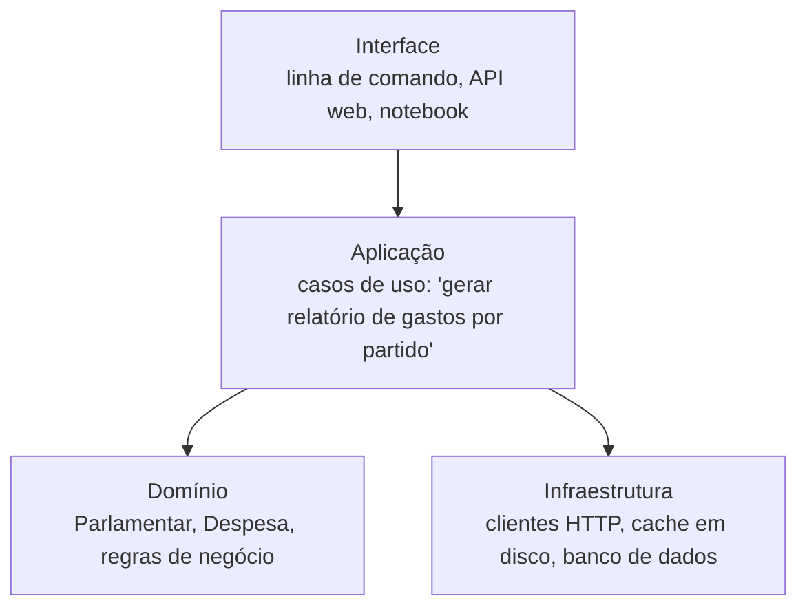
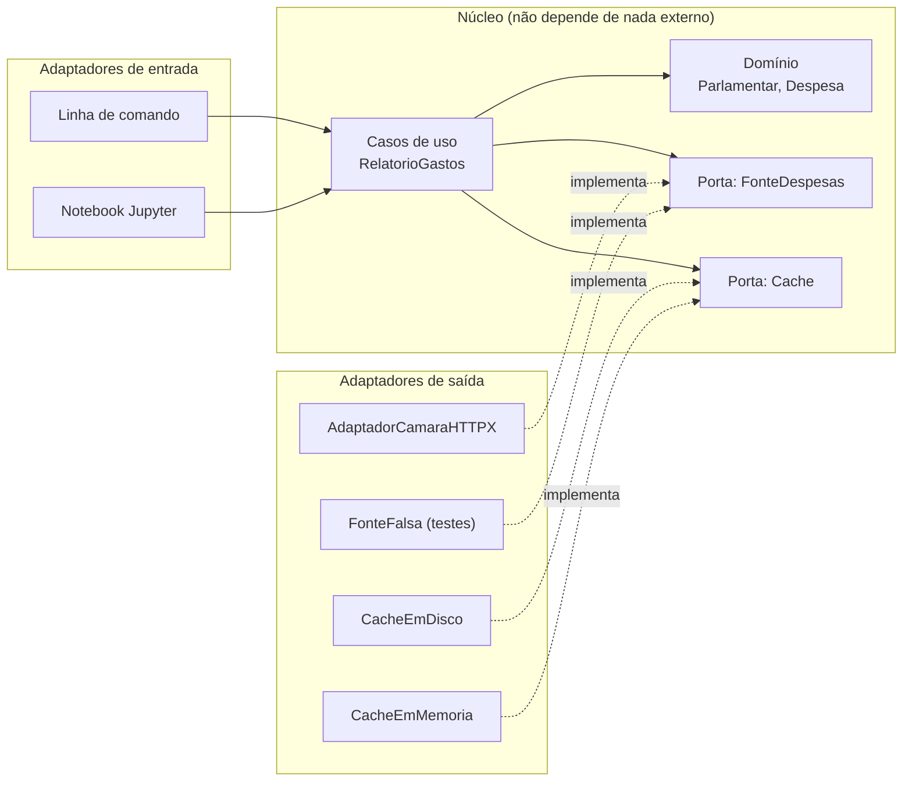

> **Aviso de Idioma:** Este currículo e todos os seus recursos de apoio foram estruturados exclusivamente em **Português (PT-BR)**.

# Aula 7 · Arquitetura: camadas e hexágonos

**MOD-202 · 10 horas · Leitura principal:** *Engenharia de Software Moderna*, capítulo 7, "Arquitetura"

## O que você vai aprender

- Explicar o que é <abbr title="Arquitetura de software: a organização de um sistema em grandes partes, as responsabilidades de cada uma e as regras de dependência entre elas. Decisões de arquitetura são as mais caras de mudar.">arquitetura de software</abbr> e por que as suas decisões são as mais caras de mudar.
- Organizar um sistema em camadas e respeitar a regra de dependência.
- Explicar a <abbr title="Arquitetura hexagonal (portas e adaptadores): estilo proposto por Alistair Cockburn em 2005, em que o núcleo do domínio se comunica com o mundo exterior só por portas (interfaces), e os adaptadores ligam essas portas a tecnologias concretas.">arquitetura hexagonal</abbr> (portas e adaptadores).
- Registrar decisões de arquitetura com <abbr title="ADR (Architecture Decision Record): documento curto que registra uma decisão de arquitetura, o seu contexto, as alternativas consideradas e as consequências.">ADRs</abbr>.
- Desenhar a arquitetura do SDK de transparência.

## Pergunta de abertura

> Daqui a cinco anos, a Câmara lança uma nova versão da API, a biblioteca HTTP que você usa é abandonada pelos mantenedores e alguém quer usar o SDK num aplicativo de celular. Que partes do seu código deveriam sobreviver intactas a todas essas mudanças?

## 1. O que é arquitetura

Se o projeto (aulas 5 e 6) trata de classes e funções, a **arquitetura** trata das grandes partes do sistema e de como elas dependem umas das outras. Uma definição útil: arquitetura é o conjunto de decisões **difíceis de mudar depois**. Escolher a linguagem, dividir o sistema em serviços, decidir onde fica a regra de negócio, escolher o formato de armazenamento.

Volte à pergunta de abertura. O que deveria sobreviver é o **domínio**: o que é um parlamentar, uma despesa, uma proposição, e as regras sobre eles (como somar gastos, como identificar uma proposição). Tudo o que é tecnologia (a API, a biblioteca HTTP, o formato de cache, a interface do usuário) deveria poder ser trocado sem tocar no domínio.

## 2. Arquitetura em camadas

O estilo mais comum divide o sistema em camadas, cada uma usando só a de baixo:



O problema desse desenho clássico: a aplicação depende diretamente da infraestrutura, e o domínio às vezes acaba dependendo dela também (um modelo que sabe se salvar no banco).

## 3. Arquitetura hexagonal: o domínio no centro

Em 2005, Alistair Cockburn propôs inverter o desenho: o **domínio e os casos de uso ficam no centro** e não dependem de nada externo. A comunicação com o mundo se dá por **portas** (interfaces, como os `Protocol` da aula 3), e **adaptadores** ligam as portas a tecnologias concretas. O hexágono é só um desenho: indica que há muitos lados possíveis para ligar adaptadores.



### A regra de dependência

**As dependências de código apontam sempre para dentro.** O domínio não importa nada da infraestrutura; os adaptadores importam o domínio e implementam as portas. É o princípio de inversão de dependências (aula 5) aplicado ao sistema inteiro.

Uma forma prática de verificar: o pacote do domínio não deve ter nenhum `import httpx`, `import sqlite3` ou `import requests`. Se tiver, a regra foi quebrada.

### Um esqueleto em código

```python
from dataclasses import dataclass
from typing import Protocol

# ---------- domínio: não importa nada externo ----------
@dataclass(frozen=True)
class Despesa:
    deputado: str
    partido: str
    valor_centavos: int

# ---------- portas ----------
class FonteDespesas(Protocol):
    def despesas(self, ano: int, uf: str) -> list[Despesa]: ...

# ---------- caso de uso ----------
class RelatorioGastosPorPartido:
    def __init__(self, fonte: FonteDespesas):
        self.fonte = fonte

    def executar(self, ano: int, uf: str) -> list[tuple[str, int]]:
        totais: dict[str, int] = {}
        for d in self.fonte.despesas(ano, uf):
            totais[d.partido] = totais.get(d.partido, 0) + d.valor_centavos
        return sorted(totais.items(), key=lambda kv: kv[1], reverse=True)

# ---------- adaptador de saída (aqui, falso; no projeto, um cliente HTTP real) ----------
class FonteDespesasEmMemoria:
    def __init__(self, dados: list[Despesa]):
        self.dados = dados

    def despesas(self, ano: int, uf: str) -> list[Despesa]:
        return list(self.dados)

# ---------- adaptador de entrada: linha de comando ----------
def cli(argumentos: list[str], fonte: FonteDespesas) -> None:
    ano, uf = int(argumentos[0]), argumentos[1]
    for partido, total in RelatorioGastosPorPartido(fonte).executar(ano, uf):
        print(f"{partido:6s} R$ {total / 100:12.2f}")

dados = [Despesa("Maria", "PA", 150000), Despesa("João", "PB", 80000), Despesa("Ana", "PA", 20000)]
cli(["2025", "CE"], FonteDespesasEmMemoria(dados))
```

Repare: o caso de uso `RelatorioGastosPorPartido` pode ser executado e testado sem internet, sem disco e sem linha de comando. Trocar a API, o cache ou a interface significa escrever um adaptador novo, nunca mexer no núcleo.

## 4. A estrutura de pastas

```text
br-transparencia-sdk/
├── pyproject.toml
├── README.md
├── docs/
│   └── adr/
│       ├── 0001-arquitetura-hexagonal.md
│       └── 0002-pydantic-para-validacao.md
├── src/
│   └── br_transparencia/
│       ├── dominio/          # Parlamentar, Despesa, Proposicao (sem imports externos)
│       ├── portas.py         # Protocolos: FonteParlamentares, FonteDespesas, Cache
│       ├── casos_de_uso/     # RelatorioGastosPorPartido, BancadaEstadual
│       ├── adaptadores/
│       │   ├── camara.py     # usa httpx e Pydantic, implementa as portas
│       │   ├── senado.py
│       │   └── cache_disco.py
│       ├── fachada.py        # ponto de entrada simples para quem só quer usar
│       └── cli.py
└── tests/                    # MOD-204
```

A **fachada** é um padrão estrutural (Facade): um objeto simples que monta tudo por trás e oferece uma interface amigável, como `Transparencia().deputados(uf="CE")`, para quem não quer saber de portas e adaptadores.

## 5. Registrando decisões: ADRs

Decisões de arquitetura costumam se perder: daqui a dois anos, ninguém lembra por que se escolheu a arquitetura hexagonal ou o Pydantic. Um **ADR** é um documento curto, versionado no próprio repositório, com um formato fixo:

```text
# ADR 0002: Usar Pydantic para validar as respostas das APIs

## Situação
Aceita (2026-11-05).

## Contexto
As APIs públicas mudam de formato e às vezes devolvem campos ausentes ou valores
em formatos inesperados. Erros de formato precisam ser detectados na entrada.

## Decisão
Validar toda resposta externa com modelos Pydantic nos adaptadores.
O domínio recebe apenas objetos já validados.

## Alternativas consideradas
- Validação manual com dicionários: mais código e mensagens de erro piores.
- dataclasses sem validação: não detectam dados malformados.

## Consequências
- Nova dependência (pydantic), estável e muito usada.
- Mensagens de erro claras para o usuário.
- O domínio continua livre de dependências externas.
```

## Exercícios

**1.** Responda à pergunta de abertura indicando, para cada mudança, qual parte do código muda e qual permanece intacta.

<details>
<summary>Gabarito</summary>

Nova versão da API da Câmara: muda só o adaptador `camara.py`. Biblioteca HTTP abandonada: mudam só os adaptadores que a usam. Uso num aplicativo de celular: escreve-se um novo adaptador de entrada (ou se usa a fachada). Em todos os casos, o domínio, as portas e os casos de uso permanecem intactos.
</details>

**2.** Escreva um teste com `assert` para o caso de uso `RelatorioGastosPorPartido`, usando `FonteDespesasEmMemoria`, verificando que o partido PA aparece primeiro com 170.000 centavos.

<details>
<summary>Gabarito</summary>

```python
resultado = RelatorioGastosPorPartido(FonteDespesasEmMemoria(dados)).executar(2025, "CE")
assert resultado[0] == ("PA", 170000), resultado
print("teste do caso de uso passou")
```
</details>

**3.** Um colega propõe colocar `import httpx` dentro de `dominio/parlamentar.py` para que o `Parlamentar` "saiba buscar os próprios dados". Explique, com a regra de dependência, por que isso é um problema.

<details>
<summary>Gabarito comentado</summary>

A regra de dependência diz que o domínio não depende de nada externo. Com o import, o domínio passa a depender de uma biblioteca HTTP e da rede: não pode mais ser testado sem internet, e qualquer mudança na biblioteca ou na API afeta o núcleo do sistema. A busca de dados é responsabilidade de um adaptador que implementa uma porta.
</details>

**4.** Escreva o ADR 0001, justificando a escolha da arquitetura hexagonal para o SDK.

<details>
<summary>Critérios de correção</summary>

O ADR deve seguir o formato (situação, contexto, decisão, alternativas, consequências), mencionar pelo menos uma alternativa real (camadas simples, um único módulo) e consequências negativas honestas (mais arquivos e mais conceitos para quem está começando).
</details>

## Resumo da aula

- Arquitetura é o conjunto de decisões difíceis de mudar; o domínio deve sobreviver às mudanças de tecnologia.
- Camadas organizam o sistema, mas podem acoplar a aplicação à infraestrutura.
- Na arquitetura hexagonal, o núcleo (domínio e casos de uso) fala com o mundo por portas, e adaptadores ligam as portas às tecnologias.
- Regra de dependência: as dependências apontam para dentro. Nada de imports de infraestrutura no domínio.
- ADRs registram as decisões, o contexto e as alternativas.

## Para ir além

- Alistair Cockburn, "Hexagonal Architecture" (2005), o texto original (em inglês).
- *Engenharia de Software Moderna*, capítulo 7, inclusive a discussão sobre microsserviços e monolitos.