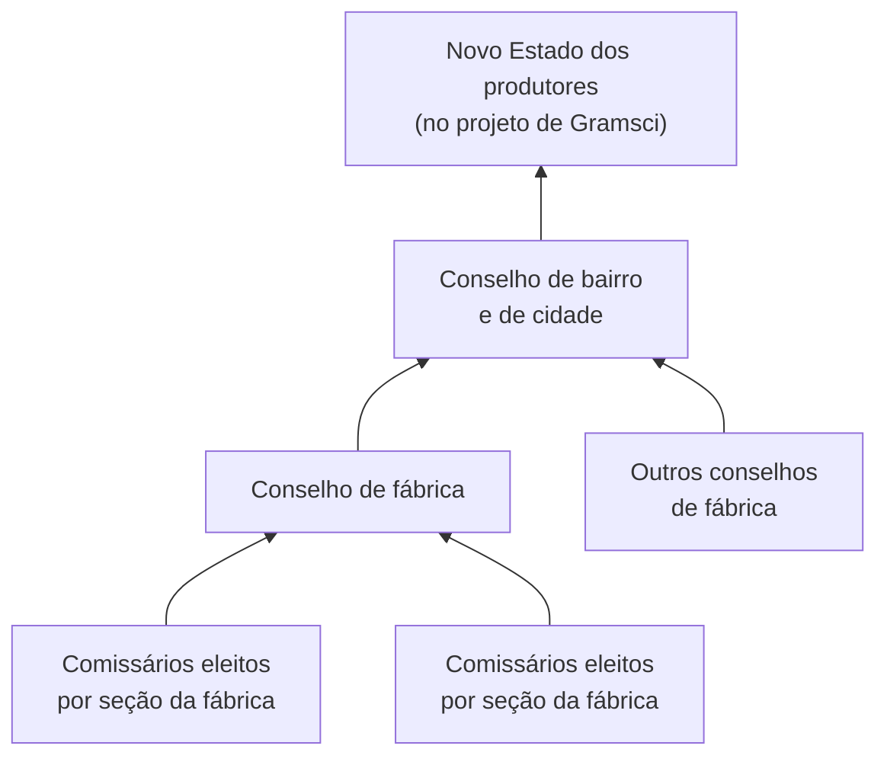
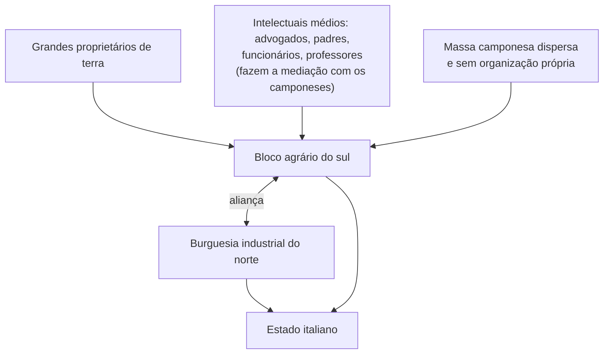

> **Aviso de Idioma:** Este currículo e todos os seus recursos de apoio foram estruturados exclusivamente em **Português (PT-BR)**.

# Aula 1 · Gramsci: Turim, os conselhos e a questão meridional

**MOD-203 · 10 horas · Leitura principal:** Gramsci, artigos de *L'Ordine Nuovo*: "Democracia operária" (1919) e "O conselho de fábrica" (1920); *Alguns Temas da Questão Meridional* (1926)

*Antonio Gramsci por volta de 1922. Autor desconhecido, domínio público.*

## O que você vai aprender

- Conhecer a trajetória de Gramsci, da Sardenha a Turim e à prisão.
- Explicar a experiência dos <abbr title="Conselhos de fábrica: órgãos eleitos por todos os trabalhadores de uma fábrica, sindicalizados ou não, que em Turim (1919 e 1920) passaram a controlar a produção e foram vistos por Gramsci como embrião de um novo Estado.">conselhos de fábrica</abbr> de Turim e o papel de *L'Ordine Nuovo*.
- Distinguir o conselho do sindicato e do partido, segundo Gramsci.
- Explicar a <abbr title="Questão meridional: o problema do atraso do sul agrário da Itália em relação ao norte industrial, e da aliança necessária entre os operários do norte e os camponeses do sul.">questão meridional</abbr> e a ideia de aliança entre operários e camponeses.
- Relacionar a divisão norte e sul da Itália com as desigualdades regionais do Brasil.

## Pergunta de abertura

> Por que operários bem organizados de uma grande cidade industrial, sozinhos, não conseguem transformar um país em que a maioria da população vive no campo, longe deles, com outra língua do dia a dia, outra religiosidade e outros problemas? O que seria preciso para construir uma aliança?

## 1. Da Sardenha a Turim

Antonio Gramsci nasceu em 1891 em Ales, na Sardenha, uma das regiões mais pobres da Itália. Teve uma deformação na coluna (provavelmente tuberculose óssea) e uma infância de pobreza, depois que o pai foi preso. Com uma bolsa de estudos, chegou em 1911 a Turim, para estudar letras na universidade.

Turim era a capital industrial da Itália: a cidade da Fiat, de dezenas de milhares de operários metalúrgicos. Gramsci se tornou jornalista socialista, escrevendo críticas de teatro e artigos políticos para o jornal *Avanti!*. A experiência do sardo pobre na cidade industrial do norte marcou toda a sua obra: ele conhecia por dentro os dois lados da divisão que dilacerava a Itália. <!-- estilo: ok -->

## 2. *L'Ordine Nuovo* e os conselhos de fábrica

Em maio de 1919, Gramsci fundou com Palmiro Togliatti, Angelo Tasca e Umberto Terracini o semanário ***L'Ordine Nuovo*** (*A Nova Ordem*), "resenha semanal de cultura socialista". Inspirado nos sovietes russos (MOD-201), o jornal propôs transformar as **comissões internas** das fábricas, que cuidavam de reclamações, em **conselhos de fábrica**.

Os anos de 1919 e 1920 ficaram conhecidos como o **biênio vermelho**: greves, ocupações de terras e, em setembro de 1920, a ocupação de centenas de fábricas por cerca de meio milhão de trabalhadores em todo o norte da Itália. Em Turim, os conselhos mantiveram a produção funcionando sem os patrões.

### Conselho, sindicato e partido

Para Gramsci, o conselho era uma instituição de **tipo novo**, diferente do sindicato e do partido:

| | Sindicato | Partido | Conselho de fábrica |
| :--- | :--- | :--- | :--- |
| Quem participa | Os filiados, voluntariamente | Os militantes que aderem a um programa | Todos os trabalhadores da fábrica, por serem produtores |
| Função | Negociar o preço da força de trabalho dentro do capitalismo | Direção política | Organizar a produção e preparar os trabalhadores para dirigi-la |
| Relação com o capitalismo | Opera dentro dele, como um "vendedor" de mão de obra | Disputa o poder | Embrião de um novo Estado, nascido no lugar da produção |

A ideia central: o trabalhador deveria aprender a se ver não como **assalariado** (o que o sindicato reforça), mas como **produtor**, capaz de dirigir a fábrica e a sociedade. Compare com o anarcossindicalismo (MOD-107, aula 6) e com a autogestão de Bakunin: há muitos pontos de contato.

### A derrota

As ocupações de setembro de 1920 terminaram sem tomada do poder: a direção do Partido Socialista e da central sindical negociou o fim do movimento em troca de promessas de "controle operário" que nunca se cumpriram. A partir de 1921, as esquadras fascistas de Mussolini, financiadas por industriais e latifundiários, passaram a atacar sindicatos, cooperativas e jornais operários. Em janeiro de 1921, em Livorno, Gramsci e outros fundaram o **Partido Comunista da Itália**. Em outubro de 1922, Mussolini chegou ao poder.

## 3. A prisão

Gramsci foi eleito deputado em 1924 e se tornou o principal dirigente do partido. Em 8 de novembro de 1926, apesar da imunidade parlamentar, foi preso pelo regime fascista. No julgamento, em 1928, o promotor teria declarado: "Precisamos impedir este cérebro de funcionar por vinte anos." Foi condenado a mais de vinte anos de prisão.

O cérebro continuou funcionando. Na prisão, com a saúde destruída, Gramsci escreveu, entre 1929 e 1935, os ***Cadernos do Cárcere***: cerca de 2.800 páginas de notas, escritas em cadernos escolares sob a vigilância da censura carcerária, o que o obrigava a usar uma linguagem cifrada (o marxismo vira "filosofia da práxis"; Lênin, "Ilitch"). Morreu em 27 de abril de 1937, dias depois de terminar a pena, aos 46 anos. A cunhada, Tatiana Schucht, salvou os cadernos e os enviou a Moscou.

## 4. A questão meridional

Pouco antes da prisão, Gramsci escreveu um ensaio inacabado, *Alguns Temas da Questão Meridional* (1926), que antecipa muitos temas dos *Cadernos*.

A Itália unificada em 1861 era dividida entre um **norte industrial** (Turim, Milão, Gênova) e um **sul agrário** (o Mezzogiorno), pobre, dominado por grandes proprietários de terra. A explicação dominante, até entre socialistas do norte, era racista: os meridionais seriam "biologicamente inferiores", preguiçosos ou criminosos por natureza.

Gramsci inverte a explicação: o atraso do sul é **produto** de uma estrutura de poder, um "bloco agrário" formado por:

Os **intelectuais** têm aqui um papel decisivo: são eles que ligam os camponeses aos proprietários e ao Estado, organizando o consentimento dos dominados. É a primeira forma da teoria dos intelectuais que Gramsci vai desenvolver nos *Cadernos* (aula 3).

A conclusão política: os operários do norte só poderiam vencer se conquistassem o **apoio dos camponeses do sul**, superando o próprio corporativismo e os preconceitos contra os meridionais. Ou seja: a classe operária precisa se tornar **dirigente** de uma aliança de classes, e não só defender os seus interesses imediatos. Essa capacidade de direção é o embrião do conceito de **hegemonia** (aula 2).

Responda à pergunta de abertura com Gramsci: a aliança exige que o grupo urbano organizado abandone o corporativismo, compreenda os problemas reais do campo e ofereça uma direção que inclua os interesses dos camponeses, contando com intelectuais capazes de fazer essa mediação.

> **Conexão com o Brasil:** a "questão meridional" tem um paralelo evidente na divisão entre o Sudeste industrializado e o Nordeste, marcada também por explicações preconceituosas que naturalizam a pobreza. Gramsci foi intensamente lido no Brasil a partir dos anos 1960, e autores como Carlos Nelson Coutinho usaram as suas categorias para pensar a formação do Estado brasileiro (aula 3).

## Leitura guiada

1. **"Democracia operária"** (*L'Ordine Nuovo*, junho de 1919, cerca de 5 páginas): a proposta dos conselhos.
2. **"O conselho de fábrica"** (junho de 1920, cerca de 6 páginas): a diferença entre conselho, sindicato e partido. Monte a sua própria tabela.
3. ***Alguns Temas da Questão Meridional*** (cerca de 30 páginas): a crítica ao racismo antimeridional, o bloco agrário e os intelectuais.

## Exercícios

**1.** Qual é a diferença entre o conselho de fábrica e o sindicato, para Gramsci?

Gabarito comentado

O sindicato reúne os filiados para negociar o preço da força de trabalho dentro do capitalismo: trata o trabalhador como assalariado. O conselho reúne todos os trabalhadores da fábrica enquanto produtores, organiza a produção e prepara-os para dirigi-la: é o embrião de um novo poder, nascido no lugar de trabalho.

**2.** Explique como Gramsci inverte a explicação racista do atraso do sul da Itália.

Gabarito comentado

A explicação racista atribuía o atraso a uma suposta inferioridade natural dos meridionais. Gramsci mostra que o atraso é produto histórico de uma estrutura de poder: o bloco agrário (grandes proprietários, intelectuais médios e massa camponesa dispersa) aliado à burguesia industrial do norte, que mantinha o sul como reserva de mão de obra e mercado. O problema é social e político, não natural.

**3.** Qual o papel dos intelectuais no bloco agrário do sul?

Gabarito

Os intelectuais médios (padres, advogados, professores, funcionários) fazem a mediação entre a massa camponesa e os grandes proprietários e o Estado: organizam o consentimento dos camponeses à ordem existente. São o elo que mantém o bloco coeso.

**4.** Escreva um parágrafo comparando a questão meridional italiana com as desigualdades regionais brasileiras, usando pelo menos um indicador do IBGE (por exemplo, o PIB per capita por grande região).

Critérios de correção

O parágrafo deve citar o indicador com fonte e ano, mostrar a desigualdade entre regiões e aplicar a inversão de Gramsci (o atraso como produto de relações de poder, e não de características naturais da população). A melhor resposta identifica os grupos que, no Brasil, ocupariam posições análogas às do bloco agrário.

## Resumo da aula

- Gramsci, sardo pobre em Turim, viveu a divisão entre norte industrial e sul agrário.
- *L'Ordine Nuovo* (1919) propôs os conselhos de fábrica como embrião de um novo Estado dos produtores, diferentes do sindicato e do partido.
- O biênio vermelho terminou em derrota e no fascismo; Gramsci foi preso em 1926 e escreveu os *Cadernos do Cárcere* na prisão.
- Na questão meridional, o atraso do sul é produto do bloco agrário, em que os intelectuais organizam o consentimento.
- A classe operária precisa se tornar dirigente de uma aliança: é o embrião do conceito de hegemonia.

## Para ir além

- Gramsci, *Cartas do Cárcere*, especialmente as cartas à família sobre a vida na prisão.
- Lincoln Secco, *Gramsci e a Revolução* (2006), introdução brasileira.