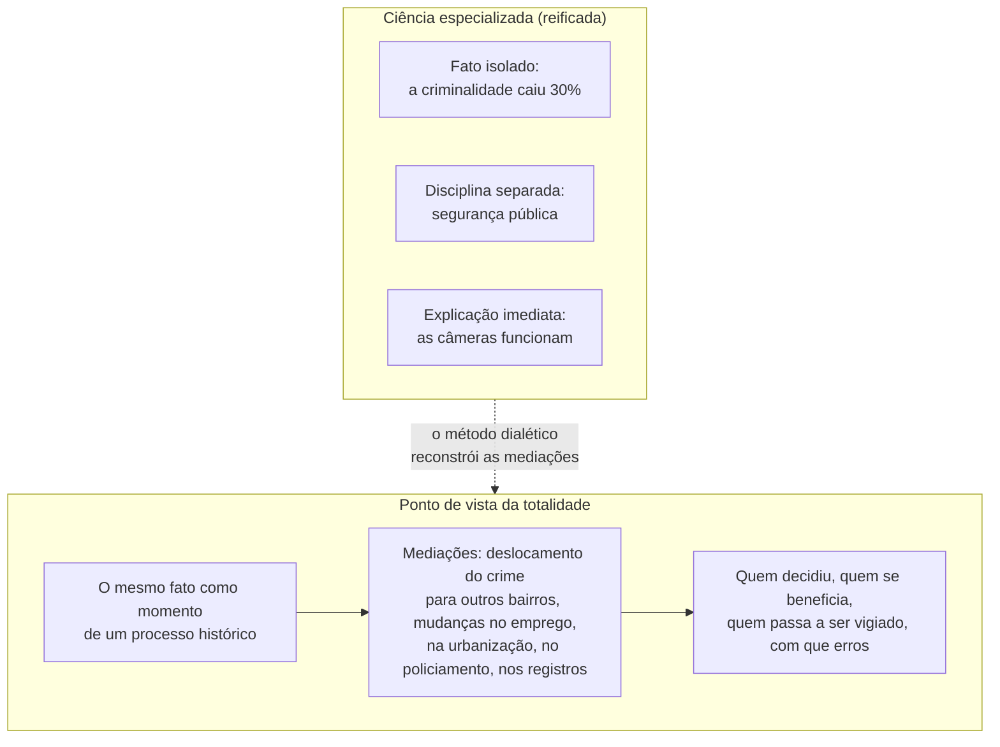
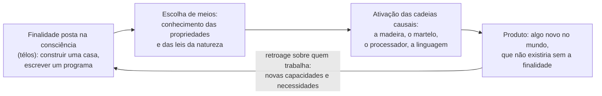

> **Aviso de Idioma:** Este currículo e todos os seus recursos de apoio foram estruturados exclusivamente em **Português (PT-BR)**.

# Aula 5 · Lukács: totalidade, método e o trabalho

**MOD-203 · 10 horas · Leitura principal:** Lukács, *História e Consciência de Classe*, "O que é o marxismo ortodoxo?" e "Consciência de classe" (seleção), e o Prefácio de 1967; *Para uma Ontologia do Ser Social*, capítulo "O trabalho" (seleção)

## O que você vai aprender

- Explicar por que, para Lukács, a ortodoxia marxista diz respeito ao **método**, e não às teses.
- Definir a categoria de <abbr title="Totalidade (em Lukács): o ponto de vista que compreende cada fato social como momento de um todo histórico em movimento, com as suas mediações, em vez de tratá-lo como dado isolado.">totalidade</abbr> e a sua oposição à fragmentação das ciências especializadas.
- Explicar a ideia de <abbr title="Consciência de classe atribuída (ou possível): em Lukács, a consciência que uma classe teria se compreendesse plenamente a sua situação na totalidade social; não coincide com o que os seus membros efetivamente pensam.">consciência de classe atribuída</abbr> e as críticas que recebeu, inclusive do próprio Lukács.
- Explicar o trabalho como <abbr title="Posição teleológica: em Lukács, a característica do trabalho humano de pôr previamente na consciência uma finalidade (télos) e realizá-la mobilizando as cadeias causais da natureza.">posição teleológica</abbr> na *Ontologia do Ser Social*.
- Usar o método da totalidade como crítica ao uso de dados isolados na pesquisa social.

## Pergunta de abertura

> Um estudo mostra que, num bairro, a criminalidade caiu 30% depois da instalação de câmeras de reconhecimento facial. Um gestor conclui que as câmeras funcionam. O que esse dado isolado não diz? O que seria preciso saber para entender o fenômeno?

## 1. O que é o marxismo ortodoxo?

O ensaio que abre *História e Consciência de Classe* faz uma afirmação provocadora: mesmo que a pesquisa empírica provasse que todas as teses particulares de Marx estavam erradas, um marxista "ortodoxo" poderia aceitar esses resultados sem abandonar o marxismo. Porque a ortodoxia, em matéria de marxismo, refere-se **exclusivamente ao método**.

E o núcleo do método é a **dialética**, que Lukács herda de Hegel (MOD-101, aula 4) e Marx: compreender a realidade como um todo em movimento, cheio de contradições, em que os "fatos" não são dados naturais, mas momentos de um processo histórico.

## 2. A categoria da totalidade

> "Não é o predomínio de motivos econômicos na explicação da história que distingue decisivamente o marxismo da ciência burguesa, mas o ponto de vista da totalidade." (tradução livre)

Na sociedade reificada (aula 4), as ciências se especializam e cada uma trata o seu objeto como um conjunto de "fatos" isolados, explicados por leis formais. O economista não vê o direito, o jurista não vê a economia, ninguém vê a sociedade como um todo. O método da totalidade não nega o estudo especializado; exige que cada fato seja relacionado com as **mediações** que o ligam ao conjunto da sociedade e à sua história.

Responda à pergunta de abertura: o dado isolado não diz se o crime foi deslocado para outro lugar, se outros fatores mudaram ao mesmo tempo (emprego, iluminação, policiamento), se os registros mudaram de critério, nem quem passou a ser vigiado e com que taxa de erro. O ponto de vista da totalidade obriga a fazer essas perguntas. No MOD-207 você vai aprender as técnicas estatísticas para controlar algumas delas; no MOD-305, a auditar sistemas de reconhecimento facial.

## 3. A consciência de classe

No ensaio "Consciência de classe", Lukács distingue:

- **A consciência psicológica efetiva:** o que os membros de uma classe de fato pensam num dado momento (o que uma pesquisa de opinião mostraria).
- **A consciência de classe atribuída (ou possível):** os pensamentos e sentimentos que os membros da classe **teriam** se fossem capazes de compreender plenamente a sua situação na totalidade social e os interesses que dela decorrem.

Para Lukács, o proletariado tem uma posição singular: por ser ele próprio transformado em mercadoria (a força de trabalho), ele pode, ao tomar consciência de si, compreender a reificação de dentro e superá-la. Ele seria o "sujeito-objeto idêntico" da história.

### A autocrítica de 1967

O livro foi condenado pela Internacional Comunista em 1924, e Lukács se distanciou dele por décadas. No **Prefácio de 1967**, fez uma autocrítica importante: reconheceu que tinha confundido a **objetivação** (todo trabalho humano se objetiva em produtos, em qualquer sociedade) com o **estranhamento** (a objetivação que se volta contra o produtor, característica do capitalismo), e que a ideia do proletariado como "sujeito-objeto idêntico" era uma tentativa de "superar Hegel em Hegel", mais idealista que materialista. Reconheceu também que o livro ignorava o trabalho, a categoria fundamental da relação entre sociedade e natureza.

Essa autocrítica abriu caminho para a obra final de Lukács.

## 4. A *Ontologia do Ser Social*: o trabalho

Na velhice, Lukács escreveu uma obra enorme, *Para uma Ontologia do Ser Social*, publicada depois da sua morte (1971). O ponto de partida é o **trabalho**, como em Marx e em Hegel, mas pensado com rigor filosófico.

O trabalho humano tem uma estrutura própria, que Lukács chama de **posição teleológica**:

Lukács retoma uma passagem célebre d'*O Capital*: o pior arquiteto se distingue da melhor abelha porque constrói a obra na cabeça antes de construí-la na cera. O trabalho une duas coisas: uma **finalidade** que só existe na consciência e a **causalidade** da natureza, que precisa ser conhecida e mobilizada. É dessa união que nasce todo o mundo social, e é por isso que o trabalho é o modelo de toda a prática humana.

Duas consequências importantes para este curso:

1. O conhecimento científico nasce da necessidade de conhecer as cadeias causais para realizar finalidades: ciência e trabalho estão ligados desde a origem.
2. Toda técnica é uma objetivação de finalidades humanas. Um sistema computacional também é uma posição teleológica: alguém pôs as finalidades que ele realiza. Perguntar **quem pôs as finalidades** de um sistema é a forma "ontológica" da crítica à reificação.

## 5. Lukács e as críticas

Lukács é um dos autores mais discutidos do marxismo:

| Crítica | Autores |
| :--- | :--- |
| A totalidade pode virar pretensão de um ponto de vista absoluto, que conhece o todo | Adorno, que respondeu que "o todo é o falso" |
| A centralidade do trabalho deixa de lado a comunicação e a linguagem | Habermas (MOD-205) |
| As relações de Lukács com o stalinismo, de que se distanciou tardiamente | Vários historiadores |

E uma defesa: num tempo de dados abundantes e especialização extrema, a exigência de relacionar cada dado com o todo social e histórico continua sendo uma das melhores proteções contra conclusões apressadas.

## Leitura guiada

1. **"O que é o marxismo ortodoxo?"** (cerca de 25 páginas): copie a passagem sobre o método e a passagem sobre a totalidade.
2. **"Consciência de classe"**, seção inicial (cerca de 15 páginas): a consciência atribuída.
3. **Prefácio de 1967** (cerca de 25 páginas): a autocrítica.
4. ***Ontologia do Ser Social*, capítulo "O trabalho"**, primeira seção (cerca de 20 páginas): a posição teleológica.

## Exercícios

**1.** O que significa dizer que a ortodoxia marxista se refere exclusivamente ao método?

Gabarito comentado

Que o que define o marxismo não é a fidelidade a teses particulares (que podem ser revistas pela pesquisa), mas o método dialético: compreender a realidade como totalidade histórica em movimento, com as suas contradições e mediações. Lukács usa isso contra o dogmatismo, embora, na prática, a sua própria relação com o partido tenha sido marcada por autocríticas e concessões.

**2.** Aplique o método da totalidade à pergunta de abertura, listando pelo menos cinco mediações a investigar.

Gabarito

Exemplos: deslocamento do crime para bairros vizinhos; mudanças simultâneas no policiamento, na iluminação ou no emprego; mudança nos critérios de registro das ocorrências; taxa de erros do reconhecimento facial e quem é afetado por eles (em geral, pessoas negras são mais afetadas); custo do sistema e quem o fornece; efeitos sobre a liberdade de circulação e a privacidade dos moradores; quem decidiu a instalação e com que consulta.

**3.** Qual foi a principal autocrítica de Lukács no Prefácio de 1967?

Gabarito

Ter confundido objetivação (presente em todo trabalho humano) com estranhamento (a objetivação que se volta contra o produtor no capitalismo), e ter tratado o proletariado como "sujeito-objeto idêntico" de forma idealista, além de ter ignorado o trabalho como categoria fundamental.

**4.** Explique o trabalho como posição teleológica e aplique o conceito a um sistema de software que você conhece: quem pôs as finalidades que ele realiza?

Critérios de correção

A resposta deve explicar a união entre finalidade posta na consciência e mobilização de cadeias causais, com o exemplo do arquiteto e da abelha. A aplicação deve identificar as finalidades do sistema escolhido (as explícitas e as implícitas, como maximizar tempo de uso) e quem as definiu, distinguindo quem escreveu o código de quem decidiu o objetivo.

## Resumo da aula

- A ortodoxia marxista, para Lukács, refere-se ao método dialético, e não às teses.
- O ponto de vista da totalidade relaciona cada fato com as mediações que o ligam ao todo social e histórico, contra a fragmentação das ciências reificadas.
- Consciência de classe atribuída: a que a classe teria se compreendesse a sua situação na totalidade.
- No Prefácio de 1967, Lukács criticou a confusão entre objetivação e estranhamento e o idealismo do "sujeito-objeto idêntico".
- Na *Ontologia*, o trabalho é posição teleológica: finalidade consciente que mobiliza a causalidade natural. Todo sistema técnico realiza finalidades postas por alguém.

## Para ir além

- Sergio Lessa, *Mundo dos Homens: Trabalho e Ser Social* (2002), introdução brasileira à *Ontologia* de Lukács.
- Theodor Adorno, *Minima Moralia* (1951), para a crítica ao conceito de totalidade.