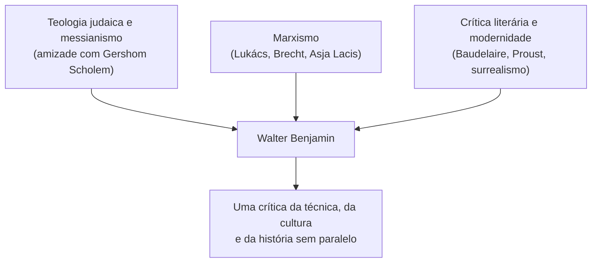
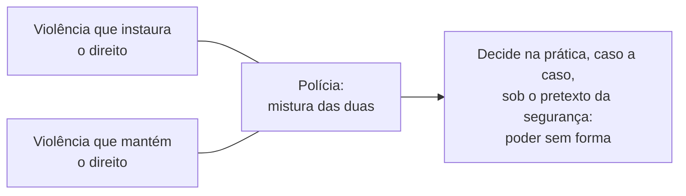

> **Aviso de Idioma:** Este currículo e todos os seus recursos de apoio foram estruturados exclusivamente em **Português (PT-BR)**.

# Aula 6 · Benjamin: violência, alegoria e montagem

**MOD-203 · 10 horas · Leitura principal:** Benjamin, *Para uma Crítica da Violência* (1921); *Origem do Drama Barroco Alemão* (1928), trechos sobre a alegoria; *Rua de Mão Única* (1928), seleção ("Posto de gasolina", "Relógio de ponto", "A caminho do planetário")

## O que você vai aprender

- Conhecer a trajetória de Walter Benjamin e a sua posição singular entre o marxismo, a teologia judaica e a crítica literária.
- Distinguir, em *Para uma Crítica da Violência*, a <abbr title="Violência instauradora do direito: em Benjamin, a violência que funda uma nova ordem jurídica (uma revolução, uma guerra vitoriosa). Violência mantenedora: a que conserva a ordem existente (a polícia, os tribunais).">violência que instaura</abbr> e a que mantém o direito.
- Explicar o conceito de <abbr title="Alegoria (em Benjamin): forma de expressão em que as coisas aparecem como ruínas e fragmentos carregados de sentido, em oposição ao símbolo, que sugere uma totalidade harmoniosa.">alegoria</abbr> no estudo sobre o drama barroco.
- Entender a <abbr title="Montagem: procedimento de construir uma obra justapondo fragmentos heterogêneos (citações, imagens, cenas) sem uma narrativa contínua, para que o choque entre eles produza sentido. Usado no cinema de Eisenstein, na fotografia e por Benjamin na escrita.">montagem</abbr> como forma de pensamento em *Rua de Mão Única*.
- Relacionar a crítica da polícia de Benjamin com o debate sobre policiamento automatizado.

## Pergunta de abertura

> Quando a polícia age, ela aplica a lei ou cria regras novas na prática, decidindo a cada abordagem quem é suspeito? E quando um sistema automatizado de policiamento indica quais bairros patrulhar, quem está fazendo a lei?

## 1. Um pensador fora de lugar

Walter Benjamin nasceu em 1892 em Berlim, numa família judia rica e assimilada. Foi crítico literário, tradutor (de Baudelaire e de Proust), filósofo e ensaísta, mas nunca conseguiu um lugar na universidade: a sua tese de livre-docência sobre o drama barroco foi rejeitada em 1925 pela Universidade de Frankfurt, cujos professores declararam não entendê-la. Viveu de escrever para jornais e rádio.

O seu pensamento combina fontes que parecem incompatíveis:

Leu *História e Consciência de Classe* (aula 4) em 1924 e se aproximou do marxismo pela amizade com a diretora de teatro letã Asja Lacis e com o dramaturgo Bertolt Brecht. Com a ascensão do nazismo, exilou-se em Paris em 1933. Em 1940, fugindo da ocupação alemã, tentou atravessar os Pireneus para a Espanha; detido na fronteira, em Portbou, e ameaçado de ser entregue à Gestapo, suicidou-se em 26 de setembro de 1940.

## 2. *Para uma Crítica da Violência* (1921)

O ensaio pergunta sob que condições a violência pode ser um meio justo. A primeira distinção:

| | Violência que instaura o direito | Violência que mantém o direito |
| :--- | :--- | :--- |
| O que faz | Funda uma nova ordem jurídica | Conserva a ordem existente |
| Exemplos | Uma guerra vitoriosa que impõe um tratado; uma revolução | O serviço militar obrigatório, os tribunais, a pena de morte |

E a observação mais aguda do ensaio é sobre a **polícia**. Na polícia, diz Benjamin, as duas violências se misturam de modo "ignominioso": ela deveria apenas manter o direito, mas, na prática, **cria regras** a cada intervenção, em casos que a lei não define com clareza, sob o pretexto da "segurança". A polícia intervém onde o Estado não consegue garantir os seus fins pela ordem jurídica, e o seu poder é "sem forma", espalhado por toda a vida dos cidadãos.

O ensaio termina com uma ideia difícil, de fundo teológico: uma "violência divina" ou "pura", que não instaura nem mantém direito algum, mas o depõe. Benjamin a associa à **greve geral proletária** (tomando a ideia do sindicalista francês Georges Sorel), que não busca impor uma nova ordem estatal, mas suspender a ordem existente. É a parte mais discutida e controversa do texto.

> **Conexão com a computação:** volte à pergunta de abertura. Sistemas de "policiamento preditivo" indicam onde e quem patrulhar a partir de registros passados de ocorrências. Como os registros refletem onde a polícia já patrulhava, o sistema tende a mandar mais policiais para os mesmos bairros, produzindo mais registros ali: um circuito que transforma decisões policiais passadas em regra "objetiva" futura. É a mistura que Benjamin descreveu, agora automatizada: a manutenção do direito cria regras, sem forma visível e sem responsabilidade clara. O MOD-305 retoma o tema com dados.

## 3. A alegoria e o drama barroco

A tese rejeitada, *Origem do Drama Barroco Alemão* (publicada em 1928), estuda as peças de teatro alemãs do século XVII, cheias de tiranos, mártires, cadáveres e ruínas, escritas durante a devastação da Guerra dos Trinta Anos.

Benjamin opõe duas formas de expressão:

| Símbolo | Alegoria |
| :--- | :--- |
| Sugere uma totalidade harmoniosa e imediata | Mostra o mundo como fragmentos e ruínas |
| O sentido aparece num instante luminoso | O sentido é atribuído, construído, precisa ser decifrado |
| Associado ao classicismo e à ideia de eternidade | Associada à história como decadência e sofrimento |

Na alegoria barroca, diz Benjamin, a história aparece como uma **paisagem petrificada**, uma caveira, uma ruína. E é aí que está a sua verdade: a alegoria recusa a ilusão de uma totalidade harmoniosa e mostra a história como acúmulo de destruição. Essa ideia reaparece, transformada, no "anjo da história" de 1940 (aula 9).

## 4. *Rua de Mão Única* (1928): pensar em fragmentos

No mesmo ano, Benjamin publicou um livro muito diferente: *Rua de Mão Única*, uma sequência de textos curtos com títulos tirados de placas, vitrines e letreiros da cidade ("Posto de gasolina", "Relógio de ponto", "Obras", "Mexicanos, embaixada"). Não há argumento contínuo: há uma **montagem** de fragmentos, de aforismos, de sonhos, de observações sobre objetos.

*Capa da primeira edição de* Rua de Mão Única *(1928), com fotomontagem de Sasha Stone. Domínio público nos Estados Unidos.*

O primeiro texto, "Posto de gasolina", já anuncia o programa: a verdadeira atividade literária não pode pretender se desenvolver dentro de um quadro literário; numa época de crise, ela precisa de formas modestas e eficazes, como **folhetos, panfletos, artigos de jornal e cartazes**, mais adequadas à influência sobre as comunidades ativas do que o "pretensioso gesto universal do livro". É um esboço de *O Autor como Produtor* (aula 7).

A montagem é, para Benjamin, mais do que um estilo literário: é uma **forma de conhecimento**. Justapor fragmentos heterogêneos sem uma narrativa que os amarre faz o leitor ver relações que a narrativa contínua esconderia. Ele aprendeu isso com o cinema soviético de Eisenstein, com o surrealismo e com a fotomontagem. O seu último grande projeto, o *Trabalho das Passagens* (aula 9), seria uma montagem de milhares de citações.

> **Conexão com o projeto:** o Motor de Passagens e Constelações do módulo é uma ferramenta de montagem: em vez de organizar as fichas numa narrativa ou numa hierarquia, ele as aproxima por conceitos em comum e deixa o leitor descobrir as relações. Comece agora a guardar as suas fichas de leitura no formato descrito no guia do módulo.

## Leitura guiada

1. ***Para uma Crítica da Violência*** (cerca de 25 páginas): faça um quadro com os tipos de violência. Copie a passagem sobre a polícia.
2. ***Origem do Drama Barroco Alemão***, trechos sobre a alegoria (cerca de 15 páginas): procure a imagem da história como paisagem petrificada.
3. ***Rua de Mão Única***, "Posto de gasolina", "Relógio de ponto" e "A caminho do planetário" (cerca de 10 páginas): este último termina com uma reflexão sobre a técnica, que você vai reencontrar na aula 8.

## Exercícios

**1.** Explique a distinção entre violência que instaura e violência que mantém o direito, com um exemplo de cada.

Gabarito

A que instaura funda uma nova ordem jurídica (uma revolução que cria uma constituição, uma guerra que impõe um tratado de paz). A que mantém conserva a ordem existente (os tribunais, a prisão, o serviço militar obrigatório).

**2.** Por que, para Benjamin, a polícia mistura as duas formas de violência?

Gabarito comentado

Porque, embora devesse apenas manter o direito, ela intervém em situações que a lei não define com clareza e decide caso a caso, sob o pretexto da segurança, criando regras na prática. Assim, exerce também uma violência instauradora, mas sem forma visível e espalhada por toda a vida social.

**3.** Responda à pergunta de abertura usando a análise de Benjamin sobre a polícia e o circuito do policiamento preditivo.

Critérios de correção

A resposta deve explicar a mistura entre manutenção e criação de regras na ação policial e mostrar como o sistema preditivo transforma decisões policiais passadas em regras futuras, num circuito que se autoconfirma. A melhor resposta discute quem responde pelas decisões do sistema e se há forma de contestá-las.

**4.** Escreva um texto curto em forma de montagem, à maneira de *Rua de Mão Única*: cinco fragmentos de até 80 palavras, cada um com um título tirado de um objeto ou letreiro do seu bairro, sobre a relação entre técnica e vida cotidiana.

Critérios de correção

Os fragmentos devem ser independentes (sem narrativa contínua), partir de objetos concretos e produzir sentido pelo contraste entre eles. A avaliação considera a precisão da linguagem (lembre de Pound, no MOD-205) e a capacidade de mostrar uma relação inesperada.

## Resumo da aula

- Benjamin combinou marxismo, teologia judaica e crítica literária; nunca teve lugar na universidade e morreu em 1940 fugindo do nazismo.
- *Para uma Crítica da Violência*: violência que instaura e que mantém o direito; na polícia, as duas se misturam num poder sem forma.
- A alegoria barroca mostra a história como ruína e fragmento, contra a falsa harmonia do símbolo.
- *Rua de Mão Única* pensa por montagem de fragmentos e defende formas modestas e eficazes de intervenção.
- A montagem é forma de conhecimento e a base do projeto do módulo.

## Para ir além

- Jeanne Marie Gagnebin, *História e Narração em Walter Benjamin* (1994).
- Susan Buck-Morss, *Dialética do Olhar: Walter Benjamin e o Projeto das Passagens* (1989).