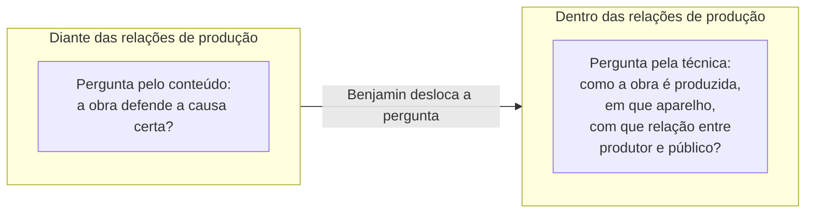
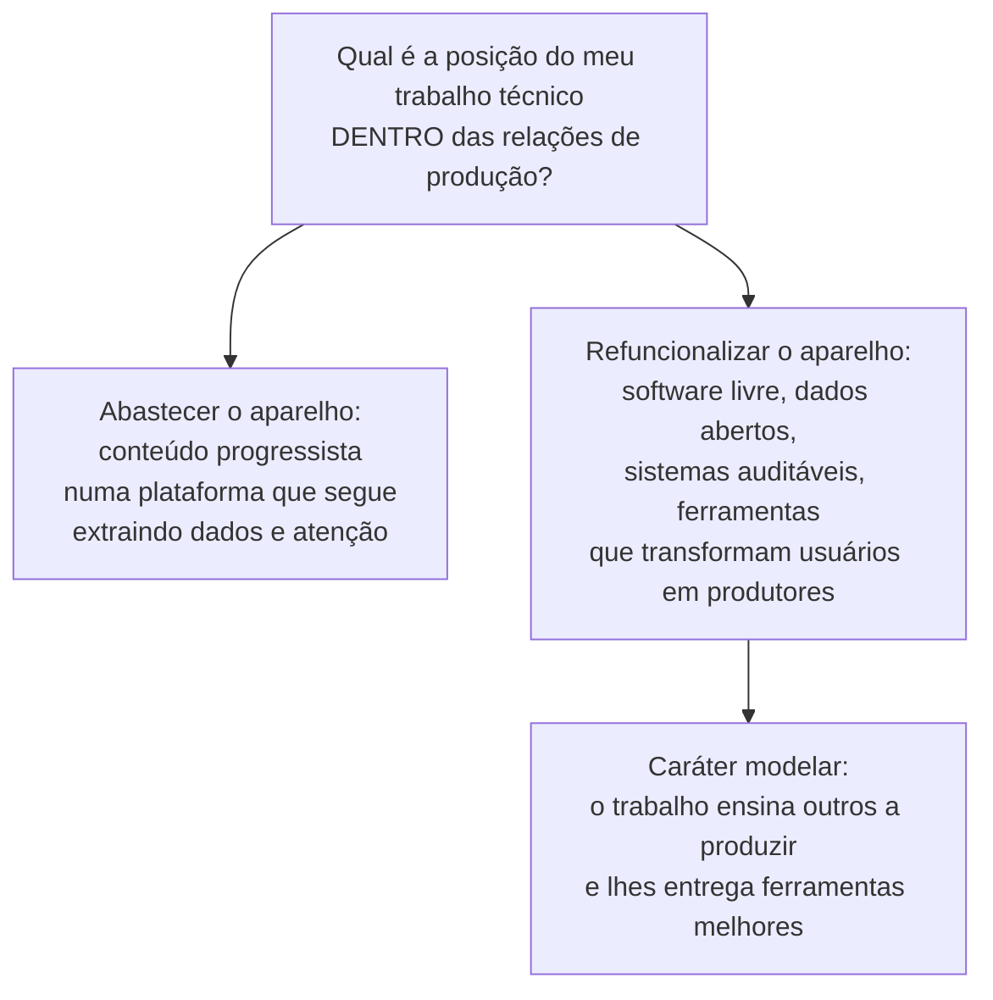

> **Aviso de Idioma:** Este currículo e todos os seus recursos de apoio foram estruturados exclusivamente em **Português (PT-BR)**.

# Aula 7 · Benjamin: *O Autor como Produtor*

**MOD-203 · 10 horas · Leitura principal:** Benjamin, *O Autor como Produtor* (conferência preparada para o Instituto para o Estudo do Fascismo, Paris, abril de 1934), texto integral

## O que você vai aprender

- Reconstruir o argumento de *O Autor como Produtor*, o texto que dá ao curso a sua ideia central.
- Explicar a passagem da pergunta pela posição de uma obra **diante** das relações de produção para a pergunta pela sua posição **dentro** delas.
- Definir <abbr title="Refuncionalização (Umfunktionierung): termo de Brecht retomado por Benjamin: transformar a função social de um aparelho técnico de produção (a imprensa, o teatro, o rádio), em vez de apenas abastecê-lo com conteúdos diferentes.">refuncionalização</abbr> e o critério do "caráter modelar" de uma obra.
- Explicar os exemplos de Tretiakov e do teatro épico de Brecht.
- Aplicar o argumento ao trabalho de quem desenvolve software: o engenheiro como produtor.

## Pergunta de abertura

> Uma desenvolvedora progressista trabalha numa grande plataforma digital. Ela se esforça para que o aplicativo exiba mais conteúdos sobre direitos humanos e combate à desigualdade. A plataforma continua coletando dados de todos, otimizando o tempo de tela e lucrando com publicidade. O trabalho dela é politicamente progressista?

## 1. O contexto

Em 1934, com o nazismo no poder na Alemanha, intelectuais de esquerda exilados em Paris discutiam a responsabilidade dos escritores. Uma posição comum era a da **tendência**: a obra deve ter a tendência política correta, defender as causas certas. Outra posição, a dos estetas, defendia a **qualidade** literária independente da política.

Benjamin preparou uma conferência que recusa os dois lados da disputa e reformula a pergunta. Não há registro seguro de que a conferência tenha sido de fato pronunciada, mas o texto se tornou um dos mais influentes da teoria crítica sobre cultura e técnica.

## 2. Diante ou dentro das relações de produção

A pergunta tradicional da crítica marxista era: **qual é a posição de uma obra diante das relações de produção da sua época?** Ela as aceita, é reacionária, ou quer transformá-las, é revolucionária?

Benjamin propõe uma pergunta anterior e mais precisa:

> "Antes de perguntar: qual é a posição de uma obra literária **diante** das relações de produção da época, eu gostaria de perguntar: qual é a sua posição **dentro** delas?" (tradução livre)

A diferença é decisiva. A primeira pergunta olha o **conteúdo** (o que a obra diz). A segunda olha a **técnica**: como a obra é produzida, por que meios, em que aparelho, com que relação entre quem produz e quem recebe.

E é aí que a disputa entre tendência e qualidade se dissolve: a tendência política correta de uma obra só é correta se a obra também for correta do ponto de vista técnico, ou seja, se ela intervier no modo de produção, e não só no conteúdo. A **técnica literária** é o ponto em que tendência e qualidade se encontram.

## 3. Abastecer ou refuncionalizar o aparelho

O argumento central: um autor que só muda o **conteúdo** do que escreve, mas continua abastecendo o mesmo aparelho de produção (a mesma editora, o mesmo jornal, o mesmo mercado), não transforma nada. O aparelho é capaz de assimilar, e até de vender, conteúdos revolucionários sem pôr em questão a sua própria existência. Benjamin dá um exemplo: a fotografia "engajada" que transforma a miséria em objeto de consumo estético e decorativo.

A tarefa é outra: **refuncionalizar** o aparelho. A expressão vem de Brecht (*Umfunktionierung*): não apenas abastecer o aparelho de produção, mas transformá-lo, na medida do possível, no sentido do socialismo.

| Abastecer o aparelho | Refuncionalizar o aparelho |
| :--- | :--- |
| Mudar o que se diz | Mudar como se produz e para quem |
| Leitores como consumidores passivos | Leitores que se tornam colaboradores e produtores |
| O autor como especialista isolado | O autor como produtor que socializa os meios de produção intelectual |

### Os exemplos

**Sergei Tretiakov** era um escritor soviético que, nos anos 1920, foi para as fazendas coletivas e, em vez de escrever romances sobre elas, ajudou a organizar jornais murais, reuniões, programas de rádio, cinemas ambulantes: o escritor "operante" em vez de "informativo". Benjamin cita também a **imprensa soviética**, em que o leitor estava sempre pronto a se tornar escritor, descrevendo, relatando, prescrevendo: a fronteira entre autor e público começa a se dissolver.

O **teatro épico de Brecht** é o segundo exemplo. Em vez de envolver o espectador numa ilusão para que ele se identifique com os personagens, o teatro épico interrompe a ação, mostra o seu funcionamento, faz o público pensar e tomar posição. A técnica teatral é transformada para mudar a relação entre a cena e o público.

### O critério do caráter modelar

Benjamin propõe um critério para julgar uma obra:

> Uma obra que não ensina nada aos escritores não ensina nada a ninguém. O decisivo é o **caráter modelar** da produção: ela deve ser capaz de, primeiro, levar outros produtores a produzir e, segundo, pôr à disposição deles um aparelho melhorado. E esse aparelho é tanto melhor quanto mais consumidores conduz à produção, ou seja, quanto mais transforma leitores ou espectadores em colaboradores. (paráfrase)

## 4. O engenheiro como produtor

Agora leia o texto trocando "autor" por "engenheiro" e "aparelho literário" por "aparelho técnico". É o exercício que dá nome ao TCC do curso (MOD-306).

Responda à pergunta de abertura com Benjamin: o trabalho da desenvolvedora muda o **conteúdo** que o aparelho distribui, mas não a sua **posição dentro** das relações de produção: a plataforma continua sendo um aparelho de coleta de dados e captura de atenção, e assimila o conteúdo progressista como mais um produto. Isso não torna o seu esforço inútil, mas o limita. A pergunta de Benjamin desloca a atenção para o aparelho: quem controla os dados, quem pode auditar o algoritmo, quem pode reutilizar o código, quem decide as finalidades (lembre da posição teleológica, aula 5).

Exemplos de refuncionalização no campo técnico:

- **Software livre:** o código é aberto para que outros estudem, modifiquem e produzam (MOD-106, aula 6; MOD-107, aula 7). É caráter modelar no sentido exato de Benjamin.
- **Ferramentas de interesse público** como o Querido Diário (MOD-301), que transformam documentos oficiais de difícil acesso em dados pesquisáveis por qualquer pessoa, e cujo código permite que outros grupos façam o mesmo nas suas cidades.
- **Documentação e formação:** um sistema que vem com tutoriais em português e convida usuários a contribuir transforma consumidores em colaboradores.

E o limite que Benjamin também reconheceria: refuncionalizar exige condições materiais (tempo, financiamento, organização coletiva). O intelectual não refuncionaliza sozinho o aparelho; precisa, diz Benjamin, de solidariedade com o proletariado, e não como "mecenas ideológico", mas como produtor que reconhece a sua própria posição nas relações de produção. Compare com o intelectual orgânico de Gramsci (aula 3).

## Leitura guiada

1. ***O Autor como Produtor***, texto integral (cerca de 20 páginas). Leia duas vezes.
   - Na primeira leitura, marque as passagens sobre tendência e qualidade, sobre a pergunta "diante ou dentro" e sobre a refuncionalização.
   - Na segunda, substitua mentalmente "escritor" por "engenheiro de software" e anote as passagens que mudam de sentido e as que não fazem sentido na transposição.

## Exercícios

**1.** Explique a diferença entre perguntar pela posição de uma obra **diante** e **dentro** das relações de produção.

Gabarito comentado

Perguntar "diante" é perguntar pelo conteúdo: a obra apoia ou combate a ordem existente? Perguntar "dentro" é perguntar pela técnica e pelo modo de produção: como a obra é produzida, em que aparelho, que relação estabelece entre produtor e público. Benjamin argumenta que a segunda pergunta é anterior e mais decisiva, porque um conteúdo crítico pode ser assimilado por um aparelho que permanece intacto.

**2.** O que é refuncionalizar um aparelho de produção? Dê um exemplo fora da literatura.

Gabarito comentado

É transformar a função social do aparelho técnico, e não só abastecê-lo com conteúdos diferentes. Exemplo: uma rádio comunitária em que os moradores produzem os programas, em vez de só ouvir; um repositório de software livre em que usuários se tornam contribuidores; um portal de dados públicos que publica também o código de coleta, permitindo que qualquer pessoa reproduza e amplie o trabalho.

**3.** Responda à pergunta de abertura com o argumento de Benjamin, reconhecendo também os limites da crítica.

Critérios de correção

A resposta deve mostrar que o trabalho da desenvolvedora atua no conteúdo e não na posição dentro das relações de produção, e que a plataforma assimila o conteúdo progressista. Deve reconhecer limites: nem toda pessoa pode escolher onde trabalhar, e mudanças de conteúdo podem ter efeitos reais. A melhor resposta aponta caminhos de refuncionalização possíveis dentro e fora da empresa (organização coletiva, abertura de código, pressão por transparência).

**4.** Escreva o primeiro rascunho (1.000 palavras) do ensaio "O Engenheiro como Produtor", usando o critério do caráter modelar para avaliar um projeto técnico real.

Critérios de correção

O rascunho deve apresentar o argumento de Benjamin com citação, escolher um projeto real (com fonte) e avaliá-lo pelos dois critérios do caráter modelar: leva outros a produzir? Põe à disposição um aparelho melhorado? Deve também relacionar com Gramsci (intelectual orgânico) ou Lukács (reificação).

## Resumo da aula

- Benjamin desloca a pergunta: da posição da obra diante das relações de produção para a sua posição dentro delas.
- A tendência política correta só é correta se a técnica também for: tendência e qualidade se encontram na técnica.
- Abastecer o aparelho com conteúdo crítico não basta; é preciso refuncionalizá-lo.
- Critério do caráter modelar: a obra deve levar outros a produzir e entregar-lhes um aparelho melhorado, transformando consumidores em colaboradores.
- Aplicado ao software: software livre, dados abertos e ferramentas de interesse público são formas de refuncionalização; o engenheiro como produtor é a ideia central do curso.

## Para ir além

- Bertolt Brecht, escritos sobre o teatro épico e "Teoria do rádio" (1927 a 1932), em que propõe transformar o rádio de aparelho de distribuição em aparelho de comunicação.
- Com esta aula, releia o propósito do curso no [README](../../../README.md).