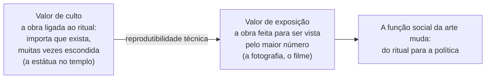
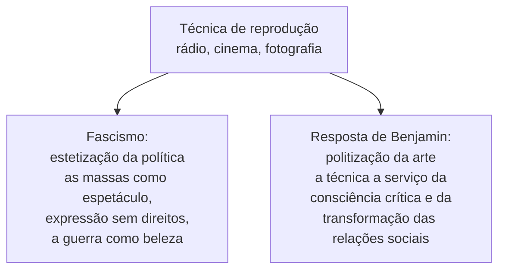

> **Aviso de Idioma:** Este currículo e todos os seus recursos de apoio foram estruturados exclusivamente em **Português (PT-BR)**.

# Aula 8 · Benjamin: a obra de arte, a aura e a técnica

**MOD-203 · 10 horas · Leitura principal:** Benjamin, *A Obra de Arte na Era de sua Reprodutibilidade Técnica* (1935 a 1936; leia a segunda versão), texto integral; *Pequena História da Fotografia* (1931), seleção

## O que você vai aprender

- Definir a <abbr title="Aura: em Benjamin, a aparição única de algo distante, por mais próximo que esteja. A autoridade e a unicidade de uma obra de arte ligada ao seu aqui e agora e à tradição.">aura</abbr> e explicar o seu declínio com a reprodutibilidade técnica.
- Distinguir <abbr title="Valor de culto e valor de exposição: em Benjamin, as obras de arte nasceram ligadas ao ritual (valor de culto: importa que existam, não que sejam vistas). A reprodução técnica desloca o peso para o valor de exposição: importa que sejam vistas pelo maior número.">valor de culto e valor de exposição</abbr>.
- Explicar o que o cinema muda na percepção: o choque, a recepção distraída, o <abbr title="Inconsciente ótico: em Benjamin, o que a câmera revela e o olho nu não vê: o movimento em câmera lenta, o detalhe ampliado, o instante congelado.">inconsciente ótico</abbr>.
- Explicar a antítese final: <abbr title="Estetização da política: em Benjamin, a política fascista que transforma as massas em espetáculo e a guerra em experiência estética, dando às massas expressão sem lhes dar direitos.">estetização da política</abbr> contra politização da arte.
- Aplicar o ensaio às imagens digitais, às redes sociais e às imagens geradas por inteligência artificial.

## Pergunta de abertura

> Por que milhares de pessoas viajam para ver a *Mona Lisa* atrás de um vidro, cercada de celulares, se qualquer um pode ver uma reprodução melhor e mais nítida em casa? E o que mudou quando cada pessoa passou a ter no bolso uma câmera e um meio de distribuir imagens para o mundo inteiro?

## 1. A reprodutibilidade técnica

Obras de arte sempre puderam ser copiadas: discípulos copiavam os mestres, gravuras e fundição em bronze multiplicavam imagens. Mas no fim do século XIX e no início do XX, a **fotografia** e depois o **cinema** criaram algo novo: a reprodução técnica em massa, em que a cópia é feita por um aparelho, em velocidade industrial, e o "original" deixa de fazer sentido (qual seria a cópia "original" de um filme?).

Benjamin escreve em 1935 e 1936, no exílio em Paris, com uma pergunta política: que mudanças na percepção e na arte a técnica produz, e como elas servem ao fascismo ou à sua crítica?

## 2. A aura

O conceito central é a **aura**:

> "Uma aparição única de uma coisa distante, por mais próxima que ela esteja." (tradução livre)

Benjamin dá um exemplo natural: numa tarde de verão, seguir com os olhos uma cadeia de montanhas no horizonte ou um galho que lança a sua sombra sobre quem repousa é respirar a aura dessas montanhas, desse galho.

Na obra de arte, a aura está ligada ao seu **aqui e agora**, à sua existência única no lugar em que se encontra, à sua **autenticidade** e à **tradição** em que está inserida. A estátua de Vênus era objeto de culto para os gregos e objeto de veneração para os clérigos medievais, mas em ambos os casos era a mesma estátua, única, com a sua autoridade.

A reprodução técnica destrói essa unicidade: aproxima as coisas das massas e multiplica a sua existência, substituindo a ocorrência única por uma existência em série. Resultado: o **declínio da aura**.

## 3. Valor de culto e valor de exposição

As primeiras obras de arte nasceram a serviço de rituais, primeiro mágicos, depois religiosos. Algumas imagens de deuses ficavam escondidas no interior do templo, acessíveis só aos sacerdotes: o que importava era que **existissem**. Com a reprodutibilidade técnica, o peso passa para o **valor de exposição**: a obra é feita para ser vista, e a sua função social pode deixar de se fundar no ritual e passar a se fundar na **política**.

Benjamin nota que, nos primeiros retratos fotográficos, o valor de culto encontrou um último refúgio: o rosto humano, a lembrança dos entes queridos. Na *Pequena História da Fotografia* (1931), ele analisa essas primeiras fotografias, com os seus longos tempos de exposição, que davam aos retratados uma presença aurática, e mostra como a fotografia de Eugène Atget, com as ruas de Paris vazias, "como se fossem o local de um crime", começou a liberar o objeto da aura.

## 4. O cinema e a percepção

O cinema é, para Benjamin, a arte em que a reprodutibilidade técnica atinge a sua forma mais desenvolvida:

| Transformação | O que Benjamin observa |
| :--- | :--- |
| **O ator diante do aparelho** | O ator de cinema representa diante de uma câmera e de uma equipe técnica, não de um público; a sua atuação é cortada e montada. A aura do ator se perde, e a indústria responde fabricando o culto da "estrela" |
| **O inconsciente ótico** | A câmera revela o que o olho não vê: a câmera lenta, o close, o instante congelado. "É através da câmera que conhecemos o inconsciente ótico, assim como conhecemos o inconsciente pulsional pela psicanálise" |
| **O choque** | A sucessão rápida de imagens não deixa o espectador contemplar: produz choques, que treinam a percepção para a vida na cidade moderna e no trabalho mecanizado |
| **A recepção distraída** | O público de cinema é um examinador, mas um examinador distraído. Como na arquitetura, que percebemos pelo uso e pelo hábito, a recepção coletiva e distraída pode formar novos hábitos de percepção |
| **Todos podem ser filmados** | Qualquer pessoa pode aparecer num filme; na imprensa, qualquer leitor pode virar autor. A distinção entre autor e público tende a perder o seu caráter fundamental |

Benjamin vê nessas transformações um **potencial emancipador**: a arte pode sair do culto e da contemplação individual e se tornar experiência coletiva, crítica, política. Mas o capitalismo do cinema, diz ele, desvia esse potencial: fabrica estrelas, explora o interesse do público por si mesmo.

## 5. A estetização da política

O epílogo do ensaio é uma das passagens mais citadas do século XX. O fascismo, diz Benjamin, tenta organizar as massas proletarizadas sem tocar nas relações de propriedade que elas tenderiam a abolir. Ele dá às massas **expressão**, não **direitos**: desfiles, comícios gigantescos, espetáculos esportivos, a guerra. A técnica da reprodução (o rádio, os cinejornais, os filmes de propaganda) permite que as massas se vejam a si mesmas como espetáculo.

O ponto culminante dessa estética é a **guerra**. Benjamin cita o manifesto do futurista italiano Marinetti, que celebrava a guerra como bela. E conclui:

> "*Fiat ars, pereat mundus* (faça-se a arte, pereça o mundo), diz o fascismo. (...) A humanidade, que antes era objeto de contemplação para os deuses olímpicos, tornou-se agora objeto de contemplação para si mesma. A sua autoalienação atingiu o ponto em que ela pode viver a sua própria destruição como um prazer estético de primeira ordem. É assim a estetização da política praticada pelo fascismo. O comunismo responde com a politização da arte." (tradução livre)

## 6. A aura na era digital

O ensaio se tornou leitura obrigatória para pensar a cultura digital, e as suas categorias precisam ser repensadas com cuidado:

- **Bilhões de câmeras:** cada celular é um aparelho de reprodução e distribuição. O que Benjamin via como potencial (todos podem ser autores) se realizou em escala inédita, e ao mesmo tempo foi capturado por plataformas que transformam a autoexposição em dados e lucro (lembre do valor de exposição e do culto da estrela).
- **O retorno da aura como mercadoria:** a *Mona Lisa* atrás do vidro (a pergunta de abertura) mostra que a aura não desapareceu: virou atração turística, e a reprodução em massa aumenta o desejo pelo original. Fenômenos como os NFTs tentaram fabricar artificialmente a escassez e o "original" de imagens digitais infinitamente copiáveis.
- **Imagens geradas por inteligência artificial:** aprofundam a separação entre a imagem e qualquer aqui e agora, e são produzidas a partir do trabalho de milhões de autores cujas obras foram usadas no treinamento (lembre do *General Intellect*, MOD-103, aula 6).
- **Estetização da política nas redes:** a política transformada em espetáculo e engajamento, com as massas convidadas a se expressar sem que isso altere a distribuição do poder. A pergunta de Benjamin continua: a técnica está servindo à expressão sem direitos ou à transformação?

## Leitura guiada

1. ***A Obra de Arte na Era de sua Reprodutibilidade Técnica***, segunda versão (cerca de 40 páginas). Leia em três sessões: seções I a VI (reprodução, aura, valor de culto); seções VII a XIV (fotografia, cinema, o ator, o inconsciente ótico); seção XV e epílogo (recepção distraída e estetização da política).
2. ***Pequena História da Fotografia***, as páginas sobre os primeiros retratos e sobre Atget (cerca de 10 páginas).

## Exercícios

**1.** Defina aura e explique por que a reprodução técnica leva ao seu declínio.

Gabarito comentado

Aura é a aparição única de algo distante, por mais próximo que esteja: a autoridade da obra ligada ao seu aqui e agora, à sua autenticidade e à tradição. A reprodução técnica multiplica a obra, aproxima-a das massas e substitui a existência única por uma existência em série, dissolvendo a autoridade do original.

**2.** Responda à pergunta de abertura com os conceitos de aura, valor de culto e valor de exposição.

Gabarito comentado

A reprodução em massa da *Mona Lisa* deveria ter dissolvido a sua aura, e de certo modo dissolveu: ninguém vai ao Louvre para contemplá-la em silêncio. Mas a reprodução também a transformou em ícone hiperexposto, e a visita passou a ter um novo valor de culto (o culto da celebridade e do turismo), registrado por celulares que geram mais reproduções. A resposta excelente nota que a aura retorna como mercadoria e espetáculo, no sentido crítico de Benjamin.

**3.** Explique a antítese "estetização da política contra politização da arte" e dê um exemplo contemporâneo de estetização da política.

Critérios de correção

A resposta deve explicar que o fascismo dá às massas expressão sem direitos, transforma a política e a guerra em espetáculo estético, e que a resposta é usar a técnica para a consciência crítica e a transformação social. O exemplo contemporâneo deve ser analisado com cuidado (o que é transformado em espetáculo, quem ganha, que direitos não são tocados), com fonte.

**4.** Escreva 400 palavras sobre imagens geradas por inteligência artificial à luz do ensaio de Benjamin.

Critérios de correção

O texto deve usar pelo menos três conceitos do ensaio (aura, valor de exposição, inconsciente ótico, recepção distraída, estetização) com precisão, considerar a origem das imagens de treinamento e evitar tanto a celebração quanto a condenação apressadas. A melhor resposta liga ao *General Intellect* (MOD-103) e ao *Autor como Produtor* (aula 7).

## Resumo da aula

- A reprodutibilidade técnica (fotografia, cinema) dissolve a aura: a aparição única de algo distante, ligada ao aqui e agora e à tradição.
- O peso passa do valor de culto ao valor de exposição; a função social da arte pode passar do ritual à política.
- O cinema transforma a percepção: inconsciente ótico, choque, recepção distraída, apagamento da fronteira entre autor e público.
- O fascismo estetiza a política (expressão sem direitos, a guerra como beleza); a resposta é politizar a arte.
- Na era digital, a aura retorna como mercadoria, e a autoexposição em massa é capturada pelas plataformas.

## Para ir além

- Susan Sontag, *Sobre Fotografia* (1977).
- Bertolt Brecht, "Teoria do rádio", para comparar com o otimismo técnico de Benjamin.