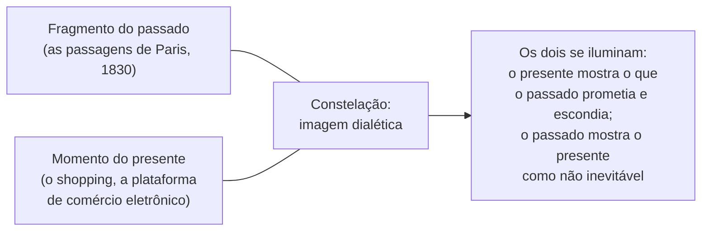
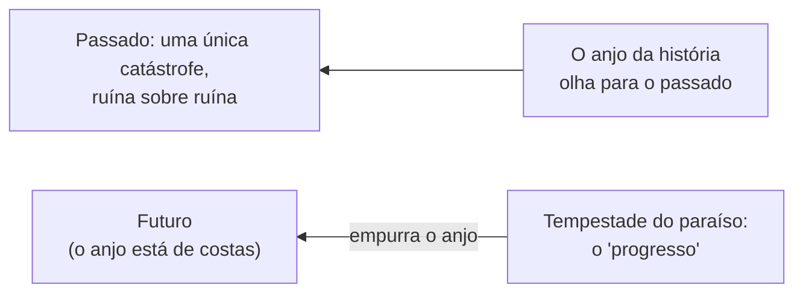

> **Aviso de Idioma:** Este currículo e todos os seus recursos de apoio foram estruturados exclusivamente em **Português (PT-BR)**.

# Aula 9 · Benjamin: as *Passagens* e a história a contrapelo

**MOD-203 · 10 horas · Leitura principal:** Benjamin, *Paris, Capital do Século XIX* (exposé de 1935); *Sobre o Conceito da História* (1940), as 18 teses e os apêndices


*Paul Klee,* Angelus Novus *(1920). Museu de Israel, Jerusalém. Domínio público.*

## O que você vai aprender

- Conhecer o *Trabalho das Passagens*, o grande projeto inacabado de Benjamin.
- Explicar a <abbr title="Fantasmagoria (em Benjamin): o brilho de ilusão com que as mercadorias, as exposições universais e a cidade moderna se apresentam, escondendo o trabalho e as relações sociais que as produziram. Uma retomada do fetichismo de Marx.">fantasmagoria</abbr> da mercadoria e a figura do <abbr title="Flâneur: o passeante ocioso das grandes cidades do século XIX, que observa a multidão e as vitrines; para Benjamin, figura do intelectual que vai ao mercado, supostamente para olhar, mas na verdade para encontrar um comprador.">*flâneur*</abbr>.
- Explicar a <abbr title="Imagem dialética: em Benjamin, o encontro súbito entre um momento do passado e o presente, que forma uma constelação e ilumina os dois. É a forma do conhecimento histórico que interrompe o fluxo contínuo do tempo.">imagem dialética</abbr> e o método da montagem.
- Interpretar as teses *Sobre o Conceito da História*: a crítica ao progresso, o anjo da história, o <abbr title="Jetztzeit (alemão): tempo de agora. Em Benjamin, o tempo carregado de possibilidades de ruptura, oposto ao tempo vazio e homogêneo do progresso contínuo.">*Jetztzeit*</abbr> e a história a contrapelo.
- Construir o núcleo do Motor de Passagens e Constelações do projeto do módulo.

## Pergunta de abertura

> Os livros de história contam a construção das grandes obras, as invenções, as vitórias. O que acontece com os nomes dos que construíram as pirâmides, dos escravizados que plantaram a cana, dos entregadores que entregam a comida? Quem decide o que entra no arquivo?

## 1. O *Trabalho das Passagens*

De 1927 até a morte, Benjamin trabalhou num projeto gigantesco sobre a Paris do século XIX, que chamou de *Passagen-Werk*: uma arqueologia da modernidade capitalista a partir dos seus objetos, lugares e personagens. As **passagens** (*passages*) eram galerias comerciais cobertas de ferro e vidro, construídas a partir dos anos 1820, com lojas de luxo dos dois lados: os primeiros templos do consumo, antepassados das lojas de departamento e dos shopping centers.

O projeto ficou inacabado: são cerca de mil páginas de **citações** e anotações, organizadas em pastas temáticas ("Moda", "Ferro e construção", "Exposições universais", "Baudelaire", "O colecionador", "O *flâneur*", "Haussmann ou as barricadas"). Benjamin pretendia construir o livro como uma **montagem** (aula 6):

> "Método deste trabalho: montagem literária. Não tenho nada a dizer. Só a mostrar." (tradução livre)

## 2. Fantasmagoria e *flâneur*

No exposé de 1935, *Paris, Capital do Século XIX*, Benjamin resume alguns temas:

- **Fantasmagoria:** as exposições universais, as vitrines, as passagens apresentam as mercadorias com um brilho mágico que esconde o trabalho que as produziu. É o fetichismo de Marx (MOD-103, aula 4) visto pelo olhar de quem caminha pela cidade.
- **O *flâneur*:** o passeante ocioso, que flana pelas passagens e pela multidão observando tudo. Benjamin o vê como figura do intelectual moderno: vai ao mercado supostamente para olhar, mas na verdade para encontrar um comprador. Ele é ao mesmo tempo observador e mercadoria.
- **Haussmann e as barricadas:** o barão Haussmann reformou Paris nos anos 1850 e 1860, abrindo grandes avenidas retas no lugar das ruelas medievais. Um dos objetivos, diz Benjamin, era impedir a construção de barricadas e permitir o deslocamento rápido das tropas: urbanismo como estratégia de controle. Lembre da barricada de 1871 (MOD-107, aula 1).
- **O colecionador:** retira os objetos da circulação das mercadorias e lhes dá um novo sentido, reunindo-os num conjunto próprio. Uma figura do pesquisador que reúne fragmentos.

## 3. A imagem dialética

Para Benjamin, o conhecimento histórico não acontece como uma narrativa contínua de causas e efeitos, mas como um **relâmpago**: um momento do passado se encontra subitamente com o presente e forma com ele uma **constelação** que ilumina os dois. É a **imagem dialética**.



Por isso o método da montagem: justapor citações e fragmentos para que deles salte a imagem, em vez de impor uma narrativa que os amarre.

## 4. *Sobre o Conceito da História* (1940)

Na primavera de 1940, pouco antes da fuga, Benjamin escreveu 18 teses curtas. Não eram destinadas à publicação: ele temia que fossem mal compreendidas. São o seu testamento intelectual, escrito depois do pacto entre Hitler e Stálin (1939), que desmoralizou a esquerda europeia.

### A crítica ao progresso

O alvo principal é a crença, comum à social-democracia e ao marxismo vulgar, num **progresso** automático e contínuo: a ideia de que a história caminha por si para o melhor, e de que basta "nadar a favor da corrente" do desenvolvimento técnico. Essa crença, diz Benjamin, desarmou a classe operária diante do fascismo: ela acreditou que o fascismo era um anacronismo que o progresso varreria.

### O anjo da história

A tese IX é uma das páginas mais famosas do século XX:

> "Há um quadro de Klee que se chama *Angelus Novus*. Representa um anjo que parece querer afastar-se de algo que ele encara fixamente. Os seus olhos estão escancarados, a sua boca dilatada, as suas asas abertas. O anjo da história deve ter esse aspecto. O seu rosto está dirigido para o passado. Onde nós vemos uma cadeia de acontecimentos, ele vê uma catástrofe única, que acumula incansavelmente ruína sobre ruína e as dispersa a seus pés. Ele gostaria de deter-se para acordar os mortos e juntar os fragmentos. Mas uma tempestade sopra do paraíso e prende-se em suas asas com tanta força que ele não pode mais fechá-las. Essa tempestade o impele irresistivelmente para o futuro, ao qual ele vira as costas, enquanto o amontoado de ruínas cresce até o céu. Essa tempestade é o que chamamos progresso." (tradução livre)



### Escovar a história a contrapelo

A tese VII afirma que a história escrita costuma ser a história dos **vencedores**: o historiador que se identifica com os vencedores do passado serve aos que dominam no presente. E a frase decisiva:

> "Nunca houve um documento da cultura que não fosse ao mesmo tempo um documento da barbárie." (tradução livre)

Cada catedral, cada palácio, cada tesouro cultural existe graças ao trabalho anônimo e à opressão de muitos. A tarefa do historiador materialista é **escovar a história a contrapelo**: ler os documentos contra a intenção de quem os produziu, recuperar o que foi silenciado, os nomes dos que não entraram no arquivo. Responda agora à pergunta de abertura com a tese VII.

### O tempo de agora

Contra o tempo "homogêneo e vazio" do progresso, que avança como os ponteiros de um relógio, Benjamin opõe o *Jetztzeit*, o **tempo de agora**: o presente carregado de possibilidades de ruptura, em que o passado oprimido pode ser "redimido". A revolução não seria a locomotiva da história (como dizia Marx), mas, talvez, o gesto da humanidade que viaja nesse trem de puxar o **freio de emergência**.

## 5. O arquivo a contrapelo e o projeto do módulo

As teses de Benjamin têm uma consequência direta para quem trabalha com dados e arquivos, que o curso retoma no MOD-301: **todo arquivo é seletivo**. Bancos de dados públicos registram o que o Estado decidiu registrar; plataformas apagam o que não lhes interessa; documentos oficiais desaparecem dos portais. Raspar, preservar e publicar documentos públicos com proveniência verificável é uma forma de escovar a história a contrapelo.

E o projeto deste módulo transforma o método da montagem em ferramenta. Um núcleo em Python, sem bibliotecas externas:

```python
from itertools import combinations

fichas = {
    "F1": {"autor": "Benjamin", "obra": "Teses", "conceitos": {"progresso", "história", "catástrofe"}},
    "F2": {"autor": "Marx", "obra": "O Capital", "conceitos": {"fetichismo", "mercadoria"}},
    "F3": {"autor": "Benjamin", "obra": "Passagens", "conceitos": {"fantasmagoria", "mercadoria", "cidade"}},
    "F4": {"autor": "Lukács", "obra": "HCC", "conceitos": {"reificação", "mercadoria", "fetichismo"}},
    "F5": {"autor": "Heidegger", "obra": "A Questão da Técnica", "conceitos": {"técnica", "progresso"}},
    "F6": {"autor": "Kropotkin", "obra": "Apoio Mútuo", "conceitos": {"cooperação"}},
}

def semelhanca(a, b):
    """Índice de Jaccard: conceitos em comum divididos pelo total de conceitos dos dois."""
    ca, cb = fichas[a]["conceitos"], fichas[b]["conceitos"]
    return len(ca & cb) / len(ca | cb)

def vizinhas(ficha, minimo=0.1):
    pares = [(outra, semelhanca(ficha, outra)) for outra in fichas if outra != ficha]
    return sorted([p for p in pares if p[1] >= minimo], key=lambda p: -p[1])

def constelacoes(minimo=0.1):
    """Agrupa fichas ligadas direta ou indiretamente (componentes conectados)."""
    ligacoes = {f: set() for f in fichas}
    for a, b in combinations(fichas, 2):
        if semelhanca(a, b) >= minimo:
            ligacoes[a].add(b)
            ligacoes[b].add(a)
    vistas, grupos = set(), []
    for inicio in fichas:
        if inicio in vistas:
            continue
        grupo, pilha = set(), [inicio]
        while pilha:
            f = pilha.pop()
            if f not in grupo:
                grupo.add(f)
                pilha.extend(ligacoes[f] - grupo)
        vistas |= grupo
        grupos.append(sorted(grupo))
    return grupos

print("Vizinhas de F3:", [(f, round(s, 2)) for f, s in vizinhas("F3")])
for g in constelacoes():
    print("Constelação:", [f"{f} ({fichas[f]['autor']})" for f in g])
```

O programa encontra, por exemplo, a constelação que liga Marx, Lukács e as *Passagens* de Benjamin pelo conceito de mercadoria, e a que liga as *Teses* a Heidegger pelo progresso. Repare que a busca das constelações usa uma **pilha** (MOD-102, aula 7) para percorrer o grafo: no MOD-303 você vai fazer o mesmo com a biblioteca NetworkX, em redes de poder com milhares de nós.

## Leitura guiada

1. ***Paris, Capital do Século XIX***, exposé de 1935 (cerca de 15 páginas): as seções sobre Fourier e as passagens, Grandville e as exposições universais, Baudelaire e as ruas, Haussmann e as barricadas.
2. ***Sobre o Conceito da História***, teses I a XVIII e apêndices A e B (cerca de 15 páginas). Leia três vezes, em dias diferentes. Copie as teses VII e IX.

## Exercícios

**1.** Explique a fantasmagoria e a relação com o fetichismo da mercadoria.

<details>
<summary>Gabarito</summary>

A fantasmagoria é o brilho de ilusão com que as mercadorias, as vitrines e as exposições se apresentam, escondendo o trabalho e as relações sociais que as produziram. É o fetichismo de Marx observado na experiência da cidade moderna: as coisas parecem dotadas de vida e poder próprios.
</details>

**2.** Interprete a tese IX: quem é o anjo, o que é a tempestade, por que ele está de costas para o futuro?

<details>
<summary>Gabarito comentado</summary>

O anjo é o olhar sobre a história que vê o passado não como cadeia de progressos, mas como uma única catástrofe que acumula ruínas e vítimas. Ele gostaria de parar e reparar (acordar os mortos, juntar os fragmentos), mas a tempestade do "progresso" o empurra para o futuro, de costas, sem que possa ver para onde vai. A imagem critica a crença num progresso automático que ignora o custo humano e impede a reparação.
</details>

**3.** Responda à pergunta de abertura com a tese VII e proponha uma prática concreta de "escovar a história a contrapelo" com dados públicos brasileiros.

<details>
<summary>Critérios de correção</summary>

A resposta deve citar a tese VII ("documento da cultura, documento da barbárie") e explicar a seletividade do arquivo. A prática deve ser concreta e viável: por exemplo, cruzar listas de obras públicas inauguradas com registros de acidentes de trabalho nas mesmas obras; recuperar nomes de trabalhadores em processos trabalhistas digitalizados; preservar versões antigas de portais oficiais que foram alteradas.
</details>

**4.** Rode o código da seção 5, acrescente cinco fichas suas, de módulos diferentes do curso, e analise as constelações formadas. Alguma relação surpreendeu você?

<details>
<summary>Critérios de correção</summary>

As fichas devem ter conceitos atribuídos com cuidado (o resultado depende inteiramente dessa escolha, o que é em si uma lição). A análise deve comentar pelo menos uma constelação inesperada e discutir se ela revela uma relação teórica real ou um artefato da escolha dos conceitos. Ajuste o parâmetro `minimo` e observe como as constelações mudam.
</details>

## Resumo da aula

- O *Trabalho das Passagens* é uma arqueologia da modernidade feita por montagem de citações: "não tenho nada a dizer, só a mostrar".
- Fantasmagoria, *flâneur*, colecionador e as reformas de Haussmann revelam a cidade da mercadoria.
- A imagem dialética é o encontro súbito entre passado e presente numa constelação.
- As teses de 1940 criticam a crença no progresso; o anjo da história vê uma catástrofe única; todo documento da cultura é também documento da barbárie; é preciso escovar a história a contrapelo.
- O projeto do módulo transforma a montagem em ferramenta: fichas, semelhanças e constelações.

## Para ir além

- Michael Löwy, *Walter Benjamin: Aviso de Incêndio* (2005), leitura comentada das teses, com a tradução de referência.
- Com esta aula você fecha o MOD-203. Volte ao [guia do módulo](../03-hegemonia-reificacao-gramsci-lukacs-benjamin.md) e faça o projeto.