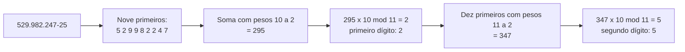
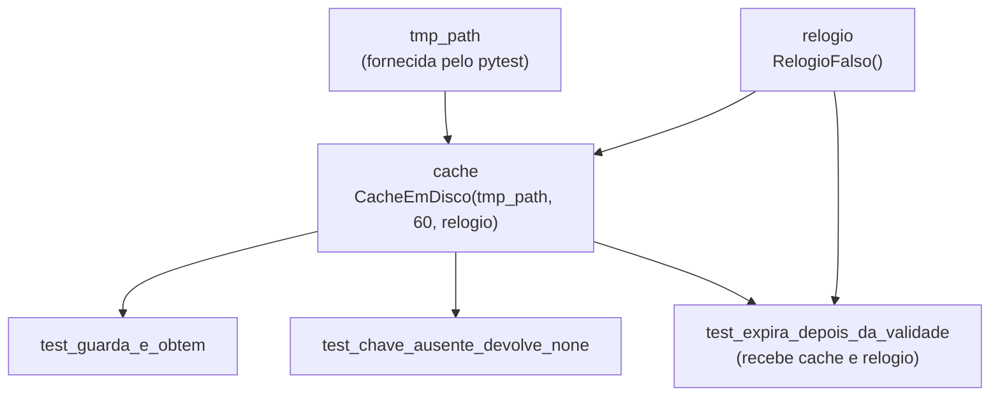
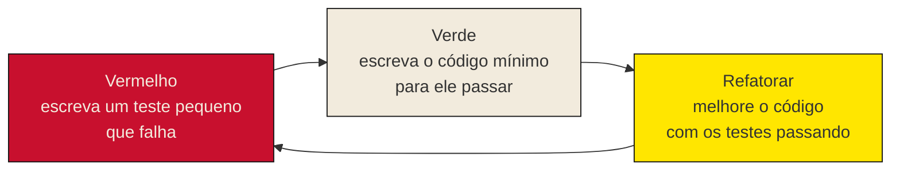

> **Aviso de Idioma:** Este currículo e todos os seus recursos de apoio foram estruturados exclusivamente em **Português (PT-BR)**.

# Aula 2 · pytest e o desenvolvimento guiado por testes

**MOD-204 · 10 horas · Leitura principal:** Valente, *Engenharia de Software Moderna*, capítulo 8, seções 8.4 a 8.6; [documentação do pytest](https://docs.pytest.org/), páginas "Get started" e "How to use fixtures"

## O que você vai aprender

- Escrever e rodar testes com <abbr title="pytest: a ferramenta de testes mais usada no ecossistema Python. Descobre sozinha os arquivos e funções de teste, mostra relatórios detalhados quando uma asserção falha e oferece parametrização e fixtures.">pytest</abbr>, lendo os relatórios de falha.
- Organizar um teste em três partes: preparar, agir e conferir.
- Usar <abbr title="Asserção: afirmação, no código, de uma condição que deve ser verdadeira. Em Python, a instrução assert; se a condição for falsa, o teste falha.">asserções</abbr>, `pytest.raises` e `pytest.approx`.
- Testar muitos casos com a mesma função usando <abbr title="Parametrização: recurso que roda a mesma função de teste várias vezes, uma para cada conjunto de dados de entrada e resultado esperado.">parametrização</abbr>.
- Preparar o ambiente de cada teste com <abbr title="Fixture: em pytest, função que prepara algo de que os testes precisam (um objeto, uma pasta temporária, um relógio falso) e é entregue a eles pelo nome do parâmetro.">fixtures</abbr>, inclusive pastas temporárias.
- Praticar o ciclo do <abbr title="TDD (desenvolvimento guiado por testes): prática proposta por Kent Beck em que se escreve primeiro um teste que falha, depois o código mínimo para ele passar e, por fim, se melhora o código mantendo os testes passando.">TDD</abbr>: vermelho, verde, refatorar.

## Pergunta de abertura

> Você corrigiu um erro na função que calcula as despesas por categoria do SDK. Como você sabe que a correção não quebrou outra coisa que funcionava? E como a próxima pessoa que mexer no código vai saber?

## 1. O primeiro teste

Um teste automatizado é um programa que executa outro programa e confere o resultado. Em Python, a forma mais simples é a instrução `assert`, que não faz nada quando a condição é verdadeira e levanta `AssertionError` quando é falsa. O pytest organiza esses testes: ele procura arquivos chamados `test_*.py`, dentro deles as funções chamadas `test_*`, roda cada uma e relata quais passaram e quais falharam.

Vamos testar uma função bem brasileira: a conferência dos dígitos verificadores do <abbr title="CPF (Cadastro de Pessoas Físicas): número de 11 dígitos da Receita Federal. Os dois últimos são dígitos verificadores, calculados a partir dos nove primeiros por somas ponderadas, para detectar erros de digitação.">CPF</abbr>. Os dois últimos dígitos são calculados a partir dos nove primeiros: multiplica-se cada dígito por um peso decrescente (10, 9, ..., 2), soma-se tudo, e o dígito é o resto da divisão de dez vezes a soma por 11 (resto 10 vira 0). O segundo dígito repete a conta com os dez primeiros e pesos de 11 a 2.



Salve o código abaixo num arquivo chamado `test_cpf.py`:

```python
import re

import pytest

def validar_cpf(cpf: str) -> bool:
    """Confere os dois dígitos verificadores de um CPF, com ou sem pontuação."""
    numeros = re.sub(r"\D", "", cpf)
    if len(numeros) != 11 or numeros == numeros[0] * 11:
        return False
    for tamanho in (9, 10):
        soma = sum(int(d) * peso for d, peso in zip(numeros[:tamanho], range(tamanho + 1, 1, -1)))
        digito = (soma * 10) % 11 % 10
        if digito != int(numeros[tamanho]):
            return False
    return True

def test_cpf_valido_com_pontuacao():
    # Preparar
    cpf = "529.982.247-25"
    # Agir
    resultado = validar_cpf(cpf)
    # Conferir
    assert resultado is True
```

O teste segue a estrutura em três partes, conhecida em inglês como *Arrange, Act, Assert*: **preparar** os dados, **agir** chamando o código testado e **conferir** o resultado. Num teste curto as três partes cabem em uma linha, mas pensar nelas ajuda a escrever testes que testam uma coisa só.

Para rodar, no terminal, na pasta do arquivo (depois de instalar com `python -m pip install pytest`):

```text
$ python -m pytest -q
.                                                                 [100%]
1 passed in 0.01s
```

Cada ponto é um teste que passou. Quando um teste falha, o pytest mostra a linha da asserção e os valores envolvidos. Se você trocar `"529.982.247-25"` por `"529.982.247-26"`, verá algo assim:

```text
    def test_cpf_valido_com_pontuacao():
        # Preparar
        cpf = "529.982.247-26"
        # Agir
        resultado = validar_cpf(cpf)
        # Conferir
>       assert resultado is True
E       assert False is True

test_cpf.py:26: AssertionError
1 failed in 0.03s
```

Ler esse relatório com calma é metade do trabalho de depuração: ele diz **qual** teste falhou, **em que linha** e **com que valores**.

### Testar exceções e números decimais

Dois auxiliares do pytest aparecem o tempo todo:

```text
import pytest

def test_divisao_por_zero():
    with pytest.raises(ZeroDivisionError):
        1 / 0

def test_media_de_despesas():
    assert (0.1 + 0.2) == pytest.approx(0.3)   # 0.1 + 0.2 == 0.3 é falso em ponto flutuante
```

`pytest.raises` confere que o código levanta a exceção esperada (e falha se não levantar). `pytest.approx` compara números de ponto flutuante com uma tolerância, porque a representação binária faz `0.1 + 0.2` valer `0.30000000000000004` (MOD-102). Para valores em dinheiro, prefira `decimal.Decimal` ou centavos inteiros, e aí a comparação exata volta a funcionar.

## 2. Parametrização: muitos casos, um teste

Um único CPF válido testa pouco. Os casos interessantes estão nas **bordas**: dígito errado, dígitos repetidos (o CPF `111.111.111-11` passa na conta, mas é inválido por regra), tamanho errado, texto vazio. Escrever uma função para cada caso seria repetitivo. A parametrização roda a mesma função com uma tabela de entradas e resultados esperados:

```python
@pytest.mark.parametrize(
    "cpf, esperado",
    [
        ("52998224725", True),        # sem pontuação
        ("529.982.247-24", False),    # segundo dígito errado
        ("529.982.247-15", False),    # primeiro dígito errado
        ("111.111.111-11", False),    # dígitos repetidos passam na conta, mas são inválidos
        ("5299822472", False),        # dígitos de menos
        ("", False),                  # vazio
        ("abc.def.ghi-jk", False),    # sem dígitos
    ],
)
def test_validar_cpf(cpf, esperado):
    assert validar_cpf(cpf) == esperado
```

```text
$ python -m pytest -q
........                                                          [100%]
8 passed in 0.02s
```

Cada linha da tabela vira um teste separado, com nome próprio no relatório (`test_validar_cpf[111.111.111-11-False]`). Se um caso falha, os outros continuam rodando. Escolher os casos é a parte intelectual do trabalho: para cada condição do código (`if`), pergunte o que acontece de um lado e do outro dela. Essa técnica se chama análise de **valores limite** e de **classes de equivalência**: dividir as entradas possíveis em grupos que o programa deveria tratar igual e testar um representante de cada grupo, mais os valores que ficam na fronteira entre grupos.

## 3. Fixtures: preparar o ambiente de cada teste

Muitos testes precisam de algo preparado antes: um objeto configurado, uma pasta, dados de exemplo. Em pytest, isso é uma **fixture**: uma função marcada com `@pytest.fixture`, cujo resultado é entregue a qualquer teste que tenha um parâmetro com o mesmo nome.

O exemplo testa o **cache em disco** do SDK (MOD-202, aula 8). Dois problemas aparecem: o cache grava arquivos (e os testes não podem sujar a pasta do projeto nem depender uns dos outros) e o cache depende do **tempo** (e não dá para esperar 60 segundos de verdade num teste). A solução para o primeiro é a fixture `tmp_path`, que o próprio pytest oferece: uma pasta temporária nova para cada teste. A solução para o segundo é **injetar o relógio**, como você injetou o cliente HTTP no MOD-202: o cache recebe uma função que diz as horas, e nos testes ela é um relógio falso que só avança quando mandamos.

```python
import hashlib
import json
import time
from pathlib import Path

import pytest

class CacheEmDisco:
    """Guarda respostas em arquivos JSON e as descarta depois de um tempo de validade."""

    def __init__(self, pasta: Path, validade_segundos: float, relogio=time.time):
        self.pasta = Path(pasta)
        self.validade = validade_segundos
        self.relogio = relogio                     # injetado: nos testes, um relógio falso

    def _arquivo(self, chave: str) -> Path:
        nome = hashlib.sha256(chave.encode()).hexdigest()[:16]
        return self.pasta / f"{nome}.json"

    def guardar(self, chave: str, valor) -> None:
        conteudo = {"momento": self.relogio(), "valor": valor}
        self._arquivo(chave).write_text(json.dumps(conteudo), encoding="utf-8")

    def obter(self, chave: str):
        arquivo = self._arquivo(chave)
        if not arquivo.exists():
            return None
        conteudo = json.loads(arquivo.read_text(encoding="utf-8"))
        if self.relogio() - conteudo["momento"] > self.validade:
            return None
        return conteudo["valor"]

class RelogioFalso:
    def __init__(self, inicio: float = 1_000.0):
        self.agora = inicio

    def __call__(self) -> float:
        return self.agora

    def avancar(self, segundos: float) -> None:
        self.agora += segundos
```

```python
@pytest.fixture
def relogio():
    return RelogioFalso()

@pytest.fixture
def cache(tmp_path, relogio):
    return CacheEmDisco(tmp_path, validade_segundos=60, relogio=relogio)

def test_guarda_e_obtem(cache):
    cache.guardar("/deputados?siglaUf=CE", ["Fulana", "Beltrano"])
    assert cache.obter("/deputados?siglaUf=CE") == ["Fulana", "Beltrano"]

def test_chave_ausente_devolve_none(cache):
    assert cache.obter("/nunca-guardada") is None

def test_expira_depois_da_validade(cache, relogio):
    cache.guardar("/deputados?siglaUf=CE", ["Fulana"])
    relogio.avancar(59)
    assert cache.obter("/deputados?siglaUf=CE") == ["Fulana"]
    relogio.avancar(2)
    assert cache.obter("/deputados?siglaUf=CE") is None

def test_cada_teste_tem_a_sua_pasta(cache, tmp_path):
    assert list(tmp_path.iterdir()) == []      # a pasta começa vazia em todo teste
```

Repare em três coisas:

- A fixture `cache` usa outras duas fixtures, `tmp_path` e `relogio`. O pytest monta a cadeia sozinho.
- No teste de expiração, recebemos **a mesma instância** de `relogio` que o cache recebeu, e avançamos o tempo à vontade: 59 segundos (ainda vale), mais 2 (expirou). O teste roda em milésimos de segundo e dá sempre o mesmo resultado.
- Cada teste recebe instâncias novas. Nenhum teste depende do que outro deixou para trás.

Fixtures usadas por vários arquivos ficam num arquivo chamado `conftest.py`, na pasta dos testes: o pytest o carrega sozinho, sem `import`.



### O que faz um bom teste

Valente resume as qualidades de um bom teste unitário em cinco palavras, conhecidas pela sigla inglesa FIRST:

| Qualidade | O que significa | Como violar (e como evitar) |
| :--- | :--- | :--- |
| **Rápido** | Roda em milésimos de segundo | Chamar a rede ou dormir de verdade; use dublês (aula 3) |
| **Independente** | Não depende da ordem nem de outros testes | Compartilhar uma lista global; use fixtures |
| **Repetível** | Dá o mesmo resultado sempre, em qualquer máquina | Depender do relógio, do acaso, do fuso horário; injete-os |
| **Autoverificável** | Diz sozinho se passou ou falhou | Imprimir valores para alguém conferir a olho; use `assert` |
| **Oportuno** | Escrito junto com o código, não meses depois | Deixar para "quando sobrar tempo"; pratique TDD |

## 4. TDD: vermelho, verde, refatorar

Kent Beck sistematizou, em *Desenvolvimento Guiado por Testes* (2002), uma prática que inverte a ordem habitual: **o teste vem antes do código**.



Um exemplo com o SDK. Queremos uma função que conte os deputados por partido, do maior para o menor.

**Primeira volta.** O teste mais simples possível: uma lista vazia dá um resultado vazio. Rodamos e ele falha (vermelho), porque a função nem existe. Escrevemos o mínimo: `def agrupar_por_partido(deputados): return []`. Passa (verde). Parece trapaça, e de propósito: o código só faz o que os testes exigem.

**Segunda volta.** Teste novo: um deputado do PT dá `[("PT", 1)]`. Falha. Agora o código precisa contar de verdade, e usamos `collections.Counter` (MOD-106). Passa.

**Terceira volta.** Teste novo: com vários partidos, a ordem é por quantidade e, em caso de empate, alfabética. Falha, porque `Counter` não garante essa ordem nos empates. Acrescentamos a ordenação com uma chave composta. Passa. Refatoramos: o nome das variáveis, a docstring. Os três testes continuam verdes.

```python
from collections import Counter

def agrupar_por_partido(deputados):
    """Conta deputados por partido, do maior para o menor; empates em ordem alfabética."""
    contagem = Counter(d["siglaPartido"] for d in deputados)
    return sorted(contagem.items(), key=lambda par: (-par[1], par[0]))

def test_lista_vazia():
    assert agrupar_por_partido([]) == []

def test_um_deputado():
    assert agrupar_por_partido([{"nome": "Ana", "siglaPartido": "PT"}]) == [("PT", 1)]

def test_ordena_por_quantidade_e_depois_por_sigla():
    deputados = [
        {"nome": "Ana", "siglaPartido": "PSOL"},
        {"nome": "Bia", "siglaPartido": "PT"},
        {"nome": "Caio", "siglaPartido": "PL"},
        {"nome": "Davi", "siglaPartido": "PT"},
    ]
    assert agrupar_por_partido(deputados) == [("PT", 2), ("PL", 1), ("PSOL", 1)]
```

O ganho do TDD não está em escrever mais testes, e sim em **pensar a interface antes da implementação**: para escrever o teste, você precisa decidir como a função se chama, o que recebe e o que devolve, do ponto de vista de quem vai usá-la. E no final você tem, sem esforço extra, uma especificação executável do comportamento.

Responda à pergunta de abertura: você sabe que a correção não quebrou nada porque a suíte de testes inteira continua passando, e a próxima pessoa saberá do mesmo jeito. Melhor ainda: antes de corrigir, escreva um teste que **reproduz o erro** (vermelho), corrija (verde) e deixe o teste na suíte. O erro não volta sem que alguém fique sabendo.

## 5. Testes como documentação e como convite

Uma suíte de testes bem escrita é a melhor documentação técnica de um projeto: ela diz, com exemplos que **funcionam de verdade**, o que cada função faz, inclusive nos casos de borda. Para quem chega a um projeto de software livre, os testes são também a porta de entrada: dá para mudar o código com segurança, porque os testes avisam se algo quebrou.

Lembre do critério do caráter modelar de Benjamin (MOD-203, aula 7): uma obra é tanto melhor quanto mais transforma consumidores em colaboradores. Um projeto sem testes só pode ser alterado por quem o escreveu e lembra de tudo; um projeto com testes pode ser alterado por qualquer pessoa. Testar é também uma forma de **socializar** o conhecimento sobre o código.

## Leitura guiada

1. ***Engenharia de Software Moderna*, capítulo 8, seções 8.4 a 8.6** (cerca de 25 páginas): cobertura (que veremos na aula 4), testabilidade e TDD.
2. **Documentação do pytest, "How to use fixtures"** (em inglês): leia as seções sobre escopo de fixtures (`scope="module"`) e sobre `yield` para limpeza depois do teste.

## Exercícios

**1.** Escreva casos parametrizados para uma função `normalizar_uf(texto)` que recebe a sigla de um estado em qualquer formatação (`" ce "`, `"Ce"`, `"CE"`) e devolve a sigla em maiúsculas, levantando `ValueError` se não for uma das 27 unidades da federação. Escreva também a função.

<details>
<summary>Gabarito</summary>

```python
UFS = set("AC AL AP AM BA CE DF ES GO MA MT MS MG PA PB PR PE PI RJ RN RS RO RR SC SP SE TO".split())

def normalizar_uf(texto: str) -> str:
    sigla = texto.strip().upper()
    if sigla not in UFS:
        raise ValueError(f"UF desconhecida: {texto!r}")
    return sigla

@pytest.mark.parametrize("entrada", [" ce ", "Ce", "CE", "ce"])
def test_normaliza_formatacoes(entrada):
    assert normalizar_uf(entrada) == "CE"

@pytest.mark.parametrize("entrada", ["", "XX", "Ceará", "C E"])
def test_recusa_invalidas(entrada):
    with pytest.raises(ValueError):
        normalizar_uf(entrada)

assert len(UFS) == 27
```

Os casos inválidos cobrem o texto vazio, uma sigla inexistente, o nome por extenso e um espaço no meio, que `strip` não remove.
</details>

**2.** O teste abaixo às vezes passa e às vezes falha. Por quê? Como corrigir sem mudar o que ele quer verificar?

```text
def test_relatorio_tem_data_de_hoje():
    relatorio = gerar_relatorio()
    assert relatorio.data == datetime.date.today()
```

<details>
<summary>Gabarito comentado</summary>

Se o teste roda perto da meia-noite, `gerar_relatorio` pode pegar a data de um dia e `today()` a do dia seguinte. O fuso horário da máquina de integração contínua também pode ser diferente do seu. A correção é injetar a data (ou um relógio) em `gerar_relatorio`, como fizemos com o cache, e no teste passar uma data fixa: `gerar_relatorio(hoje=datetime.date(2026, 3, 1))`. O teste fica repetível.
</details>

**3.** Usando TDD, desenvolva `media_de_despesas(despesas)`, que recebe uma lista de valores em centavos (inteiros) e devolve a média em centavos arredondada para baixo. Registre as voltas do ciclo (o teste de cada volta e o código mínimo que o fez passar). Decida e teste o que acontece com a lista vazia.

<details>
<summary>Critérios de correção</summary>

Pelo menos três voltas, cada uma com um teste novo que falha antes do código. A decisão sobre a lista vazia deve ser explícita e testada (devolver 0, devolver `None` ou levantar `ValueError`), com uma justificativa: levantar exceção costuma ser mais seguro, porque uma média zero pode ser confundida com um valor real. O uso de inteiros evita os problemas de ponto flutuante.
</details>

**4.** Escreva testes com fixtures para o Motor de Passagens e Constelações do MOD-203 (aula 9): uma fixture com seis fichas de exemplo e testes para `semelhanca` (fichas idênticas valem 1, fichas sem conceito em comum valem 0, a função é simétrica) e para `constelacoes` (uma ficha isolada forma uma constelação sozinha).

<details>
<summary>Critérios de correção</summary>

A fixture deve devolver um dicionário novo a cada teste, para que um teste que modifique as fichas não afete os outros. Os testes de `semelhanca` devem incluir a simetria (`semelhanca(a, b) == semelhanca(b, a)`), uma propriedade que vale para qualquer par e que voltará na aula 4. A melhor resposta testa também o caso de uma ficha sem nenhum conceito, que pode causar divisão por zero no índice de Jaccard.
</details>

## Resumo da aula

- O pytest descobre e roda funções `test_*` em arquivos `test_*.py` e mostra relatórios detalhados das falhas.
- Um teste tem três partes: preparar, agir e conferir. `pytest.raises` testa exceções e `pytest.approx` compara números decimais.
- A parametrização roda a mesma função com uma tabela de casos; os casos importantes estão nas bordas.
- Fixtures preparam o ambiente de cada teste; `tmp_path` dá uma pasta nova e relógios injetados tornam o tempo controlável.
- Bons testes são rápidos, independentes, repetíveis, autoverificáveis e oportunos.
- O TDD alterna vermelho, verde e refatorar, e faz pensar a interface antes da implementação.
- Testes documentam o código e permitem que outras pessoas colaborem com segurança.

## Para ir além

- Kent Beck, *TDD: Desenvolvimento Guiado por Testes* (2002; tradução brasileira pela Bookman).
- Mauricio Aniche, *Testes Automatizados de Software: Um Guia Prático* (Casa do Código, 2015), em português.