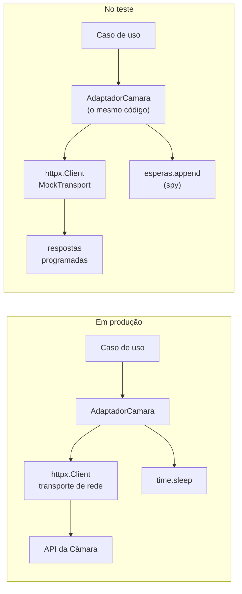
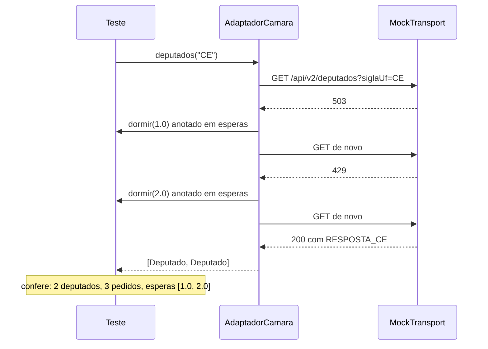

> **Aviso de Idioma:** Este currículo e todos os seus recursos de apoio foram estruturados exclusivamente em **Português (PT-BR)**.

# Aula 3 · Dublês de teste: isolar o mundo externo

**MOD-204 · 10 horas · Leitura principal:** Valente, *Engenharia de Software Moderna*, capítulo 8, seção sobre *mocks*; documentação do Python, [`unittest.mock`](https://docs.python.org/pt-br/3/library/unittest.mock.html); documentação do httpx, página "Transports"

## O que você vai aprender

- Explicar por que testes não devem depender da rede, do relógio nem do acaso.
- Distinguir os tipos de <abbr title="Dublê de teste: qualquer objeto que substitui, num teste, um componente real (um servidor, um banco de dados, o relógio), como o dublê substitui o ator numa cena perigosa.">dublês de teste</abbr>: dummy, <abbr title="Stub: dublê de teste que devolve respostas prontas, programadas antes, sem lógica própria.">stub</abbr>, spy, <abbr title="Mock: dublê de teste que, além de responder, registra como foi chamado (quantas vezes, com que argumentos), para que o teste confira essas interações.">mock</abbr> e fake.
- Usar `unittest.mock.Mock` para programar respostas e conferir chamadas.
- Testar o adaptador HTTP do SDK com um transporte falso do httpx, sem acessar a internet.
- Gravar respostas reais uma vez e usá-las em testes de contrato.
- Encontrar e eliminar fontes de não determinismo.

## Pergunta de abertura

> A suíte de testes do SDK consulta a API real da Câmara dos Deputados. Num dia ela passa; no outro, falha porque um deputado mudou de partido; numa sexta à noite, falha porque o servidor está em manutenção. E se mil estudantes do curso rodarem essa suíte a cada mudança, quantas requisições o servidor público recebe por dia? O que há de errado nesse desenho?

## 1. O problema do mundo externo

Um teste que depende de um sistema externo herda todos os problemas desse sistema:

| Dependência | Problema no teste |
| :--- | :--- |
| Rede e APIs | Lenta, instável, sujeita a limites de requisições; os dados mudam com o tempo |
| Relógio | O resultado muda conforme a hora, o dia, o fuso horário da máquina |
| Acaso | Cada execução sorteia valores diferentes |
| Sistema de arquivos | Um teste deixa arquivos que mudam o resultado do próximo |
| Efeitos no mundo | Enviar um e-mail, cobrar um cartão, apagar um registro de verdade |

O resultado é um teste <abbr title="Teste intermitente (flaky, em inglês): teste que às vezes passa e às vezes falha sem que o código tenha mudado, por depender de tempo, rede, ordem de execução ou acaso.">intermitente</abbr>: passa e falha sem que o código tenha mudado. Testes intermitentes são piores que nenhum teste, porque ensinam a equipe a ignorar falhas, exatamente como as operadoras do Therac-25 aprenderam a ignorar a "Malfunction 54" (aula 1).

E há a questão da pergunta de abertura, que é também ética: APIs públicas de transparência são mantidas com dinheiro público e por equipes pequenas. Uma suíte de testes que as consulta a cada mudança, multiplicada por todas as cópias do projeto, transforma um bom propósito num pequeno ataque de sobrecarga. Testes automatizados **não devem tocar servidores públicos**. Quem precisa ser testado é o seu código, não o servidor da Câmara.

## 2. Os tipos de dublês

Gerard Meszaros, em *xUnit Test Patterns* (2007), deu nomes às maneiras de substituir um componente real num teste. O nome geral, dublê, vem do cinema.

| Tipo | O que faz | Exemplo no SDK |
| :--- | :--- | :--- |
| **Dummy** | Só ocupa o lugar de um parâmetro obrigatório; nunca é usado | Um cliente HTTP passado a um método que não faz requisição |
| **Stub** | Devolve respostas prontas | Uma função que sempre devolve a lista de dois deputados do Ceará |
| **Spy** | Responde e anota como foi chamado | A lista `esperas` que recebe os tempos passados a `dormir` |
| **Mock** | Programado com respostas e conferido nas chamadas | `Mock(side_effect=[...])` com `call_count` conferido no final |
| **Fake** | Implementação simplificada, mas que funciona | O `RelogioFalso` da aula 2; um repositório em memória no lugar do banco de dados |

Na prática, as fronteiras entre os tipos são fluidas e muita gente chama tudo de *mock*. O que importa é a pergunta que cada um responde: **o que o meu código recebe** (stub, fake) ou **o que o meu código faz com os outros** (spy, mock).



O desenho do MOD-202 já preparou tudo: o adaptador **recebe** o cliente HTTP e a função de espera em vez de criá-los. É a injeção de dependências (MOD-202, aula 5), e é o que torna o código testável sem truques. Código difícil de testar costuma ser um sinal de acoplamento excessivo.

## 3. `unittest.mock`: programar respostas, conferir chamadas

Primeiro, o código que vamos testar. É a versão do SDK que você escreveu no MOD-202, com uma mudança pequena: o adaptador também recebe a função `dormir`, para que os testes não esperem de verdade.

```python
import json
import time
from unittest.mock import Mock

import httpx
import pytest
from pydantic import BaseModel, ConfigDict, Field

class Deputado(BaseModel):
    model_config = ConfigDict(populate_by_name=True)
    id: int
    nome: str
    sigla_partido: str = Field(alias="siglaPartido")
    sigla_uf: str = Field(alias="siglaUf")

class ErroTemporario(Exception):
    pass

def com_novas_tentativas(funcao, tentativas=4, espera_inicial=1.0, dormir=time.sleep):
    espera = espera_inicial
    for numero in range(1, tentativas + 1):
        try:
            return funcao()
        except ErroTemporario:
            if numero == tentativas:
                raise
            dormir(espera)
            espera *= 2

class AdaptadorCamara:
    BASE = "https://dadosabertos.camara.leg.br/api/v2"

    def __init__(self, cliente: httpx.Client, dormir=time.sleep):
        self.cliente = cliente
        self.dormir = dormir

    def _get(self, caminho: str, **params) -> dict:
        def chamada():
            r = self.cliente.get(f"{self.BASE}{caminho}", params=params)
            if r.status_code == 429 or r.status_code >= 500:
                raise ErroTemporario(r.status_code)
            r.raise_for_status()
            return r.json()
        return com_novas_tentativas(chamada, dormir=self.dormir)

    def deputados(self, uf: str) -> list[Deputado]:
        dados = self._get("/deputados", siglaUf=uf, itens=100)["dados"]
        return [Deputado.model_validate(d) for d in dados]
```

A biblioteca padrão traz `unittest.mock.Mock`, um objeto que aceita qualquer chamada e guarda o histórico. Com `side_effect`, programamos uma sequência de resultados: exceções são levantadas, valores são devolvidos.

```python
def test_espera_crescente_com_mock():
    funcao = Mock(side_effect=[ErroTemporario(), ErroTemporario(), "ok"])
    dormir = Mock()

    assert com_novas_tentativas(funcao, dormir=dormir) == "ok"

    assert funcao.call_count == 3
    assert [c.args[0] for c in dormir.call_args_list] == [1.0, 2.0]

def test_desiste_depois_do_limite():
    funcao = Mock(side_effect=ErroTemporario())
    with pytest.raises(ErroTemporario):
        com_novas_tentativas(funcao, tentativas=3, dormir=Mock())
    assert funcao.call_count == 3
```

O primeiro teste confere duas coisas: o **resultado** (`"ok"` depois de duas falhas) e as **interações** (a função foi chamada três vezes; a espera foi de 1 e depois de 2 segundos). O segundo confere que a função desiste no limite e repassa o erro, em vez de tentar para sempre.

### O risco de exagerar

Testes com muitos mocks ficam **acoplados à implementação**: conferem que o código chamou tal método, com tais argumentos, nessa ordem. Se você refatorar o código mantendo o mesmo comportamento, esses testes quebram sem que nada esteja errado. A regra prática:

- Use dublês só nas **fronteiras** do sistema: rede, relógio, acaso, disco, serviços de terceiros.
- Dentro do seu próprio código, prefira testar com os objetos reais.
- Confira interações apenas quando a interação **é** o comportamento esperado (como o tempo de espera entre tentativas, que existe para proteger o servidor).

O pytest oferece também a fixture `monkeypatch`, que troca temporariamente um atributo de um módulo (por exemplo, `monkeypatch.setattr(time, "sleep", lambda s: None)`). Ela é útil para código legado que não aceita injeção, mas é um remendo: o código continua escondendo as suas dependências.

## 4. Testar o adaptador HTTP sem rede

O httpx permite trocar o **transporte**, a peça que de fato envia os bytes pela rede, por um `MockTransport`: uma função que recebe o pedido e devolve uma resposta, sem sair da máquina. Tudo o resto (montagem da URL, parâmetros, leitura do JSON, códigos de estado, `raise_for_status`) roda de verdade. É um teste de integração entre o seu adaptador, o httpx e o Pydantic, sem a internet.

```python
RESPOSTA_CE = {
    "dados": [
        {"id": 204379, "nome": "Fulana de Tal", "siglaPartido": "PT", "siglaUf": "CE", "urlFoto": "..."},
        {"id": 204380, "nome": "Beltrano Silva", "siglaPartido": "PL", "siglaUf": "CE", "urlFoto": "..."},
    ],
    "links": [],
}

def transporte_falso(respostas):
    """Cria um transporte httpx que devolve as respostas da lista, uma por requisição, e anota os pedidos."""
    pedidos = []
    fila = list(respostas)

    def tratar(pedido: httpx.Request) -> httpx.Response:
        pedidos.append(pedido)
        status, corpo = fila.pop(0)
        return httpx.Response(status, json=corpo)

    return httpx.MockTransport(tratar), pedidos

def test_adaptador_converte_resposta_em_deputados():
    transporte, pedidos = transporte_falso([(200, RESPOSTA_CE)])
    adaptador = AdaptadorCamara(httpx.Client(transport=transporte))

    deputados = adaptador.deputados("CE")

    assert [d.nome for d in deputados] == ["Fulana de Tal", "Beltrano Silva"]
    assert deputados[0].sigla_partido == "PT"
    assert pedidos[0].url.params["siglaUf"] == "CE"
    assert pedidos[0].url.path == "/api/v2/deputados"

def test_adaptador_tenta_de_novo_quando_o_servidor_falha():
    transporte, pedidos = transporte_falso([(503, {}), (429, {}), (200, RESPOSTA_CE)])
    esperas = []
    adaptador = AdaptadorCamara(httpx.Client(transport=transporte), dormir=esperas.append)

    assert len(adaptador.deputados("CE")) == 2
    assert len(pedidos) == 3
    assert esperas == [1.0, 2.0]

def test_erro_404_nao_e_repetido():
    transporte, pedidos = transporte_falso([(404, {"erro": "não encontrado"})])
    adaptador = AdaptadorCamara(httpx.Client(transport=transporte), dormir=Mock())

    with pytest.raises(httpx.HTTPStatusError):
        adaptador.deputados("XX")
    assert len(pedidos) == 1
```

Os três testes cobrem o caminho feliz (resposta 200 convertida em objetos validados, com a URL e os parâmetros certos), o caminho de **recuperação** (503 e 429 seguidos de sucesso, com as esperas certas) e o caminho de **erro definitivo** (404 não deve ser repetido, porque tentar de novo não muda nada e só sobrecarrega o servidor). A função `transporte_falso` funciona ao mesmo tempo como stub (devolve respostas prontas) e como spy (anota os pedidos).



## 5. Respostas gravadas e testes de contrato

Os dados de `RESPOSTA_CE` foram escritos à mão. E se a API real tiver um formato diferente do que imaginamos? A técnica das **respostas gravadas** resolve isso: uma vez, com cuidado, você consulta a API real e salva a resposta num arquivo (chamado, por tradição, de *cassete*, como uma fita gravada). Os testes leem o cassete em vez de consultar a rede. Bibliotecas como `vcrpy` e `pytest-recording` automatizam esse processo.

O script de gravação roda à mão, raramente, e respeita o servidor (texto ilustrativo, que depende da rede):

```text
import httpx, json, pathlib

cliente = httpx.Client(headers={"User-Agent": "br-transparencia-sdk/0.1 (+contato no README)"})
r = cliente.get("https://dadosabertos.camara.leg.br/api/v2/deputados", params={"siglaUf": "CE", "itens": 5})
pathlib.Path("tests/cassetes/deputados_ce.json").write_text(json.dumps(r.json(), ensure_ascii=False, indent=2))
```

Com o cassete em mãos, o **teste de contrato** confere que a resposta tem o formato que o SDK espera. Se um dia a API mudar, você grava um cassete novo e o teste de contrato aponta exatamente o que mudou:

```python
def gravar_cassete(pasta, nome, corpo):
    (pasta / f"{nome}.json").write_text(json.dumps(corpo, ensure_ascii=False, indent=2), encoding="utf-8")

def ler_cassete(pasta, nome):
    return json.loads((pasta / f"{nome}.json").read_text(encoding="utf-8"))

CAMPOS_ESPERADOS = {"id", "nome", "siglaPartido", "siglaUf"}

def test_contrato_da_resposta_gravada(tmp_path):
    gravar_cassete(tmp_path, "deputados_ce", RESPOSTA_CE)      # no projeto, gravado uma vez da API real
    resposta = ler_cassete(tmp_path, "deputados_ce")

    for item in resposta["dados"]:
        faltando = CAMPOS_ESPERADOS - item.keys()
        assert not faltando, f"a API deixou de enviar: {faltando}"
        Deputado.model_validate(item)                           # tipos conferidos pelo Pydantic
```

No projeto, o cassete fica versionado em `tests/cassetes/` e o teste o lê de lá; aqui usamos `tmp_path` para que o exemplo rode sozinho. Uma prática comum é ter também alguns poucos testes que consultam a API real, marcados com `@pytest.mark.rede` e desligados por padrão, para rodar à mão antes de cada versão nova:

```text
# pyproject.toml
[tool.pytest.ini_options]
markers = ["rede: testes que acessam APIs reais (rodar com: pytest -m rede)"]
addopts = "-m 'not rede'"
```

## 6. Caçar o não determinismo

Mesmo sem rede, um teste pode ser intermitente. As fontes mais comuns:

| Fonte | Sintoma | Remédio |
| :--- | :--- | :--- |
| `time.time()`, `datetime.now()` | Falha perto da meia-noite ou noutro fuso | Injetar o relógio (aula 2) |
| `random` sem semente | Resultado diferente a cada execução | Injetar um `random.Random(42)` |
| Ordem de conjuntos de textos | A ordem de um `set` de strings muda entre execuções do Python | Ordenar antes de comparar: `sorted(...)` |
| Estado global | O teste passa sozinho e falha na suíte | Fixtures que criam objetos novos |
| Concorrência | Falha uma vez em cem | Testar a lógica separada das threads |

A terceira linha surpreende muita gente. O Python sorteia, a cada execução, uma "semente" para o cálculo de <abbr title="Hash: número calculado a partir de um valor (um texto, por exemplo) por uma função de dispersão, usado para guardar e encontrar elementos rapidamente em dicionários e conjuntos.">hashes</abbr> de textos, como proteção contra certos ataques. Por isso, a ordem em que um `set` de strings é percorrido pode mudar de uma execução para outra. O Motor de Constelações do MOD-203 usa conjuntos de conceitos: se um teste comparar a lista de constelações sem ordená-la, ele pode passar na sua máquina e falhar na integração contínua.

```text
$ python -c "print(list({'progresso', 'técnica', 'mercadoria'}))"
['técnica', 'mercadoria', 'progresso']
$ python -c "print(list({'progresso', 'técnica', 'mercadoria'}))"
['mercadoria', 'progresso', 'técnica']
```

O acaso mal controlado também é um problema de **segurança**, e não só de teste. Na aula 6 você vai ver como, em 2012, pesquisadores reconstruíram a ordem dos votos registrados numa urna eletrônica porque o embaralhamento usava uma semente previsível.

Responda à pergunta de abertura: o desenho está errado porque testa o servidor em vez do código, produz falhas que não indicam defeitos e transfere para um serviço público o custo dos testes. O desenho certo usa transportes falsos e cassetes gravados para quase tudo, e reserva uns poucos testes de rede, desligados por padrão, para conferências manuais.

## Leitura guiada

1. ***Engenharia de Software Moderna*, capítulo 8, seção sobre mocks** (cerca de 10 páginas): compare os exemplos em Java do livro com os exemplos em Python desta aula.
2. **Documentação de `unittest.mock`**, seções "Quick Guide" e "The Mock Class" (em português): leia sobre `return_value`, `side_effect` e `assert_called_once_with`.

## Exercícios

**1.** Classifique cada dublê: (a) uma classe `RepositorioEmMemoria` que guarda deputados num dicionário e implementa os mesmos métodos do repositório com banco de dados; (b) `lambda uf: [Deputado(...)]`; (c) `Mock()` cujo `call_args` é conferido no final do teste; (d) `None` passado como `cliente` a um método que não o usa.

<details>
<summary>Gabarito</summary>

(a) Fake: implementação simplificada que funciona. (b) Stub: devolve uma resposta pronta. (c) Mock: as chamadas são conferidas. (d) Dummy: só ocupa o lugar.
</details>

**2.** Escreva um teste com `transporte_falso` que confira que o adaptador envia o cabeçalho `User-Agent` identificado. Para isso, o adaptador precisa receber um cliente criado com esse cabeçalho. Onde deve ficar a criação do cliente para que o teste seja possível?

<details>
<summary>Gabarito comentado</summary>

```python
def criar_cliente(transporte=None) -> httpx.Client:
    return httpx.Client(
        transport=transporte,
        headers={"User-Agent": "br-transparencia-sdk/0.1 (+contato no README)"},
    )

def test_envia_user_agent_identificado():
    transporte, pedidos = transporte_falso([(200, RESPOSTA_CE)])
    AdaptadorCamara(criar_cliente(transporte)).deputados("CE")
    assert pedidos[0].headers["User-Agent"].startswith("br-transparencia-sdk/")
```

A criação do cliente fica numa função de fábrica (MOD-202, aula 6) que aceita o transporte. Assim, o mesmo código que monta o cliente em produção é o que roda no teste, e o cabeçalho não pode ser esquecido sem que o teste avise.
</details>

**3.** O teste abaixo passa na sua máquina e falha às vezes na integração contínua. Encontre a causa e corrija.

```text
def test_conceitos_em_comum():
    a = {"progresso", "técnica", "história"}
    b = {"técnica", "progresso", "mercadoria"}
    assert list(a & b) == ["progresso", "técnica"]
```

<details>
<summary>Gabarito</summary>

A interseção é um `set` de strings, cuja ordem de percurso depende da semente de hash sorteada em cada execução do Python. A correção é comparar conjuntos com conjuntos, `assert a & b == {"progresso", "técnica"}`, ou ordenar: `assert sorted(a & b) == ["progresso", "técnica"]`.
</details>

**4.** Escreva os testes do adaptador do Senado Federal do seu SDK com respostas gravadas. Inclua um teste de contrato e um teste para o caso em que a API devolve uma lista vazia.

<details>
<summary>Critérios de correção</summary>

O cassete deve ter sido gravado da API real, com `User-Agent` identificado, e versionado. O teste de contrato deve conferir os campos usados pelo SDK, não todos os campos da resposta (conferir campos que você não usa torna o teste frágil sem proteger nada). O caso da lista vazia deve ter um comportamento decidido e documentado. Nenhum teste da suíte padrão pode acessar a rede: confira desligando a internet e rodando `pytest`.
</details>

## Resumo da aula

- Testes que dependem de rede, relógio, acaso ou estado compartilhado ficam lentos e intermitentes; testes automatizados não devem sobrecarregar servidores públicos.
- Dublês substituem componentes reais: dummy, stub, spy, mock e fake.
- `unittest.mock.Mock` programa respostas com `side_effect` e registra as chamadas.
- Use dublês nas fronteiras do sistema e confira interações só quando elas são o comportamento esperado.
- O `MockTransport` do httpx testa o adaptador inteiro sem rede; cassetes gravados alimentam testes de contrato.
- Ordem de conjuntos, relógio e acaso sem semente são as fontes mais comuns de não determinismo.

## Para ir além

- Gerard Meszaros, *xUnit Test Patterns: Refactoring Test Code* (2007), em inglês, a referência sobre os tipos de dublês.
- Martin Fowler, "Mocks Aren't Stubs" (2007), ensaio em inglês que discute os dois estilos de teste.