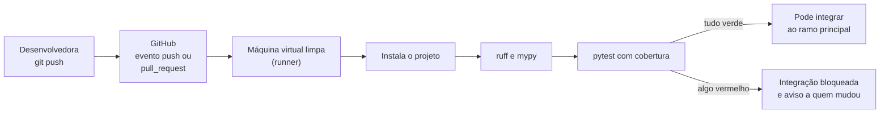
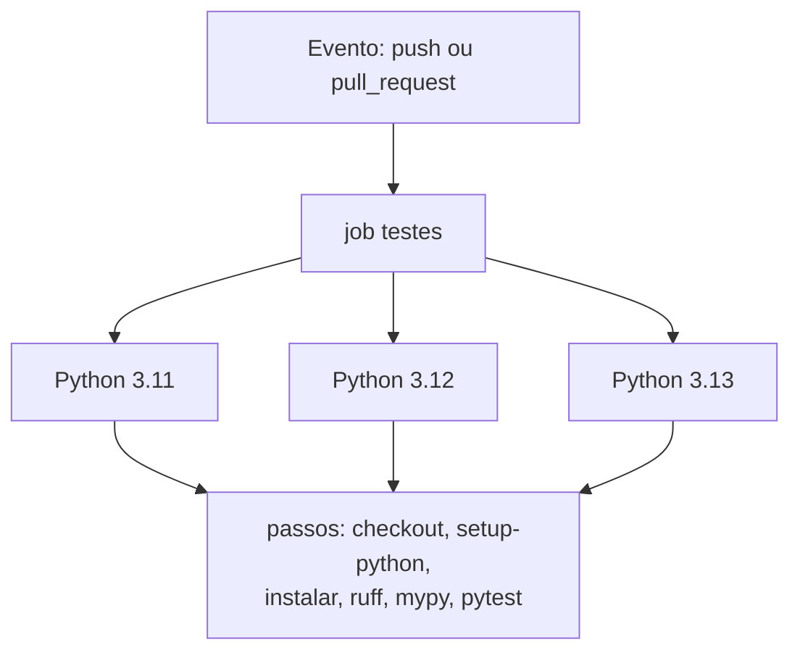
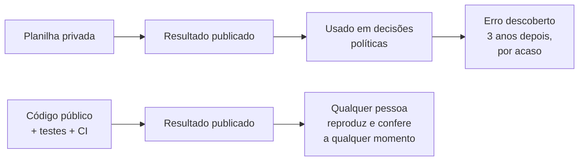

> **Aviso de Idioma:** Este currículo e todos os seus recursos de apoio foram estruturados exclusivamente em **Português (PT-BR)**.

# Aula 5 · Integração contínua e reprodutibilidade

**MOD-204 · 10 horas · Leitura principal:** Valente, *Engenharia de Software Moderna*, capítulo 10 (DevOps); [documentação do GitHub Actions em português](https://docs.github.com/pt/actions), "Início rápido" e "Criação e teste em Python"

## O que você vai aprender

- Explicar o que é <abbr title="Integração contínua (CI, de continuous integration): prática de integrar as mudanças de todos ao ramo principal com frequência, várias vezes por dia, com compilação e testes automáticos a cada integração.">integração contínua</abbr>, entrega contínua e implantação contínua.
- Escrever um <abbr title="Fluxo de trabalho (workflow): no GitHub Actions, arquivo YAML na pasta .github/workflows que descreve quando rodar (eventos) e o que rodar (jobs e passos) numa máquina virtual.">fluxo de trabalho</abbr> do GitHub Actions com matriz de versões do Python.
- Proteger o ramo principal exigindo CI verde e revisão.
- Distinguir repetibilidade, <abbr title="Reprodutibilidade: possibilidade de outra pessoa obter o mesmo resultado de uma pesquisa ou de um programa usando os mesmos dados e o mesmo código.">reprodutibilidade</abbr> e replicabilidade.
- Analisar o caso Reinhart e Rogoff e a crise de reprodutibilidade nas ciências.
- Fixar o ambiente de um projeto (versões, sementes, impressões digitais dos dados) e registrar uma certidão de execução.

## Pergunta de abertura

> Em 2010, dois economistas de Harvard publicaram um estudo segundo o qual países com dívida pública acima de 90% do PIB cresciam muito menos. O resultado foi citado por governos dos dois lados do Atlântico para justificar cortes de gastos. Em 2013, um estudante de pós-graduação, fazendo um exercício de aula, pediu a planilha aos autores e encontrou um erro. Que práticas teriam permitido encontrar o erro antes? E o que o caso ensina sobre a relação entre código, ciência e poder?

## 1. Integração contínua

Antes da integração contínua, era comum que cada pessoa de uma equipe trabalhasse semanas na sua parte e só no fim juntasse tudo. A junção, chamada com razão de "inferno da integração", revelava de uma vez centenas de conflitos e incompatibilidades. O termo *integração contínua* aparece com Grady Booch em 1991 e foi transformado em prática central pela Programação Extrema de Kent Beck, no fim dos anos 1990; um artigo de Martin Fowler de 2000 o difundiu.

A ideia é integrar **pequeno e frequente**. Cada mudança enviada ao repositório dispara automaticamente a instalação do projeto, a análise estática e os testes, numa máquina limpa. Se algo quebra, a equipe sabe em minutos, quando a mudança ainda está fresca na memória de quem a fez.



Três termos que se confundem:

| Prática | O que é automatizado |
| :--- | :--- |
| **Integração contínua** | Construir e testar cada mudança |
| **Entrega contínua** | Além disso, deixar cada versão aprovada pronta para publicar, com um clique |
| **Implantação contínua** | Além disso, publicar sozinho em produção cada versão aprovada |

Para uma biblioteca como o SDK, entrega contínua significa, por exemplo, que cada etiqueta de versão (`v0.3.0`) gera e publica automaticamente o pacote no PyPI.

## 2. O fluxo de trabalho no GitHub Actions

O GitHub Actions lê arquivos <abbr title="YAML: formato de texto para dados estruturados que usa a indentação para indicar a hierarquia, muito usado em arquivos de configuração.">YAML</abbr> na pasta `.github/workflows/` do repositório. Este é o fluxo do projeto do módulo, `.github/workflows/ci.yml`:

```yaml
name: CI

on:
  push:
    branches: [main]
  pull_request:

permissions:
  contents: read

concurrency:
  group: ci-${{ github.ref }}
  cancel-in-progress: true

jobs:
  testes:
    runs-on: ubuntu-latest
    timeout-minutes: 15
    strategy:
      fail-fast: false
      matrix:
        python: ["3.11", "3.12", "3.13"]
    steps:
      - uses: actions/checkout@v4

      - uses: actions/setup-python@v5
        with:
          python-version: ${{ matrix.python }}
          cache: pip

      - name: Instalar o pacote e as ferramentas de desenvolvimento
        run: python -m pip install -e ".[dev]"

      - name: Estilo e erros comuns (ruff)
        run: |
          ruff check .
          ruff format --check .

      - name: Tipos (mypy)
        run: mypy src

      - name: Testes com cobertura de ramos
        run: python -m pytest --cov --cov-branch --cov-report=term-missing --cov-fail-under=85
```

Linha por linha, as decisões importantes:

| Trecho | O que faz e por quê |
| :--- | :--- |
| `on: push` e `pull_request` | Roda a cada envio ao ramo principal e a cada pedido de integração (*pull request*) |
| `permissions: contents: read` | O fluxo só pode **ler** o repositório. Se uma dependência maliciosa rodar durante os testes, não consegue alterar o código nem publicar nada (aula 6) |
| `concurrency` | Se você enviar duas mudanças seguidas, a execução antiga é cancelada: economiza máquinas |
| `timeout-minutes` | Um teste travado não fica rodando por horas |
| `matrix` | O mesmo trabalho roda em três versões do Python, em paralelo; `fail-fast: false` deixa as três terminarem para você ver todas as falhas |
| `cache: pip` | Guarda os pacotes baixados entre execuções e acelera a instalação |
| `--cov-fail-under=85` | A execução fica vermelha se a cobertura de ramos cair abaixo de 85% |



### Proteger o ramo principal

O fluxo só tem valor se o resultado for respeitado. Nas configurações do repositório, em **Settings, Branches**, crie uma regra de proteção para o ramo `main` que exija: que as verificações do CI passem antes de integrar; pelo menos uma revisão aprovada de outra pessoa; e que ninguém, nem a administração, envie diretamente ao ramo. A partir daí, o CI vira parte do processo coletivo de decisão do projeto: uma mudança só entra quando a máquina **e** uma colega concordam.

Por fim, o selo de estado no `README.md` mostra a qualquer visitante se a versão atual passa nos testes:

```text

```

## 3. O caso Reinhart e Rogoff

Em 2010, Carmen Reinhart e Kenneth Rogoff publicaram o artigo *Growth in a Time of Debt* ("Crescimento em tempos de dívida"). A conclusão mais citada: nos países com dívida pública acima de 90% do PIB, o crescimento médio era negativo, de -0,1% ao ano. O número foi usado em debates sobre austeridade fiscal nos Estados Unidos e na Europa, em plena crise.

Em 2013, Thomas Herndon, estudante de doutorado na Universidade de Massachusetts em Amherst, recebeu como tarefa de uma disciplina reproduzir um artigo publicado. Escolheu esse, não conseguiu chegar aos mesmos números e pediu a planilha aos autores, que a enviaram. Com os professores Michael Ash e Robert Pollin, publicou a análise que encontrou três problemas:

1. **Um erro de fórmula**: a média calculada na planilha deixava de fora as últimas linhas da tabela, cinco países (Austrália, Áustria, Bélgica, Canadá e Dinamarca).
2. **Exclusões seletivas**: anos de alguns países com dívida alta e crescimento razoável tinham ficado fora dos dados.
3. **Uma ponderação discutível**: cada país pesava igual na média, de modo que um único ano ruim da Nova Zelândia valia tanto quanto quase duas décadas do Reino Unido.

Corrigidos os problemas, o crescimento médio dos países com dívida acima de 90% passava a ser de cerca de 2,2% ao ano: menor que o dos países menos endividados, mas muito longe da queda que o artigo anunciava. Reinhart e Rogoff reconheceram o erro de fórmula, mas sustentaram que a conclusão geral continuava de pé; o debate econômico sobre dívida e crescimento continua. O que o caso mostra sem controvérsia é outra coisa: **um resultado que orientou políticas públicas não tinha sido conferido por ninguém fora do gabinete dos autores**, porque a planilha não era pública.

O erro de fórmula é o mais fácil de reproduzir. Com dados **fictícios**, só para ver o mecanismo:

```python
from statistics import mean

# Dados fictícios, só para o exemplo: crescimento anual do PIB (%) em anos de dívida acima de 90% do PIB.
CRESCIMENTO = {
    "País A": [2.1, 1.8, 2.5], "País B": [-1.2, 0.4], "País C": [-0.5, -1.0, 0.2],
    "País D": [1.1], "País E": [2.4, 2.2], "País F": [3.0, 2.8, 3.3, 2.9],
    "País G": [4.1, 3.7], "País H": [2.6, 2.9, 3.1], "País I": [0.9, 1.4],
}

def analise(dados, paises):
    """Média das médias de cada país (cada país pesa igual) e a lista dos países usados."""
    return {"media": mean(mean(dados[p]) for p in paises), "paises_usados": list(paises)}

def paises_esquecidos(resultado, dados):
    return sorted(set(dados) - set(resultado["paises_usados"]))

publicado = analise(CRESCIMENTO, list(CRESCIMENTO)[:4])    # como uma fórmula de planilha que parou antes do fim
corrigido = analise(CRESCIMENTO, list(CRESCIMENTO))

print(f"Publicado: {publicado['media']:.2f}%   esquecidos: {paises_esquecidos(publicado, CRESCIMENTO)}")
print(f"Corrigido: {corrigido['media']:.2f}%   esquecidos: {paises_esquecidos(corrigido, CRESCIMENTO)}")

def test_nenhum_pais_fica_de_fora():
    assert paises_esquecidos(corrigido, CRESCIMENTO) == []
```

Uma planilha não tem testes. Um programa pode ter. O teste `test_nenhum_pais_fica_de_fora` confere uma propriedade que qualquer análise desse tipo deveria ter, todos os países da base entram no cálculo, e roda sozinho a cada mudança. Se a análise fosse código versionado, com testes e integração contínua, e o repositório fosse público, o erro poderia ter sido encontrado por qualquer pessoa, a qualquer momento, e não por acaso, três anos depois.



## 4. A crise de reprodutibilidade

O caso não é isolado. Em 2015, o projeto Open Science Collaboration, com 270 pesquisadores, tentou repetir 100 experimentos publicados em revistas importantes de psicologia. Os resultados originais tinham sido estatisticamente significativos em 97% dos casos; nas repetições, apenas em cerca de 36%. Levantamentos parecidos em biomedicina, economia e ciências sociais encontraram problemas semelhantes. A expressão **crise de reprodutibilidade** passou a designar esse quadro.

Três palavras ajudam a separar os problemas (o uso varia entre as áreas; adotamos o da ACM, a associação internacional de computação):

| Termo | Pergunta | Exemplo |
| :--- | :--- | :--- |
| **Repetibilidade** | A mesma equipe, no mesmo ambiente, obtém o mesmo resultado? | Você roda a análise duas vezes no seu computador |
| **Reprodutibilidade** | Outra equipe, com os mesmos dados e o mesmo código, obtém o mesmo resultado? | Herndon com a planilha de Reinhart e Rogoff |
| **Replicabilidade** | Outra equipe, com dados novos, chega à mesma conclusão? | A Open Science Collaboration refazendo os experimentos |

A engenharia de software não resolve a replicabilidade, que depende do método científico e da própria realidade estudada. Mas ela resolve quase toda a reprodutibilidade, e o MOD-207 vai aplicar estas ferramentas à pesquisa social.

## 5. Fixar o ambiente

Para que outra pessoa reproduza um resultado, ela precisa de quatro coisas: o **código** exato (o Git dá isso, com o identificador do *commit*), os **dados** exatos, o **ambiente** exato (versão do Python e de cada biblioteca) e os **parâmetros** exatos, incluindo as sementes de qualquer sorteio.

| O quê | Ferramenta |
| :--- | :--- |
| Versões exatas das dependências, inclusive as indiretas | Arquivo de travamento (`uv.lock`, `requirements.txt` gerado por `pip-compile`), com as impressões digitais de cada pacote |
| Versão do Python | `requires-python` no `pyproject.toml` e a matriz do CI |
| Sistema operacional e bibliotecas do sistema | Contêineres (Docker), quando necessário |
| Dados | Impressão digital SHA-256 de cada arquivo de dados, registrada junto com o resultado |
| Sorteios | Semente explícita, passada como parâmetro |

Uma forma simples de juntar tudo é emitir, com cada resultado, uma **certidão de execução**: um pequeno registro com tudo o que alguém precisaria para conferir.

```python
import hashlib
import json
import platform
import random
from importlib import metadata

def certidao_de_execucao(dados: bytes, semente: int, pacotes: list[str], resultado) -> dict:
    """Registra tudo o que é preciso para outra pessoa conferir um resultado."""
    versoes = {}
    for nome in pacotes:
        try:
            versoes[nome] = metadata.version(nome)
        except metadata.PackageNotFoundError:
            versoes[nome] = "não instalado"
    return {
        "python": platform.python_version(),
        "pacotes": versoes,
        "sha256_dos_dados": hashlib.sha256(dados).hexdigest(),
        "semente": semente,
        "resultado": resultado,
    }

def amostrar(itens, k, semente):
    return random.Random(semente).sample(itens, k)

bytes_dos_dados = json.dumps(CRESCIMENTO, sort_keys=True).encode()
amostra = amostrar(sorted(CRESCIMENTO), 3, semente=2024)
certidao = certidao_de_execucao(bytes_dos_dados, 2024, ["pytest", "pydantic"], amostra)
print(json.dumps({k: v for k, v in certidao.items() if k != "pacotes"}, ensure_ascii=False, indent=2))

def test_mesma_semente_mesma_amostra():
    assert amostrar(sorted(CRESCIMENTO), 3, 2024) == amostrar(sorted(CRESCIMENTO), 3, 2024)

def test_hash_muda_se_um_dado_muda():
    alterado = dict(CRESCIMENTO, **{"País D": [1.2]})
    assert hashlib.sha256(json.dumps(alterado, sort_keys=True).encode()).hexdigest() != certidao["sha256_dos_dados"]
```

A <abbr title="Função de hash criptográfico (como SHA-256): função que transforma qualquer arquivo numa sequência curta de caracteres, a impressão digital, de modo que qualquer alteração mínima no arquivo muda completamente o resultado.">impressão digital</abbr> SHA-256 dos dados muda inteiramente se um único número mudar, como confere o último teste: quem receber a certidão sabe se tem em mãos exatamente os mesmos dados. E a semente torna o sorteio repetível sem deixar de ser um sorteio. O MOD-301 vai usar a mesma ideia para registrar a proveniência de documentos raspados de portais públicos.

## 6. Reprodutibilidade como questão democrática

Responda à pergunta de abertura. As práticas que teriam encontrado o erro antes são as desta aula: código em vez de planilha, testes que conferem propriedades da análise, dados e código públicos, ambiente fixado. Mas o caso ensina também algo sobre poder. Um resultado produzido em uma das universidades mais prestigiosas do mundo orientou decisões que afetaram milhões de pessoas, e a única pessoa que o conferiu foi um estudante, porque um professor lhe deu essa tarefa e porque os autores, a pedido, abriram a planilha.

A reprodutibilidade redistribui a **autoridade de conferir**. Quando o código e os dados são públicos e os testes rodam sozinhos, a confiança num resultado deixa de depender do prestígio de quem o produziu e passa a depender de algo que qualquer pessoa pode examinar. É a mesma passagem que a aula 6 vai discutir para a urna eletrônica: da confiança na autoridade para a confiança na verificação.

## Leitura guiada

1. ***Engenharia de Software Moderna*, capítulo 10** (cerca de 25 páginas): integração contínua, entrega contínua e implantação contínua. Anote as práticas que Valente associa a cada uma.
2. **Thomas Herndon, Michael Ash e Robert Pollin, "Does High Public Debt Consistently Stifle Economic Growth? A Critique of Reinhart and Rogoff"** (2013, em inglês, cerca de 25 páginas, disponível gratuitamente no site do instituto PERI da Universidade de Massachusetts): leia a introdução e a seção sobre os erros encontrados.

## Exercícios

**1.** Explique a diferença entre integração contínua e implantação contínua. Para um portal de transparência de uma prefeitura, qual delas você adotaria e por quê?

<details>
<summary>Gabarito comentado</summary>

A integração contínua automatiza a construção e os testes de cada mudança; a implantação contínua, além disso, publica sozinha em produção cada versão aprovada. Para um portal público, a integração contínua é indispensável. A implantação contínua é possível, mas exige testes muito bons e monitoramento; muitas equipes preferem a entrega contínua, em que a publicação é automatizada mas disparada por uma pessoa, depois de conferir, por exemplo, que nenhum dado pessoal está sendo exposto.
</details>

**2.** Modifique o fluxo de CI para que, além dos testes, ele rode os testes de rede (aula 3) uma vez por semana, às segundas-feiras de manhã, mas não a cada mudança.

<details>
<summary>Gabarito</summary>

Crie um segundo arquivo, `.github/workflows/rede.yml`, com o evento de agendamento:

```text
on:
  schedule:
    - cron: "17 9 * * 1"     # segundas-feiras, 9h17 UTC
  workflow_dispatch:          # permite também rodar à mão
```

e um passo `python -m pytest -m rede`. O minuto 17, em vez de 0, evita o horário em que milhares de fluxos agendados disparam ao mesmo tempo. Uma execução por semana, com poucos testes, é uma carga mínima e aceitável para a API pública.
</details>

**3.** No exemplo de dados fictícios, a média publicada foi 0,60% e a corrigida, 1,74%. Escreva outro teste que confira uma propriedade da análise, diferente de "nenhum país fica de fora". Sugestão: a média fica entre o menor e o maior valor de crescimento da base.

<details>
<summary>Gabarito</summary>

```python
def test_media_entre_os_extremos():
    todos_os_valores = [v for valores in CRESCIMENTO.values() for v in valores]
    assert min(todos_os_valores) <= corrigido["media"] <= max(todos_os_valores)
```

É uma propriedade fraca, mas pega erros grosseiros (unidades trocadas, um dado digitado com zeros a mais). Propriedades simples e baratas como essa são o equivalente, na análise de dados, às asserções do Therac-25 que faltaram.
</details>

**4.** Escolha um artigo de ciências sociais que publicou dados e código. Tente reproduzir uma tabela ou figura. Registre: o que foi preciso instalar, o que faltou, quanto tempo levou e se o resultado bateu.

<details>
<summary>Critérios de correção</summary>

O relatório deve citar o artigo e o repositório, listar as dificuldades encontradas (versões de bibliotecas, dados ausentes, caminhos de arquivo fixos, sementes não informadas) e classificar o resultado como reproduzido, reproduzido parcialmente ou não reproduzido. A melhor resposta propõe, para cada dificuldade, a prática desta aula que a teria evitado, e, se possível, envia a sugestão aos autores.
</details>

## Resumo da aula

- A integração contínua constrói e testa cada mudança numa máquina limpa e dá retorno em minutos; a entrega e a implantação contínuas automatizam a publicação.
- Um fluxo do GitHub Actions define eventos, permissões mínimas, matriz de versões e passos; a proteção do ramo principal torna o resultado obrigatório.
- O caso Reinhart e Rogoff mostra um erro de planilha num estudo usado em decisões políticas, encontrado por um estudante que tentou reproduzi-lo.
- Repetibilidade, reprodutibilidade e replicabilidade são problemas diferentes; a engenharia de software resolve quase toda a reprodutibilidade.
- Fixar código, dados, ambiente e parâmetros, e emitir uma certidão de execução, permite a qualquer pessoa conferir um resultado.
- A reprodutibilidade redistribui a autoridade de conferir: da confiança no prestígio para a confiança na verificação.

## Para ir além

- Open Science Collaboration, "Estimating the reproducibility of psychological science", *Science*, 2015 (em inglês).
- Martin Fowler, "Continuous Integration" (2000, revisto em 2024), ensaio em inglês no site do autor.