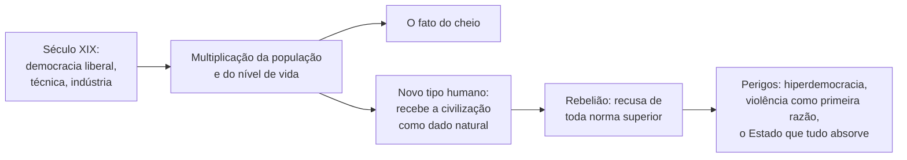
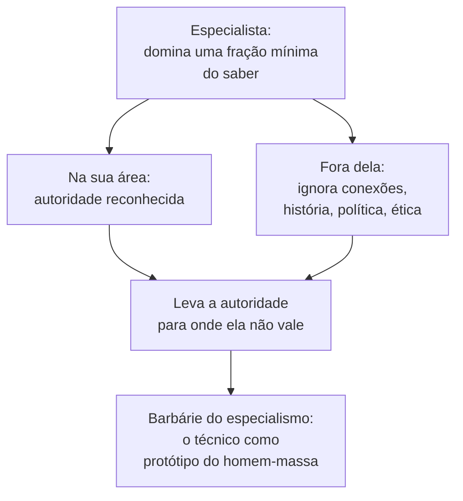
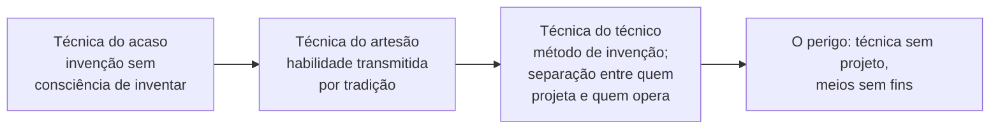

> **Aviso de Idioma:** Este currículo e todos os seus recursos de apoio foram estruturados exclusivamente em **Português (PT-BR)**.

# Aula 2 · Ortega: o homem-massa, o especialismo e a técnica

**MOD-205 · 10 horas · Leitura principal:** Ortega y Gasset, *A Rebelião das Massas* (1930), capítulos I, VI, VII e XII; *Missão da Universidade* (1930), seleção; *Meditação da Técnica* (1933, publicada em 1939), capítulos I a IV e IX a XI

## O que você vai aprender

- Explicar o conceito de <abbr title="Homem-massa (em Ortega): o tipo humano que não se exige nada de especial, sente-se igual a todo mundo e satisfeito com isso, e reclama direitos sem reconhecer obrigações. Não é uma classe social: pode estar em qualquer classe.">homem-massa</abbr> e a tese da rebelião das massas.
- Reconstruir o argumento do capítulo XII, "A barbárie do <abbr title="Especialismo: em Ortega, a condição do cientista ou técnico moderno que domina uma fração mínima do saber e, por isso, se comporta em todo o resto com a arrogância de quem se acha sábio. Ortega o chama de sábio-ignorante.">especialismo</abbr>".
- Explicar a proposta de *Missão da Universidade* e a sua relação com a formação interdisciplinar.
- Explicar a teoria da técnica de Ortega: a técnica como produção do supérfluo e os três estágios da técnica.
- Avaliar o elitismo de Ortega e as críticas que recebeu.

## Pergunta de abertura

> Um engenheiro de software brilhante, autor de algoritmos usados por milhões de pessoas, dá entrevistas com opiniões categóricas sobre educação, saúde pública, história e democracia, assuntos que nunca estudou. Ele sabe muito ou sabe pouco? E por que as pessoas o escutam?

## 1. *A Rebelião das Massas*

*A Rebelião das Massas* foi publicada em artigos no jornal *El Sol* em 1929 e em livro em 1930. Tornou-se o livro mais lido de Ortega e um dos ensaios mais influentes do século XX. Começa com uma observação simples: **o fato do cheio**. As cidades, os trens, os cafés, os teatros, as praias estão cheios de gente. Lugares e prazeres que antes eram de poucos passaram a ser de muitos.

Esse fato tem uma causa que Ortega reconhece como conquista: o século XIX, com a democracia liberal, a técnica e a industrialização, multiplicou a população europeia e elevou o nível de vida das maiorias. O problema, para ele, está no **tipo humano** que esse mundo produziu.

### O homem-massa

> "Massa é todo aquele que não atribui a si mesmo um valor especial, para o bem ou para o mal, mas se sente 'como todo o mundo' e, no entanto, não se angustia, sente-se bem por ser idêntico aos demais." (tradução livre)

O ponto decisivo da definição, que leitores apressados ignoram: **massa não é classe social**. Ortega insiste que a divisão entre massa e minoria é uma divisão entre tipos de pessoa, e não entre ricos e pobres. Há homens-massa entre os aristocratas e entre os operários; há "minorias" no sentido de Ortega em qualquer classe. O que distingue a minoria é a **exigência**: quem se exige muito, quem se submete a uma norma superior a si. Nobreza, para Ortega, é obrigação, e não privilégio.

| Homem-massa | Minoria (no sentido de Ortega) |
| :--- | :--- |
| Sente-se satisfeito como está | Exige-se mais do que já é |
| Reclama direitos, ignora obrigações | Vive a vida como serviço a algo que a transcende |
| Recebe a civilização como se fosse natural, como o ar | Sabe que a civilização é uma construção frágil, que exige esforço |
| Impõe a sua opinião sem ter razões | Dá razões e aceita discuti-las |

A figura que melhor resume o homem-massa é a do **"senhorito satisfeito"**: o herdeiro que usufrui de tudo o que a civilização produziu e se comporta como se nada lhe tivesse custado, como se a técnica, o direito e a ciência estivessem ali por natureza. É por isso que Ortega fala em "rebelião": as massas não só ocuparam os lugares, mas passaram a recusar qualquer instância superior a elas, qualquer exigência de razão.

Ortega via nos movimentos de massa da sua época, o bolchevismo e o fascismo, duas formas da mesma rebelião: a política de quem "não quer dar razões nem quer ter razão", e por isso recorre à ação direta e à violência. E apontava como "o maior perigo" o Estado moderno, capaz de absorver toda a vida social.

## 2. A barbárie do especialismo

O capítulo XII é o que mais interessa a este curso. Ortega pergunta: quem é o protótipo do homem-massa? E responde de modo surpreendente: **o homem de ciência**, o técnico, o especialista.

O argumento tem três passos:

1. **A ciência moderna exige especialização.** Para avançar, cada cientista precisa se concentrar numa porção cada vez menor do saber. Ortega reconhece que foi esse método que permitiu o enorme progresso científico do século XIX.
2. **A especialização produz um tipo novo de pessoa.** O especialista conhece muito bem o seu pequeno território e ignora todo o resto, inclusive as conexões do seu campo com os outros e com a vida. Não é um sábio, porque ignora quase tudo; não é um ignorante, porque é "homem de ciência". É um **"sábio-ignorante"**.
3. **O sábio-ignorante se comporta como homem-massa.** Fora da sua especialidade, ele não age com a modéstia de quem não sabe, mas com a arrogância de quem, na sua área, é autoridade.

> "Ele é um sábio-ignorante, coisa sobremaneira grave, pois significa que é um senhor que se comportará, em todas as questões que ignora, não como um ignorante, mas com toda a petulância de quem, na sua questão especial, é um sábio." (tradução livre)

Responda à pergunta de abertura com Ortega: o engenheiro sabe muito de algoritmos e pouco de tudo o resto, e é escutado porque o prestígio da técnica se transfere, indevidamente, para assuntos em que ela não lhe dá competência. É o sábio-ignorante em estado puro, e o século XXI, com as grandes empresas de tecnologia, deu-lhe um alcance que Ortega não poderia imaginar.

### Três diagnósticos da fragmentação

O diagnóstico de Ortega encontra outros dois, que você já estudou, e que partem de lugares políticos opostos:

| Autor | Diagnóstico | Causa apontada | Saída proposta |
| :--- | :--- | :--- | :--- |
| **Ortega** (1930) | O especialista é um bárbaro fora da sua área | O método da ciência moderna e a perda da cultura geral | Uma universidade que ensine cultura: o sistema de ideias vivas do seu tempo |
| **Lukács** (1923, MOD-203, aula 5) | As ciências especializadas não veem a totalidade | A reificação capitalista, que fragmenta o trabalho e o saber | O ponto de vista da totalidade, ligado a uma classe |
| **Gramsci** (MOD-203, aula 3) | O técnico sem formação política serve à hegemonia dominante | A divisão entre trabalho intelectual e manual | O intelectual orgânico: "de especialista a dirigente" |

O diagnóstico é parecido; a explicação e a saída, não. Para Lukács, a fragmentação tem causa social e só se supera com uma transformação social; para Ortega, ela é um efeito do próprio método científico e se corrige com educação. Ler os três juntos é um exercício de perspectivismo (aula 1).

## 3. *Missão da Universidade*

No mesmo ano de 1930, Ortega fez uma conferência para estudantes da Universidade de Madri, publicada como *Missão da Universidade*. Ali está a sua resposta ao especialismo. A universidade tem três funções:

1. **Transmitir a cultura**, entendida como "o sistema vital das ideias de cada tempo": as ideias sobre o mundo, a história, a sociedade e o ser humano com que uma época vive.
2. **Ensinar as profissões**: formar médicos, juízes, engenheiros, professores.
3. **Fazer pesquisa científica e formar novos cientistas.**

E a primeira é a mais importante, e a mais abandonada. Uma universidade que forma especialistas sem cultura produz exatamente o bárbaro do capítulo XII. Ortega propunha uma **Faculdade de Cultura** que desse a todos os estudantes, de qualquer curso, as grandes disciplinas culturais: a imagem física do mundo, os grandes temas da vida orgânica, os processos históricos da humanidade, a estrutura e o funcionamento da vida social e o plano do universo, isto é, a filosofia.

Este curso é, em parte, uma resposta a essa exigência: quem estuda engenharia de software aqui estuda também Platão, Marx, Weber e Benjamin. Mas a resposta não é a de Ortega. Ele pensava a cultura como antídoto contra a massificação; o curso a pensa como condição para que quem programa entenda as relações de poder em que o seu trabalho está metido (MOD-203, aula 7). Mesma forma, outra finalidade.

## 4. *Meditação da Técnica*

Em 1933, num curso de verão na Universidade Internacional de Santander, Ortega deu as lições publicadas em 1939 como *Meditação da Técnica*. É um dos primeiros grandes textos da filosofia da técnica, anterior à *Questão da Técnica* de Heidegger (1953).

### A técnica e o supérfluo

A pergunta inicial é: o que é a técnica? Ortega responde: é a **reforma que o ser humano impõe à natureza** para satisfazer as suas necessidades. Mas que necessidades? Os animais também têm necessidades e as satisfazem sem técnica, adaptando-se ao meio. O ser humano faz o contrário: **adapta o meio a si**.

E mais: a técnica humana não serve só para sobreviver. O fogo serve para aquecer, mas também para cozinhar pratos elaborados; a casa protege da chuva, mas tem ornamentos. O que o ser humano busca não é simplesmente *estar* no mundo, mas **estar bem**: o bem-estar. Daí a fórmula célebre:

> "O homem é um animal para o qual só o supérfluo é necessário." (tradução livre)

O que é "supérfluo" do ponto de vista biológico é necessário do ponto de vista humano, porque o ser humano não se contenta em existir: quer realizar um **projeto de vida** (aula 1). A técnica é a produção desse supérfluo necessário, e por isso cada época tem a sua técnica: ela depende do que cada época entende por bem-estar.

### Os três estágios da técnica

Ortega divide a história da técnica em três estágios, segundo a relação entre o ser humano e a técnica que usa:

| Estágio | Época | Como a técnica aparece | Quem é o técnico |
| :--- | :--- | :--- | :--- |
| **Técnica do acaso** | Pré-história | As invenções surgem por acaso e não são reconhecidas como técnica; parecem parte da natureza | Ninguém: todos fazem tudo |
| **Técnica do artesão** | Da Antiguidade à Idade Média | A técnica é uma habilidade transmitida por tradição, de mestre a aprendiz | O artesão, que concebe e executa a obra |
| **Técnica do técnico** | Desde o século XVI, sobretudo com a máquina | A técnica se separa da habilidade manual: há quem projeta e quem opera; a máquina executa | O engenheiro, separado do operário |

No terceiro estágio, o ser humano descobre que a técnica é um **método**: que é possível inventar sistematicamente. E aí surge o paradoxo que Ortega aponta no fim do livro. A técnica moderna oferece possibilidades quase ilimitadas, mas a técnica, por si só, não diz **o que** fazer com elas. O técnico tem os meios e lhe falta o projeto. Um homem que pode tudo e não sabe o que quer.

### Ortega, Lukács e Heidegger sobre a técnica

| Autor | A técnica é... | O risco moderno |
| :--- | :--- | :--- |
| **Ortega** (1933) | A reforma da natureza para realizar um projeto de vida; produção do supérfluo necessário | A técnica sem projeto: meios ilimitados, fins ausentes |
| **Lukács** (*Ontologia*, MOD-203, aula 5) | Posição teleológica: finalidade consciente que mobiliza a causalidade natural | As finalidades postas por poucos e impostas a muitos |
| **Heidegger** (1953, MOD-101) | Um modo de desvelamento que trata tudo como recurso disponível | O "armação" que reduz até o ser humano a estoque |

A comparação mostra uma convergência e uma divergência. Os três pensam a técnica a partir das **finalidades** humanas e veem o risco de as finalidades se perderem. Mas para Ortega o problema é cultural (falta de projeto), para Lukács é social (quem põe as finalidades) e para Heidegger é ontológico (o modo como o ser se mostra na época técnica).

## 5. O elitismo de Ortega e as críticas

*A Rebelião das Massas* é também um livro elitista, e não adianta disfarçar. A desconfiança de Ortega em relação às massas, a sua defesa de "minorias seletas" que dirijam a sociedade e o tom de desprezo com que fala do "homem médio" foram criticados de vários lados:

- **Da esquerda**, porque a "massa" de Ortega, que ele jura não ser classe social, coincide demais com as classes populares que entravam na vida política, e porque o livro trata a democratização como ameaça.
- **Da teoria crítica**, porque Ortega culpa as massas por um processo, a padronização da cultura, que Adorno e Horkheimer (*Dialética do Esclarecimento*, 1947) atribuem à indústria cultural, que fabrica o gosto das massas em vez de simplesmente segui-lo.
- **Da teoria democrática**, porque a ideia de que a maioria deve seguir uma minoria exigente desconsidera a capacidade de aprendizado coletivo que Habermas (aula 7) vai situar no debate público.

Isso invalida o diagnóstico do especialismo? É exatamente o tipo de pergunta que a aula 5 vai enfrentar com método. Por ora, registre: o capítulo XII se sustenta sobre um argumento (especialização, ignorância do resto, transferência indevida de autoridade) que pode ser examinado e testado independentemente do elitismo do livro. E um sinal de que isso é possível: o diagnóstico é parecido com o de Lukács e o de Gramsci, que eram tudo menos elitistas no sentido de Ortega.

## Leitura guiada

1. ***A Rebelião das Massas*, capítulos I, VI e VII** (cerca de 35 páginas): o fato do cheio, a definição de homem-massa e a vida nobre e a vida vulgar. Copie a definição de massa e a passagem em que Ortega afirma que a divisão não é entre classes sociais.
2. ***A Rebelião das Massas*, capítulo XII** (cerca de 10 páginas): reconstrua o argumento em três passos.
3. ***Meditação da Técnica*, capítulos I a IV e IX a XI** (cerca de 40 páginas): a técnica como produção do supérfluo e os três estágios.

## Exercícios

**1.** Por que, para Ortega, "massa" não é sinônimo de classe trabalhadora? A distinção se sustenta? Argumente.

Gabarito comentado

Para Ortega, massa e minoria são tipos humanos definidos pela exigência que cada um se impõe, e não pela posição econômica: há homens-massa em todas as classes. A distinção é coerente no plano conceitual, mas a crítica observa que, na prática, os exemplos e o tom do livro associam a massa às classes populares que entravam na política. Uma boa resposta reconhece a coerência da definição e examina, com exemplos do texto, se o uso que Ortega faz dela é coerente com ela.

**2.** Reconstrua em três passos o argumento do capítulo XII e dê um exemplo atual de "sábio-ignorante" sem citar nomes de pessoas.

Gabarito comentado

(1) A ciência moderna avança pela especialização; (2) a especialização produz o especialista que domina uma fração mínima do saber e ignora o resto; (3) esse especialista leva a sua autoridade para onde ela não vale, comportando-se como homem-massa fora da sua área. Exemplo: o executivo de tecnologia que propõe resolver a crise da educação pública com um aplicativo, sem conhecer a história da escola pública, a formação de professores ou as condições materiais das famílias.

**3.** Aplique os três estágios da técnica de Ortega à história da programação, do computador da Segunda Guerra ao desenvolvimento de software atual. Onde o esquema funciona e onde ele falha?

Critérios de correção

A resposta deve propor uma correspondência fundamentada (por exemplo, a programação artesanal dos primeiros computadores, com conhecimento transmitido entre poucas pessoas, e a engenharia de software com métodos, processos e divisão entre quem projeta e quem implementa, MOD-202, aula 1) e apontar limites: o software livre recompõe parte da unidade entre conceber e executar, e a divisão do trabalho em grandes empresas pode ser lida melhor com Marx (MOD-104) do que com Ortega.

**4.** Escreva um texto de uma página respondendo à pergunta: a técnica moderna sofre de "falta de projeto", como diz Ortega, ou de excesso de projeto alheio, como sugeriria Lukács ao perguntar quem pôs as finalidades?

Critérios de correção

O texto deve expor as duas posições com precisão e aplicá-las a um caso concreto (uma plataforma, um sistema público). A melhor resposta mostra que as duas leituras não são excludentes: pode faltar projeto coletivo justamente porque sobra projeto privado, isto é, porque as finalidades dos sistemas são definidas por poucos (maximizar lucro, tempo de tela) e não discutidas por quem é afetado.

## Resumo da aula

- *A Rebelião das Massas* parte do "fato do cheio" e descreve o homem-massa, que se sente igual a todos, satisfeito, e recusa qualquer norma superior; massa, para Ortega, é tipo humano e não classe.
- O capítulo XII faz do especialista o protótipo do homem-massa: o sábio-ignorante, que leva a sua autoridade para onde ela não vale.
- *Missão da Universidade* propõe que toda formação profissional inclua a cultura, o sistema vital das ideias do tempo.
- *Meditação da Técnica* define a técnica como produção do supérfluo necessário e distingue a técnica do acaso, do artesão e do técnico; o risco moderno é ter os meios e não ter o projeto.
- O elitismo de Ortega foi criticado pela esquerda, pela teoria crítica e pela teoria democrática; o diagnóstico do especialismo pode ser examinado separadamente, como fará a aula 5.

## Para ir além

- Ortega y Gasset, *Missão da Universidade* (1930), texto integral, curto e polêmico.
- Theodor Adorno e Max Horkheimer, *Dialética do Esclarecimento* (1947), capítulo "A indústria cultural".